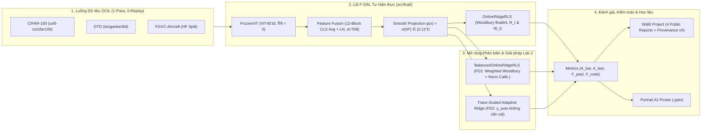

# F-OAL: Tái lập Thực nghiệm Đa Miền, Phân tích Phản biện Lý thuyết & Giải pháp Giải tích Không Lưu Mẫu

[](https://github.com/caoban123/F-OAL/actions/workflows/ci.yml)

-0F766E)


> **Đồ án Môn học:** Nhập môn Học máy (*Introduction to Machine Learning*) — Khoa Công nghệ Thông tin, Trường ĐHKHTN, ĐHQG-HCM (HCMUS)
> **Nhóm thực hiện:** **Nguyễn Cao Bản · Nguyễn Thái Thành · Phan Thế Phong** (`MSSV: 24122014 · 24122029 · 24122050`)
> **Bài báo gốc:** Huiping Zhuang\*, Yuchen Liu\*, Run He, Kai Tong, Ziqian Zeng, Cen Chen, Yi Wang, Lap-Pui Chau — *"F-OAL: Forward-only Online Analytic Learning with Fast Training and Low Memory Footprint in Class Incremental Learning"*, **NeurIPS 2024** ([Proceedings](https://proceedings.neurips.cc/paper_files/paper/2024/hash/48ffa38c13078d6ce26b328e7f373243-Abstract-Conference.html) · [PDF](https://papers.neurips.cc/paper_files/paper/2024/file/48ffa38c13078d6ce26b328e7f373243-Paper-Conference.pdf) · [Mã nguồn tác giả](https://github.com/liuyuchen-cz/F-OAL)).

---

## Cổng Điều hướng Nhanh cho Giảng viên & Người chấm (Executive Hub)

### A. Trung tâm Báo cáo Trực tuyến Weights & Biases (`hcmus-foal-reproduction`)

Toàn bộ thực nghiệm của dự án được quản lý tập trung trên một W&B Project công khai duy nhất: **[`hcmus-foal-reproduction`](https://forge.coreweave.com/wandb/caoban170106-tr-ng-i-h-c-khoa-h-c-t-nhi-n-hqg-hcm/hcmus-foal-reproduction)**. Để thuận tiện nhất khi chấm bài, nhóm tổ chức thành **2 chế độ xem đồng bộ**:
* **Xem Báo cáo Tổng hợp & Đồ thị So sánh Đa Mô hình (Khuyên dùng đầu tiên):** Nhấp vào **4 trang W&B Report công khai** dưới đây (mỗi biểu đồ đã khóa sẵn đúng bộ lọc thực nghiệm, hiển thị đầy đủ trên mọi trình duyệt không cần đăng nhập).
* **Xem Chi tiết Từng Lượt chạy Đơn lẻ (`Overview`, `Charts`, `Logs`, `Artifacts`):** Nhấp vào từng mã Run ở **[Mục 6](#6-hệ-thống-đăng-ký-thực-nghiệm-wb--kiểm-toán-nguồn-gốc-provenance)** (Workspace đã được chuẩn hóa mở sẵn mục `Charts` tự động ở Trang 1 và đồng bộ đầy đủ khóa `summary/*_pct` để không xảy ra hiện tượng khung biểu đồ trống).

| STT | Chuyên đề Báo cáo Trực tuyến (Public W&B Reports) | Tập dữ liệu / Chặng | Đường dẫn Trực tiếp |
| :---: | :--- | :---: | :--- |
| **1** | **Tái lập Kết quả, So sánh Baselines & Chuỗi Chẩn đoán C1–C3** | **CIFAR-100** *(Core Scope)* | [Mở W&B Report CIFAR-100](https://forge.coreweave.com/wandb/caoban170106-tr-ng-i-h-c-khoa-h-c-t-nhi-n-hqg-hcm/hcmus-foal-reproduction/reports/F-OAL-T-i-l-p-k-t-qu-v-ph-n-t-ch-th-c-nghi-m-tr-n-b-d-li-u-CIFAR-100--VmlldzoxODI2NDExMA) |
| **2** | **Tái lập Thực nghiệm, Baselines & Phân tích Ablation Đa Seed** | **DTD** *(Cross-Domain)* | [Mở W&B Report DTD](https://forge.coreweave.com/wandb/caoban170106-tr-ng-i-h-c-khoa-h-c-t-nhi-n-hqg-hcm/hcmus-foal-reproduction/reports/F-OAL-T%C3%A1i-l%E1%BA%ADp-th%E1%BB%B1c-nghi%E1%BB%87m-v%C3%A0-ph%C3%A2n-t%C3%ADch-ablation-tr%C3%AAn-DTD--VmlldzoxODI3ODAxMQ) |
| **3** | **Thí nghiệm Loại bỏ Thành phần (Table 4) & Kiểm soát C1–C3** | **FGVC-Aircraft** *(Fine-Grained)* | [Mở W&B Report FGVC-Aircraft](https://forge.coreweave.com/wandb/caoban170106-tr-ng-i-h-c-khoa-h-c-t-nhi-n-hqg-hcm/hcmus-foal-reproduction/reports/F-OAL-Th%C3%AD-nghi%E1%BB%87m-lo%E1%BA%A1i-b%E1%BB%8F-th%C3%A0nh-ph%E1%BA%A7n-tr%C3%AAn-FGVC-Aircraft--VmlldzoxODI3NTM0Mg) |
| **4** | **Phản biện Lý thuyết & Thực nghiệm Lab 2 (`Long-Tail` & `Scaling`)** | **Lab 2** *(152 Runs, `FD1` & `FD2`)* | [Mở W&B Report Lab 2](https://forge.coreweave.com/wandb/caoban170106-tr-ng-i-h-c-khoa-h-c-t-nhi-n-hqg-hcm/hcmus-foal-reproduction/reports/F-OAL-Ph%C3%A2n-t%C3%ADch-Ph%E1%BA%A3n-bi%E1%BB%87n-L%C3%BD-thuy%E1%BA%BFt-Th%E1%BB%B1c-nghi%E1%BB%87m-Lab-2-Long-Tail-Scaling--VmlldzoxODM1OTE5Mg) |

### B. Bảng Ánh xạ Toàn bộ Học liệu Theo Cấu trúc Đánh giá HCMUS

| Chặng Đồ án | Trọng tâm Khoa học & Kỹ thuật | Mã nguồn Chính | Tài liệu Báo cáo & Sản phẩm Nộp |
| :--- | :--- | :--- | :--- |
| **Checklist Tuân thủ** | Đối chiếu 13 tiêu chí bắt buộc của HCMUS Lab Book | Toàn bộ repo `main` | [`docs/TEACHER_COMPLIANCE_CHECKLIST.md`](docs/TEACHER_COMPLIANCE_CHECKLIST.md) · [`docs/hcmus_core_scope_matrix.md`](docs/hcmus_core_scope_matrix.md) |
| **Clean-Room Core** | Tự hiện thực F-OAL từ công thức bài báo (`FrozenViT`, `FF`, `SP`, `Woodbury RLS`) | [`src/foal/`](src/foal/) · [`tests/`](tests/) | [`README_IMPLEMENTATION.md`](README_IMPLEMENTATION.md) · [`docs/repository_structure.md`](docs/repository_structure.md) |
| **Lab 1 — Tái lập & Mở rộng** | Headline Table 2 + Multi-Seed Table 4 (36 runs) + Chẩn đoán C0–C3 trên **CIFAR-100, DTD, Aircraft** | [`scripts/reproduce_cifar100.py`](scripts/reproduce_cifar100.py) · [`configs/`](configs/) | [`docs/CIFAR100_FINAL_REPRODUCTION_REPORT.md`](docs/CIFAR100_FINAL_REPRODUCTION_REPORT.md) · [`docs/dtd_ablation_report.md`](docs/dtd_ablation_report.md) · [`docs/aircraft_ablation_report_vi.md`](docs/aircraft_ablation_report_vi.md) |
| **Milestone 3 — Critical Analysis** | Kiểm toán 5 giả định ẩn, 5 lỗi nội tại PDF, 3 điểm mạnh (`S1–S3`), 3 điểm yếu (`L1–L3`) & 3 giải pháp (`FD1–FD3`) | — | [`docs/CRITICAL_ANALYSIS_REPORT.md`](docs/CRITICAL_ANALYSIS_REPORT.md) · [`docs/Limitations_2.md`](docs/Limitations_2.md) |
| **Lab 2 — Empirical Demo** | Hiện thực giải pháp 0-replay `BalancedOnlineRidgeRLS` (`FD1`) & `Trace-Scaled Ridge` (`FD2`); 54 runs `E1` + 98 runs `E3` | [`src/foal/critical_analysis.py`](src/foal/critical_analysis.py) · [`scripts/run_lab2_longtail.py`](scripts/run_lab2_longtail.py) | [`docs/LAB2_EMPIRICAL_DEMONSTRATION_REPORT.md`](docs/LAB2_EMPIRICAL_DEMONSTRATION_REPORT.md) · [`notebooks/foal_lab2_empirical_demonstration.ipynb`](notebooks/foal_lab2_empirical_demonstration.ipynb) |
| **Poster Workshop** | Poster khoa học **1 slide `Portrait A2 (420 × 594 mm)`** chuẩn mù màu + Kịch bản bảo vệ 3.5 phút | [`scripts/build_poster_a2_pptx.py`](scripts/build_poster_a2_pptx.py) | **[`poster/F-OAL_Critical_Analysis_Poster_A2.pptx`](poster/F-OAL_Critical_Analysis_Poster_A2.pptx)** · [`docs/POSTER_WORKSHOP_DEFENSE_GUIDE.md`](docs/POSTER_WORKSHOP_DEFENSE_GUIDE.md) |

### Mục lục Nội dung
1. [Kiến trúc Hệ thống, Cấu trúc Mã nguồn & Thư viện Phụ trợ](#1-kiến-trúc-hệ-thống-cấu-trúc-mã-nguồn--thư-viện-phụ-trợ)
2. [Hướng dẫn Cài đặt & Chạy Lại Nhanh (Quick Start)](#2-hướng-dẫn-cài-đặt--chạy-lại-nhanh-quick-start)
3. [Giới thiệu Toàn diện & Nền tảng Toán học Bài báo F-OAL (NeurIPS 2024)](#3-giới-thiệu-toàn-diện--nền-tảng-toán-học-bài-báo-f-oal-neurips-2024)
4. [Giai đoạn I — Kết quả Tái lập Thực nghiệm & Giải mã Chênh lệch Đa Tập Dữ Liệu](#4-giai-đoạn-i--kết-quả-tái-lập-thực-nghiệm--giải-mã-chênh-lệch-đa-tập-dữ-liệu)
5. [Giai đoạn II — Phân tích Phản biện Lý thuyết, Thực nghiệm Lab 2 & Poster A2](#5-giai-đoạn-ii--phân-tích-phản-biện-lý-thuyết-thực-nghiệm-lab-2--poster-a2)
6. [Hệ thống Đăng ký Thực nghiệm W&B & Kiểm toán Nguồn gốc (Provenance)](#6-hệ-thống-đăng-ký-thực-nghiệm-wb--kiểm-toán-nguồn-gốc-provenance)
7. [Bản đồ Toàn bộ Tài liệu Chuyên sâu (`docs/*.md`) & Tài liệu Tham khảo](#7-bản-đồ-toàn-bộ-tài-liệu-chuyên-sâu-docsmd--tài-liệu-tham-khảo)

---

## 1. Kiến trúc Hệ thống, Cấu trúc Mã nguồn & Thư viện Phụ trợ

### 1.1. Sơ đồ Kiến trúc Toàn Hệ thống



### 1.2. Tổ chức Thư mục Cốt lõi (Chi tiết xem [`docs/repository_structure.md`](docs/repository_structure.md))

* **[`src/foal/`](src/foal/) — Lõi thuật toán tự hiện thực hoàn toàn từ mô tả toán học của bài báo:**
  * [`backbone.py`](src/foal/backbone.py) & [`feature_fusion.py`](src/foal/feature_fusion.py): Nạp ViT-B/16 đóng băng và hợp nhất trung bình cộng CLS token qua 12 khối Transformer kèm `LayerNorm` cuối ($d_{\text{in}} = 768$).
  * [`projection.py`](src/foal/projection.py): Phép chiếu ngẫu nhiên cố định $\boldsymbol{\phi}(x) = \sigma(\mathbf{h}\mathbf{P})$ hỗ trợ 3 chế độ kiểm soát phương sai (`P0` Gaussian chuẩn, `P1` Official Uniform, `P2` Gaussian khớp phương sai).
  * [`rls.py`](src/foal/rls.py) & [`model.py`](src/foal/model.py): Bộ phân loại giải tích `OnlineRidgeRLS` cập nhật đệ quy bằng đồng nhất thức Woodbury và `torch.linalg.solve` ở độ chính xác kép `float64`, mở rộng cột phân loại động khi có lớp mới.
  * [`critical_analysis.py`](src/foal/critical_analysis.py): Module độc lập của **Lab 2** chứa `BalancedOnlineRidgeRLS` (`FD1`), tự hiệu chỉnh chính quy hóa theo vết `compute_trace_scaled_gamma` (`FD2`), bộ sinh luồng mất cân bằng mũ Long-Tail và nhiễu cảm biến tất định.
  * [`baselines/`](src/foal/baselines/) & [`dataset_adapters/`](src/foal/dataset_adapters/): Các baseline đối chứng (`Experience Replay`, `Official LwF`, `Adapted LwF`) và bộ nạp tự động từ Hugging Face cho DTD & FGVC-Aircraft.
* **[`configs/`](configs/) · [`scripts/`](scripts/) · [`notebooks/`](notebooks/) · [`results/`](results/) · [`poster/`](poster/) · [`tests/`](tests/) · [`docs/`](docs/):** Tách biệt hoàn toàn cấu hình YAML, CLI scripts, notebooks GPU, kết quả JSON/CSV đã kiểm toán, Poster A2 và bộ kiểm thử đơn vị.

### 1.3. Phân định Minh bạch Thư viện Phụ trợ Tái sử dụng (External Dependencies)
Tuân thủ quy tắc hiện thực của môn học, các thư viện ngoài chỉ phục vụ hạ tầng tensor, nạp dữ liệu/trọng số tiền huấn luyện và ghi nhận thực nghiệm:
* **`torch`, `torchvision`:** Phép toán ma trận/tensor, biến đổi kích thước ảnh và `DataLoader`.
* **`timm`:** Tải trọng số ViT-B/16 tiền huấn luyện đóng băng (`vit_base_patch16_224.augreg2_in21k_ft_in1k` và `vit_base_patch16_224.augreg_in1k`).
* **`datasets` (Hugging Face):** Tải tự động `uoft-cs/cifar100`, `tanganke/dtd`, `Multimodal-Fatima/FGVC_Aircraft_train` & `_test` trực tiếp bằng code, không cần chuẩn bị thủ công.
* **`wandb`, `PyYAML`, `numpy`, `pytest`, `matplotlib`, `pandas`:** Quản lý cấu hình, theo dõi thực nghiệm, kiểm thử tự động và xuất biểu đồ phân tích (không tham gia vào lõi thuật toán cập nhật F-OAL).

---

## 2. Hướng dẫn Cài đặt & Chạy Lại Nhanh (Quick Start)

Yêu cầu **Python 3.10+** (hướng dẫn đầy đủ từng tham số xem tại [`README_IMPLEMENTATION.md`](README_IMPLEMENTATION.md)):

```bash
# 1. Khởi tạo môi trường ảo & cài đặt thư viện
python -m venv .venv
# Windows: .venv\Scripts\Activate.ps1 | Linux/macOS: source .venv/bin/activate
pip install -r requirements.txt && pip install -e .

# 2. Chạy bộ kiểm thử đơn vị CPU-safe (tương đương GitHub Actions CI, không cần dữ liệu GPU cục bộ)
python -m pytest -q \
  --ignore=tests/test_checkpoint_roundtrip.py \
  --ignore=tests/test_rls_real_features.py \
  --ignore=tests/test_vit_transforms.py

# 3. Chạy Smoke Test đầu-cuối trên CPU (~45 giây, 2 tasks, không cần W&B API key, không ghi đè results/)
python -m scripts.reproduce_cifar100 --mode smoke

# 4. Chạy Full Reproduction CIFAR-100 (10 tasks x 10 lớp, khuyến nghị GPU T4/A100)
python -m scripts.reproduce_cifar100 --mode full --config configs/c3_d_bilinear_raw.yaml --seed 42

# 5. Chạy thực nghiệm Phản biện & Giải pháp Lab 2 (Long-Tail E1 + Scaling/Double-Descent E3) & Xuất Poster A2
python -m scripts.run_lab2_longtail --dataset cifar100 --seeds 42 123 2026
python -m scripts.run_lab2_scaling_sensitivity --dataset cifar100 --seeds 42 123 2026
python -m scripts.build_poster_assets && python -m scripts.build_poster_a2_pptx
```

* **Phân biệt rõ 3 mức độ xác minh:**
  1. **`smoke verified`:** Đã kiểm chứng chạy thông suốt đầu-cuối trên CPU qua `--mode smoke`.
  2. **`full execution supported`:** Toàn bộ scripts/notebooks 10 tasks sẵn sàng thực thi lại từ đầu khi có GPU.
  3. **`numerical reproduction verified`:** Mọi số liệu báo cáo đều được xuất từ các lượt chạy thực tế trên GPU/CPU đã kiểm toán SHA256 trong `results/` và đồng bộ công khai trên W&B.

---

## 3. Giới thiệu Toàn diện & Nền tảng Toán học Bài báo F-OAL (NeurIPS 2024)

### 3.1. Hồ sơ Xuất bản & Tóm tắt Nghiên cứu

* **Tên công trình:** *F-OAL: Forward-only Online Analytic Learning with Fast Training and Low Memory Footprint in Class Incremental Learning*.
* **Nhóm tác giả:** Huiping Zhuang\*, Yuchen Liu\*, Run He, Kai Tong, Ziqian Zeng, Cen Chen, Yi Wang và Lap-Pui Chau (*South China University of Technology, East China Normal University, Singapore Management University, The Hong Kong Polytechnic University*).
* **Nơi công bố:** Hội nghị *Advances in Neural Information Processing Systems* lần thứ 38 (**NeurIPS 2024**, Main Conference Track, tr. 41517–41538) — Xếp hạng **A\*** theo [ICORE2026](https://portal.core.edu.au/conf-ranks/98/).
* **Lĩnh vực:** Học máy (*Machine Learning*), Học liên tục (*Continual Learning*), Học tăng dần theo lớp trực tuyến (*Online Class-Incremental Learning — OCIL*), Thị giác máy tính (*Computer Vision*).
* **Liên kết gốc:** [NeurIPS Proceedings](https://proceedings.neurips.cc/paper_files/paper/2024/hash/48ffa38c13078d6ce26b328e7f373243-Abstract-Conference.html) · [Full Paper PDF](https://papers.neurips.cc/paper_files/paper/2024/file/48ffa38c13078d6ce26b328e7f373243-Paper-Conference.pdf) · [Official Author GitHub (`liuyuchen-cz/F-OAL`)](https://github.com/liuyuchen-cz/F-OAL).

**Tóm tắt ý tưởng trung tâm:**
F-OAL là một phương pháp **Online Class-Incremental Learning (OCIL)** được đề xuất nhằm giải quyết đồng thời ba thách thức lớn: hạn chế hiện tượng **Quên thảm khốc (*Catastrophic Forgetting*)**, rút ngắn tối đa thời gian huấn luyện và cắt giảm mức tiêu thụ bộ nhớ GPU. Khác với phần lớn các mô hình Deep Learning truyền thống phụ thuộc vào lan truyền ngược (*Backpropagation*) và bộ đệm phát lại (*Experience Replay*), F-OAL sử dụng một **Vision Transformer (ViT-B/16) tiền huấn luyện đóng băng hoàn toàn**, kết hợp tuần tự với **Feature Fusion**, **Smooth Projection** và một **Analytic Classifier**. Bằng cách chuyển bài toán học bộ phân loại từ tối ưu lặp bằng Gradient Descent sang bài toán **Hồi quy Ridge (*Ridge Regression*) có nghiệm đóng**, rồi cập nhật nghiệm đó theo từng mini-batch bằng **Bình phương Tối thiểu Đệ quy (*Recursive Least Squares — RLS*)**, F-OAL tiếp nhận luồng dữ liệu mới liên tục trong một lượt duyệt duy nhất mà không cần lưu giữ bất kỳ ảnh huấn luyện cũ nào.

---

### 3.2. Bối cảnh Bài toán: Từ Học Máy Tĩnh đến Online Class-Incremental Learning (OCIL)

1. **Class-Incremental Learning (CIL):**
   Trong học máy cổ điển, mô hình giả định toàn bộ tập lớp cần nhận dạng đã có mặt đầy đủ ngay từ lúc huấn luyện. Tuy nhiên, trong thế giới thực (robot tự hành, giám sát công nghiệp, thương mại điện tử), các danh mục đối tượng mới xuất hiện liên tục theo thời gian. Ở bài toán **CIL**, chẳng hạn trên CIFAR-100, mô hình ban đầu chỉ học 10 lớp đầu tiên; sang giai đoạn thứ hai, mô hình nhận thêm dữ liệu của 10 lớp mới và lúc kiểm thử phải phân biệt chính xác tất cả **20 lớp đã từng thấy** (mà không được cung cấp nhãn định danh giai đoạn — *task-agnostic inference*), tiếp diễn cho đến đủ 100 lớp. Trở ngại lớn nhất của CIL là **Catastrophic Forgetting**: việc cập nhật tham số mạng cho các lớp mới làm biến dạng vùng quyết định của các lớp cũ, khiến độ chính xác trên kiến thức quá khứ sụp đổ nhanh chóng.
2. **Online Class-Incremental Learning (OCIL):**
   **OCIL** đặt thêm ràng buộc khắc nghiệt về luồng dữ liệu thời gian thực: thay vì được phép lưu toàn bộ tập dữ liệu của một task để lặp lại qua hàng chục epoch (*offline CIL*), mô hình chỉ tiếp nhận một chuỗi các mini-batch tuần tự:
   $$\mathcal{D}_1 \longrightarrow \mathcal{D}_2 \longrightarrow \cdots \longrightarrow \mathcal{D}_t, \qquad \mathcal{D}_t = (\mathbf{X}_t, \mathbf{Y}_t)$$
   Mỗi mẫu $(\mathbf{x}_i, y_i)$ đi qua hệ thống **đúng một lần duy nhất (*one-pass*)** rồi bị loại bỏ ngay sau khi xử lý.
   > **Lưu ý khái niệm quan trọng:** *Online Learning* trong F-OAL **không** đồng nghĩa với *Unsupervised Learning*. Dữ liệu huấn luyện trong luồng $\mathcal{D}_t$ vẫn đi kèm nhãn thực $\mathbf{Y}_t$ (*Online Supervised Learning*); tính từ *online* nhấn mạnh việc dữ liệu đến theo luồng tuần tự từng lô nhỏ và giới hạn chỉ duyệt một lần.

---

### 3.3. Hạn chế của các Phương pháp Tiền nhiệm & Bốn Đóng góp của F-OAL

Trước F-OAL, các công trình giải bài toán CIL / OCIL chia thành ba nhánh chính nhưng đều vướng phải những đánh đổi khó dung hòa:

| Nhóm Phương pháp | Đại diện Điển hình | Lưu Ảnh Cũ (Replay) | Cần Backprop | Học 1-Pass Theo Mini-batch | Nút thắt Cốt lõi |
| :--- | :--- | :---: | :---: | :---: | :--- |
| **1. Experience Replay** | ER, iCaRL, SCR, DVC, PCR, OCM, OnPro | Có | Có | Có | Tốn bộ nhớ lưu trữ, thời gian huấn luyện chậm do lặp lại gradient trên mẫu cũ, và **rủi ro vi phạm quyền riêng tư dữ liệu** (y tế, tài chính, sinh trắc học). |
| **2. Exemplar-Free (Gradient)** | LwF, EWC, SLCA, EASE, LAE | Không | Có | Khó ổn định | Dưới luồng 1-pass rất dễ rơi vào hai thái cực: hoặc chỉ nhớ lớp vừa học (*recency collapse*), hoặc quá cứng nhắc không học nổi lớp mới (*catastrophic rigidity*). |
| **3. Analytic CL Thế hệ trước** | ACIL, DS-AL | Không | Cần ở Base Phase | Chưa hỗ trợ hoàn chỉnh | Đòi hỏi một giai đoạn huấn luyện nền (*base-training*) nhiều epoch bằng Backpropagation trên một tập lớp lớn ban đầu và thường xử lý theo từng task tĩnh, khó chạy trực tiếp từ con số 0 trên luồng mini-batch online. |
| **4. F-OAL (Bài báo nghiên cứu)** | **Zhuang et al., NeurIPS 2024** | **Không (`0`)** | **Không (`Forward-Only`)** | **Có (Từ lô đầu tiên)** | Khắc phục cả ba nút thắt nhờ kết hợp Frozen Pre-trained ViT + FF + SP với cập nhật đệ quy Woodbury RLS trực tiếp theo từng mini-batch. |

Từ đó, bài báo xác lập **4 đóng góp chính**:
1. Mở rộng thành công khung **Analytic Continual Learning (ACL)** sang bối cảnh **Online Class-Incremental Learning** một lượt duyệt, vận hành hoàn toàn tuyến xuôi (*Forward-only*) ngay từ mini-batch đầu tiên mà không cần giai đoạn huấn luyện nền.
2. Đề xuất tổ hợp trích xuất biểu diễn không cần tinh chỉnh mạng (**Frozen Encoder + Feature Fusion + Smooth Projection**), vừa loại bỏ chi phí tính gradient trên backbone vừa khai thác hiệu quả đặc trưng đa tầng cho các bài toán phân loại tinh (*fine-grained*).
3. Xây dựng cơ chế cập nhật **Analytic Classifier bằng Recursive Least Squares (RLS)** theo từng mini-batch nhỏ với cột phân loại mở rộng động, đảm bảo nghiệm thu được trùng khít với nghiệm Hồi quy Ridge toàn cục trên toàn bộ dữ liệu tích lũy mà không cần lưu lại mẫu gốc.
4. Thực nghiệm toàn diện trên **6 bộ dữ liệu chuẩn** chứng minh sự cân bằng vượt trội giữa độ chính xác, tốc độ huấn luyện và mức tiêu thụ VRAM GPU.

---

### 3.4. Giải phẫu Chi tiết Bốn Thành phần Kiến trúc của F-OAL

#### 3.4.1. Frozen Pre-trained Encoder (`ViT-B/16`)
F-OAL sử dụng mạng **Vision Transformer cơ sở (`ViT-B/16`)** đã tiền huấn luyện làm bộ trích xuất đặc trưng và **đóng băng toàn bộ $85.8$ triệu tham số** ($\nabla_\theta = 0$) xuyên suốt quá trình học tăng dần. Thiết kế này mang lại hai lợi ích nền tảng:
* **Triệt tiêu chi phí lan truyền ngược:** Trong huấn luyện mạng nơ-ron sâu, Backpropagation không chỉ tốn xấp xỉ gấp đôi lượng phép toán so với Forward Pass mà còn buộc GPU phải giữ lại toàn bộ đồ thị kích hoạt trung gian (*intermediate activations*) của mọi tầng để tính đạo hàm. Đóng băng encoder giải phóng hoàn toàn gánh nặng VRAM và thời gian này.
* **Chống trôi biểu diễn (*Zero Representation Drift*):** Vì tham số encoder bất biến, vector đặc trưng của một ảnh thuộc lớp cũ hoàn toàn không bị dịch chuyển khi mô hình tiếp nhận các lớp mới — điều kiện tiên quyết để các thống kê bậc hai tích lũy ở tầng phân loại luôn giữ nguyên hiệu lực toán học. *(Lưu ý: Đóng băng encoder không đồng nghĩa mô hình miễn nhiễm hoàn toàn với sự quên, vì ranh giới quyết định của bộ phân loại vẫn thay đổi khi không gian lớp mở rộng).*

#### 3.4.2. Feature Fusion (`FF` — Hợp nhất Đặc trưng Đa Tầng, `Eq. 2`)
Thay vì chỉ lấy đầu ra của khối Transformer cuối cùng (khối thứ $L = 12$, vốn thiên về ngữ nghĩa trừu tượng toàn cục dựa trên tác vụ tiền huấn luyện gốc), F-OAL trích xuất token phân loại `[CLS]` sau mỗi khối $\ell \in \{1, \dots, L\}$ và lấy trung bình cộng trước khi đi qua tầng chuẩn hóa `LayerNorm` cuối:

$$\mathbf{h}_{\text{fusion}}(x) = \mathrm{LayerNorm}\!\left(\frac{1}{L}\sum_{\ell=1}^{L} \mathbf{h}^{(\ell)}_{\text{CLS}}(x)\right) \in \mathbb{R}^{d_{\text{in}}}, \qquad d_{\text{in}} = 768$$

Các khối Transformer nông và trung gian bảo lưu nhiều chi tiết hình thái cục bộ, biên cạnh và họa tiết tần số cao; nhờ đó **Feature Fusion** giúp tăng đáng kể khả năng phân biệt trên các miền dữ liệu lệch xa ImageNet hoặc đòi hỏi nhận dạng chi tiết tinh tế như phân loại dòng máy bay (**FGVC-Aircraft**) và kết cấu bề mặt (**DTD**).

#### 3.4.3. Smooth Projection (`SP` — Phép chiếu Ngẫu nhiên Phi tuyến Cố định, `Eq. 3`)
Vector $\mathbf{h}_{\text{fusion}}(x) \in \mathbb{R}^{768}$ tiếp tục được chiếu qua một ma trận trọng số ngẫu nhiên $\mathbf{P} \in \mathbb{R}^{d_{\text{in}} \times D}$ (cấu hình chính $D = 1{,}000$) kết hợp hàm kích hoạt trơn Sigmoid $\sigma(u) = (1 + e^{-u})^{-1}$:

$$\boldsymbol{\phi}(x) = \sigma\!\left(\mathbf{h}_{\text{fusion}}(x)\mathbf{P}\right) \in (0, 1)^D$$

* **Vai trò toán học kép của Smooth Projection:**
  1. Theo **Định lý Cover (1965)**, phép ánh xạ phi tuyến sang không gian đặc trưng ngẫu nhiên có số chiều lớn hơn ($768 \to 1{,}000$) giúp các cụm dữ liệu phức tạp trở nên dễ phân tách tuyến tính hơn đối với bộ phân loại bình phương tối thiểu phía sau.
  2. **$\mathbf{P}$ chỉ được khởi tạo một lần duy nhất rồi giữ cố định vĩnh viễn** qua tất cả các task: không cần Backpropagation để học $\mathbf{P}$, đồng thời bảo đảm hệ tọa độ đặc trưng $\boldsymbol{\phi}(\cdot)$ cố định tuyệt đối để cập nhật đệ quy RLS không bị mất tính tương thích giữa các giai đoạn.
* > **Đính chính quan trọng từ kiểm toán của nhóm (`C1` & `L3`):** Ở Mục 3.1 (trang 4), bài báo viết vắn tắt các phần tử của $\mathbf{P}$ lấy mẫu từ phân phối chuẩn mà không nêu quy luật chuẩn hóa phương sai theo chiều đầu vào $1/d_{\text{in}}$. Nếu khởi tạo theo $\mathcal{N}(0, 1)$, độ lệch chuẩn tiền kích hoạt vọt lên $\approx 20$, đẩy hơn **$81\%$** phần tử rơi vào vùng bão hòa chết ($0$ hoặc $1$); trong thực tế, phương sai của $\mathbf{P}$ bắt buộc phải có bậc $\sigma_P^2 = \Theta(1/d_{\text{in}})$ (như $\mathcal{U}(-1/\sqrt{768}, +1/\sqrt{768})$ trong code tác giả) để Sigmoid vận hành trong vùng trơn giàu thông tin.

#### 3.4.4. Analytic Classifier (`AC` — Bộ phân loại Giải tích Hồi quy Ridge, `Eq. 4–5`)
Giả sử tính đến thời điểm hiện tại hệ thống đã quan sát tổng cộng $V$ mẫu thuộc $C$ lớp. Xếp chồng các vector đặc trưng thành ma trận $\boldsymbol{\Phi} \in \mathbb{R}^{V \times D}$ và các vector nhãn mã hóa One-Hot thành $\mathbf{Y} \in \{0, 1\}^{V \times C}$. Thay vì dùng hàm mất mát Cross-Entropy (không có nghiệm đóng), Analytic Classifier tìm ma trận trọng số $\mathbf{W} \in \mathbb{R}^{D \times C}$ cực tiểu hóa hàm mục tiêu **Ridge Regression** với hệ số chính quy hóa $\gamma > 0$:

$$\mathbf{W}^* = \arg\min_{\mathbf{W} \in \mathbb{R}^{D \times C}} \left(\|\boldsymbol{\Phi}\mathbf{W} - \mathbf{Y}\|_F^2 + \gamma\|\mathbf{W}\|_F^2\right)$$

Lấy đạo hàm theo $\mathbf{W}$ và giải phương trình chuẩn $2\boldsymbol{\Phi}^\top(\boldsymbol{\Phi}\mathbf{W} - \mathbf{Y}) + 2\gamma\mathbf{W} = \mathbf{0}$, ta thu được nghiệm tối ưu toàn cục duy nhất dưới dạng đóng (*Closed-form Solution*):

$$\mathbf{W}^* = \left(\boldsymbol{\Phi}^\top\boldsymbol{\Phi} + \gamma\mathbf{I}_D\right)^{-1}\boldsymbol{\Phi}^\top\mathbf{Y}$$

Tuy nhiên, tính trực tiếp công thức trên tại mỗi thời điểm đòi hỏi phải lưu giữ toàn bộ ma trận $\boldsymbol{\Phi}$ và $\mathbf{Y}$ của quá khứ — vi phạm ràng buộc *Zero-replay* của OCIL. Đây chính là lý do F-OAL đưa vào cơ chế cập nhật đệ quy **RLS**.

---

### 3.5. Cơ chế Cập nhật Đệ quy Bình phương Tối thiểu (Recursive Least Squares — RLS)

#### 3.5.1. Ma trận Trạng thái Hiệp phương sai Nghịch đảo $\mathbf{R}_t$
Giả sử luồng dữ liệu đến theo từng mini-batch $(\mathbf{H}_1, \mathbf{Y}_1), (\mathbf{H}_2, \mathbf{Y}_2), \dots, (\mathbf{H}_t, \mathbf{Y}_t)$ với $\mathbf{H}_i \in \mathbb{R}^{S \times D}$ là đặc trưng sau Smooth Projection của lô thứ $i$. Tổng ma trận Gram tích lũy có thể viết tách rời theo lô: $\boldsymbol{\Phi}_t^\top\boldsymbol{\Phi}_t = \sum_{i=1}^{t}\mathbf{H}_i^\top\mathbf{H}_i$. F-OAL định nghĩa ma trận trạng thái:

$$\mathbf{R}_t = \left(\gamma\mathbf{I}_D + \sum_{i=1}^{t}\mathbf{H}_i^\top\mathbf{H}_i\right)^{-1} \in \mathbb{R}^{D \times D}$$

* **Ý nghĩa bản chất:** $\mathbf{R}_t$ nén toàn bộ hình học bậc hai (phương sai và tương quan chéo giữa các chiều đặc trưng) của mọi mẫu từng xuất hiện vào một ma trận đối xứng xác định dương kích thước cố định $D \times D$. Cần lưu ý rằng **$\mathbf{R}_t$ hoàn toàn không lưu nhãn**; mối liên hệ giữa đặc trưng và nhãn được duy trì đồng thời bên trong ma trận trọng số phân loại $\mathbf{W}_t$.

#### 3.5.2. Hai Phương trình Cập nhật Woodbury Theo Mini-Batch (`Eq. 10–13`)
Khởi tạo tại $t = 0$ trước khi thấy dữ liệu: $\mathbf{R}_0 = \gamma^{-1}\mathbf{I}_D$ và $\mathbf{W}_0 = \mathbf{0}$ (trong cấu hình chuẩn của F-OAL, $\gamma = 1 \implies \mathbf{R}_0 = \mathbf{I}_D$). Khi mini-batch mới $(\mathbf{H}_t, \mathbf{Y}_t)$ cỡ $S$ đi vào, F-OAL thực hiện đúng hai phép cập nhật đại số tuyến tính:

1. **Cập nhật $\mathbf{R}_t$ bằng Đồng nhất thức Ma trận Woodbury (*Woodbury Matrix Identity*):**
   $$\mathbf{R}_t = \mathbf{R}_{t-1} - \mathbf{R}_{t-1}\mathbf{H}_t^\top\left(\mathbf{I}_S + \mathbf{H}_t\mathbf{R}_{t-1}\mathbf{H}_t^\top\right)^{-1}\mathbf{H}_t\mathbf{R}_{t-1}$$
   *(Thay vì phải nghịch đảo ma trận lớn cỡ $D \times D$ với $D=1{,}000$, công thức Woodbury chỉ cần giải hệ tuyến tính cỡ đúng bằng kích thước mini-batch $S \times S$ với $S=10$!)*
2. **Cập nhật trọng số phân loại $\mathbf{W}_t$:**
   $$\mathbf{W}_t = \mathbf{W}_{t-1} + \mathbf{R}_t\mathbf{H}_t^\top\left(\mathbf{Y}_t - \mathbf{H}_t\mathbf{W}_{t-1}\right)$$
   Trong đó $\mathbf{Y}_t - \mathbf{H}_t\mathbf{W}_{t-1}$ là sai số dự đoán trên lô mới. Khác căn bản với Gradient Descent dùng hệ số bước học vô hướng cố định ($\eta$), RLS nhân sai số với ma trận khuếch đại $\mathbf{R}_t\mathbf{H}_t^\top$: những phương đặc trưng đã xuất hiện dày đặc ở các task cũ có trị riêng trong $\mathbf{R}_t$ rất nhỏ nên tự động được bảo vệ khỏi bị xô lệch quá mức bởi lô mới.

#### 3.5.3. Ví dụ Tính toán Từng Bước Minh họa Tính Khớp Tuyệt đối (*Exact Joint Equivalence*)
Xét bài toán tối giản $D = 1, C = 1, \gamma = 1 \implies R_0 = 1, W_0 = 0$:
* **Bước 1:** Nhận mẫu đầu tiên $(H_1 = 1, Y_1 = 1)$ rồi hủy bỏ ngay sau khi học:
  $$R_1 = 1 - \frac{1 \cdot 1}{1 + 1 \cdot 1 \cdot 1} = \frac{1}{2}, \qquad W_1 = 0 + \frac{1}{2}\cdot 1 \cdot (1 - 0) = \frac{1}{2}$$
* **Bước 2:** Nhận mẫu thứ hai $(H_2 = 1, Y_2 = 0)$:
  $$R_2 = \frac{1}{2} - \frac{(1/2)^2}{1 + 1 \cdot (1/2) \cdot 1} = \frac{1}{2} - \frac{1/4}{3/2} = \frac{1}{3}, \qquad W_2 = \frac{1}{2} + \frac{1}{3}\cdot 1 \cdot \left(0 - \frac{1}{2}\right) = \frac{1}{3}$$
* **Đối chứng với học gộp toàn cục (*Joint Offline Ridge*):** Nếu giữ lại cả hai mẫu và giải một lần từ đầu:
  $$W^* = \frac{H_1 Y_1 + H_2 Y_2}{H_1^2 + H_2^2 + \gamma} = \frac{1\cdot 1 + 1\cdot 0}{1^2 + 1^2 + 1} = \frac{1}{3} \equiv W_2$$
Nghiệm cập nhật tuần tự từng bước bằng RLS **bằng chính xác 100%** nghiệm học đồng thời trên toàn bộ lịch sử dữ liệu mà không cần lưu lại mẫu $(H_1, Y_1)$.

#### 3.5.4. Mở rộng Cột Động Khi Xuất hiện Lớp Mới & Bản chất Chống Quên
* **Mở rộng lớp động:** Giả sử đến hết task trước mô hình đã biết $3$ lớp ($\mathbf{W}_{t-1} \in \mathbb{R}^{1000 \times 3}$) và lô mới mang thêm $2$ lớp chưa từng gặp. Trước bước cập nhật $\mathbf{W}_t$, F-OAL chỉ cần nối thêm $2$ cột $\mathbf{0}$ vào bên phải tạo thành $\mathbf{W}'_{t-1} = [\mathbf{W}_{t-1}, \mathbf{0}_{1000 \times 2}] \in \mathbb{R}^{1000 \times 5}$ (tương đương ngầm gán nhãn $0$ cho $2$ lớp mới đối với tất cả các mẫu quá khứ — hoàn toàn đúng về mặt ngữ nghĩa nhãn One-Hot!). Trong khi đó, **ma trận $\mathbf{R}_t \in \mathbb{R}^{1000 \times 1000}$ không hề thay đổi kích thước** dù số lớp tăng lên hàng trăm hay hàng nghìn.
* **Vì sao RLS hạn chế Catastrophic Forgetting (và ranh giới của tính chất này):** Vì ở mọi bước $t$, $\mathbf{W}_t$ luôn là nghiệm cực tiểu toàn cục của tổng hàm mục tiêu $\sum_{i=1}^{t}\|\mathbf{H}_i\mathbf{W} - \mathbf{Y}_i\|_F^2 + \gamma\|\mathbf{W}\|_F^2$, mô hình **hoàn toàn miễn nhiễm với thiên lệch thời gian (*order / recency bias*)** vốn phá hủy các phương pháp SGD 1-pass. Tuy nhiên, đẳng thức nghiệm tối ưu bình phương tối thiểu **không đồng nghĩa độ chính xác phân loại lớp cũ không bao giờ giảm**: khi số lượng lớp $C_t$ tăng lên, các lớp mới có đặc trưng gần lớp cũ vẫn tạo ra sự chồng lấn biên quyết định tự nhiên (*inter-class confusion*).

---

### 3.6. Phân tích Độ phức tạp Không gian & Thời gian

* **Không gian bộ nhớ bổ sung:** Hai ma trận trạng thái $\mathbf{R} \in \mathbb{R}^{D \times D}$ và $\mathbf{W} \in \mathbb{R}^{D \times C}$ chiếm độ phức tạp không gian $\mathcal{O}(D^2 + DC)$ — **hằng số theo tổng số mẫu $V$**. Với $D = 1{,}000$, riêng ma trận $\mathbf{R}$ chứa $10^6$ phần tử ($\approx 4\text{ MB}$ ở `float32` hoặc $7.63\text{ MB}$ ở `float64` chuẩn số học cao). Lưu ý rằng tổng VRAM thực tế khi chạy ($\approx 1.9\text{ GB}$ ở cỡ lô $10$) chủ yếu dùng để chứa trọng số và bước truyền xuôi của backbone `ViT-B/16`.
* **Thời gian cập nhật mỗi mini-batch (Đính chính `Eq. 14` của paper):** Trên mỗi mini-batch cỡ $S$, phép cập nhật $\mathbf{R}_t$ cần $\Theta(D^2 S + DS^2 + S^3)$ phép toán và cập nhật $\mathbf{W}_t$ cần $\Theta(DSC_t)$ phép toán (bài báo gốc ở `Eq. 14` trang 5 ghi nhầm chi phí cập nhật $\mathbf{R}_t$ có chứa thừa số số lớp $C$). Vì $S = 10 \ll D = 1{,}000$, cập nhật đại số diễn ra cực nhanh ở quy mô mili-giây; tuy nhiên, sự phụ thuộc bậc hai $\Theta(D^2)$ vào chiều chiếu $D$ chính là giới hạn mở rộng được nhóm đi sâu ở **Trục II (Mục 5.3)**.

---

### 3.7. Tổng quan Kết quả Thực nghiệm Công bố trong Bài báo Gốc (NeurIPS 2024)

Trong bài báo gốc, nhóm tác giả đánh giá F-OAL trên GPU **NVIDIA RTX 4070 Ti 12 GB** (trung bình 3 lần chạy, $S = 10, D = 1{,}000, \gamma = 1$) qua **6 bộ dữ liệu** trải rộng từ vật thể tự nhiên (*CIFAR-100, Tiny-ImageNet, CORe50*) đến phân loại tinh và kết cấu/địa điểm (*FGVC-Aircraft, DTD, Country211*) theo 3 chỉ số: **Average Incremental Accuracy ($A_{\text{avg}} \uparrow$)**, **Last Accuracy ($A_{\text{last}} \uparrow$)** và **Forgetting Rate ($F \downarrow$)**:

1. **Độ chính xác công bố trên 6 tập dữ liệu (`Table 2` của bài báo gốc):**

   | Tập dữ liệu | Số lớp / Số Tasks | F-OAL ($A_{\text{avg}}$) | Baseline Mạnh nhất Ngoài F-OAL ($A_{\text{avg}}$) | Chênh lệch của F-OAL | Đặc trưng Miền Dữ liệu |
   | :--- | :---: | :---: | :--- | :---: | :--- |
   | **CIFAR-100** | 100 lớp / 10 tasks | `91.1%` | `92.4%` — *DVC (Replay)* | `-1.3 pp` | Vật thể tự nhiên độ phân giải thấp ($32^2$). |
   | **CORe50** | 50 lớp / 9 tasks | `96.3%` | `97.1%` — *DVC (Replay)* | `-0.8 pp` | Nhận dạng vật thể cầm tay qua nhiều phiên. |
   | **FGVC-Aircraft** | 100 lớp / 10 tasks | **`62.2%`**\* | `55.6%` — *SCR (Replay)* | **`+6.6 pp`** | Phân loại tinh các biến thể máy bay. |
   | **DTD** | 40 lớp / 10 tasks | **`82.8%`** | `76.0%` — *EASE (Exemplar-free)* | **`+6.8 pp`** | Kết cấu và họa tiết bề mặt tri giác. |
   | **Tiny-ImageNet** | 200 lớp / 10 tasks | `91.2%` | `92.0%` — *EASE (Exemplar-free)* | `-0.8 pp` | Vật thể tự nhiên 200 lớp rút trích từ ImageNet. |
   | **Country211** | 200 lớp / 10 tasks | **`24.4%`** | `17.8%` — *SLCA (Exemplar-free)* | **`+6.6 pp`** | Định vị quốc gia từ bối cảnh ảnh địa lý khó. |

   *\*Lưu ý trích dẫn chính xác: Đoạn văn Mục 4.4 của bài báo ghi nhầm FGVC-Aircraft là `66.2%`, trong khi cả `Table 2` và `Table 4` đều ghi `62.2%` (và `Table 6` ghi `61.1%`). Báo cáo của nhóm sử dụng mốc chuẩn `62.2%` từ bảng kết quả chính.*

2. **Tốc độ huấn luyện (`Table 3`) & Tiêu thụ VRAM GPU (`Figure 2` của bài báo gốc):**
   * **Thời gian tổng thể (gồm cả trích xuất đặc trưng):** Trên CIFAR-100, F-OAL chỉ mất **`261s`** (nhanh gấp **`2.5×`** so với ER `652s` và nhanh hơn EASE `383s`); trên DTD mất **`8s`** (nhanh gấp **`17.4×`** so với EASE `139s`); trên FGVC-Aircraft mất **`16s`** (so với ER `40s`, EASE `147s`).
   * **Bộ nhớ GPU đỉnh (*Peak VRAM*):** Trên CIFAR-100 ($S=10$), F-OAL sử dụng khoảng **`1.9 GB` VRAM**, thấp hơn nhiều so với các phương pháp Replay như ER (`~6.3 GB`) hay iCaRL (`~7.5 GB`). *(Dù một vài baseline exemplar-free gọn nhẹ khác có thể dùng VRAM tương đương hoặc thấp hơn chút ít, F-OAL đạt điểm cân bằng tốt nhất giữa độ chính xác cao và chi phí tài nguyên thấp).*

3. **Nghiên cứu loại bỏ thành phần công bố trong bài báo gốc (`Table 4` & `Section 4.5`):**
   * Trên **DTD (`Table 4`)**, bài báo báo cáo loại bỏ đồng thời `FF` và `SP` làm $A_{\text{avg}}$ sụt giảm mạnh `11.6 pp` (`82.8%` $\to$ `71.2%`).
   * Ở **`Section 4.5`**, khi giữ nguyên toàn bộ đặc trưng `Frozen ViT + FF + SP` nhưng thay thế **Analytic Classifier (RLS)** bằng một tầng tuyến tính **Fully Connected huấn luyện 1-pass bằng Backpropagation**, $A_{\text{avg}}$ trên CIFAR-100 sụp đổ từ **`91.1%` xuống chỉ còn `32.4%`**, khẳng định cơ chế cập nhật giải tích RLS chính là trụ cột chống quên của toàn bộ hệ thống.

Toàn bộ những tuyên bố trên của bài báo gốc được nhóm kiểm chứng độc lập bằng thực nghiệm tái lập ở **[Mục 4](#4-giai-đoạn-i--kết-quả-tái-lập-thực-nghiệm--giải-mã-chênh-lệch-đa-tập-dữ-liệu)** và mổ xẻ các giới hạn toán học ẩn sâu ở **[Mục 5](#5-giai-đoạn-ii--phân-tích-phản-biện-lý-thuyết-thực-nghiệm-lab-2--poster-a2)**.

---

## 4. Giai đoạn I — Kết quả Tái lập Thực nghiệm & Giải mã Chênh lệch Đa Tập Dữ Liệu

### 4.1. Chuỗi Chẩn đoán C0 $\to$ C3: Giải mã Khoảng cách $-11.65\text{ pp}$ với Mã nguồn Tác giả
Ở lượt chạy tái lập độc lập đầu tiên từ mô tả chữ của bài báo trên CIFAR-100 (`seed=42`, Run [`2cdeiptv`](https://forge.coreweave.com/wandb/caoban170106-tr-ng-i-h-c-khoa-h-c-t-nhi-n-hqg-hcm/hcmus-foal-reproduction/runs/2cdeiptv)), mô hình đạt $\bar{A} = 79.33\%$, thấp hơn $-11.65\text{ pp}$ so với lượt chạy mã gốc tác giả (`90.98%`, Run [`3eca8232`](https://forge.coreweave.com/wandb/caoban170106-tr-ng-i-h-c-khoa-h-c-t-nhi-n-hqg-hcm/hcmus-foal-reproduction/runs/3eca8232)). Thay vì sao chép code tác giả, nhóm thiết kế chuỗi thí nghiệm kiểm soát từng nhân tố (**`C0–C3`**, chi tiết tại [`docs/original_vs_ours_protocol.md`](docs/original_vs_ours_protocol.md) và [`docs/CIFAR100_PREPROCESSING_AUDIT.md`](docs/CIFAR100_PREPROCESSING_AUDIT.md)) và xác minh lặp lại trên cả **DTD** lẫn **FGVC-Aircraft**:

| Bậc Chẩn đoán | Nhân tố Cô lập (Thay đổi đúng 1 biến) | CIFAR-100 $\bar{A}$ | DTD $\bar{A}$ | FGVC-Aircraft $\bar{A}$ | Phát hiện Khoa học Cốt lõi |
| :--- | :--- | :---: | :---: | :---: | :--- |
| **`C1-P0` (Ban đầu)** | $\mathbf{P} \sim \mathcal{N}(0, 1)$, ViT `augreg_in1k` | `79.33%` | `62.20%` | `31.04%` | **$>81\%$ đầu ra Sigmoid bão hòa cứng** ($\text{Std}(\mathbf{h}\mathbf{P}) \approx 19.3\text{–}20.7$). |
| **`C1-P1` (Chuẩn phương sai)** | Đổi $\mathbf{P} \sim \mathcal{U}(\pm 1/\sqrt{768})$ (`0.00%` bão hòa) | `83.28%` *(+3.95)* | `78.68%` *(+16.48)* | `49.82%` *(+18.78)* | `C1-P2` Gaussian cùng phương sai $\mathcal{N}(0, \frac{1}{3\cdot 768})$ cho kết quả trùng khít (`83.26%`, `78.68%`, `49.95%`). |
| **`C2-B1` (Chuẩn Backbone)** | Đổi sang `augreg2_in21k_ft_in1k` (như `timm` mặc định của tác giả) | `91.77%` *(+8.49)* | `85.83%` *(+7.15)* | `64.46%` *(+14.64)* | Tiền huấn luyện ImageNet-21K quyết định chất lượng phân tách đặc trưng đóng băng. |
| **`C3` (Chuẩn Tiền xử lý)** | Nội suy ảnh + Raw `[0,1]` khớp code tác giả (`Max abs diff = 0.0`) | **`90.40%`** *(C3-D)* | **`85.08%`** *(A0 s42)* | **`64.63%`** *(C3-E)* | Khớp hoàn toàn giao thức gốc; phần chênh nhỏ còn lại (`< 0.7 pp`) thuần túy do khác `seed` (`42` vs `0`). |

*(Ngoài ra, kiểm toán **`C0`** phát hiện code tác giả chia độ quên cho $T = 10$ gồm cả task cuối luôn có độ quên bằng $0$, làm $F_{\text{code}} = \frac{9}{10} F_{\text{past}}$; repo tính song song cả hai chỉ số để đối sánh minh bạch).*

### 4.2. Kết quả Headline Comparison (Table 2 — CIFAR-100 & DTD, `seed=42`)

| Tập dữ liệu | Phương pháp | Replay Buffer | $\bar{A}$ (Nhóm) | $\bar{A}$ (Paper) | $A_{10}$ (Nhóm) | $F_{\text{past}}$ (Nhóm) | W&B Run | Nhận định Kiểm định |
| :---: | :--- | :---: | :---: | :---: | :---: | :---: | :---: | :--- |
| **CIFAR-100** | *Official Author Code (`seed=0`)* | 0 | `90.98%` | `91.1%` | `85.84%` | `5.17%` | [`3eca8232`](https://forge.coreweave.com/wandb/caoban170106-tr-ng-i-h-c-khoa-h-c-t-nhi-n-hqg-hcm/hcmus-foal-reproduction/runs/3eca8232) | Mốc đối chứng mã gốc `liuyuchen-cz/F-OAL @ 73e4ac1`. |
| **CIFAR-100** | **F-OAL Clean-Room (`C3-D`)** | **0** | **`90.40%`** | **`91.1%`** | **`85.73%`** | **`5.16%`** | [`3v53tmq5`](https://forge.coreweave.com/wandb/caoban170106-tr-ng-i-h-c-khoa-h-c-t-nhi-n-hqg-hcm/hcmus-foal-reproduction/runs/3v53tmq5) | Tái lập thành công lợi thế vượt trội cả về độ chính xác, tốc độ (`229s`) và bộ nhớ. |
| **CIFAR-100** | Experience Replay (`ER`) | 5,000 | `86.67%` | `90.1%` | `79.79%` | `16.74%` | [`xlcme1c3`](https://forge.coreweave.com/wandb/caoban170106-tr-ng-i-h-c-khoa-h-c-t-nhi-n-hqg-hcm/hcmus-foal-reproduction/runs/xlcme1c3) | Dù lưu 5,000 ảnh cũ vẫn kém F-OAL `-3.73 pp` $\bar{A}$ và quên gấp `3.2×`. |
| **CIFAR-100** | Official-Protocol `LwF` (`SGD`) | 0 | `46.29%` | `69.3%` | `23.34%` | `0.41%`* | [`c5pjewk4`](https://forge.coreweave.com/wandb/caoban170106-tr-ng-i-h-c-khoa-h-c-t-nhi-n-hqg-hcm/hcmus-foal-reproduction/runs/c5pjewk4) | *Độ cứng nhắc thảm khốc (*under-learning*): không học được task mới nên $F_{\text{past}}$ thấp giả tạo. |
| **CIFAR-100** | Adapted `LwF` (`AdamW`) | 0 | `29.63%` | `69.3%` | `11.21%` | `94.99%` | [`ifl3rz2u`](https://forge.coreweave.com/wandb/caoban170106-tr-ng-i-h-c-khoa-h-c-t-nhi-n-hqg-hcm/hcmus-foal-reproduction/runs/ifl3rz2u) | *Recency collapse*: chỉ nhớ task vừa học, xóa sạch các task cũ. |
| **DTD** | **F-OAL Clean-Room (`A0`)** | **0** | **`85.08%`** | **`82.8%`** | **`76.06%`** | **`8.61%`** | [`nyukb6j0`](https://forge.coreweave.com/wandb/caoban170106-tr-ng-i-h-c-khoa-h-c-t-nhi-n-hqg-hcm/hcmus-foal-reproduction/runs/nyukb6j0) | Vượt con số bài báo `+2.28 pp` (trung bình 3 seeds đạt **`85.85 ± 0.92%`**). |
| **DTD** | `ER` / `Official LwF` / `Adapted LwF` | 5,000 / 0 | `53.00%` / `15.40%` / `25.00%` | `61.3%` / `40.9%` | `38.94%` / `8.56%` / `8.62%` | `29.74%` / `0.90%` / `90.90%` | [`q6pm84ej`](https://forge.coreweave.com/wandb/caoban170106-tr-ng-i-h-c-khoa-h-c-t-nhi-n-hqg-hcm/hcmus-foal-reproduction/runs/q6pm84ej) · [`0068ne1c`](https://forge.coreweave.com/wandb/caoban170106-tr-ng-i-h-c-khoa-h-c-t-nhi-n-hqg-hcm/hcmus-foal-reproduction/runs/0068ne1c) · [`uga0pme6`](https://forge.coreweave.com/wandb/caoban170106-tr-ng-i-h-c-khoa-h-c-t-nhi-n-hqg-hcm/hcmus-foal-reproduction/runs/uga0pme6) | Trên tập mẫu nhỏ ($40$ mẫu/lớp), SGD/AdamW 1-pass suy sụp nặng so với nghiệm giải tích RLS. |

### 4.3. Kết quả Table 4 Ablation Đa Seed (3 Seeds `42, 123, 2026` × 4 Cấu hình × 3 Tập Dữ Liệu = 36 Runs)

| Cấu hình Ablation | FF | SP | **CIFAR-100** $\bar{A}$ *(Paper: 91.1)* | **DTD** $\bar{A}$ *(Paper: 82.8)* | **FGVC-Aircraft** $\bar{A}$ *(Paper: 62.2)* |
| :--- | :---: | :---: | :---: | :---: | :---: |
| **`A0` — Full F-OAL** | ✓ | ✓ | **`90.59 ± 0.16%`** | **`85.85 ± 0.92%`** | **`64.22 ± 3.70%`** |
| **`A1` — Without Feature Fusion** | ✗ | ✓ | `90.23 ± 0.11%` *(-0.36 pp)* | `82.93 ± 0.95%` *(-2.93 pp)* | `62.98 ± 3.68%` *(-1.24 pp)* |
| **`A2` — Without Smooth Projection** | ✓ | ✗ | `90.58 ± 0.18%` *(-0.01 pp)* | `79.32 ± 1.97%` *(-6.53 pp)* | `60.40 ± 4.16%` *(-3.82 pp)* |
| **`A3` — Without Both (Linear RLS)** | ✗ | ✗ | `90.16 ± 0.21%` *(-0.43 pp)* | `75.24 ± 1.26%` *(-10.61 pp)* | `57.75 ± 3.97%` *(-6.46 pp)* |

> **Quy luật Khoa học Xuyên Tập Dữ Liệu:** Trên **CIFAR-100** (vật thể tự nhiên trùng miền với ImageNet-21K), CLS tầng cuối đã gần như khả tách tuyến tính nên `FF + SP` chỉ cộng thêm `+0.43 pp`. Ngược lại, khi lệch sang miền kết cấu bề mặt (**DTD**) hoặc hình thái tinh (**FGVC-Aircraft**), hợp nhất đặc trưng đa tầng (`FF`) và mở rộng phi tuyến theo Định lý Cover (`SP`) đóng vai trò sống còn, mang lại mức tăng ròng **`+10.61 ± 0.50 pp`** trên DTD và **`+6.46 ± 0.43 pp`** trên FGVC-Aircraft.

---

## 5. Giai đoạn II — Phân tích Phản biện Lý thuyết, Thực nghiệm Lab 2 & Poster A2

Toàn bộ cơ sở chứng minh định lý xem tại [`docs/CRITICAL_ANALYSIS_REPORT.md`](docs/CRITICAL_ANALYSIS_REPORT.md) và báo cáo thực nghiệm 152 runs xem tại [`docs/LAB2_EMPIRICAL_DEMONSTRATION_REPORT.md`](docs/LAB2_EMPIRICAL_DEMONSTRATION_REPORT.md) ([W&B Report Lab 2](https://forge.coreweave.com/wandb/caoban170106-tr-ng-i-h-c-khoa-h-c-t-nhi-n-hqg-hcm/hcmus-foal-reproduction/reports/F-OAL-Ph%C3%A2n-t%C3%ADch-Ph%E1%BA%A3n-bi%E1%BB%87n-L%C3%BD-thuy%E1%BA%BFt-Th%E1%BB%B1c-nghi%E1%BB%87m-Lab-2-Long-Tail-Scaling--VmlldzoxODM1OTE5Mg)).

### 5.1. Ba Điểm Mạnh Được Bảo Chứng (`S1–S3`) & Các Lỗi Nội Tại Phát Hiện Trong Bài Báo Gốc
* **Ba điểm mạnh thực chất:** **(S1)** Đồng nhất thức Woodbury bảo toàn nghiệm tối ưu toàn cục một lượt không thiên lệch recency gradient; **(S2)** Bộ nhớ trạng thái cố định $\mathcal{O}(D^2 + DC)$ không phụ thuộc độ dài luồng dữ liệu, loại bỏ hoàn toàn backward pass ($\sim 70\%$ FLOPs); **(S3)** Cộng hưởng `FF + SP` đặc biệt hiệu quả khi chuyển miền sang bài toán kết cấu và phân loại tinh.
* **Năm sai sót toán học / bất nhất nội tại được nhóm phát hiện trong PDF NeurIPS 2024:** **(1)** `Eq. (1)` trang 4 viết ngược thứ tự hợp hàm $B_1(B_2(x))$; **(2)** `Eq. (14)–(15)` trang 5 viết nhầm chi phí cập nhật $\mathbf{R}$ phụ thuộc số lớp $C$ thay vì $\Theta(D^2 S + DS^2 + S^3)$; **(3)** Số liệu FGVC-Aircraft tự mâu thuẫn giữa Mục 4.4 (`66.2%`), Table 2/4 (`62.2%`) và Table 6 (`61.1%`); **(4)** Mục 3.1 thiếu hệ số phương sai $1/d_{\text{in}}$ cho ma trận $\mathbf{P}$; **(5)** Mục 4.3 khẳng định phương sai cực nhỏ không cần báo cáo thanh sai số, trái ngược hướng dẫn NeurIPS Checklist #7.

### 5.2. Trục Chính I (`L1` & `FD1`): Sụp đổ Lớp Hiếm Long-Tail OCIL & Giải pháp `BalancedOnlineRidgeRLS` (54 Runs)
* **Phản biện lý thuyết (`Theorem L1`):** Mục 4.6 & Figure 3 của bài báo khẳng định chuẩn cột $\|\hat{\mathbf{w}}_c\|_2$ tự động đồng đều chống thiên lệch. Phép giải tích Sherman–Morrison chứng minh tính chất này **chỉ đúng khi $N_1 = \dots = N_C$**: dưới hàm mục tiêu bình phương nhãn $\{0, 1\}$ và nền kích hoạt dương $\sigma(\mathbf{h}\mathbf{P}) \in (0, 1)^D$, lớp hiếm $c$ bị $V - N_c$ mẫu âm kéo về $0$ khiến $\|\hat{\mathbf{w}}_c\|_2 \propto N_c$.
* **Giải pháp 1 lượt, 0-replay (`FD1` — [`BalancedOnlineRidgeRLS`](src/foal/critical_analysis.py)):** Nhân trọng số tần suất nghịch đảo nhân quả $\omega_i = (N_{\text{ref}} / \hat{N}_{y_i}^{(t)})^\beta$ trực tiếp qua phép biến đổi $\tilde{\mathbf{x}}_i = \sqrt{\omega_i}\boldsymbol{\phi}_i$ trong cập nhật Woodbury (`FD1a`), kết hợp chuẩn hóa lũy thừa cột lúc suy luận $\hat{\mathbf{w}}_c / \|\hat{\mathbf{w}}_c\|_2^\tau$ (`FD1b`).
* **Chứng minh thực nghiệm (CIFAR-100, 60,000 ảnh, seeds `42, 123, 2026`):** Khi $\rho = N_{\max}/N_{\min} = 100$, Vanilla F-OAL (`g34o8awx`) có $r(\|\hat{\mathbf{w}}_c\|_2, N_c) = +0.89$, làm nhóm 1/3 lớp hiếm sụp đổ **$-60.84\text{ pp}$** (`87.48%` $\to$ `26.64%`). Chỉ riêng chuẩn hóa suy luận `FD1b` (`kafjjzio`, **0 chi phí train**) khôi phục **`+28.50 pp`** (`55.14%`); kết hợp `FD1a+b` (`fqahbyt4`) khôi phục **`+42.67 pp` Tail Recall (`69.31 ± 1.62%`)** và **`+13.32 pp` $\bar{A}$ (`86.11 ± 0.17%`)** mà không lưu bất kỳ mẫu cũ nào.

### 5.3. Trục Chính II (`L2` & `FD2`): Quy Luật $\Theta(D^2)$, Đỉnh Double-Descent & Tự Hiệu Chỉnh `FD2` (98 Runs)
* **Phản biện lý thuyết (`Critique L2`):** (i) Mở rộng chiều $D$ vấp phải bức tường chi phí bậc hai $\Theta(D^2)$; (ii) Khi tổng số mẫu nhỏ ($V \approx D$, như DTD $V=1{,}600$ hay Aircraft $V=3{,}334$), phổ Marchenko–Pastur sinh ra các trị riêng cực nhỏ $\sigma_r \to 0^+$. Nếu chọn $\gamma \ll 1$, bộ lọc Tikhonov $\frac{\sigma_r}{\sigma_r^2 + \gamma}$ khuếch đại nhiễu lên $\frac{1}{2\sqrt{\gamma}}$ gây nổ chuẩn $\|\hat{\mathbf{W}}\|_F$ (giải thích trực tiếp cú sập xuống `22.4%` ở Table 6 bài báo gốc).
* **Giải pháp không tham số (`FD2` — [`compute_trace_scaled_gamma`](src/foal/critical_analysis.py)):** Tự động định cỡ $\gamma_{\text{auto}} = \gamma_0 \cdot \frac{\mathrm{tr}(\boldsymbol{\Phi}_1^\top\boldsymbol{\Phi}_1)}{0.25 V_1 D_{\text{ref}}} \cdot \max(1, D/V_{\text{est}})$ ngay sau Task 1 mà không cần tách tập validation.
* **Chứng minh thực nghiệm:** Lũy thừa thời gian RLS thực nghiệm đạt **$\alpha = 2.11 \approx 2.00$** (`nbr04hu5`: `D=6000` chậm gấp `35.6×` và tốn `274.66 MB` chỉ đổi lấy `+0.77 pp` $\bar{A}$). Ở chế độ ít mẫu $V = 1{,}600$ (`kyj36qk9`), đúng tại ngưỡng nội suy $D = 2{,}000 \approx V$ với $\gamma = 10^{-3}$, chuẩn $\|\hat{\mathbf{W}}\|_F$ **nổ gấp `16×` lên `155.0`** kéo $A_{10}$ sập xuống **`72.64%`**; công thức tự động `FD2` triệt tiêu hoàn toàn đỉnh suy biến và đạt $\bar{A}$ cao nhất toàn lưới (**`88.19%`** ở $D = 4{,}000$).

### 5.4. Các Điểm Yếu Đã Chứng Minh Còn Lại Ghi Nhận Tại `README.md` (`L3` & Độ Quên $F_{\text{past}}$)
Theo quy định của mục *Empirical Demonstration* (đưa 2 trục điểm yếu + giải pháp nổi bật nhất lên Poster A2 và ghi nhận đầy đủ các điểm yếu đã chứng minh còn lại tại `README.md`), nhóm báo cáo chi tiết **2 phát hiện bổ trợ đã chứng minh thực nghiệm**:
1. **Khuyết định luật tỷ lệ phương sai $\sigma_P^2 = \Theta(1/d_{\text{in}})$ gây bão hòa cứng hàm Sigmoid trên cả 3 bộ dữ liệu (`L3`):**
   * Vì vector đầu ra `LayerNorm` có $\|\mathbf{h}\|_2^2 \approx d_{\text{in}} = 768$, khởi tạo $\mathbf{P} \sim \mathcal{N}(0, 1)$ đẩy độ lệch chuẩn tiền kích hoạt lên $\approx 19.3\text{–}20.7$, làm bão hòa cứng **`81.03%`** đơn vị trên CIFAR-100 (mất **$-3.95\text{ pp}$**, [`qw78us1k`](https://forge.coreweave.com/wandb/caoban170106-tr-ng-i-h-c-khoa-h-c-t-nhi-n-hqg-hcm/hcmus-foal-reproduction/runs/qw78us1k) vs [`6whrot4z`](https://forge.coreweave.com/wandb/caoban170106-tr-ng-i-h-c-khoa-h-c-t-nhi-n-hqg-hcm/hcmus-foal-reproduction/runs/6whrot4z)), bão hòa **`82.32%`** trên DTD (mất **$-16.48\text{ pp}$**, [`u7apoirr`](https://forge.coreweave.com/wandb/caoban170106-tr-ng-i-h-c-khoa-h-c-t-nhi-n-hqg-hcm/hcmus-foal-reproduction/runs/u7apoirr) vs [`qel56wwv`](https://forge.coreweave.com/wandb/caoban170106-tr-ng-i-h-c-khoa-h-c-t-nhi-n-hqg-hcm/hcmus-foal-reproduction/runs/qel56wwv)), và bão hòa **`81.25%`** trên FGVC-Aircraft (mất **$-18.78\text{ pp}$**, [`do82b0k3`](https://forge.coreweave.com/wandb/caoban170106-tr-ng-i-h-c-khoa-h-c-t-nhi-n-hqg-hcm/hcmus-foal-reproduction/runs/do82b0k3) vs [`bemgqzjf`](https://forge.coreweave.com/wandb/caoban170106-tr-ng-i-h-c-khoa-h-c-t-nhi-n-hqg-hcm/hcmus-foal-reproduction/runs/bemgqzjf)). Áp đặt quy luật phương sai $\sigma_P^2 = 1/(3d_{\text{in}})$ đưa tỷ lệ bão hòa về đúng `0.00%` trên mọi phân phối (`P1`, `P2`).
2. **Thiên lệch che lấp độ quên của công thức $F_{\text{past}}$ (*Underlearning Masks Forgetting*):**
   * Từ đồng nhất thức phân rã $\Delta F_{\text{past}} = \Delta\overline{\text{Peak}} - \Delta\overline{\text{Final}}$ (chứng minh vi mô trên ma trận $10 \times 10$ của DTD tại [`docs/Limitations_2.md`](docs/Limitations_2.md)), mô hình học yếu ở giai đoạn đầu (như `A2/A3` khi tắt `SP`, hoặc `Official LwF`) có đỉnh ban đầu thấp nên hiệu số quên nhỏ giả tạo, chứng minh không bao giờ được đánh giá $F$ tách rời khỏi $\bar{A}$ và $A_{\text{last}}$.

### 5.5. Poster Khoa học Khổ Dọc `Portrait A2` (`420.0 mm × 594.0 mm`, 1 Slide `.pptx`)

* **Tải file PowerPoint `.pptx` gốc (1 slide chuẩn in A2):** **[`poster/F-OAL_Critical_Analysis_Poster_A2.pptx`](poster/F-OAL_Critical_Analysis_Poster_A2.pptx)**
* **Kịch bản thuyết trình 3.5 phút & 12 câu hỏi vấn đáp:** **[`docs/POSTER_WORKSHOP_DEFENSE_GUIDE.md`](docs/POSTER_WORKSHOP_DEFENSE_GUIDE.md)**


---

## 6. Hệ thống Đăng ký Thực nghiệm W&B & Kiểm toán Nguồn gốc (Provenance)

### 6.1. CIFAR-100 — Headline Comparison, Official Reference & Provenance Artifacts (`v0`)

| Thực nghiệm | Script / Notebook | W&B Run (`state=finished`) | Phân loại Nguồn gốc & Minh chứng |
| :--- | :--- | :---: | :--- |
| **F-OAL Official Reference (`seed=0`)** | [`notebooks/foal_official_cifar100_reproduction.ipynb`](notebooks/foal_official_cifar100_reproduction.ipynb) | [Run `3eca8232`](https://forge.coreweave.com/wandb/caoban170106-tr-ng-i-h-c-khoa-h-c-t-nhi-n-hqg-hcm/hcmus-foal-reproduction/runs/3eca8232) | Chạy mã gốc `liuyuchen-cz/F-OAL @ 73e4ac1` ($\bar{A}=90.98\%$, $A_{10}=85.84\%$). |
| **F-OAL Initial Rebuild (`seed=42`)** | [`scripts/train.py`](scripts/train.py) / [`notebooks/foal_cifar100_full_reproduction.ipynb`](notebooks/foal_cifar100_full_reproduction.ipynb) | [Run `2cdeiptv`](https://forge.coreweave.com/wandb/caoban170106-tr-ng-i-h-c-khoa-h-c-t-nhi-n-hqg-hcm/hcmus-foal-reproduction/runs/2cdeiptv) | Bản tái lập đầu tiên ($\bar{A}=79.33\%$), khởi phát chuỗi chẩn đoán `C0–C3`. |
| **F-OAL Aligned `C3-D` (`seed=42`)** | [`scripts/train.py`](scripts/train.py) (`configs/c3_d_bilinear_raw.yaml`) | [Run `3v53tmq5`](https://forge.coreweave.com/wandb/caoban170106-tr-ng-i-h-c-khoa-h-c-t-nhi-n-hqg-hcm/hcmus-foal-reproduction/runs/3v53tmq5) | `ONLINE_TRAINING` · Artifact `c3_d_bilinear_raw_results:v0` (`SHA256: 903456d6...`). |
| **Experience Replay (`B=5000`, `s42`)** | [`scripts/train_baseline.py`](scripts/train_baseline.py) (`configs/headline/er_cifar100.yaml`) | [Run `xlcme1c3`](https://forge.coreweave.com/wandb/caoban170106-tr-ng-i-h-c-khoa-h-c-t-nhi-n-hqg-hcm/hcmus-foal-reproduction/runs/xlcme1c3) | `POST_HOC_IMPORT` · Artifact `headline_er_provenance_bundle:v0` (`SHA256: 190a5870...`). |
| **Official-Protocol `LwF` (`s42`)** | [`scripts/train_baseline.py`](scripts/train_baseline.py) (`configs/headline/lwf_cifar100_official_protocol.yaml`) | [Run `c5pjewk4`](https://forge.coreweave.com/wandb/caoban170106-tr-ng-i-h-c-khoa-h-c-t-nhi-n-hqg-hcm/hcmus-foal-reproduction/runs/c5pjewk4) | `POST_HOC_IMPORT` · Artifact `headline_official_lwf_provenance_bundle:v0` (`SHA256: d47e5755...`). |
| **Adapted `LwF` (`AdamW`, `s42`)** | [`scripts/train_baseline.py`](scripts/train_baseline.py) (`configs/headline/lwf_cifar100.yaml`) | [Run `ifl3rz2u`](https://forge.coreweave.com/wandb/caoban170106-tr-ng-i-h-c-khoa-h-c-t-nhi-n-hqg-hcm/hcmus-foal-reproduction/runs/ifl3rz2u) | `POST_HOC_IMPORT` · Artifact `headline_adapted_lwf_provenance_bundle:v0` (`SHA256: 9b612893...`). |
| **10-Task Progression Curve** | [`scripts/create_wandb_accuracy_progression_run.py`](scripts/create_wandb_accuracy_progression_run.py) | [Run `nceap43w`](https://forge.coreweave.com/wandb/caoban170106-tr-ng-i-h-c-khoa-h-c-t-nhi-n-hqg-hcm/hcmus-foal-reproduction/runs/nceap43w) | `ANALYSIS_ONLY` (`job_type="analysis"`) — tổng hợp đường cong 10 tasks của 4 phương pháp. |

### 6.2. CIFAR-100 — Multi-Seed Table 4 Ablation (12 Runs) & Chẩn đoán C1–C3

| Nhóm Thực nghiệm | Script / Notebook | Danh sách W&B Runs Chính thức (`state=finished`) | Kết quả Chính |
| :--- | :--- | :--- | :--- |
| **Table 4 `seed=42` (`A0–A3`)** | [`scripts/ablation.py`](scripts/ablation.py) | A0 [`3v53tmq5`](https://forge.coreweave.com/wandb/caoban170106-tr-ng-i-h-c-khoa-h-c-t-nhi-n-hqg-hcm/hcmus-foal-reproduction/runs/3v53tmq5) · A1 [`shl4p10l`](https://forge.coreweave.com/wandb/caoban170106-tr-ng-i-h-c-khoa-h-c-t-nhi-n-hqg-hcm/hcmus-foal-reproduction/runs/shl4p10l) · A2 [`rkedlkkk`](https://forge.coreweave.com/wandb/caoban170106-tr-ng-i-h-c-khoa-h-c-t-nhi-n-hqg-hcm/hcmus-foal-reproduction/runs/rkedlkkk) · A3 [`k01pp8st`](https://forge.coreweave.com/wandb/caoban170106-tr-ng-i-h-c-khoa-h-c-t-nhi-n-hqg-hcm/hcmus-foal-reproduction/runs/k01pp8st) | `90.40%` / `90.10%` / `90.38%` / `89.92%`. |
| **Table 4 `seed=123` (`A0–A3`)** | [`scripts/run_cifar100_multiseed_ablation.py`](scripts/run_cifar100_multiseed_ablation.py) | A0 [`g32wwf9a`](https://forge.coreweave.com/wandb/caoban170106-tr-ng-i-h-c-khoa-h-c-t-nhi-n-hqg-hcm/hcmus-foal-reproduction/runs/g32wwf9a) · A1 [`4lqkxf9f`](https://forge.coreweave.com/wandb/caoban170106-tr-ng-i-h-c-khoa-h-c-t-nhi-n-hqg-hcm/hcmus-foal-reproduction/runs/4lqkxf9f) · A2 [`q3d9rei2`](https://forge.coreweave.com/wandb/caoban170106-tr-ng-i-h-c-khoa-h-c-t-nhi-n-hqg-hcm/hcmus-foal-reproduction/runs/q3d9rei2) · A3 [`cvo857q3`](https://forge.coreweave.com/wandb/caoban170106-tr-ng-i-h-c-khoa-h-c-t-nhi-n-hqg-hcm/hcmus-foal-reproduction/runs/cvo857q3) | `90.68%` / `90.29%` / `90.63%` / `90.27%`. |
| **Table 4 `seed=2026` (`A0–A3`)** | [`scripts/run_cifar100_multiseed_ablation.py`](scripts/run_cifar100_multiseed_ablation.py) | A0 [`9uinxzzr`](https://forge.coreweave.com/wandb/caoban170106-tr-ng-i-h-c-khoa-h-c-t-nhi-n-hqg-hcm/hcmus-foal-reproduction/runs/9uinxzzr) · A1 [`0wotm3e8`](https://forge.coreweave.com/wandb/caoban170106-tr-ng-i-h-c-khoa-h-c-t-nhi-n-hqg-hcm/hcmus-foal-reproduction/runs/0wotm3e8) · A2 [`6oxn4ioz`](https://forge.coreweave.com/wandb/caoban170106-tr-ng-i-h-c-khoa-h-c-t-nhi-n-hqg-hcm/hcmus-foal-reproduction/runs/6oxn4ioz) · A3 [`w0e0h1od`](https://forge.coreweave.com/wandb/caoban170106-tr-ng-i-h-c-khoa-h-c-t-nhi-n-hqg-hcm/hcmus-foal-reproduction/runs/w0e0h1od) | `90.69%` / `90.29%` / `90.72%` / `90.29%`. |
| **`C1` Projection (`P0, P1, P2`)** | [`scripts/run_c1_diagnostics.py`](scripts/run_c1_diagnostics.py) | P0 [`qw78us1k`](https://forge.coreweave.com/wandb/caoban170106-tr-ng-i-h-c-khoa-h-c-t-nhi-n-hqg-hcm/hcmus-foal-reproduction/runs/qw78us1k) · P1 [`6whrot4z`](https://forge.coreweave.com/wandb/caoban170106-tr-ng-i-h-c-khoa-h-c-t-nhi-n-hqg-hcm/hcmus-foal-reproduction/runs/6whrot4z) · P2 [`hsgsvb6p`](https://forge.coreweave.com/wandb/caoban170106-tr-ng-i-h-c-khoa-h-c-t-nhi-n-hqg-hcm/hcmus-foal-reproduction/runs/hsgsvb6p) | Khử `81.03%` bão hòa Sigmoid (`+3.95 pp`). |
| **`C2` Backbone (`B0` vs `B1`)** | [`scripts/run_c2_diagnostics.py`](scripts/run_c2_diagnostics.py) | B0 [`3oiftwg6`](https://forge.coreweave.com/wandb/caoban170106-tr-ng-i-h-c-khoa-h-c-t-nhi-n-hqg-hcm/hcmus-foal-reproduction/runs/3oiftwg6) · B1 [`ne1p16b5`](https://forge.coreweave.com/wandb/caoban170106-tr-ng-i-h-c-khoa-h-c-t-nhi-n-hqg-hcm/hcmus-foal-reproduction/runs/ne1p16b5) | `augreg_in1k` $\to$ `augreg2_in21k_ft_in1k` (`+8.49 pp`). |
| **`C3` Preprocessing (`B, C, D`)** | [`scripts/run_c3_diagnostics.py`](scripts/run_c3_diagnostics.py) | C3-B [`ts2wh4e3`](https://forge.coreweave.com/wandb/caoban170106-tr-ng-i-h-c-khoa-h-c-t-nhi-n-hqg-hcm/hcmus-foal-reproduction/runs/ts2wh4e3) · C3-C [`4m4uir7h`](https://forge.coreweave.com/wandb/caoban170106-tr-ng-i-h-c-khoa-h-c-t-nhi-n-hqg-hcm/hcmus-foal-reproduction/runs/4m4uir7h) · C3-D [`3v53tmq5`](https://forge.coreweave.com/wandb/caoban170106-tr-ng-i-h-c-khoa-h-c-t-nhi-n-hqg-hcm/hcmus-foal-reproduction/runs/3v53tmq5) | `C3-D` khớp bitwise với tensor đầu vào code gốc. |

### 6.3. Mở rộng Đa Tập Dữ Liệu — DTD & FGVC-Aircraft (42 Runs Chính thức)

| Tập dữ liệu & Hạng mục | Script / Notebook | Danh sách W&B Runs Chính thức (`state=finished`) | Tóm tắt Định lượng |
| :--- | :--- | :--- | :--- |
| **DTD Official (`seed=0`)** | [`notebooks/foal_official_dtd_reproduction.ipynb`](notebooks/foal_official_dtd_reproduction.ipynb) | [Run `c9yyo08r`](https://forge.coreweave.com/wandb/caoban170106-tr-ng-i-h-c-khoa-h-c-t-nhi-n-hqg-hcm/hcmus-foal-reproduction/runs/c9yyo08r) | $\bar{A} = 85.04\%$, $A_{10} = 75.94\%$ (40 lớp, 10 tasks). |
| **DTD Table 4 (`3 seeds × A0–A3`)** | [`notebooks/foal_dtd_ablation_colab.ipynb`](notebooks/foal_dtd_ablation_colab.ipynb) | A0: [`nyukb6j0`](https://forge.coreweave.com/wandb/caoban170106-tr-ng-i-h-c-khoa-h-c-t-nhi-n-hqg-hcm/hcmus-foal-reproduction/runs/nyukb6j0), [`munb2s1x`](https://forge.coreweave.com/wandb/caoban170106-tr-ng-i-h-c-khoa-h-c-t-nhi-n-hqg-hcm/hcmus-foal-reproduction/runs/munb2s1x), [`hdrhmlo7`](https://forge.coreweave.com/wandb/caoban170106-tr-ng-i-h-c-khoa-h-c-t-nhi-n-hqg-hcm/hcmus-foal-reproduction/runs/hdrhmlo7)<br>A1: [`l0avdaso`](https://forge.coreweave.com/wandb/caoban170106-tr-ng-i-h-c-khoa-h-c-t-nhi-n-hqg-hcm/hcmus-foal-reproduction/runs/l0avdaso), [`giu86cr7`](https://forge.coreweave.com/wandb/caoban170106-tr-ng-i-h-c-khoa-h-c-t-nhi-n-hqg-hcm/hcmus-foal-reproduction/runs/giu86cr7), [`ff4y0s7i`](https://forge.coreweave.com/wandb/caoban170106-tr-ng-i-h-c-khoa-h-c-t-nhi-n-hqg-hcm/hcmus-foal-reproduction/runs/ff4y0s7i)<br>A2: [`xwtx7ibk`](https://forge.coreweave.com/wandb/caoban170106-tr-ng-i-h-c-khoa-h-c-t-nhi-n-hqg-hcm/hcmus-foal-reproduction/runs/xwtx7ibk), [`b4zu17cf`](https://forge.coreweave.com/wandb/caoban170106-tr-ng-i-h-c-khoa-h-c-t-nhi-n-hqg-hcm/hcmus-foal-reproduction/runs/b4zu17cf), [`rr92acgq`](https://forge.coreweave.com/wandb/caoban170106-tr-ng-i-h-c-khoa-h-c-t-nhi-n-hqg-hcm/hcmus-foal-reproduction/runs/rr92acgq)<br>A3: [`wmhz0kcs`](https://forge.coreweave.com/wandb/caoban170106-tr-ng-i-h-c-khoa-h-c-t-nhi-n-hqg-hcm/hcmus-foal-reproduction/runs/wmhz0kcs), [`ad85oywu`](https://forge.coreweave.com/wandb/caoban170106-tr-ng-i-h-c-khoa-h-c-t-nhi-n-hqg-hcm/hcmus-foal-reproduction/runs/ad85oywu), [`i1bm2km4`](https://forge.coreweave.com/wandb/caoban170106-tr-ng-i-h-c-khoa-h-c-t-nhi-n-hqg-hcm/hcmus-foal-reproduction/runs/i1bm2km4) | A0 `85.85 ± 0.92%`; tổng lợi ích `FF + SP` đạt **`+10.61 ± 0.50 pp`**. |
| **DTD `C1–C3` & Baselines** | [`scripts/run_c1_dtd_diagnostics.py`](scripts/run_c1_dtd_diagnostics.py) · [`notebooks/foal_dtd_headline_final.ipynb`](notebooks/foal_dtd_headline_final.ipynb) | C1: [`u7apoirr`](https://forge.coreweave.com/wandb/caoban170106-tr-ng-i-h-c-khoa-h-c-t-nhi-n-hqg-hcm/hcmus-foal-reproduction/runs/u7apoirr), [`qel56wwv`](https://forge.coreweave.com/wandb/caoban170106-tr-ng-i-h-c-khoa-h-c-t-nhi-n-hqg-hcm/hcmus-foal-reproduction/runs/qel56wwv), [`ccn9l0sh`](https://forge.coreweave.com/wandb/caoban170106-tr-ng-i-h-c-khoa-h-c-t-nhi-n-hqg-hcm/hcmus-foal-reproduction/runs/ccn9l0sh) · C2: [`4i3yehho`](https://forge.coreweave.com/wandb/caoban170106-tr-ng-i-h-c-khoa-h-c-t-nhi-n-hqg-hcm/hcmus-foal-reproduction/runs/4i3yehho), [`drgbs8xm`](https://forge.coreweave.com/wandb/caoban170106-tr-ng-i-h-c-khoa-h-c-t-nhi-n-hqg-hcm/hcmus-foal-reproduction/runs/drgbs8xm) · C3: [`mwxf525w`](https://forge.coreweave.com/wandb/caoban170106-tr-ng-i-h-c-khoa-h-c-t-nhi-n-hqg-hcm/hcmus-foal-reproduction/runs/mwxf525w), [`smz0h0zu`](https://forge.coreweave.com/wandb/caoban170106-tr-ng-i-h-c-khoa-h-c-t-nhi-n-hqg-hcm/hcmus-foal-reproduction/runs/smz0h0zu), [`7gvtu924`](https://forge.coreweave.com/wandb/caoban170106-tr-ng-i-h-c-khoa-h-c-t-nhi-n-hqg-hcm/hcmus-foal-reproduction/runs/7gvtu924) · Baselines: [`q6pm84ej`](https://forge.coreweave.com/wandb/caoban170106-tr-ng-i-h-c-khoa-h-c-t-nhi-n-hqg-hcm/hcmus-foal-reproduction/runs/q6pm84ej), [`0068ne1c`](https://forge.coreweave.com/wandb/caoban170106-tr-ng-i-h-c-khoa-h-c-t-nhi-n-hqg-hcm/hcmus-foal-reproduction/runs/0068ne1c), [`uga0pme6`](https://forge.coreweave.com/wandb/caoban170106-tr-ng-i-h-c-khoa-h-c-t-nhi-n-hqg-hcm/hcmus-foal-reproduction/runs/uga0pme6) | C1 `+16.48 pp`, C2 `+7.15 pp`, C3 chênh `0.05 pp`; F-OAL vượt ER `+32.08 pp`. |
| **Aircraft Official (`seed=0`)** | [`docs/aircraft_provenance/`](docs/aircraft_provenance/) | [Run `9ko84fxj`](https://forge.coreweave.com/wandb/caoban170106-tr-ng-i-h-c-khoa-h-c-t-nhi-n-hqg-hcm/hcmus-foal-reproduction/runs/9ko84fxj) | $\bar{A} = 61.91\%$, $A_{10} = 53.67\%$ (sát paper `62.2% / 54.0%`). |
| **Aircraft Table 4 (`3 seeds × A0–A3`)** | [`scripts/run_aircraft_ablation.py`](scripts/run_aircraft_ablation.py) | A0: [`2qksp3kv`](https://forge.coreweave.com/wandb/caoban170106-tr-ng-i-h-c-khoa-h-c-t-nhi-n-hqg-hcm/hcmus-foal-reproduction/runs/2qksp3kv), [`m1kze328`](https://forge.coreweave.com/wandb/caoban170106-tr-ng-i-h-c-khoa-h-c-t-nhi-n-hqg-hcm/hcmus-foal-reproduction/runs/m1kze328), [`2qqecl0m`](https://forge.coreweave.com/wandb/caoban170106-tr-ng-i-h-c-khoa-h-c-t-nhi-n-hqg-hcm/hcmus-foal-reproduction/runs/2qqecl0m)<br>A1: [`4fsupq4x`](https://forge.coreweave.com/wandb/caoban170106-tr-ng-i-h-c-khoa-h-c-t-nhi-n-hqg-hcm/hcmus-foal-reproduction/runs/4fsupq4x), [`0n4xc8ap`](https://forge.coreweave.com/wandb/caoban170106-tr-ng-i-h-c-khoa-h-c-t-nhi-n-hqg-hcm/hcmus-foal-reproduction/runs/0n4xc8ap), [`no2junlu`](https://forge.coreweave.com/wandb/caoban170106-tr-ng-i-h-c-khoa-h-c-t-nhi-n-hqg-hcm/hcmus-foal-reproduction/runs/no2junlu)<br>A2: [`yezjox78`](https://forge.coreweave.com/wandb/caoban170106-tr-ng-i-h-c-khoa-h-c-t-nhi-n-hqg-hcm/hcmus-foal-reproduction/runs/yezjox78), [`37254a6g`](https://forge.coreweave.com/wandb/caoban170106-tr-ng-i-h-c-khoa-h-c-t-nhi-n-hqg-hcm/hcmus-foal-reproduction/runs/37254a6g), [`tp4fd91q`](https://forge.coreweave.com/wandb/caoban170106-tr-ng-i-h-c-khoa-h-c-t-nhi-n-hqg-hcm/hcmus-foal-reproduction/runs/tp4fd91q)<br>A3: [`gclk75xs`](https://forge.coreweave.com/wandb/caoban170106-tr-ng-i-h-c-khoa-h-c-t-nhi-n-hqg-hcm/hcmus-foal-reproduction/runs/gclk75xs), [`ergopmva`](https://forge.coreweave.com/wandb/caoban170106-tr-ng-i-h-c-khoa-h-c-t-nhi-n-hqg-hcm/hcmus-foal-reproduction/runs/ergopmva), [`n8s1hjzc`](https://forge.coreweave.com/wandb/caoban170106-tr-ng-i-h-c-khoa-h-c-t-nhi-n-hqg-hcm/hcmus-foal-reproduction/runs/n8s1hjzc) | A0 `64.22 ± 3.70%`; tổng lợi ích `FF + SP` đạt **`+6.46 ± 0.43 pp`**. |
| **Aircraft `C1–C3` (`seed=42`)** | [`scripts/run_c1_aircraft_diagnostics.py`](scripts/run_c1_aircraft_diagnostics.py) | C1: [`do82b0k3`](https://forge.coreweave.com/wandb/caoban170106-tr-ng-i-h-c-khoa-h-c-t-nhi-n-hqg-hcm/hcmus-foal-reproduction/runs/do82b0k3), [`bemgqzjf`](https://forge.coreweave.com/wandb/caoban170106-tr-ng-i-h-c-khoa-h-c-t-nhi-n-hqg-hcm/hcmus-foal-reproduction/runs/bemgqzjf), [`72oidkep`](https://forge.coreweave.com/wandb/caoban170106-tr-ng-i-h-c-khoa-h-c-t-nhi-n-hqg-hcm/hcmus-foal-reproduction/runs/72oidkep) · C2: [`rkgjxdvs`](https://forge.coreweave.com/wandb/caoban170106-tr-ng-i-h-c-khoa-h-c-t-nhi-n-hqg-hcm/hcmus-foal-reproduction/runs/rkgjxdvs) · C3: [`k0m9djvw`](https://forge.coreweave.com/wandb/caoban170106-tr-ng-i-h-c-khoa-h-c-t-nhi-n-hqg-hcm/hcmus-foal-reproduction/runs/k0m9djvw), [`z64dog21`](https://forge.coreweave.com/wandb/caoban170106-tr-ng-i-h-c-khoa-h-c-t-nhi-n-hqg-hcm/hcmus-foal-reproduction/runs/z64dog21), [`mb7h3mz9`](https://forge.coreweave.com/wandb/caoban170106-tr-ng-i-h-c-khoa-h-c-t-nhi-n-hqg-hcm/hcmus-foal-reproduction/runs/mb7h3mz9) | C1 `+18.78 pp`, C2 `+14.64 pp`, 5 biến thể C3 chỉ lệch `0.51 pp`. |

### 6.4. Lab 2 — Critical Analysis & Empirical Demonstration (`tag: lab2-empirical-demo`)

| Thực nghiệm Lab 2 | Script / Module | W&B Run (`state=finished`) | Phát hiện Định lượng & Ý nghĩa |
| :--- | :--- | :---: | :--- |
| **E1 — Vanilla F-OAL Long-Tail (`3 seeds`)** | [`scripts/run_lab2_longtail.py`](scripts/run_lab2_longtail.py) | [Run `g34o8awx`](https://forge.coreweave.com/wandb/caoban170106-tr-ng-i-h-c-khoa-h-c-t-nhi-n-hqg-hcm/hcmus-foal-reproduction/runs/g34o8awx) | Tương quan $r(\|\hat{\mathbf{w}}_c\|_2, N_c) = +0.89$; nhóm lớp hiếm sụp đổ **$-60.84\text{ pp}$** ở $\rho = 100$. |
| **E1 — Norm Calibration `FD1b` (`3 seeds`)** | [`src/foal/critical_analysis.py`](src/foal/critical_analysis.py) | [Run `kafjjzio`](https://forge.coreweave.com/wandb/caoban170106-tr-ng-i-h-c-khoa-h-c-t-nhi-n-hqg-hcm/hcmus-foal-reproduction/runs/kafjjzio) | Chuẩn hóa cột lúc suy luận ($\tau = 0.70$, **0 chi phí train**) khôi phục **`+28.50 pp`** Tail Recall. |
| **E1 — Balanced Woodbury `FD1a+b` (`3 seeds`)** | [`src/foal/critical_analysis.py`](src/foal/critical_analysis.py) | [Run `fqahbyt4`](https://forge.coreweave.com/wandb/caoban170106-tr-ng-i-h-c-khoa-h-c-t-nhi-n-hqg-hcm/hcmus-foal-reproduction/runs/fqahbyt4) | Khôi phục **`+42.67 pp`** Tail Recall (`69.31%`) và **`+13.32 pp`** $\bar{A}$ (`86.11%`) với **0 mẫu lưu trữ**. |
| **E3A — Quadratic $\Theta(D^2)$ Scaling (`3 seeds`)** | [`scripts/run_lab2_scaling_sensitivity.py`](scripts/run_lab2_scaling_sensitivity.py) | [Run `nbr04hu5`](https://forge.coreweave.com/wandb/caoban170106-tr-ng-i-h-c-khoa-h-c-t-nhi-n-hqg-hcm/hcmus-foal-reproduction/runs/nbr04hu5) | Đính chính lỗi `Eq. (14)`: mũ thời gian RLS $\alpha = 2.11$ (`D=6000` chậm gấp `35.6×`, ma trận $\mathbf{R}$ tăng `36.0×`). |
| **E3B — Sample-Rich Grid ($V=50{,}000$)** | [`scripts/run_lab2_scaling_sensitivity.py`](scripts/run_lab2_scaling_sensitivity.py) | [Run `1bns4np4`](https://forge.coreweave.com/wandb/caoban170106-tr-ng-i-h-c-khoa-h-c-t-nhi-n-hqg-hcm/hcmus-foal-reproduction/runs/1bns4np4) | Đối chứng dư xác định ($V \gg D$): phổ trị riêng cách xa $0$, ổn định trên toàn dải $\gamma \in [10^{-3}, 1]$. |
| **E3B — Double-Descent & `FD2` ($V=1{,}600$)** | [`scripts/run_lab2_scaling_sensitivity.py`](scripts/run_lab2_scaling_sensitivity.py) | [Run `kyj36qk9`](https://forge.coreweave.com/wandb/caoban170106-tr-ng-i-h-c-khoa-h-c-t-nhi-n-hqg-hcm/hcmus-foal-reproduction/runs/kyj36qk9) | Bắt trọn đỉnh nổ chuẩn $\|\hat{\mathbf{W}}\|_F = 155.0$ tại $D = 2{,}000 \approx V$; `FD2` đạt $\bar{A}$ cao nhất toàn lưới (`88.19%`). |

### 6.5. Minh bạch Kiểm toán & Giới hạn Khả năng Tái lập Chính xác
* **Các lượt chạy Pilot / Thử nghiệm lịch sử ngoài thống kê chính:** Các pilot kiểm thử giới hạn mẫu (`172e2y2y`, `b4bao7ql`, `euwibfmj`, `zzzeg0k6`, `ixsoajxj`, `no13lg4t`), lượt chạy đầy đủ partition DTD ngoài giao thức 40 mẫu/lớp (`u449ge40`, $\bar{A}=87.20\%$), bản đồng bộ trùng (`rce44mi0`), và 2 lượt lỗi lịch sử đã được thay thế (`97nxs96l` failed $\to$ thay bằng `xlcme1c3`; `jh6dbi0h` crashed $\to$ thay bằng `u449ge40`) được lưu giữ nguyên vẹn trên project để đảm bảo tính minh bạch nhật ký nhưng không gộp vào các bảng thống kê chính thức.
* **Giới hạn Provenance của 4 source runs CIFAR-100 (`seed=42`):** Chi tiết kiểm toán đầy đủ tại [`docs/WANDB_PROVENANCE_AUDIT.md`](docs/WANDB_PROVENANCE_AUDIT.md) và [`docs/WANDB_PROVENANCE_REMEDIATION_REPORT.md`](docs/WANDB_PROVENANCE_REMEDIATION_REPORT.md): (1) Cả 4 runs gốc có `source_worktree_dirty=True` lúc chạy trên Colab; (2) Ba baselines CIFAR-100 (`xlcme1c3`, `c5pjewk4`, `ifl3rz2u`) thuộc loại `POST_HOC_IMPORT` từ kết quả GPU Colab đã xác minh SHA256 (thiếu `original_stdout_log` trực tiếp lúc train). Mọi thao tác bổ sung Artifact hay chuẩn hóa khóa hiển thị `summary/*_pct` đều có bản sao lưu bất biến kèm `.sha256` trong `results/headline_analysis/wandb_provenance_backups/` và `results/lab2_empirical/wandb_backups/`.

---

## 7. Bản đồ Toàn bộ Tài liệu Chuyên sâu (`docs/*.md`) & Tài liệu Tham khảo

### 7.1. Chỉ mục Báo cáo Khoa học trong `docs/`

| Nhóm Chủ đề | Tài liệu Chuyên sâu | Nội dung Cốt lõi |
| :--- | :--- | :--- |
| **Quản trị & Tuân thủ Đề bài** | [`docs/TEACHER_COMPLIANCE_CHECKLIST.md`](docs/TEACHER_COMPLIANCE_CHECKLIST.md)<br>[`docs/hcmus_core_scope_matrix.md`](docs/hcmus_core_scope_matrix.md)<br>[`docs/repository_structure.md`](docs/repository_structure.md) | Checklist 13 tiêu chí chấm điểm HCMUS, ma trận phạm vi bắt buộc/mở rộng và cấu trúc toàn bộ kho mã nguồn. |
| **Tái lập & Kiểm toán CIFAR-100** | [`docs/CIFAR100_FINAL_REPRODUCTION_REPORT.md`](docs/CIFAR100_FINAL_REPRODUCTION_REPORT.md)<br>[`docs/CIFAR100_MULTISEED_ABLATION_REPORT.md`](docs/CIFAR100_MULTISEED_ABLATION_REPORT.md)<br>[`docs/CIFAR100_PREPROCESSING_AUDIT.md`](docs/CIFAR100_PREPROCESSING_AUDIT.md)<br>[`docs/original_vs_ours_protocol.md`](docs/original_vs_ours_protocol.md) | Báo cáo Headline Comparison, phân tích đa seed Table 4 (`42, 123, 2026`), kiểm toán khớp bitwise `C3-D` và đối chiếu từng dòng lệnh với code tác giả. |
| **Mở rộng Đa Miền: DTD & Aircraft** | [`docs/dtd_ablation_report.md`](docs/dtd_ablation_report.md)<br>[`docs/Limitations.md`](docs/Limitations.md) · [`docs/Limitations_2.md`](docs/Limitations_2.md)<br>[`docs/aircraft_ablation_report_vi.md`](docs/aircraft_ablation_report_vi.md) | Phân tích giai thừa $2 \times 2$ trên DTD & FGVC-Aircraft, kiểm định thống kê cặp và chứng minh định lý *Nghịch lý Độ quên khi tắt Smooth Projection*. |
| **Kiểm toán Pháp y W&B** | [`docs/WANDB_PROVENANCE_AUDIT.md`](docs/WANDB_PROVENANCE_AUDIT.md)<br>[`docs/WANDB_PROVENANCE_REMEDIATION_REPORT.md`](docs/WANDB_PROVENANCE_REMEDIATION_REPORT.md) | Hồ sơ kiểm toán nguồn gốc các runs W&B, bảng đối chiếu checksum SHA256 của toàn bộ Provenance Artifacts (`v0`). |
| **Critical Analysis, Lab 2 & Poster** | [`docs/CRITICAL_ANALYSIS_REPORT.md`](docs/CRITICAL_ANALYSIS_REPORT.md)<br>[`docs/LAB2_EMPIRICAL_DEMONSTRATION_REPORT.md`](docs/LAB2_EMPIRICAL_DEMONSTRATION_REPORT.md)<br>[`docs/POSTER_WORKSHOP_DEFENSE_GUIDE.md`](docs/POSTER_WORKSHOP_DEFENSE_GUIDE.md) | Chứng minh toán học `S1–S3`, `L1–L3`, giải pháp 0-replay `FD1–FD3`, báo cáo 152 runs Lab 2 và cẩm nang thuyết trình & phản biện Poster A2. |

### 7.2. Tài liệu Tham khảo
1. **Zhuang, H., Liu, Y., He, R., Tong, K., Zeng, Z., Chen, C., Wang, Y., & Chau, L.-P. (2024).** *F-OAL: Forward-only Online Analytic Learning with Fast Training and Low Memory Footprint in Class Incremental Learning*. Advances in Neural Information Processing Systems (NeurIPS), 37, 41517–41538.
2. **Huo, Z., Gu, B., & Huang, H. (2018).** *Training Neural Networks Using Features Replay*. ICML 2018, pp. 2098–2106.
3. **Cover, T. M. (1965).** *Geometrical and Statistical Properties of Systems of Linear Inequalities with Applications in Pattern Recognition*. IEEE Transactions on Electronic Computers, EC-14(3), 326–334.
4. **Marchenko, V. A., & Pastur, L. A. (1967).** *Distribution of Eigenvalues for Some Sets of Random Matrices*. Mathematics of the USSR-Sbornik, 1(4), 457–483.
5. **Menon, A. K., Jayasumana, S., Rawat, A. S., Jain, H., Veit, A., & Kumar, S. (2021).** *Long-Tail Learning via Logit Adjustment*. ICLR 2021.
