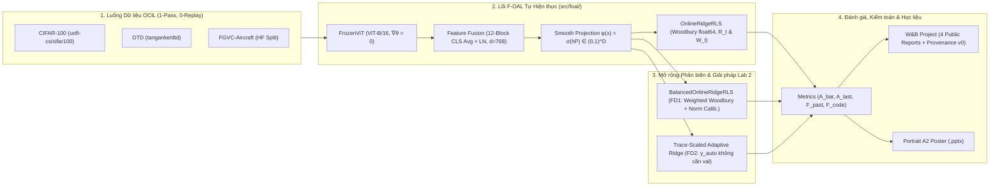
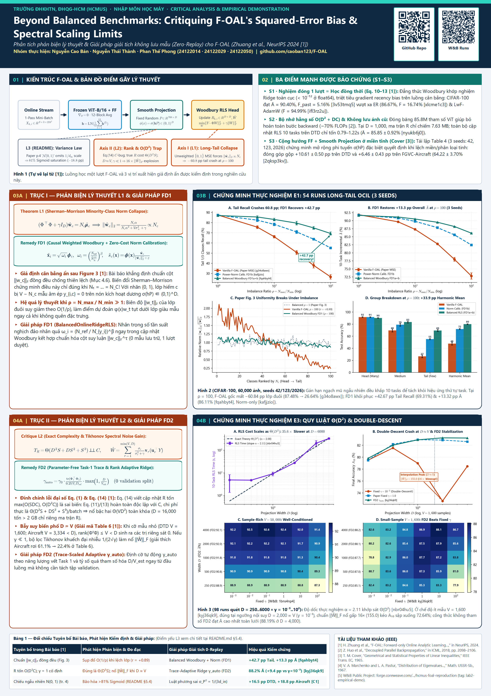

# F-OAL: Tái lập Thực nghiệm Đa Miền, Phân tích Phản biện Lý thuyết & Giải pháp Giải tích Không Lưu Mẫu

[](https://github.com/caoban123/F-OAL/actions/workflows/ci.yml)

-0F766E)


> **Đồ án Môn học:** Nhập môn Học máy (*Introduction to Machine Learning*) — Khoa Công nghệ Thông tin, Trường ĐHKHTN, ĐHQG-HCM (HCMUS)
> **Nhóm thực hiện:** **Nguyễn Cao Bản · Nguyễn Thái Thành · Phan Thế Phong** (`MSSV: 24122014 · 24122029 · 24122050`)
> **Bài báo gốc:** Huiping Zhuang\*, Yuchen Liu\*, Run He, Kai Tong, Ziqian Zeng, Cen Chen, Yi Wang, Lap-Pui Chau — *"F-OAL: Forward-only Online Analytic Learning with Fast Training and Low Memory Footprint in Class Incremental Learning"*, **NeurIPS 2024** ([Proceedings](https://proceedings.neurips.cc/paper_files/paper/2024/hash/48ffa38c13078d6ce26b328e7f373243-Abstract-Conference.html) · [PDF](https://papers.neurips.cc/paper_files/paper/2024/file/48ffa38c13078d6ce26b328e7f373243-Paper-Conference.pdf) · [Mã nguồn tác giả](https://github.com/liuyuchen-cz/F-OAL)).

---

## Cổng Điều hướng Nhanh cho Giảng viên & Người chấm (Executive Hub)

### A. Trung tâm Báo cáo Trực tuyến Weights & Biases (`hcmus-foal-reproduction`)

Toàn bộ thực nghiệm của dự án được quản lý tập trung trên một W&B Project công khai duy nhất: **[`hcmus-foal-reproduction`](https://forge.coreweave.com/wandb/caoban170106-tr-ng-i-h-c-khoa-h-c-t-nhi-n-hqg-hcm/hcmus-foal-reproduction)**. Để thuận tiện nhất khi chấm bài, nhóm tổ chức thành **2 chế độ xem đồng bộ**:
* **Xem Báo cáo Tổng hợp & Đồ thị So sánh Đa Mô hình (Khuyên dùng đầu tiên):** Nhấp vào **4 trang W&B Report công khai** dưới đây (mỗi biểu đồ đã khóa sẵn đúng bộ lọc thực nghiệm, hiển thị đầy đủ trên mọi trình duyệt không cần đăng nhập).
* **Xem Chi tiết Từng Lượt chạy Đơn lẻ (`Overview`, `Charts`, `Logs`, `Artifacts`):** Nhấp vào từng mã Run ở **[Mục 6](#6-hệ-thống-đăng-ký-thực-nghiệm-wb--kiểm-toán-nguồn-gốc-provenance)** (Workspace đã được chuẩn hóa mở sẵn mục `Charts` tự động ở Trang 1 và đồng bộ đầy đủ khóa `summary/*_pct` để không xảy ra hiện tượng khung biểu đồ trống).

| STT | Chuyên đề Báo cáo Trực tuyến (Public W&B Reports) | Tập dữ liệu / Chặng | Đường dẫn Trực tiếp |
| :---: | :--- | :---: | :--- |
| **1** | **Tái lập Kết quả, So sánh Baselines & Chuỗi Chẩn đoán C1–C3** | **CIFAR-100** *(Core Scope)* | [Mở W&B Report CIFAR-100](https://forge.coreweave.com/wandb/caoban170106-tr-ng-i-h-c-khoa-h-c-t-nhi-n-hqg-hcm/hcmus-foal-reproduction/reports/F-OAL-T-i-l-p-k-t-qu-v-ph-n-t-ch-th-c-nghi-m-tr-n-b-d-li-u-CIFAR-100--VmlldzoxODI2NDExMA) |
| **2** | **Tái lập Thực nghiệm, Baselines & Phân tích Ablation Đa Seed** | **DTD** *(Cross-Domain)* | [Mở W&B Report DTD](https://forge.coreweave.com/wandb/caoban170106-tr-ng-i-h-c-khoa-h-c-t-nhi-n-hqg-hcm/hcmus-foal-reproduction/reports/F-OAL-T%C3%A1i-l%E1%BA%ADp-th%E1%BB%B1c-nghi%E1%BB%87m-v%C3%A0-ph%C3%A2n-t%C3%ADch-ablation-tr%C3%AAn-DTD--VmlldzoxODI3ODAxMQ) |
| **3** | **Thí nghiệm Loại bỏ Thành phần (Table 4) & Kiểm soát C1–C3** | **FGVC-Aircraft** *(Fine-Grained)* | [Mở W&B Report FGVC-Aircraft](https://forge.coreweave.com/wandb/caoban170106-tr-ng-i-h-c-khoa-h-c-t-nhi-n-hqg-hcm/hcmus-foal-reproduction/reports/F-OAL-Th%C3%AD-nghi%E1%BB%87m-lo%E1%BA%A1i-b%E1%BB%8F-th%C3%A0nh-ph%E1%BA%A7n-tr%C3%AAn-FGVC-Aircraft--VmlldzoxODI3NTM0Mg) |
| **4** | **Phản biện Lý thuyết & Thực nghiệm Lab 2 (`Long-Tail` & `Scaling`)** | **Lab 2** *(152 Runs, `FD1` & `FD2`)* | [Mở W&B Report Lab 2](https://forge.coreweave.com/wandb/caoban170106-tr-ng-i-h-c-khoa-h-c-t-nhi-n-hqg-hcm/hcmus-foal-reproduction/reports/F-OAL-Ph%C3%A2n-t%C3%ADch-Ph%E1%BA%A3n-bi%E1%BB%87n-L%C3%BD-thuy%E1%BA%BFt-Th%E1%BB%B1c-nghi%E1%BB%87m-Lab-2-Long-Tail-Scaling--VmlldzoxODM1OTE5Mg) |

### B. Bảng Ánh xạ Toàn bộ Học liệu Theo Cấu trúc Đánh giá HCMUS

| Chặng Đồ án | Trọng tâm Khoa học & Kỹ thuật | Mã nguồn Chính | Tài liệu Báo cáo & Sản phẩm Nộp |
| :--- | :--- | :--- | :--- |
| **Checklist Tuân thủ** | Đối chiếu 13 tiêu chí bắt buộc của HCMUS Lab Book | Toàn bộ repo `main` | [`docs/TEACHER_COMPLIANCE_CHECKLIST.md`](docs/TEACHER_COMPLIANCE_CHECKLIST.md) · [`docs/hcmus_core_scope_matrix.md`](docs/hcmus_core_scope_matrix.md) |
| **Clean-Room Core** | Tự hiện thực F-OAL từ công thức bài báo (`FrozenViT`, `FF`, `SP`, `Woodbury RLS`) | [`src/foal/`](src/foal/) · [`tests/`](tests/) | [`README_IMPLEMENTATION.md`](README_IMPLEMENTATION.md) · [`docs/repository_structure.md`](docs/repository_structure.md) |
| **Lab 1 — Tái lập & Mở rộng** | Headline Table 2 + Multi-Seed Table 4 (36 runs) + Chẩn đoán C0–C3 trên **CIFAR-100, DTD, Aircraft** | [`scripts/reproduce_cifar100.py`](scripts/reproduce_cifar100.py) · [`configs/`](configs/) | [`docs/CIFAR100_FINAL_REPRODUCTION_REPORT.md`](docs/CIFAR100_FINAL_REPRODUCTION_REPORT.md) · [`docs/dtd_ablation_report.md`](docs/dtd_ablation_report.md) · [`docs/aircraft_ablation_report_vi.md`](docs/aircraft_ablation_report_vi.md) |
| **Milestone 3 — Critical Analysis** | Kiểm toán 5 giả định ẩn, 5 lỗi nội tại PDF, 3 điểm mạnh (`S1–S3`), 3 điểm yếu (`L1–L3`) & 3 giải pháp (`FD1–FD3`) | — | [`docs/CRITICAL_ANALYSIS_REPORT.md`](docs/CRITICAL_ANALYSIS_REPORT.md) · [`docs/Limitations_2.md`](docs/Limitations_2.md) |
| **Lab 2 — Empirical Demo** | Hiện thực giải pháp 0-replay `BalancedOnlineRidgeRLS` (`FD1`) & `Trace-Scaled Ridge` (`FD2`); 54 runs `E1` + 98 runs `E3` | [`src/foal/critical_analysis.py`](src/foal/critical_analysis.py) · [`scripts/run_lab2_longtail.py`](scripts/run_lab2_longtail.py) | [`docs/LAB2_EMPIRICAL_DEMONSTRATION_REPORT.md`](docs/LAB2_EMPIRICAL_DEMONSTRATION_REPORT.md) · [`notebooks/foal_lab2_empirical_demonstration.ipynb`](notebooks/foal_lab2_empirical_demonstration.ipynb) |
| **Poster Workshop** | Poster khoa học **1 slide `Portrait A2 (420 × 594 mm)`** chuẩn mù màu + Kịch bản bảo vệ 3.5 phút | [`scripts/build_poster_a2_pptx.py`](scripts/build_poster_a2_pptx.py) | **[`poster/F-OAL_Critical_Analysis_Poster_A2.pptx`](poster/F-OAL_Critical_Analysis_Poster_A2.pptx)** · [`docs/POSTER_WORKSHOP_DEFENSE_GUIDE.md`](docs/POSTER_WORKSHOP_DEFENSE_GUIDE.md) |

### Mục lục Nội dung
1. [Kiến trúc Hệ thống, Cấu trúc Mã nguồn & Thư viện Phụ trợ](#1-kiến-trúc-hệ-thống-cấu-trúc-mã-nguồn--thư-viện-phụ-trợ)
2. [Hướng dẫn Cài đặt & Chạy Lại Nhanh (Quick Start)](#2-hướng-dẫn-cài-đặt--chạy-lại-nhanh-quick-start)
3. [Cơ sở Lý thuyết & Nền tảng Toán học F-OAL](#3-cơ-sở-lý-thuyết--nền-tảng-toán-học-f-oal)
4. [Giai đoạn I — Kết quả Tái lập Thực nghiệm & Giải mã Chênh lệch Đa Tập Dữ Liệu](#4-giai-đoạn-i--kết-quả-tái-lập-thực-nghiệm--giải-mã-chênh-lệch-đa-tập-dữ-liệu)
5. [Giai đoạn II — Phân tích Phản biện Lý thuyết, Thực nghiệm Lab 2 & Poster A2](#5-giai-đoạn-ii--phân-tích-phản-biện-lý-thuyết-thực-nghiệm-lab-2--poster-a2)
6. [Hệ thống Đăng ký Thực nghiệm W&B & Kiểm toán Nguồn gốc (Provenance)](#6-hệ-thống-đăng-ký-thực-nghiệm-wb--kiểm-toán-nguồn-gốc-provenance)
7. [Bản đồ Toàn bộ Tài liệu Chuyên sâu (`docs/*.md`) & Tài liệu Tham khảo](#7-bản-đồ-toàn-bộ-tài-liệu-chuyên-sâu-docsmd--tài-liệu-tham-khảo)

---

## 1. Kiến trúc Hệ thống, Cấu trúc Mã nguồn & Thư viện Phụ trợ

### 1.1. Sơ đồ Kiến trúc Toàn Hệ thống



### 1.2. Tổ chức Thư mục Cốt lõi (Chi tiết xem [`docs/repository_structure.md`](docs/repository_structure.md))

* **[`src/foal/`](src/foal/) — Lõi thuật toán tự hiện thực hoàn toàn từ mô tả toán học của bài báo:**
  * [`backbone.py`](src/foal/backbone.py) & [`feature_fusion.py`](src/foal/feature_fusion.py): Nạp ViT-B/16 đóng băng và hợp nhất trung bình cộng CLS token qua 12 khối Transformer kèm `LayerNorm` cuối ($d_{\text{in}} = 768$).
  * [`projection.py`](src/foal/projection.py): Phép chiếu ngẫu nhiên cố định $\boldsymbol{\phi}(x) = \sigma(\mathbf{h}\mathbf{P})$ hỗ trợ 3 chế độ kiểm soát phương sai (`P0` Gaussian chuẩn, `P1` Official Uniform, `P2` Gaussian khớp phương sai).
  * [`rls.py`](src/foal/rls.py) & [`model.py`](src/foal/model.py): Bộ phân loại giải tích `OnlineRidgeRLS` cập nhật đệ quy bằng đồng nhất thức Woodbury và `torch.linalg.solve` ở độ chính xác kép `float64`, mở rộng cột phân loại động khi có lớp mới.
  * [`critical_analysis.py`](src/foal/critical_analysis.py): Module độc lập của **Lab 2** chứa `BalancedOnlineRidgeRLS` (`FD1`), tự hiệu chỉnh chính quy hóa theo vết `compute_trace_scaled_gamma` (`FD2`), bộ sinh luồng mất cân bằng mũ Long-Tail và nhiễu cảm biến tất định.
  * [`baselines/`](src/foal/baselines/) & [`dataset_adapters/`](src/foal/dataset_adapters/): Các baseline đối chứng (`Experience Replay`, `Official LwF`, `Adapted LwF`) và bộ nạp tự động từ Hugging Face cho DTD & FGVC-Aircraft.
* **[`configs/`](configs/) · [`scripts/`](scripts/) · [`notebooks/`](notebooks/) · [`results/`](results/) · [`poster/`](poster/) · [`tests/`](tests/) · [`docs/`](docs/):** Tách biệt hoàn toàn cấu hình YAML, CLI scripts, notebooks GPU, kết quả JSON/CSV đã kiểm toán, Poster A2 và bộ kiểm thử đơn vị.

### 1.3. Phân định Minh bạch Thư viện Phụ trợ Tái sử dụng (External Dependencies)
Tuân thủ quy tắc hiện thực của môn học, các thư viện ngoài chỉ phục vụ hạ tầng tensor, nạp dữ liệu/trọng số tiền huấn luyện và ghi nhận thực nghiệm:
* **`torch`, `torchvision`:** Phép toán ma trận/tensor, biến đổi kích thước ảnh và `DataLoader`.
* **`timm`:** Tải trọng số ViT-B/16 tiền huấn luyện đóng băng (`vit_base_patch16_224.augreg2_in21k_ft_in1k` và `vit_base_patch16_224.augreg_in1k`).
* **`datasets` (Hugging Face):** Tải tự động `uoft-cs/cifar100`, `tanganke/dtd`, `Multimodal-Fatima/FGVC_Aircraft_train` & `_test` trực tiếp bằng code, không cần chuẩn bị thủ công.
* **`wandb`, `PyYAML`, `numpy`, `pytest`, `matplotlib`, `pandas`:** Quản lý cấu hình, theo dõi thực nghiệm, kiểm thử tự động và xuất biểu đồ phân tích (không tham gia vào lõi thuật toán cập nhật F-OAL).

---

## 2. Hướng dẫn Cài đặt & Chạy Lại Nhanh (Quick Start)

Yêu cầu **Python 3.10+** (hướng dẫn đầy đủ từng tham số xem tại [`README_IMPLEMENTATION.md`](README_IMPLEMENTATION.md)):

```bash
# 1. Khởi tạo môi trường ảo & cài đặt thư viện
python -m venv .venv
# Windows: .venv\Scripts\Activate.ps1 | Linux/macOS: source .venv/bin/activate
pip install -r requirements.txt && pip install -e .

# 2. Chạy bộ kiểm thử đơn vị CPU-safe (tương đương GitHub Actions CI, không cần dữ liệu GPU cục bộ)
python -m pytest -q \
  --ignore=tests/test_checkpoint_roundtrip.py \
  --ignore=tests/test_rls_real_features.py \
  --ignore=tests/test_vit_transforms.py

# 3. Chạy Smoke Test đầu-cuối trên CPU (~45 giây, 2 tasks, không cần W&B API key, không ghi đè results/)
python -m scripts.reproduce_cifar100 --mode smoke

# 4. Chạy Full Reproduction CIFAR-100 (10 tasks x 10 lớp, khuyến nghị GPU T4/A100)
python -m scripts.reproduce_cifar100 --mode full --config configs/c3_d_bilinear_raw.yaml --seed 42

# 5. Chạy thực nghiệm Phản biện & Giải pháp Lab 2 (Long-Tail E1 + Scaling/Double-Descent E3) & Xuất Poster A2
python -m scripts.run_lab2_longtail --dataset cifar100 --seeds 42 123 2026
python -m scripts.run_lab2_scaling_sensitivity --dataset cifar100 --seeds 42 123 2026
python -m scripts.build_poster_assets && python -m scripts.build_poster_a2_pptx
```

* **Phân biệt rõ 3 mức độ xác minh:**
  1. **`smoke verified`:** Đã kiểm chứng chạy thông suốt đầu-cuối trên CPU qua `--mode smoke`.
  2. **`full execution supported`:** Toàn bộ scripts/notebooks 10 tasks sẵn sàng thực thi lại từ đầu khi có GPU.
  3. **`numerical reproduction verified`:** Mọi số liệu báo cáo đều được xuất từ các lượt chạy thực tế trên GPU/CPU đã kiểm toán SHA256 trong `results/` và đồng bộ công khai trên W&B.

---

## 3. Cơ sở Lý thuyết & Nền tảng Toán học F-OAL

### 3.1. Bài toán Online Class-Incremental Learning (OCIL)
Trong bối cảnh **OCIL**, dữ liệu đến tuần tự theo luồng các mini-batch $\mathcal{D}_1 \to \mathcal{D}_2 \to \dots \to \mathcal{D}_t$ với $\mathcal{D}_t = (\mathbf{X}_t, \mathbf{Y}_t)$ thuộc các tập lớp mở rộng dần qua $K$ giai đoạn (ví dụ CIFAR-100 gồm $K = 10$ tasks $\times$ $10$ lớp mới/task). Mô hình bị ràng buộc nghiêm ngặt bởi hai điều kiện:
1. **Học một lượt (*One-pass*):** Mỗi mẫu $(\mathbf{x}_i, y_i)$ chỉ đi qua mô hình đúng một lần duy nhất.
2. **Không lưu mẫu cũ (*Exemplar-free / Zero-replay*):** Không lưu ảnh cũ vào bộ đệm để huấn luyện lại nhằm tiết kiệm bộ nhớ và bảo vệ quyền riêng tư dữ liệu.

Các phương pháp huấn luyện bằng lan truyền ngược (*Backpropagation*) trong OCIL thường rơi vào **Quên thảm khốc (*Catastrophic Forgetting*)** do gradient của mini-batch mới ghi đè trọng số của các lớp cũ (*recency bias*). F-OAL giải quyết tận gốc vấn đề này bằng cách chuyển bài toán cập nhật bộ phân loại sang **nghiệm đóng đệ quy của bài toán Hồi quy Ridge tuyến tính** trên không gian đặc trưng đóng băng.

### 3.2. Ba Khối Biểu diễn Tuyến Xuôi (*Forward-Only Feature Pipeline*)

1. **Frozen Pre-trained ViT-B/16 & Feature Fusion (`Eq. 2`):**
   Toàn bộ tham số của backbone Vision Transformer ($L = 12$ khối) được đóng băng hoàn toàn ($\nabla_\theta = 0$). Để thu nhận đồng thời thông tin kết cấu cục bộ ở các tầng nông và ngữ nghĩa trừu tượng ở tầng sâu, F-OAL lấy trung bình cộng vector `[CLS]` đầu ra của cả 12 khối rồi chuẩn hóa qua `LayerNorm` cuối:
   $$\mathbf{h}(x) = \mathrm{LayerNorm}\!\left(\frac{1}{L}\sum_{\ell=1}^{L} \mathbf{h}^{(\ell)}_{\text{CLS}}(x)\right) \in \mathbb{R}^{d_{\text{in}}}, \qquad d_{\text{in}} = 768$$
2. **Smooth Projection (`Eq. 3`):**
   Vector $\mathbf{h}(x)$ được chiếu qua một ma trận ngẫu nhiên **khởi tạo một lần duy nhất rồi giữ cố định** $\mathbf{P} \in \mathbb{R}^{d_{\text{in}} \times D}$ (cấu hình chuẩn $D = 1{,}000$), theo sau bởi hàm kích hoạt Sigmoid:
   $$\boldsymbol{\phi}(x) = \sigma(\mathbf{h}(x)\mathbf{P}) \in (0, 1)^D$$
   > **Đính chính quan trọng từ kiểm toán của nhóm (`C1` & `L3`):** Bài báo gốc (Mục 3.1, trang 4) ghi các phần tử của $\mathbf{P}$ lấy từ phân phối chuẩn mà bỏ sót hệ số chuẩn hóa phương sai theo chiều đầu vào $1/d_{\text{in}}$. Nếu dùng $\mathcal{N}(0, 1)$, hơn $81\%$ đầu ra Sigmoid bị bão hòa cứng tại $0$ hoặc $1$; để Sigmoid hoạt động trong vùng trơn hiệu quả, phương sai bắt buộc phải tuân theo quy luật $\sigma_P^2 = \Theta(1/d_{\text{in}})$ (như $\mathcal{U}(-1/\sqrt{d_{\text{in}}}, +1/\sqrt{d_{\text{in}}})$ trong code tác giả).
3. **Analytic Classifier dựa trên Hồi quy Ridge (`Eq. 4–5`):**
   Gọi $\boldsymbol{\Phi} \in \mathbb{R}^{V \times D}$ là ma trận đặc trưng tích lũy của toàn bộ $V$ mẫu đã quan sát và $\mathbf{Y} \in \{0, 1\}^{V \times C}$ là ma trận nhãn One-Hot. Trọng số tối ưu toàn cục đạt được từ bài toán lồi chặt ($\gamma > 0$, cấu hình chuẩn $\gamma = 1.0$):
   $$\hat{\mathbf{W}} = \arg\min_{\mathbf{W} \in \mathbb{R}^{D \times C}} \left(\|\mathbf{Y} - \boldsymbol{\Phi}\mathbf{W}\|_F^2 + \gamma\|\mathbf{W}\|_F^2\right) = (\boldsymbol{\Phi}^\top\boldsymbol{\Phi} + \gamma\mathbf{I}_D)^{-1}\boldsymbol{\Phi}^\top\mathbf{Y}$$

### 3.3. Cập nhật Đệ quy Bình phương Tối thiểu Woodbury RLS (`Eq. 10–13`)
Thay vì lưu trữ $\boldsymbol{\Phi}$ và $\mathbf{Y}$ qua thời gian, F-OAL chỉ duy trì **ma trận hiệp phương sai nghịch đảo (Autocorrelation / Precision Matrix)** $\mathbf{R}_t = (\gamma\mathbf{I}_D + \sum_{i=1}^{t}\mathbf{H}_i^\top\mathbf{H}_i)^{-1} \in \mathbb{R}^{D \times D}$ (khởi tạo $\mathbf{R}_0 = \gamma^{-1}\mathbf{I}_D$) và ma trận trọng số $\mathbf{W}_t \in \mathbb{R}^{D \times C_t}$. Khi mini-batch mới $(\mathbf{H}_t \in \mathbb{R}^{S \times D}, \mathbf{Y}_t \in \mathbb{R}^{S \times C_t})$ cỡ $S$ xuất hiện (nếu có lớp mới, ghép thêm các cột $\mathbf{0}$ vào $\mathbf{W}_{t-1}$):

$$\mathbf{R}_t = \mathbf{R}_{t-1} - \mathbf{R}_{t-1}\mathbf{H}_t^\top\left(\mathbf{I}_S + \mathbf{H}_t\mathbf{R}_{t-1}\mathbf{H}_t^\top\right)^{-1}\mathbf{H}_t\mathbf{R}_{t-1}$$

$$\mathbf{W}_t = \mathbf{W}_{t-1} + \mathbf{R}_t\mathbf{H}_t^\top\left(\mathbf{Y}_t - \mathbf{H}_t\mathbf{W}_{t-1}\right)$$

* **Tính bất biến theo thứ tự & cỡ lô (*Exact Joint Equivalence*):** Ví dụ vô hướng đơn giản với $D=1, \gamma=1, R_0=1, W_0=0$: sau mẫu $(H_1=1, Y_1=1)$ ta có $R_1 = 1/2, W_1 = 1/2$; sau mẫu $(H_2=1, Y_2=0)$ ta có $R_2 = 1/3, W_2 = 1/3$ — trùng khít tuyệt đối với nghiệm giải gộp toàn tập $W^* = \frac{1\cdot 1 + 1\cdot 0}{1^2 + 1^2 + 1} = \frac{1}{3}$ mà không cần lưu lại mẫu thứ nhất.
* **Bộ nhớ & Độ phức tạp thực tế (Đính chính `Eq. 14` của bài báo):** Hai ma trận trạng thái chiếm bộ nhớ cố định $\mathcal{O}(D^2 + DC)$ ($\approx 7.63\text{ MB}$ cho $\mathbf{R}$ ở `float64`, $D=1{,}000$). Chi phí cập nhật $\mathbf{R}_t$ trên mỗi mini-batch cỡ $S$ thực chất là $\Theta(D^2 S + DS^2 + S^3)$ (**hoàn toàn độc lập với số lớp $C$**, đính chính lỗi in nhầm biến $C$ trong `Eq. 14` trang 5 của bài báo gốc).

---

## 4. Giai đoạn I — Kết quả Tái lập Thực nghiệm & Giải mã Chênh lệch Đa Tập Dữ Liệu

### 4.1. Chuỗi Chẩn đoán C0 $\to$ C3: Giải mã Khoảng cách $-11.65\text{ pp}$ với Mã nguồn Tác giả
Ở lượt chạy tái lập độc lập đầu tiên từ mô tả chữ của bài báo trên CIFAR-100 (`seed=42`, Run [`2cdeiptv`](https://forge.coreweave.com/wandb/caoban170106-tr-ng-i-h-c-khoa-h-c-t-nhi-n-hqg-hcm/hcmus-foal-reproduction/runs/2cdeiptv)), mô hình đạt $\bar{A} = 79.33\%$, thấp hơn $-11.65\text{ pp}$ so với lượt chạy mã gốc tác giả (`90.98%`, Run [`3eca8232`](https://forge.coreweave.com/wandb/caoban170106-tr-ng-i-h-c-khoa-h-c-t-nhi-n-hqg-hcm/hcmus-foal-reproduction/runs/3eca8232)). Thay vì sao chép code tác giả, nhóm thiết kế chuỗi thí nghiệm kiểm soát từng nhân tố (**`C0–C3`**, chi tiết tại [`docs/original_vs_ours_protocol.md`](docs/original_vs_ours_protocol.md) và [`docs/CIFAR100_PREPROCESSING_AUDIT.md`](docs/CIFAR100_PREPROCESSING_AUDIT.md)) và xác minh lặp lại trên cả **DTD** lẫn **FGVC-Aircraft**:

| Bậc Chẩn đoán | Nhân tố Cô lập (Thay đổi đúng 1 biến) | CIFAR-100 $\bar{A}$ | DTD $\bar{A}$ | FGVC-Aircraft $\bar{A}$ | Phát hiện Khoa học Cốt lõi |
| :--- | :--- | :---: | :---: | :---: | :--- |
| **`C1-P0` (Ban đầu)** | $\mathbf{P} \sim \mathcal{N}(0, 1)$, ViT `augreg_in1k` | `79.33%` | `62.20%` | `31.04%` | **$>81\%$ đầu ra Sigmoid bão hòa cứng** ($\text{Std}(\mathbf{h}\mathbf{P}) \approx 19.3\text{–}20.7$). |
| **`C1-P1` (Chuẩn phương sai)** | Đổi $\mathbf{P} \sim \mathcal{U}(\pm 1/\sqrt{768})$ (`0.00%` bão hòa) | `83.28%` *(+3.95)* | `78.68%` *(+16.48)* | `49.82%` *(+18.78)* | `C1-P2` Gaussian cùng phương sai $\mathcal{N}(0, \frac{1}{3\cdot 768})$ cho kết quả trùng khít (`83.26%`, `78.68%`, `49.95%`). |
| **`C2-B1` (Chuẩn Backbone)** | Đổi sang `augreg2_in21k_ft_in1k` (như `timm` mặc định của tác giả) | `91.77%` *(+8.49)* | `85.83%` *(+7.15)* | `64.46%` *(+14.64)* | Tiền huấn luyện ImageNet-21K quyết định chất lượng phân tách đặc trưng đóng băng. |
| **`C3` (Chuẩn Tiền xử lý)** | Nội suy ảnh + Raw `[0,1]` khớp code tác giả (`Max abs diff = 0.0`) | **`90.40%`** *(C3-D)* | **`85.08%`** *(A0 s42)* | **`64.63%`** *(C3-E)* | Khớp hoàn toàn giao thức gốc; phần chênh nhỏ còn lại (`< 0.7 pp`) thuần túy do khác `seed` (`42` vs `0`). |

*(Ngoài ra, kiểm toán **`C0`** phát hiện code tác giả chia độ quên cho $T = 10$ gồm cả task cuối luôn có độ quên bằng $0$, làm $F_{\text{code}} = \frac{9}{10} F_{\text{past}}$; repo tính song song cả hai chỉ số để đối sánh minh bạch).*

### 4.2. Kết quả Headline Comparison (Table 2 — CIFAR-100 & DTD, `seed=42`)

| Tập dữ liệu | Phương pháp | Replay Buffer | $\bar{A}$ (Nhóm) | $\bar{A}$ (Paper) | $A_{10}$ (Nhóm) | $F_{\text{past}}$ (Nhóm) | W&B Run | Nhận định Kiểm định |
| :---: | :--- | :---: | :---: | :---: | :---: | :---: | :---: | :--- |
| **CIFAR-100** | *Official Author Code (`seed=0`)* | 0 | `90.98%` | `91.1%` | `85.84%` | `5.17%` | [`3eca8232`](https://forge.coreweave.com/wandb/caoban170106-tr-ng-i-h-c-khoa-h-c-t-nhi-n-hqg-hcm/hcmus-foal-reproduction/runs/3eca8232) | Mốc đối chứng mã gốc `liuyuchen-cz/F-OAL @ 73e4ac1`. |
| **CIFAR-100** | **F-OAL Clean-Room (`C3-D`)** | **0** | **`90.40%`** | **`91.1%`** | **`85.73%`** | **`5.16%`** | [`3v53tmq5`](https://forge.coreweave.com/wandb/caoban170106-tr-ng-i-h-c-khoa-h-c-t-nhi-n-hqg-hcm/hcmus-foal-reproduction/runs/3v53tmq5) | Tái lập thành công lợi thế vượt trội cả về độ chính xác, tốc độ (`229s`) và bộ nhớ. |
| **CIFAR-100** | Experience Replay (`ER`) | 5,000 | `86.67%` | `90.1%` | `79.79%` | `16.74%` | [`xlcme1c3`](https://forge.coreweave.com/wandb/caoban170106-tr-ng-i-h-c-khoa-h-c-t-nhi-n-hqg-hcm/hcmus-foal-reproduction/runs/xlcme1c3) | Dù lưu 5,000 ảnh cũ vẫn kém F-OAL `-3.73 pp` $\bar{A}$ và quên gấp `3.2×`. |
| **CIFAR-100** | Official-Protocol `LwF` (`SGD`) | 0 | `46.29%` | `69.3%` | `23.34%` | `0.41%`* | [`c5pjewk4`](https://forge.coreweave.com/wandb/caoban170106-tr-ng-i-h-c-khoa-h-c-t-nhi-n-hqg-hcm/hcmus-foal-reproduction/runs/c5pjewk4) | *Độ cứng nhắc thảm khốc (*under-learning*): không học được task mới nên $F_{\text{past}}$ thấp giả tạo. |
| **CIFAR-100** | Adapted `LwF` (`AdamW`) | 0 | `29.63%` | `69.3%` | `11.21%` | `94.99%` | [`ifl3rz2u`](https://forge.coreweave.com/wandb/caoban170106-tr-ng-i-h-c-khoa-h-c-t-nhi-n-hqg-hcm/hcmus-foal-reproduction/runs/ifl3rz2u) | *Recency collapse*: chỉ nhớ task vừa học, xóa sạch các task cũ. |
| **DTD** | **F-OAL Clean-Room (`A0`)** | **0** | **`85.08%`** | **`82.8%`** | **`76.06%`** | **`8.61%`** | [`nyukb6j0`](https://forge.coreweave.com/wandb/caoban170106-tr-ng-i-h-c-khoa-h-c-t-nhi-n-hqg-hcm/hcmus-foal-reproduction/runs/nyukb6j0) | Vượt con số bài báo `+2.28 pp` (trung bình 3 seeds đạt **`85.85 ± 0.92%`**). |
| **DTD** | `ER` / `Official LwF` / `Adapted LwF` | 5,000 / 0 | `53.00%` / `15.40%` / `25.00%` | `61.3%` / `40.9%` | `38.94%` / `8.56%` / `8.62%` | `29.74%` / `0.90%` / `90.90%` | [`q6pm84ej`](https://forge.coreweave.com/wandb/caoban170106-tr-ng-i-h-c-khoa-h-c-t-nhi-n-hqg-hcm/hcmus-foal-reproduction/runs/q6pm84ej) · [`0068ne1c`](https://forge.coreweave.com/wandb/caoban170106-tr-ng-i-h-c-khoa-h-c-t-nhi-n-hqg-hcm/hcmus-foal-reproduction/runs/0068ne1c) · [`uga0pme6`](https://forge.coreweave.com/wandb/caoban170106-tr-ng-i-h-c-khoa-h-c-t-nhi-n-hqg-hcm/hcmus-foal-reproduction/runs/uga0pme6) | Trên tập mẫu nhỏ ($40$ mẫu/lớp), SGD/AdamW 1-pass suy sụp nặng so với nghiệm giải tích RLS. |

### 4.3. Kết quả Table 4 Ablation Đa Seed (3 Seeds `42, 123, 2026` × 4 Cấu hình × 3 Tập Dữ Liệu = 36 Runs)

| Cấu hình Ablation | FF | SP | **CIFAR-100** $\bar{A}$ *(Paper: 91.1)* | **DTD** $\bar{A}$ *(Paper: 82.8)* | **FGVC-Aircraft** $\bar{A}$ *(Paper: 62.2)* |
| :--- | :---: | :---: | :---: | :---: | :---: |
| **`A0` — Full F-OAL** | ✓ | ✓ | **`90.59 ± 0.16%`** | **`85.85 ± 0.92%`** | **`64.22 ± 3.70%`** |
| **`A1` — Without Feature Fusion** | ✗ | ✓ | `90.23 ± 0.11%` *(-0.36 pp)* | `82.93 ± 0.95%` *(-2.93 pp)* | `62.98 ± 3.68%` *(-1.24 pp)* |
| **`A2` — Without Smooth Projection** | ✓ | ✗ | `90.58 ± 0.18%` *(-0.01 pp)* | `79.32 ± 1.97%` *(-6.53 pp)* | `60.40 ± 4.16%` *(-3.82 pp)* |
| **`A3` — Without Both (Linear RLS)** | ✗ | ✗ | `90.16 ± 0.21%` *(-0.43 pp)* | `75.24 ± 1.26%` *(-10.61 pp)* | `57.75 ± 3.97%` *(-6.46 pp)* |

> **Quy luật Khoa học Xuyên Tập Dữ Liệu:** Trên **CIFAR-100** (vật thể tự nhiên trùng miền với ImageNet-21K), CLS tầng cuối đã gần như khả tách tuyến tính nên `FF + SP` chỉ cộng thêm `+0.43 pp`. Ngược lại, khi lệch sang miền kết cấu bề mặt (**DTD**) hoặc hình thái tinh (**FGVC-Aircraft**), hợp nhất đặc trưng đa tầng (`FF`) và mở rộng phi tuyến theo Định lý Cover (`SP`) đóng vai trò sống còn, mang lại mức tăng ròng **`+10.61 ± 0.50 pp`** trên DTD và **`+6.46 ± 0.43 pp`** trên FGVC-Aircraft.

---

## 5. Giai đoạn II — Phân tích Phản biện Lý thuyết, Thực nghiệm Lab 2 & Poster A2

Toàn bộ cơ sở chứng minh định lý xem tại [`docs/CRITICAL_ANALYSIS_REPORT.md`](docs/CRITICAL_ANALYSIS_REPORT.md) và báo cáo thực nghiệm 152 runs xem tại [`docs/LAB2_EMPIRICAL_DEMONSTRATION_REPORT.md`](docs/LAB2_EMPIRICAL_DEMONSTRATION_REPORT.md) ([W&B Report Lab 2](https://forge.coreweave.com/wandb/caoban170106-tr-ng-i-h-c-khoa-h-c-t-nhi-n-hqg-hcm/hcmus-foal-reproduction/reports/F-OAL-Ph%C3%A2n-t%C3%ADch-Ph%E1%BA%A3n-bi%E1%BB%87n-L%C3%BD-thuy%E1%BA%BFt-Th%E1%BB%B1c-nghi%E1%BB%87m-Lab-2-Long-Tail-Scaling--VmlldzoxODM1OTE5Mg)).

### 5.1. Ba Điểm Mạnh Được Bảo Chứng (`S1–S3`) & Các Lỗi Nội Tại Phát Hiện Trong Bài Báo Gốc
* **Ba điểm mạnh thực chất:** **(S1)** Đồng nhất thức Woodbury bảo toàn nghiệm tối ưu toàn cục một lượt không thiên lệch recency gradient; **(S2)** Bộ nhớ trạng thái cố định $\mathcal{O}(D^2 + DC)$ không phụ thuộc độ dài luồng dữ liệu, loại bỏ hoàn toàn backward pass ($\sim 70\%$ FLOPs); **(S3)** Cộng hưởng `FF + SP` đặc biệt hiệu quả khi chuyển miền sang bài toán kết cấu và phân loại tinh.
* **Năm sai sót toán học / bất nhất nội tại được nhóm phát hiện trong PDF NeurIPS 2024:** **(1)** `Eq. (1)` trang 4 viết ngược thứ tự hợp hàm $B_1(B_2(x))$; **(2)** `Eq. (14)–(15)` trang 5 viết nhầm chi phí cập nhật $\mathbf{R}$ phụ thuộc số lớp $C$ thay vì $\Theta(D^2 S + DS^2 + S^3)$; **(3)** Số liệu FGVC-Aircraft tự mâu thuẫn giữa Mục 4.4 (`66.2%`), Table 2/4 (`62.2%`) và Table 6 (`61.1%`); **(4)** Mục 3.1 thiếu hệ số phương sai $1/d_{\text{in}}$ cho ma trận $\mathbf{P}$; **(5)** Mục 4.3 khẳng định phương sai cực nhỏ không cần báo cáo thanh sai số, trái ngược hướng dẫn NeurIPS Checklist #7.

### 5.2. Trục Chính I (`L1` & `FD1`): Sụp đổ Lớp Hiếm Long-Tail OCIL & Giải pháp `BalancedOnlineRidgeRLS` (54 Runs)
* **Phản biện lý thuyết (`Theorem L1`):** Mục 4.6 & Figure 3 của bài báo khẳng định chuẩn cột $\|\hat{\mathbf{w}}_c\|_2$ tự động đồng đều chống thiên lệch. Phép giải tích Sherman–Morrison chứng minh tính chất này **chỉ đúng khi $N_1 = \dots = N_C$**: dưới hàm mục tiêu bình phương nhãn $\{0, 1\}$ và nền kích hoạt dương $\sigma(\mathbf{h}\mathbf{P}) \in (0, 1)^D$, lớp hiếm $c$ bị $V - N_c$ mẫu âm kéo về $0$ khiến $\|\hat{\mathbf{w}}_c\|_2 \propto N_c$.
* **Giải pháp 1 lượt, 0-replay (`FD1` — [`BalancedOnlineRidgeRLS`](src/foal/critical_analysis.py)):** Nhân trọng số tần suất nghịch đảo nhân quả $\omega_i = (N_{\text{ref}} / \hat{N}_{y_i}^{(t)})^\beta$ trực tiếp qua phép biến đổi $\tilde{\mathbf{x}}_i = \sqrt{\omega_i}\boldsymbol{\phi}_i$ trong cập nhật Woodbury (`FD1a`), kết hợp chuẩn hóa lũy thừa cột lúc suy luận $\hat{\mathbf{w}}_c / \|\hat{\mathbf{w}}_c\|_2^\tau$ (`FD1b`).
* **Chứng minh thực nghiệm (CIFAR-100, 60,000 ảnh, seeds `42, 123, 2026`):** Khi $\rho = N_{\max}/N_{\min} = 100$, Vanilla F-OAL (`g34o8awx`) có $r(\|\hat{\mathbf{w}}_c\|_2, N_c) = +0.89$, làm nhóm 1/3 lớp hiếm sụp đổ **$-60.84\text{ pp}$** (`87.48%` $\to$ `26.64%`). Chỉ riêng chuẩn hóa suy luận `FD1b` (`kafjjzio`, **0 chi phí train**) khôi phục **`+28.50 pp`** (`55.14%`); kết hợp `FD1a+b` (`fqahbyt4`) khôi phục **`+42.67 pp` Tail Recall (`69.31 ± 1.62%`)** và **`+13.32 pp` $\bar{A}$ (`86.11 ± 0.17%`)** mà không lưu bất kỳ mẫu cũ nào.

### 5.3. Trục Chính II (`L2` & `FD2`): Quy Luật $\Theta(D^2)$, Đỉnh Double-Descent & Tự Hiệu Chỉnh `FD2` (98 Runs)
* **Phản biện lý thuyết (`Critique L2`):** (i) Mở rộng chiều $D$ vấp phải bức tường chi phí bậc hai $\Theta(D^2)$; (ii) Khi tổng số mẫu nhỏ ($V \approx D$, như DTD $V=1{,}600$ hay Aircraft $V=3{,}334$), phổ Marchenko–Pastur sinh ra các trị riêng cực nhỏ $\sigma_r \to 0^+$. Nếu chọn $\gamma \ll 1$, bộ lọc Tikhonov $\frac{\sigma_r}{\sigma_r^2 + \gamma}$ khuếch đại nhiễu lên $\frac{1}{2\sqrt{\gamma}}$ gây nổ chuẩn $\|\hat{\mathbf{W}}\|_F$ (giải thích trực tiếp cú sập xuống `22.4%` ở Table 6 bài báo gốc).
* **Giải pháp không tham số (`FD2` — [`compute_trace_scaled_gamma`](src/foal/critical_analysis.py)):** Tự động định cỡ $\gamma_{\text{auto}} = \gamma_0 \cdot \frac{\mathrm{tr}(\boldsymbol{\Phi}_1^\top\boldsymbol{\Phi}_1)}{0.25 V_1 D_{\text{ref}}} \cdot \max(1, D/V_{\text{est}})$ ngay sau Task 1 mà không cần tách tập validation.
* **Chứng minh thực nghiệm:** Lũy thừa thời gian RLS thực nghiệm đạt **$\alpha = 2.11 \approx 2.00$** (`nbr04hu5`: `D=6000` chậm gấp `35.6×` và tốn `274.66 MB` chỉ đổi lấy `+0.77 pp` $\bar{A}$). Ở chế độ ít mẫu $V = 1{,}600$ (`kyj36qk9`), đúng tại ngưỡng nội suy $D = 2{,}000 \approx V$ với $\gamma = 10^{-3}$, chuẩn $\|\hat{\mathbf{W}}\|_F$ **nổ gấp `16×` lên `155.0`** kéo $A_{10}$ sập xuống **`72.64%`**; công thức tự động `FD2` triệt tiêu hoàn toàn đỉnh suy biến và đạt $\bar{A}$ cao nhất toàn lưới (**`88.19%`** ở $D = 4{,}000$).

### 5.4. Các Điểm Yếu Đã Chứng Minh Còn Lại Ghi Nhận Tại `README.md` (`L3` & Độ Quên $F_{\text{past}}$)
Theo quy định của mục *Empirical Demonstration* (đưa 2 trục điểm yếu + giải pháp nổi bật nhất lên Poster A2 và ghi nhận đầy đủ các điểm yếu đã chứng minh còn lại tại `README.md`), nhóm báo cáo chi tiết **2 phát hiện bổ trợ đã chứng minh thực nghiệm**:
1. **Khuyết định luật tỷ lệ phương sai $\sigma_P^2 = \Theta(1/d_{\text{in}})$ gây bão hòa cứng hàm Sigmoid trên cả 3 bộ dữ liệu (`L3`):**
   * Vì vector đầu ra `LayerNorm` có $\|\mathbf{h}\|_2^2 \approx d_{\text{in}} = 768$, khởi tạo $\mathbf{P} \sim \mathcal{N}(0, 1)$ đẩy độ lệch chuẩn tiền kích hoạt lên $\approx 19.3\text{–}20.7$, làm bão hòa cứng **`81.03%`** đơn vị trên CIFAR-100 (mất **$-3.95\text{ pp}$**, [`qw78us1k`](https://forge.coreweave.com/wandb/caoban170106-tr-ng-i-h-c-khoa-h-c-t-nhi-n-hqg-hcm/hcmus-foal-reproduction/runs/qw78us1k) vs [`6whrot4z`](https://forge.coreweave.com/wandb/caoban170106-tr-ng-i-h-c-khoa-h-c-t-nhi-n-hqg-hcm/hcmus-foal-reproduction/runs/6whrot4z)), bão hòa **`82.32%`** trên DTD (mất **$-16.48\text{ pp}$**, [`u7apoirr`](https://forge.coreweave.com/wandb/caoban170106-tr-ng-i-h-c-khoa-h-c-t-nhi-n-hqg-hcm/hcmus-foal-reproduction/runs/u7apoirr) vs [`qel56wwv`](https://forge.coreweave.com/wandb/caoban170106-tr-ng-i-h-c-khoa-h-c-t-nhi-n-hqg-hcm/hcmus-foal-reproduction/runs/qel56wwv)), và bão hòa **`81.25%`** trên FGVC-Aircraft (mất **$-18.78\text{ pp}$**, [`do82b0k3`](https://forge.coreweave.com/wandb/caoban170106-tr-ng-i-h-c-khoa-h-c-t-nhi-n-hqg-hcm/hcmus-foal-reproduction/runs/do82b0k3) vs [`bemgqzjf`](https://forge.coreweave.com/wandb/caoban170106-tr-ng-i-h-c-khoa-h-c-t-nhi-n-hqg-hcm/hcmus-foal-reproduction/runs/bemgqzjf)). Áp đặt quy luật phương sai $\sigma_P^2 = 1/(3d_{\text{in}})$ đưa tỷ lệ bão hòa về đúng `0.00%` trên mọi phân phối (`P1`, `P2`).
2. **Thiên lệch che lấp độ quên của công thức $F_{\text{past}}$ (*Underlearning Masks Forgetting*):**
   * Từ đồng nhất thức phân rã $\Delta F_{\text{past}} = \Delta\overline{\text{Peak}} - \Delta\overline{\text{Final}}$ (chứng minh vi mô trên ma trận $10 \times 10$ của DTD tại [`docs/Limitations_2.md`](docs/Limitations_2.md)), mô hình học yếu ở giai đoạn đầu (như `A2/A3` khi tắt `SP`, hoặc `Official LwF`) có đỉnh ban đầu thấp nên hiệu số quên nhỏ giả tạo, chứng minh không bao giờ được đánh giá $F$ tách rời khỏi $\bar{A}$ và $A_{\text{last}}$.

### 5.5. Poster Khoa học Khổ Dọc `Portrait A2` (`420.0 mm × 594.0 mm`, 1 Slide `.pptx`)

* **Tải file PowerPoint `.pptx` gốc (1 slide chuẩn in A2):** **[`poster/F-OAL_Critical_Analysis_Poster_A2.pptx`](poster/F-OAL_Critical_Analysis_Poster_A2.pptx)**
* **Kịch bản thuyết trình 3.5 phút & 12 câu hỏi vấn đáp:** **[`docs/POSTER_WORKSHOP_DEFENSE_GUIDE.md`](docs/POSTER_WORKSHOP_DEFENSE_GUIDE.md)**



---

## 6. Hệ thống Đăng ký Thực nghiệm W&B & Kiểm toán Nguồn gốc (Provenance)

### 6.1. CIFAR-100 — Headline Comparison, Official Reference & Provenance Artifacts (`v0`)

| Thực nghiệm | Script / Notebook | W&B Run (`state=finished`) | Phân loại Nguồn gốc & Minh chứng |
| :--- | :--- | :---: | :--- |
| **F-OAL Official Reference (`seed=0`)** | [`notebooks/foal_official_cifar100_reproduction.ipynb`](notebooks/foal_official_cifar100_reproduction.ipynb) | [Run `3eca8232`](https://forge.coreweave.com/wandb/caoban170106-tr-ng-i-h-c-khoa-h-c-t-nhi-n-hqg-hcm/hcmus-foal-reproduction/runs/3eca8232) | Chạy mã gốc `liuyuchen-cz/F-OAL @ 73e4ac1` ($\bar{A}=90.98\%$, $A_{10}=85.84\%$). |
| **F-OAL Initial Rebuild (`seed=42`)** | [`scripts/train.py`](scripts/train.py) / [`notebooks/foal_cifar100_full_reproduction.ipynb`](notebooks/foal_cifar100_full_reproduction.ipynb) | [Run `2cdeiptv`](https://forge.coreweave.com/wandb/caoban170106-tr-ng-i-h-c-khoa-h-c-t-nhi-n-hqg-hcm/hcmus-foal-reproduction/runs/2cdeiptv) | Bản tái lập đầu tiên ($\bar{A}=79.33\%$), khởi phát chuỗi chẩn đoán `C0–C3`. |
| **F-OAL Aligned `C3-D` (`seed=42`)** | [`scripts/train.py`](scripts/train.py) (`configs/c3_d_bilinear_raw.yaml`) | [Run `3v53tmq5`](https://forge.coreweave.com/wandb/caoban170106-tr-ng-i-h-c-khoa-h-c-t-nhi-n-hqg-hcm/hcmus-foal-reproduction/runs/3v53tmq5) | `ONLINE_TRAINING` · Artifact `c3_d_bilinear_raw_results:v0` (`SHA256: 903456d6...`). |
| **Experience Replay (`B=5000`, `s42`)** | [`scripts/train_baseline.py`](scripts/train_baseline.py) (`configs/headline/er_cifar100.yaml`) | [Run `xlcme1c3`](https://forge.coreweave.com/wandb/caoban170106-tr-ng-i-h-c-khoa-h-c-t-nhi-n-hqg-hcm/hcmus-foal-reproduction/runs/xlcme1c3) | `POST_HOC_IMPORT` · Artifact `headline_er_provenance_bundle:v0` (`SHA256: 190a5870...`). |
| **Official-Protocol `LwF` (`s42`)** | [`scripts/train_baseline.py`](scripts/train_baseline.py) (`configs/headline/lwf_cifar100_official_protocol.yaml`) | [Run `c5pjewk4`](https://forge.coreweave.com/wandb/caoban170106-tr-ng-i-h-c-khoa-h-c-t-nhi-n-hqg-hcm/hcmus-foal-reproduction/runs/c5pjewk4) | `POST_HOC_IMPORT` · Artifact `headline_official_lwf_provenance_bundle:v0` (`SHA256: d47e5755...`). |
| **Adapted `LwF` (`AdamW`, `s42`)** | [`scripts/train_baseline.py`](scripts/train_baseline.py) (`configs/headline/lwf_cifar100.yaml`) | [Run `ifl3rz2u`](https://forge.coreweave.com/wandb/caoban170106-tr-ng-i-h-c-khoa-h-c-t-nhi-n-hqg-hcm/hcmus-foal-reproduction/runs/ifl3rz2u) | `POST_HOC_IMPORT` · Artifact `headline_adapted_lwf_provenance_bundle:v0` (`SHA256: 9b612893...`). |
| **10-Task Progression Curve** | [`scripts/create_wandb_accuracy_progression_run.py`](scripts/create_wandb_accuracy_progression_run.py) | [Run `nceap43w`](https://forge.coreweave.com/wandb/caoban170106-tr-ng-i-h-c-khoa-h-c-t-nhi-n-hqg-hcm/hcmus-foal-reproduction/runs/nceap43w) | `ANALYSIS_ONLY` (`job_type="analysis"`) — tổng hợp đường cong 10 tasks của 4 phương pháp. |

### 6.2. CIFAR-100 — Multi-Seed Table 4 Ablation (12 Runs) & Chẩn đoán C1–C3

| Nhóm Thực nghiệm | Script / Notebook | Danh sách W&B Runs Chính thức (`state=finished`) | Kết quả Chính |
| :--- | :--- | :--- | :--- |
| **Table 4 `seed=42` (`A0–A3`)** | [`scripts/ablation.py`](scripts/ablation.py) | A0 [`3v53tmq5`](https://forge.coreweave.com/wandb/caoban170106-tr-ng-i-h-c-khoa-h-c-t-nhi-n-hqg-hcm/hcmus-foal-reproduction/runs/3v53tmq5) · A1 [`shl4p10l`](https://forge.coreweave.com/wandb/caoban170106-tr-ng-i-h-c-khoa-h-c-t-nhi-n-hqg-hcm/hcmus-foal-reproduction/runs/shl4p10l) · A2 [`rkedlkkk`](https://forge.coreweave.com/wandb/caoban170106-tr-ng-i-h-c-khoa-h-c-t-nhi-n-hqg-hcm/hcmus-foal-reproduction/runs/rkedlkkk) · A3 [`k01pp8st`](https://forge.coreweave.com/wandb/caoban170106-tr-ng-i-h-c-khoa-h-c-t-nhi-n-hqg-hcm/hcmus-foal-reproduction/runs/k01pp8st) | `90.40%` / `90.10%` / `90.38%` / `89.92%`. |
| **Table 4 `seed=123` (`A0–A3`)** | [`scripts/run_cifar100_multiseed_ablation.py`](scripts/run_cifar100_multiseed_ablation.py) | A0 [`g32wwf9a`](https://forge.coreweave.com/wandb/caoban170106-tr-ng-i-h-c-khoa-h-c-t-nhi-n-hqg-hcm/hcmus-foal-reproduction/runs/g32wwf9a) · A1 [`4lqkxf9f`](https://forge.coreweave.com/wandb/caoban170106-tr-ng-i-h-c-khoa-h-c-t-nhi-n-hqg-hcm/hcmus-foal-reproduction/runs/4lqkxf9f) · A2 [`q3d9rei2`](https://forge.coreweave.com/wandb/caoban170106-tr-ng-i-h-c-khoa-h-c-t-nhi-n-hqg-hcm/hcmus-foal-reproduction/runs/q3d9rei2) · A3 [`cvo857q3`](https://forge.coreweave.com/wandb/caoban170106-tr-ng-i-h-c-khoa-h-c-t-nhi-n-hqg-hcm/hcmus-foal-reproduction/runs/cvo857q3) | `90.68%` / `90.29%` / `90.63%` / `90.27%`. |
| **Table 4 `seed=2026` (`A0–A3`)** | [`scripts/run_cifar100_multiseed_ablation.py`](scripts/run_cifar100_multiseed_ablation.py) | A0 [`9uinxzzr`](https://forge.coreweave.com/wandb/caoban170106-tr-ng-i-h-c-khoa-h-c-t-nhi-n-hqg-hcm/hcmus-foal-reproduction/runs/9uinxzzr) · A1 [`0wotm3e8`](https://forge.coreweave.com/wandb/caoban170106-tr-ng-i-h-c-khoa-h-c-t-nhi-n-hqg-hcm/hcmus-foal-reproduction/runs/0wotm3e8) · A2 [`6oxn4ioz`](https://forge.coreweave.com/wandb/caoban170106-tr-ng-i-h-c-khoa-h-c-t-nhi-n-hqg-hcm/hcmus-foal-reproduction/runs/6oxn4ioz) · A3 [`w0e0h1od`](https://forge.coreweave.com/wandb/caoban170106-tr-ng-i-h-c-khoa-h-c-t-nhi-n-hqg-hcm/hcmus-foal-reproduction/runs/w0e0h1od) | `90.69%` / `90.29%` / `90.72%` / `90.29%`. |
| **`C1` Projection (`P0, P1, P2`)** | [`scripts/run_c1_diagnostics.py`](scripts/run_c1_diagnostics.py) | P0 [`qw78us1k`](https://forge.coreweave.com/wandb/caoban170106-tr-ng-i-h-c-khoa-h-c-t-nhi-n-hqg-hcm/hcmus-foal-reproduction/runs/qw78us1k) · P1 [`6whrot4z`](https://forge.coreweave.com/wandb/caoban170106-tr-ng-i-h-c-khoa-h-c-t-nhi-n-hqg-hcm/hcmus-foal-reproduction/runs/6whrot4z) · P2 [`hsgsvb6p`](https://forge.coreweave.com/wandb/caoban170106-tr-ng-i-h-c-khoa-h-c-t-nhi-n-hqg-hcm/hcmus-foal-reproduction/runs/hsgsvb6p) | Khử `81.03%` bão hòa Sigmoid (`+3.95 pp`). |
| **`C2` Backbone (`B0` vs `B1`)** | [`scripts/run_c2_diagnostics.py`](scripts/run_c2_diagnostics.py) | B0 [`3oiftwg6`](https://forge.coreweave.com/wandb/caoban170106-tr-ng-i-h-c-khoa-h-c-t-nhi-n-hqg-hcm/hcmus-foal-reproduction/runs/3oiftwg6) · B1 [`ne1p16b5`](https://forge.coreweave.com/wandb/caoban170106-tr-ng-i-h-c-khoa-h-c-t-nhi-n-hqg-hcm/hcmus-foal-reproduction/runs/ne1p16b5) | `augreg_in1k` $\to$ `augreg2_in21k_ft_in1k` (`+8.49 pp`). |
| **`C3` Preprocessing (`B, C, D`)** | [`scripts/run_c3_diagnostics.py`](scripts/run_c3_diagnostics.py) | C3-B [`ts2wh4e3`](https://forge.coreweave.com/wandb/caoban170106-tr-ng-i-h-c-khoa-h-c-t-nhi-n-hqg-hcm/hcmus-foal-reproduction/runs/ts2wh4e3) · C3-C [`4m4uir7h`](https://forge.coreweave.com/wandb/caoban170106-tr-ng-i-h-c-khoa-h-c-t-nhi-n-hqg-hcm/hcmus-foal-reproduction/runs/4m4uir7h) · C3-D [`3v53tmq5`](https://forge.coreweave.com/wandb/caoban170106-tr-ng-i-h-c-khoa-h-c-t-nhi-n-hqg-hcm/hcmus-foal-reproduction/runs/3v53tmq5) | `C3-D` khớp bitwise với tensor đầu vào code gốc. |

### 6.3. Mở rộng Đa Tập Dữ Liệu — DTD & FGVC-Aircraft (42 Runs Chính thức)

| Tập dữ liệu & Hạng mục | Script / Notebook | Danh sách W&B Runs Chính thức (`state=finished`) | Tóm tắt Định lượng |
| :--- | :--- | :--- | :--- |
| **DTD Official (`seed=0`)** | [`notebooks/foal_official_dtd_reproduction.ipynb`](notebooks/foal_official_dtd_reproduction.ipynb) | [Run `c9yyo08r`](https://forge.coreweave.com/wandb/caoban170106-tr-ng-i-h-c-khoa-h-c-t-nhi-n-hqg-hcm/hcmus-foal-reproduction/runs/c9yyo08r) | $\bar{A} = 85.04\%$, $A_{10} = 75.94\%$ (40 lớp, 10 tasks). |
| **DTD Table 4 (`3 seeds × A0–A3`)** | [`notebooks/foal_dtd_ablation_colab.ipynb`](notebooks/foal_dtd_ablation_colab.ipynb) | A0: [`nyukb6j0`](https://forge.coreweave.com/wandb/caoban170106-tr-ng-i-h-c-khoa-h-c-t-nhi-n-hqg-hcm/hcmus-foal-reproduction/runs/nyukb6j0), [`munb2s1x`](https://forge.coreweave.com/wandb/caoban170106-tr-ng-i-h-c-khoa-h-c-t-nhi-n-hqg-hcm/hcmus-foal-reproduction/runs/munb2s1x), [`hdrhmlo7`](https://forge.coreweave.com/wandb/caoban170106-tr-ng-i-h-c-khoa-h-c-t-nhi-n-hqg-hcm/hcmus-foal-reproduction/runs/hdrhmlo7)<br>A1: [`l0avdaso`](https://forge.coreweave.com/wandb/caoban170106-tr-ng-i-h-c-khoa-h-c-t-nhi-n-hqg-hcm/hcmus-foal-reproduction/runs/l0avdaso), [`giu86cr7`](https://forge.coreweave.com/wandb/caoban170106-tr-ng-i-h-c-khoa-h-c-t-nhi-n-hqg-hcm/hcmus-foal-reproduction/runs/giu86cr7), [`ff4y0s7i`](https://forge.coreweave.com/wandb/caoban170106-tr-ng-i-h-c-khoa-h-c-t-nhi-n-hqg-hcm/hcmus-foal-reproduction/runs/ff4y0s7i)<br>A2: [`xwtx7ibk`](https://forge.coreweave.com/wandb/caoban170106-tr-ng-i-h-c-khoa-h-c-t-nhi-n-hqg-hcm/hcmus-foal-reproduction/runs/xwtx7ibk), [`b4zu17cf`](https://forge.coreweave.com/wandb/caoban170106-tr-ng-i-h-c-khoa-h-c-t-nhi-n-hqg-hcm/hcmus-foal-reproduction/runs/b4zu17cf), [`rr92acgq`](https://forge.coreweave.com/wandb/caoban170106-tr-ng-i-h-c-khoa-h-c-t-nhi-n-hqg-hcm/hcmus-foal-reproduction/runs/rr92acgq)<br>A3: [`wmhz0kcs`](https://forge.coreweave.com/wandb/caoban170106-tr-ng-i-h-c-khoa-h-c-t-nhi-n-hqg-hcm/hcmus-foal-reproduction/runs/wmhz0kcs), [`ad85oywu`](https://forge.coreweave.com/wandb/caoban170106-tr-ng-i-h-c-khoa-h-c-t-nhi-n-hqg-hcm/hcmus-foal-reproduction/runs/ad85oywu), [`i1bm2km4`](https://forge.coreweave.com/wandb/caoban170106-tr-ng-i-h-c-khoa-h-c-t-nhi-n-hqg-hcm/hcmus-foal-reproduction/runs/i1bm2km4) | A0 `85.85 ± 0.92%`; tổng lợi ích `FF + SP` đạt **`+10.61 ± 0.50 pp`**. |
| **DTD `C1–C3` & Baselines** | [`scripts/run_c1_dtd_diagnostics.py`](scripts/run_c1_dtd_diagnostics.py) · [`notebooks/foal_dtd_headline_final.ipynb`](notebooks/foal_dtd_headline_final.ipynb) | C1: [`u7apoirr`](https://forge.coreweave.com/wandb/caoban170106-tr-ng-i-h-c-khoa-h-c-t-nhi-n-hqg-hcm/hcmus-foal-reproduction/runs/u7apoirr), [`qel56wwv`](https://forge.coreweave.com/wandb/caoban170106-tr-ng-i-h-c-khoa-h-c-t-nhi-n-hqg-hcm/hcmus-foal-reproduction/runs/qel56wwv), [`ccn9l0sh`](https://forge.coreweave.com/wandb/caoban170106-tr-ng-i-h-c-khoa-h-c-t-nhi-n-hqg-hcm/hcmus-foal-reproduction/runs/ccn9l0sh) · C2: [`4i3yehho`](https://forge.coreweave.com/wandb/caoban170106-tr-ng-i-h-c-khoa-h-c-t-nhi-n-hqg-hcm/hcmus-foal-reproduction/runs/4i3yehho), [`drgbs8xm`](https://forge.coreweave.com/wandb/caoban170106-tr-ng-i-h-c-khoa-h-c-t-nhi-n-hqg-hcm/hcmus-foal-reproduction/runs/drgbs8xm) · C3: [`mwxf525w`](https://forge.coreweave.com/wandb/caoban170106-tr-ng-i-h-c-khoa-h-c-t-nhi-n-hqg-hcm/hcmus-foal-reproduction/runs/mwxf525w), [`smz0h0zu`](https://forge.coreweave.com/wandb/caoban170106-tr-ng-i-h-c-khoa-h-c-t-nhi-n-hqg-hcm/hcmus-foal-reproduction/runs/smz0h0zu), [`7gvtu924`](https://forge.coreweave.com/wandb/caoban170106-tr-ng-i-h-c-khoa-h-c-t-nhi-n-hqg-hcm/hcmus-foal-reproduction/runs/7gvtu924) · Baselines: [`q6pm84ej`](https://forge.coreweave.com/wandb/caoban170106-tr-ng-i-h-c-khoa-h-c-t-nhi-n-hqg-hcm/hcmus-foal-reproduction/runs/q6pm84ej), [`0068ne1c`](https://forge.coreweave.com/wandb/caoban170106-tr-ng-i-h-c-khoa-h-c-t-nhi-n-hqg-hcm/hcmus-foal-reproduction/runs/0068ne1c), [`uga0pme6`](https://forge.coreweave.com/wandb/caoban170106-tr-ng-i-h-c-khoa-h-c-t-nhi-n-hqg-hcm/hcmus-foal-reproduction/runs/uga0pme6) | C1 `+16.48 pp`, C2 `+7.15 pp`, C3 chênh `0.05 pp`; F-OAL vượt ER `+32.08 pp`. |
| **Aircraft Official (`seed=0`)** | [`docs/aircraft_provenance/`](docs/aircraft_provenance/) | [Run `9ko84fxj`](https://forge.coreweave.com/wandb/caoban170106-tr-ng-i-h-c-khoa-h-c-t-nhi-n-hqg-hcm/hcmus-foal-reproduction/runs/9ko84fxj) | $\bar{A} = 61.91\%$, $A_{10} = 53.67\%$ (sát paper `62.2% / 54.0%`). |
| **Aircraft Table 4 (`3 seeds × A0–A3`)** | [`scripts/run_aircraft_ablation.py`](scripts/run_aircraft_ablation.py) | A0: [`2qksp3kv`](https://forge.coreweave.com/wandb/caoban170106-tr-ng-i-h-c-khoa-h-c-t-nhi-n-hqg-hcm/hcmus-foal-reproduction/runs/2qksp3kv), [`m1kze328`](https://forge.coreweave.com/wandb/caoban170106-tr-ng-i-h-c-khoa-h-c-t-nhi-n-hqg-hcm/hcmus-foal-reproduction/runs/m1kze328), [`2qqecl0m`](https://forge.coreweave.com/wandb/caoban170106-tr-ng-i-h-c-khoa-h-c-t-nhi-n-hqg-hcm/hcmus-foal-reproduction/runs/2qqecl0m)<br>A1: [`4fsupq4x`](https://forge.coreweave.com/wandb/caoban170106-tr-ng-i-h-c-khoa-h-c-t-nhi-n-hqg-hcm/hcmus-foal-reproduction/runs/4fsupq4x), [`0n4xc8ap`](https://forge.coreweave.com/wandb/caoban170106-tr-ng-i-h-c-khoa-h-c-t-nhi-n-hqg-hcm/hcmus-foal-reproduction/runs/0n4xc8ap), [`no2junlu`](https://forge.coreweave.com/wandb/caoban170106-tr-ng-i-h-c-khoa-h-c-t-nhi-n-hqg-hcm/hcmus-foal-reproduction/runs/no2junlu)<br>A2: [`yezjox78`](https://forge.coreweave.com/wandb/caoban170106-tr-ng-i-h-c-khoa-h-c-t-nhi-n-hqg-hcm/hcmus-foal-reproduction/runs/yezjox78), [`37254a6g`](https://forge.coreweave.com/wandb/caoban170106-tr-ng-i-h-c-khoa-h-c-t-nhi-n-hqg-hcm/hcmus-foal-reproduction/runs/37254a6g), [`tp4fd91q`](https://forge.coreweave.com/wandb/caoban170106-tr-ng-i-h-c-khoa-h-c-t-nhi-n-hqg-hcm/hcmus-foal-reproduction/runs/tp4fd91q)<br>A3: [`gclk75xs`](https://forge.coreweave.com/wandb/caoban170106-tr-ng-i-h-c-khoa-h-c-t-nhi-n-hqg-hcm/hcmus-foal-reproduction/runs/gclk75xs), [`ergopmva`](https://forge.coreweave.com/wandb/caoban170106-tr-ng-i-h-c-khoa-h-c-t-nhi-n-hqg-hcm/hcmus-foal-reproduction/runs/ergopmva), [`n8s1hjzc`](https://forge.coreweave.com/wandb/caoban170106-tr-ng-i-h-c-khoa-h-c-t-nhi-n-hqg-hcm/hcmus-foal-reproduction/runs/n8s1hjzc) | A0 `64.22 ± 3.70%`; tổng lợi ích `FF + SP` đạt **`+6.46 ± 0.43 pp`**. |
| **Aircraft `C1–C3` (`seed=42`)** | [`scripts/run_c1_aircraft_diagnostics.py`](scripts/run_c1_aircraft_diagnostics.py) | C1: [`do82b0k3`](https://forge.coreweave.com/wandb/caoban170106-tr-ng-i-h-c-khoa-h-c-t-nhi-n-hqg-hcm/hcmus-foal-reproduction/runs/do82b0k3), [`bemgqzjf`](https://forge.coreweave.com/wandb/caoban170106-tr-ng-i-h-c-khoa-h-c-t-nhi-n-hqg-hcm/hcmus-foal-reproduction/runs/bemgqzjf), [`72oidkep`](https://forge.coreweave.com/wandb/caoban170106-tr-ng-i-h-c-khoa-h-c-t-nhi-n-hqg-hcm/hcmus-foal-reproduction/runs/72oidkep) · C2: [`rkgjxdvs`](https://forge.coreweave.com/wandb/caoban170106-tr-ng-i-h-c-khoa-h-c-t-nhi-n-hqg-hcm/hcmus-foal-reproduction/runs/rkgjxdvs) · C3: [`k0m9djvw`](https://forge.coreweave.com/wandb/caoban170106-tr-ng-i-h-c-khoa-h-c-t-nhi-n-hqg-hcm/hcmus-foal-reproduction/runs/k0m9djvw), [`z64dog21`](https://forge.coreweave.com/wandb/caoban170106-tr-ng-i-h-c-khoa-h-c-t-nhi-n-hqg-hcm/hcmus-foal-reproduction/runs/z64dog21), [`mb7h3mz9`](https://forge.coreweave.com/wandb/caoban170106-tr-ng-i-h-c-khoa-h-c-t-nhi-n-hqg-hcm/hcmus-foal-reproduction/runs/mb7h3mz9) | C1 `+18.78 pp`, C2 `+14.64 pp`, 5 biến thể C3 chỉ lệch `0.51 pp`. |

### 6.4. Lab 2 — Critical Analysis & Empirical Demonstration (`tag: lab2-empirical-demo`)

| Thực nghiệm Lab 2 | Script / Module | W&B Run (`state=finished`) | Phát hiện Định lượng & Ý nghĩa |
| :--- | :--- | :---: | :--- |
| **E1 — Vanilla F-OAL Long-Tail (`3 seeds`)** | [`scripts/run_lab2_longtail.py`](scripts/run_lab2_longtail.py) | [Run `g34o8awx`](https://forge.coreweave.com/wandb/caoban170106-tr-ng-i-h-c-khoa-h-c-t-nhi-n-hqg-hcm/hcmus-foal-reproduction/runs/g34o8awx) | Tương quan $r(\|\hat{\mathbf{w}}_c\|_2, N_c) = +0.89$; nhóm lớp hiếm sụp đổ **$-60.84\text{ pp}$** ở $\rho = 100$. |
| **E1 — Norm Calibration `FD1b` (`3 seeds`)** | [`src/foal/critical_analysis.py`](src/foal/critical_analysis.py) | [Run `kafjjzio`](https://forge.coreweave.com/wandb/caoban170106-tr-ng-i-h-c-khoa-h-c-t-nhi-n-hqg-hcm/hcmus-foal-reproduction/runs/kafjjzio) | Chuẩn hóa cột lúc suy luận ($\tau = 0.70$, **0 chi phí train**) khôi phục **`+28.50 pp`** Tail Recall. |
| **E1 — Balanced Woodbury `FD1a+b` (`3 seeds`)** | [`src/foal/critical_analysis.py`](src/foal/critical_analysis.py) | [Run `fqahbyt4`](https://forge.coreweave.com/wandb/caoban170106-tr-ng-i-h-c-khoa-h-c-t-nhi-n-hqg-hcm/hcmus-foal-reproduction/runs/fqahbyt4) | Khôi phục **`+42.67 pp`** Tail Recall (`69.31%`) và **`+13.32 pp`** $\bar{A}$ (`86.11%`) với **0 mẫu lưu trữ**. |
| **E3A — Quadratic $\Theta(D^2)$ Scaling (`3 seeds`)** | [`scripts/run_lab2_scaling_sensitivity.py`](scripts/run_lab2_scaling_sensitivity.py) | [Run `nbr04hu5`](https://forge.coreweave.com/wandb/caoban170106-tr-ng-i-h-c-khoa-h-c-t-nhi-n-hqg-hcm/hcmus-foal-reproduction/runs/nbr04hu5) | Đính chính lỗi `Eq. (14)`: mũ thời gian RLS $\alpha = 2.11$ (`D=6000` chậm gấp `35.6×`, ma trận $\mathbf{R}$ tăng `36.0×`). |
| **E3B — Sample-Rich Grid ($V=50{,}000$)** | [`scripts/run_lab2_scaling_sensitivity.py`](scripts/run_lab2_scaling_sensitivity.py) | [Run `1bns4np4`](https://forge.coreweave.com/wandb/caoban170106-tr-ng-i-h-c-khoa-h-c-t-nhi-n-hqg-hcm/hcmus-foal-reproduction/runs/1bns4np4) | Đối chứng dư xác định ($V \gg D$): phổ trị riêng cách xa $0$, ổn định trên toàn dải $\gamma \in [10^{-3}, 1]$. |
| **E3B — Double-Descent & `FD2` ($V=1{,}600$)** | [`scripts/run_lab2_scaling_sensitivity.py`](scripts/run_lab2_scaling_sensitivity.py) | [Run `kyj36qk9`](https://forge.coreweave.com/wandb/caoban170106-tr-ng-i-h-c-khoa-h-c-t-nhi-n-hqg-hcm/hcmus-foal-reproduction/runs/kyj36qk9) | Bắt trọn đỉnh nổ chuẩn $\|\hat{\mathbf{W}}\|_F = 155.0$ tại $D = 2{,}000 \approx V$; `FD2` đạt $\bar{A}$ cao nhất toàn lưới (`88.19%`). |

### 6.5. Minh bạch Kiểm toán & Giới hạn Khả năng Tái lập Chính xác
* **Các lượt chạy Pilot / Thử nghiệm lịch sử ngoài thống kê chính:** Các pilot kiểm thử giới hạn mẫu (`172e2y2y`, `b4bao7ql`, `euwibfmj`, `zzzeg0k6`, `ixsoajxj`, `no13lg4t`), lượt chạy đầy đủ partition DTD ngoài giao thức 40 mẫu/lớp (`u449ge40`, $\bar{A}=87.20\%$), bản đồng bộ trùng (`rce44mi0`), và 2 lượt lỗi lịch sử đã được thay thế (`97nxs96l` failed $\to$ thay bằng `xlcme1c3`; `jh6dbi0h` crashed $\to$ thay bằng `u449ge40`) được lưu giữ nguyên vẹn trên project để đảm bảo tính minh bạch nhật ký nhưng không gộp vào các bảng thống kê chính thức.
* **Giới hạn Provenance của 4 source runs CIFAR-100 (`seed=42`):** Chi tiết kiểm toán đầy đủ tại [`docs/WANDB_PROVENANCE_AUDIT.md`](docs/WANDB_PROVENANCE_AUDIT.md) và [`docs/WANDB_PROVENANCE_REMEDIATION_REPORT.md`](docs/WANDB_PROVENANCE_REMEDIATION_REPORT.md): (1) Cả 4 runs gốc có `source_worktree_dirty=True` lúc chạy trên Colab; (2) Ba baselines CIFAR-100 (`xlcme1c3`, `c5pjewk4`, `ifl3rz2u`) thuộc loại `POST_HOC_IMPORT` từ kết quả GPU Colab đã xác minh SHA256 (thiếu `original_stdout_log` trực tiếp lúc train). Mọi thao tác bổ sung Artifact hay chuẩn hóa khóa hiển thị `summary/*_pct` đều có bản sao lưu bất biến kèm `.sha256` trong `results/headline_analysis/wandb_provenance_backups/` và `results/lab2_empirical/wandb_backups/`.

---

## 7. Bản đồ Toàn bộ Tài liệu Chuyên sâu (`docs/*.md`) & Tài liệu Tham khảo

### 7.1. Chỉ mục Báo cáo Khoa học trong `docs/`

| Nhóm Chủ đề | Tài liệu Chuyên sâu | Nội dung Cốt lõi |
| :--- | :--- | :--- |
| **Quản trị & Tuân thủ Đề bài** | [`docs/TEACHER_COMPLIANCE_CHECKLIST.md`](docs/TEACHER_COMPLIANCE_CHECKLIST.md)<br>[`docs/hcmus_core_scope_matrix.md`](docs/hcmus_core_scope_matrix.md)<br>[`docs/repository_structure.md`](docs/repository_structure.md) | Checklist 13 tiêu chí chấm điểm HCMUS, ma trận phạm vi bắt buộc/mở rộng và cấu trúc toàn bộ kho mã nguồn. |
| **Tái lập & Kiểm toán CIFAR-100** | [`docs/CIFAR100_FINAL_REPRODUCTION_REPORT.md`](docs/CIFAR100_FINAL_REPRODUCTION_REPORT.md)<br>[`docs/CIFAR100_MULTISEED_ABLATION_REPORT.md`](docs/CIFAR100_MULTISEED_ABLATION_REPORT.md)<br>[`docs/CIFAR100_PREPROCESSING_AUDIT.md`](docs/CIFAR100_PREPROCESSING_AUDIT.md)<br>[`docs/original_vs_ours_protocol.md`](docs/original_vs_ours_protocol.md) | Báo cáo Headline Comparison, phân tích đa seed Table 4 (`42, 123, 2026`), kiểm toán khớp bitwise `C3-D` và đối chiếu từng dòng lệnh với code tác giả. |
| **Mở rộng Đa Miền: DTD & Aircraft** | [`docs/dtd_ablation_report.md`](docs/dtd_ablation_report.md)<br>[`docs/Limitations.md`](docs/Limitations.md) · [`docs/Limitations_2.md`](docs/Limitations_2.md)<br>[`docs/aircraft_ablation_report_vi.md`](docs/aircraft_ablation_report_vi.md) | Phân tích giai thừa $2 \times 2$ trên DTD & FGVC-Aircraft, kiểm định thống kê cặp và chứng minh định lý *Nghịch lý Độ quên khi tắt Smooth Projection*. |
| **Kiểm toán Pháp y W&B** | [`docs/WANDB_PROVENANCE_AUDIT.md`](docs/WANDB_PROVENANCE_AUDIT.md)<br>[`docs/WANDB_PROVENANCE_REMEDIATION_REPORT.md`](docs/WANDB_PROVENANCE_REMEDIATION_REPORT.md) | Hồ sơ kiểm toán nguồn gốc các runs W&B, bảng đối chiếu checksum SHA256 của toàn bộ Provenance Artifacts (`v0`). |
| **Critical Analysis, Lab 2 & Poster** | [`docs/CRITICAL_ANALYSIS_REPORT.md`](docs/CRITICAL_ANALYSIS_REPORT.md)<br>[`docs/LAB2_EMPIRICAL_DEMONSTRATION_REPORT.md`](docs/LAB2_EMPIRICAL_DEMONSTRATION_REPORT.md)<br>[`docs/POSTER_WORKSHOP_DEFENSE_GUIDE.md`](docs/POSTER_WORKSHOP_DEFENSE_GUIDE.md) | Chứng minh toán học `S1–S3`, `L1–L3`, giải pháp 0-replay `FD1–FD3`, báo cáo 152 runs Lab 2 và cẩm nang thuyết trình & phản biện Poster A2. |

### 7.2. Tài liệu Tham khảo
1. **Zhuang, H., Liu, Y., He, R., Tong, K., Zeng, Z., Chen, C., Wang, Y., & Chau, L.-P. (2024).** *F-OAL: Forward-only Online Analytic Learning with Fast Training and Low Memory Footprint in Class Incremental Learning*. Advances in Neural Information Processing Systems (NeurIPS), 37, 41517–41538.
2. **Huo, Z., Gu, B., & Huang, H. (2018).** *Training Neural Networks Using Features Replay*. ICML 2018, pp. 2098–2106.
3. **Cover, T. M. (1965).** *Geometrical and Statistical Properties of Systems of Linear Inequalities with Applications in Pattern Recognition*. IEEE Transactions on Electronic Computers, EC-14(3), 326–334.
4. **Marchenko, V. A., & Pastur, L. A. (1967).** *Distribution of Eigenvalues for Some Sets of Random Matrices*. Mathematics of the USSR-Sbornik, 1(4), 457–483.
5. **Menon, A. K., Jayasumana, S., Rawat, A. S., Jain, H., Veit, A., & Kumar, S. (2021).** *Long-Tail Learning via Logit Adjustment*. ICLR 2021.
