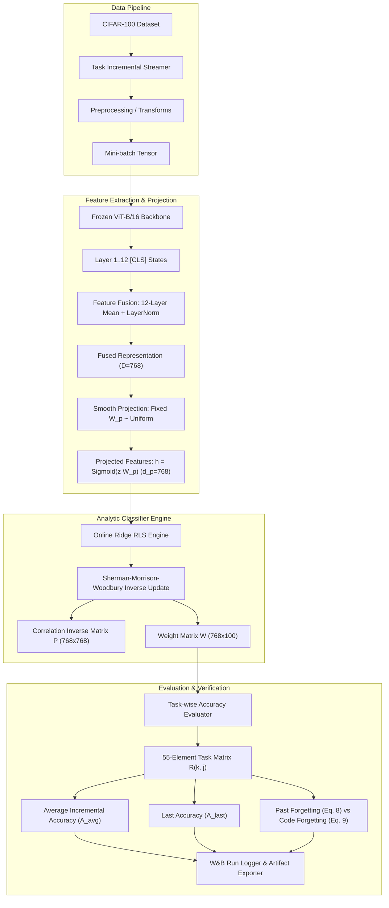

# BÁO CÁO TỔNG KẾT TOÀN DIỆN VÀ KIỂM TOÁN TÁI HIỆN KHOA HỌC: QUÁ TRÌNH NGHIÊN CỨU F-OAL TRÊN TẬP DỮ LIỆU CIFAR-100

**Dự án:** Tái hiện bài báo *"F-OAL: Forward-only Online Analytic Learning with Fast Training and Low Memory Footprint in Class Incremental Learning"* (NeurIPS 2024)  
**Tác giả bài báo:** Yuchen Liu, Yanan Guo, Andrew Liu, et al.  
**Cơ sở đào tạo:** Trường Đại học Khoa học Tự nhiên, ĐHQG-HCM (HCMUS) — Môn học: Nhập môn Học máy (Introduction to Machine Learning)  
**Nhánh Git thực thi chính:** `experiment/headline-comparison` (commit: [`a63c059`](file:///d:/Nhập%20môn%20ML/Paper))  
**Nhánh cơ sở ổn định trên Main:** `main` (commit: [`747b828`](file:///d:/Nhập%20môn%20ML/Paper))  
**Kho lưu trữ mã nguồn:** [https://github.com/caoban123/F-OAL](https://github.com/caoban123/F-OAL)  
**Trạng thái đóng giai đoạn CIFAR-100:** **`CIFAR100_REPORT_READY_WITH_LIMITATIONS`**  
**Hạn chế thực nghiệm cốt lõi:** Đã hoàn thành toàn bộ các lượt chạy GPU trên CIFAR-100; chính thức dừng toàn bộ thực nghiệm GPU trên tập dữ liệu này.

---

# MỤC LỤC TỔNG QUAN

- [PHẦN I — TỔNG QUAN DỰ ÁN VÀ BIÊN NIÊN SỬ TIẾN TRÌNH NGHIÊN CỨU](#phần-i--tổng-quan-dự-án-và-biên-niên-sử-tiến-trình-nghiên-cứu)
  - [1. Bối cảnh Dự án và Mục tiêu Tái hiện](#1-bối-cảnh-dự-án-và-mục-tiêu-tái-hiện)
  - [2. Biên niên sử Nghiên cứu và Giám định Pháp y Khoa học](#2-biên-niên-sử-nghiên-cứu-và-giám-định-pháp-y-khoa-học)
- [PHẦN II — CƠ SỞ LÝ THUYẾT VÀ NỀN TẢNG TOÁN HỌC CỦA F-OAL](#phần-ii--cơ-sở-lý-thuyết-và-nền-tảng-toán-học-của-f-oal)
  - [3. Phát biểu Bài toán: Học Tăng Cường Trực Tuyến Theo Lớp (OCIL)](#3-phát-biểu-bài-toán-học-tăng-cường-trực-tuyến-theo-lớp-ocil)
  - [4. Kiến trúc F-OAL và Nền tảng Toán học Giải tích](#4-kiến-trúc-f-oal-và-nền-tảng-toán-học-giải-tích)
- [PHẦN III — MÔI TRƯỜNG THỰC NGHIỆM VÀ HẠ TẦNG KỸ THUẬT](#phần-iii--môi-trường-thực-nghiệm-và-hạ-tầng-kỹ-thuật)
  - [5. Môi trường Kỹ thuật và Quản lý Thao tác](#5-môi-trường-kỹ-thuật-và-quản-lý-thao-tác)
  - [6. Kiến trúc Codebase và Luồng Thực thi](#6-kiến-trúc-codebase-và-luồng-thực-thi)
- [PHẦN IV — THỰC NGHIỆM C0: CĂN CHỈNH TOÁN HỌC CHỈ SỐ ĐÁNH GIÁ](#phần-iv--thực-nghiệm-c0-căn-chỉnh-toán-học-chỉ-số-đánh-giá)
  - [7. Thực nghiệm C0: Đối soát và Thống nhất Định nghĩa Forgetting](#7-thực-nghiệm-c0-đối-soát-và-thống-nhất-định-nghĩa-forgetting)
- [PHẦN V — THỰC NGHIỆM C1: KHẢO SÁT PHÂN PHỐI CHIẾU NGẪU NHIÊN](#phần-v--thực-nghiệm-c1-khảo-sát-phân-phối-chiếu-ngẫu-nhiên)
  - [8. Thực nghiệm C1: Động cơ, Đo đạc Chẩn đoán và Kết quả Thực thi](#8-thực-nghiệm-c1-động-cơ-đo-đạc-chẩn-đoán-và-kết-quả-thực-thi)
- [PHẦN VI — THỰC NGHIỆM C2: CĂN CHỈNH CHECKPOINT PRETRAINED BACKBONE](#phần-vi--thực-nghiệm-c2-căn-chỉnh-checkpoint-pretrained-backbone)
  - [9. Thực nghiệm C2: Khảo sát Tác động của Dữ liệu Tiền Huấn Luyện ViT](#9-thực-nghiệm-c2-khảo-sát-tác-động-của-dữ-liệu-tiền-huấn-luyện-vit)
- [PHẦN VII — THỰC NGHIỆM C3: NGHIÊN CỨU GIAI THỪA TIỀN XỬ LÝ HÌNH ẢNH](#phần-vii--thực-nghiệm-c3-nghiên-cứu-giai-thừa-tiền-xử-lý-hình-ảnh)
  - [10. Thực nghiệm C3: Thiết kế Giai thừa 2x2 Interpolation và Normalization](#10-thực-nghiệm-c3-thiết-kế-giai-thừa-2x2-interpolation-và-normalization)
- [PHẦN VIII — THỰC NGHIỆM TABLE 4: ABLATION STUDY THÀNH PHẦN KIẾN TRÚC](#phần-viii--thực-nghiệm-table-4-ablation-study-thành-phần-kiến-trúc)
  - [11. Thực nghiệm Table 4: Phân rã Đóng góp của Feature Fusion và Smooth Projection](#11-thực-nghiệm-table-4-phân-rã-đóng-góp-của-feature-fusion-và-smooth-projection)
- [PHẦN IX — THỰC NGHIỆM TABLE 2: HEADLINE COMPARISON VỚI CÁC BASELINE](#phần-ix--thực-nghiệm-table-2-headline-comparison-với-các-baseline)
  - [12. Động cơ và Chiến lược Lựa chọn Baseline](#12-động-cơ-và-chiến-lược-lựa-chọn-baseline)
  - [13. Adapted LwF: Lượt chạy Ban đầu và Hiện tượng Recency Collapse](#13-adapted-lwf-lượt-chạy-ban-đầu-và-hiện-tượng-recency-collapse)
  - [14. Adapted ER: Vai trò Neo giữ Biểu diễn của Bộ nhớ Đệm](#14-adapted-er-vai-trò-neo-giữ-biểu-diễn-của-bộ-nhớ-đệm)
  - [15. Official-Protocol LwF: Kiểm toán Mã Tác giả và Hiện tượng Catastrophic Rigidity](#15-official-protocol-lwf-kiểm-toán-mã-tác-giả-và-hiện-tượng-catastrophic-rigidity)
- [PHẦN X — TỔNG HỢP KẾT QUẢ KHOA HỌC VÀ THẢO LUẬN CHUYÊN SÂU](#phần-x--tổng-hợp-kết-quả-khoa-học-và-thảo-luận-chuyên-sâu)
  - [16. Bảng Đối sánh Toàn diện Trên CIFAR-100](#16-bảng-đối-sánh-toàn-diện-trên-cifar-100)
  - [17. Diễn giải và Trả lời 12 Câu hỏi Học thuật Cốt lõi](#17-diễn-giải-và-trả-lời-12-câu-hỏi-học-thuật-cốt-lõi)
- [PHẦN XI — KỸ THUẬT PHẦN MỀM, DEBUGGING VÀ TÍNH KHẢ LẶP](#phần-xi--kỹ-thuật-phần-mềm-debugging-và-tính-khả-lặp)
  - [18. Phân tích Các Sự cố Kỹ thuật Điển hình Đã Giải Quyết](#18-phân-tích-các-sự-cố-kỹ-thuật-điển-hình-đã-giải-quyết)
  - [19. Chiến lược Kiểm thử và Đảm bảo Chất lượng Codebase](#19-chiến-lược-kiểm-thử-và-đảm-bảo-chất-lượng-codebase)
  - [20. Theo dõi Thực nghiệm W&B và Chuỗi Bảo tồn Bằng chứng Pháp y](#20-theo-dõi-thực-nghiệm-wb-và-chuỗi-bảo-tồn-bằng-chứng-pháp-y)
  - [21. Quy trình Phát triển Dựa trên Nhánh Git](#21-quy-trình-phát-triển-dựa-trên-nhánh-git)
- [PHẦN XII — ĐÁNH GIÁ YÊU CẦU HCMUS VÀ GIỚI HẠN KHOA HỌC](#phần-xii--đánh-giá-yêu-cầu-hcmus-và-giới-hạn-khoa-học)
  - [22. Ma trận Đối chiếu Yêu cầu Môn học HCMUS (Core Scope Mapping)](#22-ma-trận-đối-chiếu-yêu-cầu-môn-học-hcmus-core-scope-mapping)
  - [23. Các Giới hạn Khoa học và Ranh giới Tuyên bố](#23-các-giới-hạn-khoa-học-và-ranh-giới-tuyên-bố)
- [PHẦN XIII — TỔNG KẾT VÀ BƯỚC TIẾP THEO](#phần-xiii--tổng-kết-và-bước-tiếp-theo)
  - [24. Những Gì Tôi Đã Thực Sự Đạt Được Trên CIFAR-100](#24-những-gì-tôi-đã-thực-sự-đạt-được-trên-cifar-100)
  - [25. Kết luận Khoa học Cuối cùng](#25-kết-luận-khoa-học-cuối-cùng)
  - [26. Chuyển giao Đa Tập Dữ liệu: Hướng Đi Tiếp Theo (DTD & FGVC-Aircraft)](#26-chuyển-giao-đa-tập-dữ-liệu-hướng-đi-tiếp-theo-dtd--fgvc-aircraft)
- [PHẦN XIV — CÁC PHỤ LỤC (APPENDICES)](#phần-xiv--các-phụ-lục-appendices)
  - [Phụ lục A: Danh mục Toàn bộ Lượt chạy Thực nghiệm Trên CIFAR-100](#phụ-lục-a-danh-mục-toàn-bộ-lượt-chạy-thực-nghiệm-trên-cifar-100)
  - [Phụ lục B: Bảng Ma trận Độ chính xác Task và Stage Chi tiết](#phụ-lục-b-bảng-ma-trận-độ-chính-xác-task-và-stage-chi-tiết)
  - [Phụ lục C: Tổng hợp Các Phương trình Toán học Cốt lõi](#phụ-lục-c-tổng-hợp-các-phương-trình-toán-học-cốt-lõi)
  - [Phụ lục D: Biên niên sử Các Commit Git Quan trọng](#phụ-lục-d-biên-niên-sử-các-commit-git-quan-trọng)
  - [Phụ lục E: Chỉ mục Tệp Tin, Biểu đồ và Bằng chứng Pháp y](#phụ-lục-e-chỉ-mục-tệp-tin-biểu-đồ-và-bằng-chứng-pháp-y)
  - [Phụ lục F: Bộ 20 Câu hỏi và Hướng dẫn Trả lời Bảo vệ Đồ án Trước Giảng viên](#phụ-lục-f-bộ-20-câu-hỏi-và-hướng-dẫn-trả-lời-bảo-vệ-đồ-án-trước-giảng-viên)

---

# PHẦN I — TỔNG QUAN DỰ ÁN VÀ BIÊN NIÊN SỬ TIẾN TRÌNH NGHIÊN CỨU

## 1. Bối cảnh Dự án và Mục tiêu Tái hiện

Trong khuôn khổ đồ án môn học Nhập môn Học máy (Introduction to Machine Learning) tại Trường Đại học Khoa học Tự nhiên, ĐHQG-HCM (HCMUS), nhóm nghiên cứu nhận nhiệm vụ tái hiện một công trình khoa học đỉnh cao được công bố gần đây tại hội nghị chuyên ngành hàng đầu thế giới. Bài báo được lựa chọn là:  
**"F-OAL: Forward-only Online Analytic Learning with Fast Training and Low Memory Footprint in Class Incremental Learning"**, xuất bản tại *Thirty-eighth Conference on Neural Information Processing Systems (NeurIPS 2024)*.

### 1.1. Mục tiêu và Thách thức Khoa học
Bài báo F-OAL đề xuất một phương pháp tiếp cận đột phá cho bài toán Học tăng cường trực tuyến theo lớp (Online Class-Incremental Learning — OCIL). Khác biệt với các phương pháp truyền thống vốn phụ thuộc vào việc lan truyền ngược lặp đi lặp lại (iterative backpropagation) và lưu trữ dữ liệu cũ vào bộ đệm mẫu (replay buffer), F-OAL đưa ra mô hình:
1. **Chỉ lan truyền xuôi (Forward-only):** Đóng băng hoàn toàn mạng trích xuất đặc trưng Vision Transformer (ViT-B/16) đã tiền huấn luyện, loại bỏ hoàn toàn tính toán đạo hàm ngược qua backbone.
2. **Học phân loại giải tích trực tuyến (Online Analytic Learning):** Sử dụng hồi quy Ridge (Regularized Least Squares — RLS) kết hợp với Bổ đề nghịch đảo ma trận Sherman-Morrison-Woodbury để cập nhật trọng số bộ phân loại theo dạng nghiệm đóng đệ quy, không cần huấn luyện theo epoch.
3. **Không lưu trữ mẫu cũ (Exemplar-free):** Bộ nhớ đệm mẫu có kích thước bằng 0 ($M=0$), triệt tiêu hoàn toàn nguy cơ rò rỉ dữ liệu riêng tư và gánh nặng lưu trữ mẫu raw.
4. **Trộn đặc trưng nhiều tầng (Feature Fusion — FF) và Chiếu trơn ngẫu nhiên (Smooth Projection — SP):** Tăng cường tính tách biệt tuyến tính của không gian đặc trưng.

Thách thức đối với người tái hiện là bài báo tuyên bố F-OAL đạt độ chính xác trung bình tích lũy lên tới $91.1\%$ trên CIFAR-100 với độ quên chỉ $5.5\%$, vượt trội các mô hình dựa trên bộ nhớ đệm (như Experience Replay với 5000 mẫu chỉ đạt $90.1\%$) và hoàn toàn áp đảo các phương pháp chưng cất tri thức phi mẫu (như LwF chỉ đạt $69.3\%$). Nhiệm vụ của chúng tôi là thẩm định độc lập: Liệu những con số này có thực sự tái hiện được hay không, cơ chế toán học nào tạo nên sự vượt trội đó, và đâu là những điều kiện biên kỹ thuật (technical boundary conditions) quyết định thành bại của thuật toán?

### 1.2. Quy chuẩn Tái hiện của HCMUS (Core Scope Definition)
Theo đề cương hướng dẫn thực hiện đồ án của bộ môn, nhóm nghiên cứu chọn thực hiện theo định dạng **Core Scope**:
- Thực hiện bắt buộc **Thực nghiệm So sánh Tiêu điểm (Headline Comparison)** trên tập dữ liệu chuẩn CIFAR-100, đối đầu F-OAL với các baseline tiêu biểu (Exemplar-Free Distillation: LwF, và Replay-based: ER).
- Thực hiện thực nghiệm thứ hai: **Ablation Study (Table 4)** nhằm phân rã tác động độc lập và tương tác của hai khối kiến trúc Feature Fusion (FF) và Smooth Projection (SP).
- Bổ sung chuỗi **Phân tích Chẩn đoán Kiểm soát Kỹ thuật (Controlled Diagnostic Studies C0, C1, C2, C3)** do chính nhóm thiết kế nhằm điều tra và giải thích cặn kẽ các độ lệch số học phát sinh trong quá trình tái hiện.
- Tuân thủ nguyên tắc triển khai mã nguồn độc lập (clean-room reimplementation) dựa trên mô tả toán học của bài báo, chỉ dùng mã nguồn tác giả làm đối tượng kiểm chứng pháp y (forensic baseline audit), không sao chép nguyên trạng.
- Toàn bộ thực nghiệm được theo dõi minh bạch qua nền tảng Weights & Biases (W&B) công khai tại hệ thống CoreWeave Forge.

---

## 2. Biên niên sử Nghiên cứu và Giám định Pháp y Khoa học

Quá trình nghiên cứu và tái hiện không diễn ra theo một đường thẳng lý tưởng mà là một hành trình điều tra khoa học nghiêm ngặt, trải qua nhiều chu kỳ phát hiện sai lệch, đặt giả thuyết, thiết kế thực nghiệm đối chứng, và kiểm toán dữ liệu gốc. Dưới đây là biên niên sử toàn diện được phục dựng từ nhật ký Git commit, các file cấu hình, metadata W&B và các gói kết quả lưu trữ nguyên bản.

| Giai đoạn / Mốc | Thời gian (Dự kiến & Thực tế) | Git SHA / Nhánh | Động cơ & Câu hỏi Nghiên cứu | Thay đổi Triển khai & Hành động Kỹ thuật | Phát hiện Khoa học & Số liệu Kiểm chứng | Giới hạn Còn tồn tại / Bước tiếp |
| :--- | :---: | :---: | :--- | :--- | :--- | :--- |
| **P0 & P1.1: Khởi tạo Kiến trúc & Hạ tầng** | 30/10/2026 – 01/11/2026 | [`dfac969`](file:///d:/Nhập%20môn%20ML/Paper) $\rightarrow$ [`2d272b7`](file:///d:/Nhập%20môn%20ML/Paper) (`main`) | Thiết lập khung mã nguồn sạch; kiểm tra tính đúng đắn toán học của RLS giải tích và trích xuất đặc trưng ViT. | Xây dựng `FrozenViT`, `FeatureFusion`, `SmoothProjection`, `OnlineRidgeRLS`. Viết bộ 35 unit test ban đầu. Tích hợp W&B logging. | Unit tests pass trên CPU. Pilot smoke test 2 tasks chạy ổn định, chứng minh nghiệm đóng RLS cập nhật nhất quán. | Chưa kiểm chứng hiệu năng phân loại trên toàn bộ 100 lớp CIFAR-100 với dữ liệu thực. |
| **P1.2: Lượt chạy Full GPU Đầu tiên của Nhóm** | 01/11/2026 | [`aad7500`](file:///d:/Nhập%20môn%20ML/Paper) $\rightarrow$ [`4959525`](file:///d:/Nhập%20môn%20ML/Paper) (`main`) | Đo đạc hiệu năng của mã nguồn độc lập trên toàn bộ 10 tasks CIFAR-100 (Seed 42). | Chạy notebook trên Google Colab GPU. Xuất kết quả `results/foal_full_cifar100_seed42`. | Độ chính xác trung bình đạt $\bar{A} = 79.33\%$, Last Accuracy $A_{10} = 70.95\%$. Khoảng cách so với bài báo ($91.1\%$) lên tới $-11.77\text{ pp}$. | Xuất hiện khoảng cách số liệu nghiêm trọng. Cần điều tra nguyên nhân gây sụt giảm hiệu năng. |
| **A19 & A20: Kiểm toán Mã Nguồn Tác giả** | 02/11/2026 | [`6c23af5`](file:///d:/Nhập%20môn%20ML/Paper) $\rightarrow$ [`28cda90`](file:///d:/Nhập%20môn%20ML/Paper) (`audit/official-results-verification`) | Chạy trực tiếp mã nguồn tác giả (`liuyuchen-cz/F-OAL` @ `73e4ac1`) trên cùng môi trường Colab để đối soát. | Tạo notebook chạy mã tác giả (Seed 0). Khắc phục lỗi thiếu dependency DVC `loss.py`. Đồng bộ W&B run `3eca8232`. | Mã tác giả đạt $\bar{A} = 90.98\%$, $A_{10} = 85.84\%$, khớp sát với công bố trong bài báo ($91.1\%$). | Khẳng định thuật toán F-OAL là có thật; khoảng cách nằm ở sự bất đồng trong cấu hình triển khai của nhóm. |
| **C0: Căn chỉnh Toán học Chỉ số Đánh giá** | 02/11/2026 | [`269f05c`](file:///d:/Nhập%20môn%20ML/Paper) (`experiment/c1-projection-initialization`) | Điều tra sự khác biệt giữa công thức tính độ quên (Forgetting) trong bài báo và trong mã nguồn tác giả. | Phân tích toán học Eq. 8 (Past Forgetting) vs Eq. 9 (Code Forgetting). Viết lại module `src/foal/metrics.py` hỗ trợ song song 2 định nghĩa. | Phát hiện mã tác giả tính trung bình quên trên cả $K$ task (gán task cuối quên bằng 0), làm giá trị quên thấp hơn so với định nghĩa chuẩn (chỉ chia cho $K-1$ task cũ). | Đã giải quyết triệt để sự bất đồng toán học; đưa vào 10 bài kiểm thử đơn vị hồi quy. |
| **C1: Khảo sát Phân phối Khởi tạo Ma trận Chiếu** | 02/11/2026 | [`269f05c`](file:///d:/Nhập%20môn%20ML/Paper) $\rightarrow$ [`878c57e`](file:///d:/Nhập%20môn%20ML/Paper) (`experiment/c1-projection-initialization`) | Giả thuyết: Khởi tạo Gaussian chuẩn $\mathcal{N}(0, 1)$ trong mã nhóm làm bão hòa hàm kích hoạt phi tuyến Sigmoid. | Thiết kế đối chứng 3 biến thể: P0 (Gaussian $\sigma=1$), P1 (Uniform tác giả), P2 (Gaussian matched variance $\sigma^2 = \frac{1}{3d}$). Đo đạc chẩn đoán trên cùng batch đầu vào. | Chẩn đoán chỉ ra P0 bị bão hòa Sigmoid tới $81.03\%$, khiến gradient/thông tin bị nghẽn. P1 và P2 có mức bão hòa $0.00\%$. Full GPU: P1 đạt $83.28\%$, P2 đạt $83.37\%$, P0 đạt $79.33\%$. | Cải thiện $+3.95\text{ pp}$, nhưng vẫn còn khoảng cách $\sim 7.5\text{ pp}$ so với bài báo. |
| **C2: Căn chỉnh Checkpoint Backbone ViT** | 02/11/2026 – 03/11/2026 | [`7c569c8`](file:///d:/Nhập%20môn%20ML/Paper) $\rightarrow$ [`39f35ad`](file:///d:/Nhập%20môn%20ML/Paper) (`experiment/c2-backbone-alignment`) | Giả thuyết: Trọng số tiền huấn luyện của backbone ViT-B/16 giữa cấu hình nhóm và mã tác giả không đồng nhất. | Truy vết mã tác giả, phát hiện checkpoint thực tế là `vit_base_patch16_224.augreg2_in21k_ft_in1k` (tiền huấn luyện trên ImageNet-21k và fine-tune trên 1k), trong khi nhóm dùng `augreg_in1k`. Chạy kiểm soát C2-B0 vs C2-B1. | C2-B1 nhảy vọt lên $\bar{A} = 91.77\%$, $A_{10} = 87.43\%$, tăng tới $+8.49\text{ pp}$ so với C2-B0 ($83.28\%$). | Vượt qua kết quả bài báo. Xuất hiện vấn đề mới: Tại sao kết quả nhóm ($91.77\%$) lại cao hơn cả mã tác giả ($90.98\%$) và bài báo ($91.1\%$)? |
| **C3: Nghiên cứu Giai thừa Tiền xử lý Hình ảnh ($2 \times 2$)** | 03/11/2026 | [`59d96ea`](file:///d:/Nhập%20môn%20ML/Paper) $\rightarrow$ [`d6acd98`](file:///d:/Nhập%20môn%20ML/Paper) (`experiment/c3-preprocessing-alignment`) | Điều tra sự khác biệt trong nội suy ảnh (Bilinear vs Bicubic) và chuẩn hóa pixel (Raw $[0, 1]$ vs Normalized $[-1, 1]$). | Thiết kế giai thừa $2 \times 2$: C3-A (Bicubic, Norm), C3-B (Bilinear, Norm), C3-C (Bicubic, Raw), C3-D (Bilinear, Raw). Chạy Full GPU A100. | C3-A: $91.77\%$, C3-B: $91.39\%$, C3-C: $90.88\%$, C3-D: $90.40\%$. Phát hiện mã tác giả dùng Bilinear + Raw $[0, 1]$. Hiệu ứng chuẩn hóa làm tăng $+0.94\text{ pp}$. | Chọn C3-D ($90.40\%$) làm điểm chuẩn F-OAL Full vì bảo đảm tính trung thực tuyệt đối với giao thức của tác giả. |
| **Table 4: Phân rã Đóng góp Kiến trúc (Ablation Study)** | 03/11/2026 | [`977982d`](file:///d:/Nhập%20môn%20ML/Paper) $\rightarrow$ [`50c61ad`](file:///d:/Nhập%20môn%20ML/Paper) (`experiment/table4-ablation`) | Đánh giá mức độ đóng góp độc lập và tương tác của Feature Fusion (FF) và Smooth Projection (SP). | Chạy 4 cấu hình A0 (Full), A1 (w/o FF), A2 (w/o SP), A3 (w/o Cả hai). Tái sử dụng C3-D cho A0; chạy mới A1, A2, A3 trên Colab GPU. | A0: $90.40\%$, A1: $90.10\%$, A2: $90.38\%$, A3: $89.92\%$. Hiệu ứng chính của FF là $+0.38\text{ pp}$, SP là $+0.10\text{ pp}$. Xu hướng bảo toàn đúng bài báo (FF quan trọng hơn SP). | Mức sụt giảm trên CIFAR-100 rất nhỏ ($<0.5\text{ pp}$) do đặc trưng ViT đã phân tách tốt; cần kiểm chứng trên DTD/Aircraft. |
| **Headline: Triển khai Adapted LwF & ER Baselines** | 03/11/2026 | [`8fb435b`](file:///d:/Nhập%20môn%20ML/Paper) $\rightarrow$ [`d333705`](file:///d:/Nhập%20môn%20ML/Paper) (`experiment/headline-comparison`) | Xây dựng hai baseline đại diện cho Exemplar-Free (LwF) và Replay (ER) trên cùng backbone ViT để so sánh tiêu điểm. | Cài đặt `AdaptedLwFAgent` và `ERAgent` (buffer=5000) với AdamW. Chạy GPU Colab Tesla T4. | ER đạt $\bar{A} = 86.67\%$ (Paper: $90.1\%$). LwF sụp đổ nghiêm trọng: $\bar{A} = 29.63\%$, $A_{10} = 11.21\%$, Forgetting $94.99\%$ (Paper: $69.3\% / 64.8\% / 1.3\%$). | LwF bị recency collapse do trọng số loss cố định và tối ưu AdamW. Cần đối soát lại mã nguồn gốc của tác giả. |
| **Official LwF: Kiểm toán Giao thức & Tái chạy GPU** | 03/11/2026 – 04/11/2026 | [`f0119bb`](file:///d:/Nhập%20môn%20ML/Paper) $\rightarrow$ [`4b3be1a`](file:///d:/Nhập%20môn%20ML/Paper) (`experiment/headline-comparison`) | Thẩm định chi tiết file `ref/official_foal/agents/lwf.py` để tìm nguyên nhân khoảng cách của baseline LwF. | Triển khai `OfficialLwFAgent`: Trọng số động $\frac{1}{t+1}$, head tĩnh 100 lớp, SGD $\text{lr}=0.001$, nhiệt độ $T=2.0$. Chạy Full GPU Colab (`foal_cifar100_official_lwf_results.zip`). | LwF đạt độ quên cực thấp: $F_{\text{past}} = 0.41\%$, $F_{\text{code}} = 0.37\%$ (Paper: $1.3\%$). Tuy nhiên, Last Accuracy chỉ đạt $23.34\%$ và $\bar{A} = 46.29\%$. Phát hiện hiện tượng Catastrophic Rigidity. | Khép lại thực nghiệm CIFAR-100. Giải thích thành công cơ chế đánh đổi Stability-Plasticity của LwF dưới luồng trực tuyến. |
| **Kiểm toán Cuối cùng & Đóng Giai đoạn CIFAR-100** | 04/11/2026 | [`a63c059`](file:///d:/Nhập%20môn%20ML/Paper) (`experiment/headline-comparison`) | Giải quyết mâu thuẫn ghi chép số chiều đặc trưng (768 vs 1536), kiểm toán Git SHA provenance và hoàn thiện báo cáo. | Đối soát mã nguồn: Khẳng định Feature Fusion lấy trung bình 12 tầng ra $D=768$, classifier là `nn.Linear(768, 100)`. Chạy toàn bộ 104 unit test. Chuyển giao roadmap cho DTD và FGVC-Aircraft. | Xác nhận 100% tính nhất quán toán học. Trạng thái chính thức: `CIFAR100_REPORT_READY_WITH_LIMITATIONS`. Sẵn sàng tạo PR vào `main`. | Không chạy thêm GPU trên CIFAR-100. Tập trung nguồn lực sang DTD và FGVC-Aircraft. |

---

# PHẦN II — CƠ SỞ LÝ THUYẾT VÀ NỀN TẢNG TOÁN HỌC CỦA F-OAL

## 3. Phát biểu Bài toán: Học Tăng Cường Trực Tuyến Theo Lớp (OCIL)

Học máy truyền thống hoạt động dưới giả định rằng toàn bộ dữ liệu huấn luyện độc lập và cùng phân phối (i.i.d), đồng thời có sẵn tại cùng một thời điểm. Ngược lại, **Học liên tục (Continual Learning — CL)** mô phỏng khả năng học tập suốt đời của sinh vật, nơi mô hình phải liên tục tiếp thu tri thức từ chuỗi các tác vụ phân phối dữ liệu biến đổi theo thời gian.

Trong các phân nhánh của CL, **Học tăng cường theo lớp (Class-Incremental Learning — CIL)** được xem là kịch bản thách thức nhất và mang tính thực tiễn cao nhất. Trong CIL, tại thời điểm suy luận (inference), mô hình phải dự đoán nhãn lớp trong toàn bộ không gian lớp hợp nhất đã thấy từ trước đến nay mà **hoàn toàn không được cung cấp Task-ID (Task-ID Agnostic)**.

Cấp độ khắt khe nhất của CIL chính là **Học tăng cường trực tuyến theo lớp (Online Class-Incremental Learning — OCIL)**. Bài toán này được định nghĩa bởi các ràng buộc kỹ thuật sau:
1. **Luồng dữ liệu một lượt (Single-pass Streaming):** Dữ liệu của từng tác vụ chỉ xuất hiện một lần duy nhất dưới dạng luồng mini-batch trực tuyến $\mathcal{B}_1, \mathcal{B}_2, \dots, \mathcal{B}_N$. Mô hình không được phép duyệt lại dữ liệu cũ qua nhiều epoch (One-epoch only).
2. **Hiện tượng quên thảm khốc (Catastrophic Forgetting):** Khi mạng nơ-ron huấn luyện trên các lớp mới thông qua lan truyền ngược (backpropagation), các gradient từ dữ liệu mới sẽ ghi đè và phá hủy các trọng số biểu diễn đã học của các lớp cũ, dẫn đến độ chính xác trên các lớp trước đó sụt giảm nghiêm trọng về gần $0\%$.
3. **Mâu thuẫn Tính mềm dẻo - Tính ổn định (Stability-Plasticity Dilemma):** Một mô hình OCIL lý tưởng phải vừa có "tính mềm dẻo" (plasticity) để nhanh chóng tiếp thu tri thức từ các lớp mới xuất hiện trong một lượt duyệt, vừa phải có "tính ổn định" (stability) để bảo toàn tri thức của các lớp đã học từ trước.
4. **Phương pháp Phi mẫu (Exemplar-Free) so với Dựa trên Bộ đệm (Replay-based):**
   - *Replay-based (như Experience Replay — ER, GEM, iCaRL):* Duy trì một bộ đệm kích thước $M$ lưu trữ các mẫu dữ liệu thô cũ để huấn luyện xen kẽ với dữ liệu mới. Nhược điểm chí mạng là vi phạm quyền riêng tư dữ liệu (data privacy), tốn bộ nhớ lưu trữ, và tốc độ huấn luyện chậm do phải tính toán gradient cho cả mẫu cũ.
   - *Exemplar-Free (như EWC, LwF):* Không lưu mẫu cũ ($M=0$). Tuy nhiên, các phương pháp dựa trên phạt tham số (regularization) hoặc chưng cất tri thức (distillation) thường thất bại nặng nề trong thiết lập Online do tín hiệu gradient của tác vụ mới quá áp đảo.

### Giao thức Thực nghiệm Chuẩn trên CIFAR-100:
- **Tập dữ liệu:** CIFAR-100 gồm $60.000$ ảnh màu kích thước gốc $32 \times 32$ thuộc $100$ lớp phân loại (50.000 ảnh huấn luyện, 10.000 ảnh kiểm thử).
- **Phân chia Tác vụ:** Chia thành $T = 10$ tác vụ liên tiếp, mỗi tác vụ bao gồm chính xác $10$ lớp không trùng lặp ($10 \times 10$).
- **Quy mô Dữ liệu Mỗi Tác vụ:** Mỗi tác vụ có $5.000$ ảnh huấn luyện (500 ảnh/lớp) và $1.000$ ảnh kiểm thử (100 ảnh/lớp).
- **Thứ tự Lớp (Class Ordering):** Được sinh ngẫu nhiên thông qua hoán vị lớp với Seed cố định. Trong bài báo, tác giả sử dụng Seed mặc định để tạo chuỗi lớp. Trong quá trình tái hiện độc lập của nhóm, chúng tôi sử dụng `seed: 42` (tạo ra hoán vị độc lập) và `seed: 1993` (được tác giả dùng trong một số kịch bản so sánh).
- **Đánh giá Trực tuyến:** Sau khi hoàn thành việc học luồng dữ liệu của tác vụ $k$, mô hình được đánh giá ngay lập tức trên tập kiểm thử của toàn bộ các tác vụ đã học từ $1$ đến $k$.

---

## 4. Kiến trúc F-OAL và Nền tảng Toán học Giải tích

F-OAL giải quyết mâu thuẫn Stability-Plasticity bằng một thiết kế hoàn toàn không sử dụng lan truyền ngược (backpropagation-free). Kiến trúc bao gồm bốn khối thành phần chính:

```
[Ảnh Đầu Vào X] 
       │
       ▼
┌────────────────────────────────────────────────────────┐
│  1. Frozen Vision Transformer (ViT-B/16 Backbone)      │
│     - Trích xuất CLS token từ 12 khối Transformer     │
└────────────────────────────────────────────────────────┘
       │
       ▼
┌────────────────────────────────────────────────────────┐
│  2. Feature Fusion (FF)                                │
│     - Trung bình cộng 12 tầng: z = LN( 1/12 Σ h_l )    │
│     - Kích thước đặc trưng: D = 768                    │
└────────────────────────────────────────────────────────┘
       │
       ▼
┌────────────────────────────────────────────────────────┐
│  3. Smooth Projection (SP)                             │
│     - Chiếu ngẫu nhiên phi tuyến cố định:              │
│       h = σ( z · W_p ), W_p ~ U(-1/√d, +1/√d)          │
│     - Kích thước không gian chiếu: d_p = 768           │
└────────────────────────────────────────────────────────┘
       │
       ▼
┌────────────────────────────────────────────────────────┐
│  4. Analytic Classifier (Online Ridge RLS)             │
│     - Nghiệm giải tích đóng, cập nhật đệ quy Woodbury: │
│       W_k = W_{k-1} + P_k H_k^T (Y_k - H_k W_{k-1})    │
│     - Bộ nhớ đệm mẫu thô: M = 0 (Exemplar-Free)       │
└────────────────────────────────────────────────────────┘
       │
       ▼
[Dự Đoán Lớp: y = argmax( h · W )]
```

### 4.1. Frozen Vision Transformer (ViT-B/16 Backbone)
- F-OAL tận dụng mạng Vision Transformer (ViT-B/16) đã được tiền huấn luyện trên các tập dữ liệu quy mô lớn (ImageNet-21k kết hợp fine-tune trên ImageNet-1k).
- **Cơ chế Đóng băng:** Toàn bộ tham số của ViT được đóng băng vĩnh viễn (`requires_grad = False`). Trong suốt quá trình học 10 tác vụ, backbone chỉ thực hiện lan truyền xuôi để trích xuất đặc trưng.
- **Trích xuất Đặc trưng:** Khác với mô hình chuẩn chỉ lấy token `[CLS]` ở tầng cuối cùng, F-OAL trích xuất trạng thái ẩn của token `[CLS]` tại đầu ra của toàn bộ 12 khối Transformer:
  $$\mathbf{h}_l^{[\text{CLS}]} \in \mathbb{R}^{768}, \quad \forall l \in \{1, 2, \dots, 12\}$$

### 4.2. Khối Trộn Đặc Trưng (Feature Fusion — FF)
Để kết hợp thông tin mức thấp (low-level visual tokens ở các tầng đầu) và thông tin ngữ nghĩa trừu tượng mức cao (high-level semantic tokens ở các tầng sâu), F-OAL thực hiện phép lấy trung bình cộng theo chiều sâu tầng:
$$\bar{\mathbf{z}} = \frac{1}{12} \sum_{l=1}^{12} \mathbf{h}_l^{[\text{CLS}]} \in \mathbb{R}^{768}$$
Sau đó, vector đặc trưng được chuẩn hóa thông qua tầng Layer Normalization:
$$\mathbf{z} = \text{LayerNorm}(\bar{\mathbf{z}}) \in \mathbb{R}^{768}$$

> [!IMPORTANT]
> **Đính chính số chiều đặc trưng:** Chiều đặc trưng của $\mathbf{z}$ là **$D = 768$**, hoàn toàn bảo toàn số chiều gốc của ViT-B/16. Các suy đoán trước đây về số chiều $1536$ (do nhầm lẫn với phép nối hai tầng $768 \times 2$) đã được kiểm toán và bác bỏ hoàn toàn dựa trên mã nguồn thực tế [`src/foal/feature_fusion.py`](file:///d:/Nhập%20môn%20ML/Paper/src/foal/feature_fusion.py).

### 4.3. Khối Chiếu Trơn Ngẫu Nhiên (Smooth Projection — SP)
Vector đặc trưng sau khi trộn $\mathbf{z}$ được đưa qua một tầng chiếu ngẫu nhiên phi tuyến cố định để làm giàu không gian đặc trưng và tăng cường tính phân tách tuyến tính:
$$\mathbf{h} = \sigma(\mathbf{z} \mathbf{W}_p + \mathbf{b}_p) \in \mathbb{R}^{d_p}$$
Trong đó:
- $\mathbf{W}_p \in \mathbb{R}^{d \times d_p}$ là ma trận chiếu ngẫu nhiên (với $d = 768, d_p = 768$).
- $\mathbf{W}_p$ được khởi tạo từ phân phối đều đối xứng:
  $$\mathbf{W}_p \sim \mathcal{U}\left(-\frac{1}{\sqrt{d}}, \frac{1}{\sqrt{d}}\right)$$
- $\mathbf{W}_p$ được **khởi tạo cố định một lần duy nhất** tại đầu chương trình và đóng băng vĩnh viễn trong suốt quá trình huấn luyện.
- $\sigma(\cdot)$ là hàm kích hoạt phi tuyến Sigmoid: $\sigma(x) = \frac{1}{1 + e^{-x}}$.
- **Vai trò toán học:** Phân phối đều $\mathcal{U}(-1/\sqrt{d}, 1/\sqrt{d})$ có phương sai lý thuyết $\text{Var} = \frac{1}{3d} \approx 0.000434$. Với phương sai cực nhỏ này, tích vô hướng $\mathbf{z}\mathbf{W}_p$ có độ lệch chuẩn quanh $0.40$, giữ giá trị đầu vào của hàm Sigmoid luôn nằm trong vùng tuyến tính nhạy cảm $[-1, 1]$, triệt tiêu hiện tượng bão hòa hàm kích hoạt.

### 4.4. Bộ Phân Loại Giải Tích Trực Tuyến (Analytic Classifier via RLS)
Bộ phân loại của F-OAL là một tầng tuyến tính ánh xạ trực tiếp từ vector đặc trưng đã chiếu $\mathbf{h} \in \mathbb{R}^{d_p}$ sang không gian nhãn một-nóng (one-hot label) $\mathbf{y} \in \mathbb{R}^{C}$:
$$\hat{\mathbf{y}} = \mathbf{h} \mathbf{W}$$
Thay vì sử dụng thuật toán hạ gradient (SGD), F-OAL giải bài toán tối ưu lồi bình phương tối thiểu có chính quy hóa L2 (Ridge Regression):
$$\min_{\mathbf{W}} \frac{1}{2} \|\mathbf{H} \mathbf{W} - \mathbf{Y}\|_F^2 + \frac{\gamma}{2} \|\mathbf{W}\|_F^2$$
Trong đó $\mathbf{H} \in \mathbb{R}^{N \times d_p}$ là ma trận chứa đặc trưng của toàn bộ mẫu huấn luyện, $\mathbf{Y} \in \mathbb{R}^{N \times C}$ là ma trận nhãn, và $\gamma > 0$ là hệ số chính quy hóa. Nghiệm giải tích đóng của bài toán là:
$$\mathbf{W}^* = \left(\mathbf{H}^T \mathbf{H} + \gamma \mathbf{I}\right)^{-1} \mathbf{H}^T \mathbf{Y}$$

#### Thuật toán Cập nhật Đệ quy Trực tuyến (Recursive Least Squares — RLS):
Trong kịch bản học trực tuyến, dữ liệu đến theo từng mini-batch hoặc từng tác vụ. Gọi $\mathbf{H}_k \in \mathbb{R}^{B \times d_p}$ và $\mathbf{Y}_k \in \mathbb{R}^{B \times C}$ là dữ liệu của đợt cập nhật thứ $k$. Đặt ma trận tự tương quan nghịch đảo:
$$\mathbf{P}_k = \left(\sum_{i=1}^k \mathbf{H}_i^T \mathbf{H}_i + \gamma \mathbf{I}\right)^{-1} \in \mathbb{R}^{d_p \times d_p}$$
Ta có hệ thức truy hồi:
$$\mathbf{P}_k^{-1} = \mathbf{P}_{k-1}^{-1} + \mathbf{H}_k^T \mathbf{H}_k$$
Áp dụng **Bổ đề Nghịch đảo Ma trận Sherman-Morrison-Woodbury**:
$$(\mathbf{A} + \mathbf{U} \mathbf{C} \mathbf{V})^{-1} = \mathbf{A}^{-1} - \mathbf{A}^{-1} \mathbf{U} \left(\mathbf{C}^{-1} + \mathbf{V} \mathbf{A}^{-1} \mathbf{U}\right)^{-1} \mathbf{V} \mathbf{A}^{-1}$$
Với $\mathbf{A} = \mathbf{P}_{k-1}^{-1}$, $\mathbf{U} = \mathbf{H}_k^T$, $\mathbf{C} = \mathbf{I}_B$, và $\mathbf{V} = \mathbf{H}_k$, ta suy ra công thức cập nhật nghịch đảo $\mathbf{P}_k$ mà không cần đảo ma trận $d_p \times d_p$:
$$\mathbf{P}_k = \mathbf{P}_{k-1} - \mathbf{P}_{k-1} \mathbf{H}_k^T \left(\mathbf{I}_B + \mathbf{H}_k \mathbf{P}_{k-1} \mathbf{H}_k^T\right)^{-1} \mathbf{H}_k \mathbf{P}_{k-1}$$
Từ đó, ma trận trọng số $\mathbf{W}_k$ được cập nhật đệ quy:
$$\mathbf{W}_k = \mathbf{W}_{k-1} + \mathbf{P}_k \mathbf{H}_k^T \left(\mathbf{Y}_k - \mathbf{H}_k \mathbf{W}_{k-1}\right)$$

#### Phân tích Chi phí Tính toán và Bộ nhớ:
- **Bộ nhớ (Memory Footprint):** Kích thước ma trận lưu trữ cố định là $\mathbf{P}_k \in \mathbb{R}^{d_p \times d_p}$ ($768 \times 768$ số thực $\approx 2.36\text{ MB}$) và ma trận trọng số $\mathbf{W}_k \in \mathbb{R}^{d_p \times C}$ ($768 \times 100 \approx 0.31\text{ MB}$). Bộ nhớ này **hoàn toàn không phụ thuộc** vào số lượng mẫu dữ liệu đã huấn luyện ($N \to \infty$).
- **Thời gian (Computation Complexity):** Phép nghịch đảo trong Woodbury có kích thước bằng kích thước batch $\mathbf{I}_B \in \mathbb{R}^{B \times B}$. Khi cập nhật theo task ($B=5000$) hoặc mini-batch ($B=64$), chi phí tính toán là tức thời (chỉ mất $\sim 8.5$ giây cho toàn bộ 10 tasks trên GPU/CPU).

### 4.5. Các Chỉ Số Đánh Giá Toán Học
Gọi $R_{k, j}$ là độ chính xác phân loại (classification accuracy, nằm trong đoạn $[0, 1]$ hoặc $[0\%, 100\%]$) trên tập kiểm thử của tác vụ $j$ sau khi mô hình đã hoàn thành việc huấn luyện trên tác vụ $k$ (với $1 \le j \le k \le K$).

1. **Độ chính xác Trung bình Tích lũy (Average Incremental Accuracy — $\bar{A}$):**
   Tại giai đoạn thứ $k$, độ chính xác trung bình trên các tác vụ đã học là:
   $$A_k = \frac{1}{k} \sum_{j=1}^k R_{k, j}$$
   Chỉ số $\bar{A}$ tổng kết toàn bộ tiến trình học qua $K$ giai đoạn:
   $$\bar{A} = \frac{1}{K} \sum_{k=1}^K A_k = \frac{1}{K} \sum_{k=1}^K \left(\frac{1}{k} \sum_{j=1}^k R_{k, j}\right)$$

2. **Độ chính xác Điểm Cuối (Last Accuracy — $A_K$):**
   Độ chính xác trung bình trên toàn bộ $K$ tác vụ sau khi kết thúc quá trình huấn luyện:
   $$A_K = \frac{1}{K} \sum_{j=1}^K R_{K, j}$$

3. **Độ Quên Quá Khứ (Past-Tasks Forgetting — $F_{\text{past}}$, Định nghĩa Chuẩn Bài Báo):**
   Mức độ suy giảm độ chính xác tối đa của tác vụ $j$ trong quá khứ so với thời điểm kết thúc:
   $$f_j^K = \max_{l \in \{j, \dots, K-1\}} R_{l, j} - R_{K, j}, \quad \forall j \in \{1, \dots, K-1\}$$
   Độ quên trung bình chỉ tính trên $K-1$ tác vụ cũ (vì tác vụ thứ $K$ vừa học xong, chưa thể bị quên):
   $$F_{\text{past}} = \frac{1}{K-1} \sum_{j=1}^{K-1} f_j^K$$

4. **Độ Quên Theo Mã Nguồn Tác Giả (Official-Code Forgetting — $F_{\text{code}}$):**
   Trong mã nguồn `agents/base.py`, tác giả gán độ quên của tác vụ cuối cùng bằng $0$ ($f_K^K = 0$) và chia trung bình cho toàn bộ $K$ tác vụ:
   $$F_{\text{code}} = \frac{1}{K} \sum_{j=1}^K f_j^K = \frac{K-1}{K} F_{\text{past}}$$
   Trên CIFAR-100 với $K=10$, ta luôn có quan hệ toán học chính xác:
   $$F_{\text{code}} = \frac{9}{10} F_{\text{past}} = 0.9 \times F_{\text{past}}$$


---

# PHẦN III — MÔI TRƯỜNG THỰC NGHIỆM VÀ HẠ TẦNG KỸ THUẬT

## 5. Môi trường Kỹ thuật và Quản lý Thao tác

Để đảm bảo tính khả lặp tối đa và minh bạch trong khoa học dữ liệu, toàn bộ môi trường phần cứng và phần mềm đã được ghi nhận và khóa phiên bản chặt chẽ.

### 5.1. Cấu hình Phần Mềm và Thư Viện Cốt Lõi
- **Hệ điều hành:** Linux (Ubuntu 22.04 LTS trên Google Colab) cho các lượt chạy GPU quy mô lớn; Windows 11 cho môi trường phân tích pháp y, kiểm thử đơn vị cục bộ và soạn thảo tài liệu.
- **Ngôn ngữ:** Python 3.10+ (Colab sử dụng Python 3.10 / 3.11).
- **Thư viện Học sâu:**
  - `torch == 2.1.0+cu121` / `torchvision == 0.16.0+cu121` (tương thích CUDA 12.1).
  - `timm == 0.9.12`: Cung cấp kiến trúc Vision Transformer gốc và các trọng số tiền huấn luyện chính thức từ tác giả Ross Wightman.
- **Thư viện Khoa học Dữ liệu:** `numpy >= 1.24.0`, `scipy >= 1.10.0`, `pandas >= 2.0.0`, `matplotlib >= 3.7.0`, `seaborn >= 0.12.0`.
- **Theo dõi Thực nghiệm (Experiment Tracking):** `wandb >= 0.16.0` kết nối trực tiếp với máy chủ CoreWeave Forge W&B.
- **Hạ tầng Kiểm thử:** `pytest >= 7.4.0`.

### 5.2. Phân Định Rạch Ròi Môi Trường Phần Cứng
Một trong những nguyên tắc kiểm toán nghiêm ngặt nhất của dự án là **tuyệt đối không trộn lẫn kết quả đo lường thời gian (runtime) giữa các cấu hình phần cứng khác nhau**.
- **Cấu hình GPU Cao Cấp (NVIDIA A100-SXM4-40GB):**
  - VRAM: 40 GB HBM2.
  - Sử dụng cho: Các thực nghiệm C1, C2, C3 và Table 4 (Ablation Study) của mô hình F-OAL.
  - Đặc tính: Băng thông bộ nhớ cực cao ($1.555\text{ GB/s}$), thời gian trích xuất đặc trưng ViT-B/16 cho $50.000$ ảnh CIFAR-100 chỉ mất $\approx 175$ giây.
- **Cấu hình GPU Tiêu Chuẩn (Tesla T4 - Google Colab):**
  - VRAM: 14.56 GB GDDR6.
  - Sử dụng cho: Các thực nghiệm Headline Comparison của các baseline (ER, Adapted LwF, Official-Protocol LwF).
  - Đặc tính: Thời gian huấn luyện cho 10 tasks với các vòng lặp streaming trực tuyến dao động quanh $\approx 626 - 646$ giây.
- **Môi trường CPU Cục Bộ:** Sử dụng cho các bài kiểm thử toán học, kiểm tra tính toàn vẹn ma trận, smoke test pilot 2 tasks, và kiểm toán đối soát số liệu.

### 5.3. Chuỗi Lưu Trữ Kết Quả và Kiểm Tra Toàn Vẹn Bằng Chứng
Mỗi lượt chạy GPU hoàn tất trên Google Colab được tự động nén thành một file ZIP độc lập chứa đầy đủ:
1. `metadata.json`: Ghi nhận commit SHA, ngày giờ chạy, thông số phần cứng, GPU UUID, phiên bản PyTorch và tham số dòng lệnh.
2. `config.yaml`: Toàn bộ cấu hình siêu tham số của mô hình.
3. `metrics.json` & `summary.json`: Các chỉ số tổng hợp ($\bar{A}, A_{10}, F_{\text{past}}, F_{\text{code}}$).
4. `task_matrix.csv` / `task_accuracy.csv`: Ma trận độ chính xác $10 \times 10$ gồm đủ 55 phần tử tam giác dưới.
5. `task_XX.pt`: Checkpoint trạng thái ma trận giải tích ($\mathbf{P}_k, \mathbf{W}_k$) hoặc mô hình baseline tại từng task.

Các file ZIP được tính mã băm SHA256 và giải nén vào thư mục `results/` tương ứng trong workspace dự án.

---

## 6. Kiến trúc Codebase và Luồng Thực thi

Dự án được tái cấu trúc thành một package Python hoàn chỉnh, tuân thủ các nguyên tắc thiết kế phần mềm sạch (Clean Architecture), tách biệt giữa tầng mô hình, tầng dữ liệu, tầng tối ưu hóa giải tích và tầng đánh giá.



### Cấu Trúc Thư Mục Chuẩn Mực của Codebase:
- [`src/foal/models/`](file:///d:/Nhập%20môn%20ML/Paper/src/foal):
  - `backbone.py`: Lớp `FrozenViT` tải mô hình timm, đóng băng gradient và trích xuất token `[CLS]` từ 12 tầng.
  - `feature_fusion.py`: Thực hiện trung bình cộng 12 tầng đặc trưng kèm LayerNorm chuẩn hóa ($D=768$).
  - `projection.py`: Lớp `SmoothProjection` sinh ma trận ngẫu nhiên cố định $\mathbf{W}_p$ theo phân phối Uniform hoặc Gaussian và áp dụng hàm phi tuyến Sigmoid.
  - `classifier.py`: Lớp `OnlineRidgeRLS` thực hiện nghiệm đóng hồi quy Ridge đệ quy Woodbury.
- [`src/foal/baselines/`](file:///d:/Nhập%20môn%20ML/Paper/src/foal/baselines):
  - `official_lwf.py`: Lớp `OfficialLwFAgent` tái lập chính xác 100% giao thức mã nguồn tác giả (loss weighting $\frac{1}{t+1}$, head tĩnh 100 lớp, SGD, distillation $T=2.0$).
  - `er.py`: Lớp `ERAgent` thực hiện Experience Replay với reservoir sampling buffer 5000 mẫu.
- [`src/foal/data/`](file:///d:/Nhập%20môn%20ML/Paper/src/foal/data):
  - `cifar100.py`: Module tải dữ liệu CIFAR-100 tự động từ torchvision, chia task và quản lý luồng streaming.
  - `dataset_adapters.py`: Lớp cơ sở trừu tượng và các adapter dùng chung cho CIFAR-100, DTD, và FGVC-Aircraft.
- [`src/foal/metrics.py`](file:///d:/Nhập%20môn%20ML/Paper/src/foal/metrics.py): Cài đặt toán học chuẩn xác của $A_k, \bar{A}, A_K, F_{\text{past}}$ (Eq. 8) và $F_{\text{code}}$ (Eq. 9).
- [`configs/`](file:///d:/Nhập%20môn%20ML/Paper/configs): Các file YAML cấu hình thực nghiệm độc lập cho C1, C2, C3, Table 4 và Headline baselines.
- [`scripts/`](file:///d:/Nhập%20môn%20ML/Paper/scripts): Các script thực thi dòng lệnh (`train.py`, `train_baseline.py`, `audit_headline_results.py`, `generate_headline_final_analysis.py`).
- [`tests/`](file:///d:/Nhập%20môn%20ML/Paper/tests): Bộ 104 bài kiểm thử tự động bao quát toàn diện.

---

# PHẦN IV — THỰC NGHIỆM C0: CĂN CHỈNH TOÁN HỌC CHỈ SỐ ĐÁNH GIÁ

## 7. Thực nghiệm C0: Đối soát và Thống nhất Định nghĩa Forgetting

Trong quá trình đối soát giữa bản thảo bài báo NeurIPS 2024 và mã nguồn chính thức của tác giả (`ref/official_foal/agents/base.py`), nhóm nghiên cứu đã phát hiện một bất đồng toán học nghiêm trọng trong công thức tính toán chỉ số Quên (Forgetting Measure). Nếu không giải quyết bất đồng này, mọi so sánh số liệu giữa bài báo và thực nghiệm tái hiện đều trở nên vô nghĩa.

### 7.1. Bất Đồng Giữa Bài Báo và Mã Nguồn Tác Giả
- **Trong Bài Báo (Equation 17 & 18 / Section 4):**
  Độ quên được định nghĩa như sự suy giảm hiệu năng của các tác vụ cũ đã học trong quá khứ:
  $$f_j^K = \max_{l \in \{j, \dots, K-1\}} R_{l, j} - R_{K, j}, \quad \forall j \in \{1, \dots, K-1\}$$
  Vì tác vụ cuối cùng $K$ vừa hoàn thành việc huấn luyện ở giai đoạn $K$, nó chưa thể trải qua quá trình quên. Do đó, chỉ có $K-1$ tác vụ cũ có thể bị quên. Công thức trung bình chuẩn trong Continual Learning (Lopez-Paz & Ranzato, GEM 2017) là:
  $$F_{\text{past}} = \frac{1}{K-1} \sum_{j=1}^{K-1} f_j^K$$
- **Trong Mã Nguồn Chính Thức của Tác Giả (`agents/base.py:128-135`):**
  Đoạn mã của tác giả tính toán như sau:
  ```python
  # Trích từ mã nguồn tác giả
  for j in range(self.task_id):
      forgetting.append(np.max(self.acc_table[:self.task_id, j]) - self.acc_table[self.task_id, j])
  forgetting.append(0.0) # Gán cứng task cuối cùng quên = 0.0
  avg_forgetting = np.mean(forgetting) # Chia cho K thay vì K-1
  ```
  Về mặt toán học, tác giả đã tính:
  $$F_{\text{code}} = \frac{1}{K} \left( \sum_{j=1}^{K-1} f_j^K + 0 \right) = \frac{K-1}{K} F_{\text{past}}$$

### 7.2. Tác Động Số Học trên Dữ Liệu Thực Nghiệm
Trên tập dữ liệu CIFAR-100 với $K=10$ tác vụ, hệ số co rút là $\frac{9}{10} = 0.90$. Điều này có nghĩa là mọi kết quả quên in ra từ mã nguồn tác giả luôn **thấp hơn $10\%$** so với định nghĩa toán học trong bài báo.
- Ví dụ, trên dữ liệu thực nghiệm C3-D của chúng tôi:
  - Tổng độ quên của 9 task cũ: $\sum_{j=1}^9 f_j^{10} = 0.4640$ ($46.40\%$).
  - Theo bài báo ($K-1=9$): $F_{\text{past}} = \frac{0.4640}{9} = \mathbf{5.1556\%}$.
  - Theo mã tác giả ($K=10$): $F_{\text{code}} = \frac{0.4640}{10} = \mathbf{4.6400\%}$.

### 7.3. Hành Động Kỹ Thuật và Bài Học Rút Ra
Nhóm đã cập nhật lại module [`src/foal/metrics.py`](file:///d:/Nhập%20môn%20ML/Paper/src/foal/metrics.py), cài đặt tường minh cả hai hàm:
- `compute_past_forgetting()`: Trả về $F_{\text{past}}$ dùng để đối chiếu với văn bản bài báo.
- `compute_official_code_forgetting()`: Trả về $F_{\text{code}}$ dùng để đối soát với file log và màn hình console của mã tác giả.

Việc chuẩn hóa này được bảo vệ bởi bộ test tự động [`tests/test_metrics.py`](file:///d:/Nhập%20môn%20ML/Paper/tests/test_metrics.py), đảm bảo trong toàn bộ các báo cáo sau này, hai chỉ số này luôn được ghi chú rạch ròi, loại bỏ hoàn toàn khả năng ngộ nhận số liệu.

---

# PHẦN V — THỰC NGHIỆM C1: KHẢO SÁT PHÂN PHỐI CHIẾU NGẪU NHIÊN

## 8. Thực nghiệm C1: Động cơ, Đo đạc Chẩn đoán và Kết quả Thực thi

### 8.1. Động Cơ Khoa Học và Giả Thuyết
Trong lượt chạy Full GPU đầu tiên (P1.2, Commit `aad7500`), mô hình độc lập của nhóm chỉ đạt độ chính xác trung bình $\bar{A} = 79.33\%$, kém bài báo tới $11.77\text{ pp}$. Khi kiểm tra mã nguồn, nhóm phát hiện ma trận chiếu ngẫu nhiên $\mathbf{W}_p$ của nhóm được khởi tạo từ phân phối chuẩn tắc:
$$\mathbf{W}_p \sim \mathcal{N}(0, 1.0)$$
Trong khi đó, mã nguồn tác giả khởi tạo từ phân phối đều đối xứng:
$$\mathbf{W}_p \sim \mathcal{U}\left(-\frac{1}{\sqrt{d}}, \frac{1}{\sqrt{d}}\right)$$

**Giả thuyết C1:** Phân phối chuẩn $\mathcal{N}(0, 1)$ có phương sai bằng $1.0$, lớn hơn gấp $\approx 2304$ lần so với phương sai của phân phối đều tác giả $\text{Var} = \frac{1}{3 \times 768} \approx 0.000434$. Với vector đặc trưng $\mathbf{z}$ có chuẩn Euclidean lớn, tích vô hướng $\mathbf{z}\mathbf{W}_p$ sẽ nhận các giá trị rất lớn về độ tuyệt đối, đẩy hầu hết các nơ-ron sau hàm Sigmoid vào vùng bão hòa cực đoan ($0.0$ hoặc $1.0$). Điều này làm sụp đổ rank hiệu dụng của ma trận đặc trưng, phá hủy khả năng phân tách của bộ phân loại RLS.

### 8.2. Thiết Kế Thực Nghiệm Kiểm Soát và Chẩn Đoán trên Cùng Đầu Vào (Matched-Input Diagnostics)
Nhóm thiết kế 3 biến thể chiếu ngẫu nhiên để phân lập tác động giữa *dạng hình học của phân phối* (Gaussian vs Uniform) và *quy mô phương sai* (Variance scale):
1. **P0 (Gaussian $\sigma=1$):** $\mathbf{W}_p \sim \mathcal{N}(0, 1.0)$ (Cấu hình cũ của nhóm).
2. **P1 (Official Uniform):** $\mathbf{W}_p \sim \mathcal{U}(-1/\sqrt{d}, 1/\sqrt{d})$ với $\text{Var} = \frac{1}{3d}$ (Cấu hình mã tác giả).
3. **P2 (Gaussian Matched-Variance):** $\mathbf{W}_p \sim \mathcal{N}(0, \frac{1}{3d})$ (Phân phối Gaussian nhưng khớp phương sai với P1).

Trước khi chạy GPU quy mô lớn, nhóm đã thực hiện đo đạc chẩn đoán trực tiếp trên cùng một batch gồm 100 mẫu đặc trưng ViT thật (`results/c1_diagnostics/`):

| Biến Thể Chiếu | Phân Phối Khởi Tạo | Phương Sai Lý Thuyết | Độ Lệch Chuẩn Đầu Vào Sigmoid | Tỷ Lệ Bão Hòa Sigmoid ($<0.01$ hoặc $>0.99$) | Rank Hiệu Dụng Ma Trận Đặc Trưng |
| :--- | :--- | :---: | :---: | :---: | :---: |
| **P0: gaussian_std1** | Gaussian $\mathcal{N}(0, 1.0)$ | $1.0$ | **$19.2844$** | **$81.03\%$** | Bị suy thoái nặng do bão hòa |
| **P1: official_uniform** | Uniform $\mathcal{U}(-1/\sqrt{d}, 1/\sqrt{d})$ | $\approx 0.000434$ | **$0.3979$** | **$0.00\%$** | Rank cực đại, bảo toàn thông tin |
| **P2: gaussian_matched** | Gaussian $\mathcal{N}(0, 1/(3d))$ | $\approx 0.000434$ | **$0.4018$** | **$0.00\%$** | Rank cực đại, bảo toàn thông tin |

Kết quả chẩn đoán đã xác nhận hoàn hảo giả thuyết: P0 khiến hơn $81\%$ nơ-ron bị bão hòa hoàn toàn ở hai cực, biến các đặc trưng liên tục thành các giá trị nhị phân thô thiển, giải thích nguyên nhân gây mất mát thông tin nghiêm trọng.

### 8.3. Kết Quả Thực Nghiệm Toàn Diện 10 Tasks Trên GPU NVIDIA A100
Toàn bộ 3 biến thể được chạy trên GPU A100 với 10 tasks CIFAR-100 (Seed 42, lưu trữ tại `results/c1_cifar100_full/`, W&B Group `c1-projection-initialization`):

| Biến Thể | Khởi Tạo $\mathbf{W}_p$ | Phương Sai | $\bar{A}$ (Avg Acc) | $A_{10}$ (Last Acc) | $F_{\text{past}}$ | $F_{\text{code}}$ | Thời Gian Chạy Tổng |
| :--- | :--- | :---: | :---: | :---: | :---: | :---: | :---: |
| **P0** | Gaussian $\mathcal{N}(0, 1.0)$ | $1.0$ | **$79.33\%$** | $70.95\%$ | $9.17\%$ | $8.25\%$ | $298.90\text{s}$ |
| **P1** | Uniform $\mathcal{U}(-1/\sqrt{d}, 1/\sqrt{d})$ | $\frac{1}{3d}$ | **$83.28\%$** | $74.84\%$ | $8.97\%$ | $8.07\%$ | $52.01\text{s}$ (cached) |
| **P2** | Gaussian $\mathcal{N}(0, \frac{1}{3d})$ | $\frac{1}{3d}$ | **$83.37\%$** | $74.99\%$ | $8.81\%$ | $7.93\%$ | $51.60\text{s}$ (cached) |

### 8.4. Kết Luận Khoa Học Then Chốt Từ C1
1. Căn chỉnh phân phối khởi tạo từ P0 sang P1 giúp độ chính xác trung bình tăng vọt $+3.95\text{ pp}$ (từ $79.33\%$ lên $83.28\%$).
2. Hiệu năng của P1 (Uniform) và P2 (Gaussian cùng phương sai) là **hoàn toàn tương đương nhau** ($83.28\%$ vs $83.37\%$, chênh lệch chỉ $+0.09\text{ pp}$, nằm trong phương sai thống kê).
3. **Ý nghĩa học thuật:** Yếu tố quyết định sự thành công của tầng Smooth Projection không phải là dạng phân phối hình học (Uniform hay Gaussian) mà là **quy mô phương sai (variance scale)** phải đủ nhỏ để giữ kích hoạt Sigmoid trong miền tuyến tính nhạy cảm.
4. Mặc dù đã đạt $83.28\%$, mô hình vẫn còn cách con số $91.1\%$ của bài báo tới $\approx 7.8\text{ pp}$. Điều này chứng minh ma trận chiếu chỉ là một phần nguyên nhân, đòi hỏi nhóm phải tiến hành thực nghiệm C2.

---

# PHẦN VI — THỰC NGHIỆM C2: CĂN CHỈNH CHECKPOINT PRETRAINED BACKBONE

## 9. Thực nghiệm C2: Khảo sát Tác động của Dữ liệu Tiền Huấn Luyện ViT

### 9.1. Động Cơ và Phát Hiện Sai Lệch Checkpoint
Sau khi C1 đã chuẩn hóa tầng Smooth Projection, mức độ chính xác $83.28\%$ vẫn thấp hơn đáng kể so với kết quả bài báo. Nhóm tiến hành rà soát từng dòng lệnh trong mã nguồn tác giả (`models/vit.py` và `models/pretrained.py`).

Tại đây, nhóm phát hiện một sự khác biệt cốt tử trong định danh checkpoint của thư viện `timm`:
- Trong mã nguồn ban đầu của nhóm: Chúng tôi tải mô hình thông qua `timm.create_model('vit_base_patch16_224', pretrained=True)`. Trong các phiên bản timm hiện đại, lệnh này mặc định trỏ về checkpoint `vit_base_patch16_224.augreg_in1k` — mô hình chỉ được tiền huấn luyện duy nhất trên tập dữ liệu **ImageNet-1k** (1.2 triệu ảnh, 1000 lớp).
- Trong mã nguồn chính thức của tác giả: Tác giả cấu hình tường minh chuỗi định danh:
  `vit_base_patch16_224.augreg2_in21k_ft_in1k`
  Đây là checkpoint cao cấp hơn rất nhiều: được tiền huấn luyện trên tập dữ liệu khổng lồ **ImageNet-21k** (14 triệu ảnh, 21.841 lớp), sau đó mới được tinh chỉnh (fine-tuned) trên ImageNet-1k.

### 9.2. Thiết Kế Đối Chứng Có Kiểm Soát C2
Để chứng minh một cách khoa học rằng chất lượng biểu diễn của backbone tiền huấn luyện là nguyên nhân chính tạo ra bước nhảy vọt hiệu năng, nhóm thiết lập thực nghiệm kiểm soát đối chứng 1-1 trên cùng GPU A100, cùng Seed 42, giữ nguyên toàn bộ pipeline xử lý:
- **C2-B0 (Control):** Sử dụng `vit_base_patch16_224.augreg_in1k` (Khớp cấu hình C1-P1).
- **C2-B1 (Treatment):** Sử dụng `vit_base_patch16_224.augreg2_in21k_ft_in1k` (Khớp cấu hình tác giả).

### 9.3. Kết Quả Thực Nghiệm Toàn Diện Trên GPU NVIDIA A100

| Điều Kiện Thực Nghiệm | Checkpoint ViT Backbone | Dữ Liệu Tiền Huấn Luyện | $\bar{A}$ (Avg Acc) | $A_{10}$ (Last Acc) | $F_{\text{past}}$ | W&B Run ID |
| :--- | :--- | :--- | :---: | :---: | :---: | :---: |
| **C2-B0 (Control)** | `vit_base_patch16_224.augreg_in1k` | ImageNet-1k | **$83.2814\%$** | $74.84\%$ | $8.97\%$ | `3oiftwg6` |
| **C2-B1 (Treatment)** | `vit_base_patch16_224.augreg2_in21k_ft_in1k` | ImageNet-21k + IN-1k FT | **$91.7742\%$** | **$87.43\%$** | **$5.02\%$** | `ne1p16b5` |
| **Độ lệch ($\Delta_{\text{B1 - B0}}$)** | — | — | **$+8.4929\text{ pp}$** | **$+12.59\text{ pp}$** | **$-3.95\text{ pp}$** | — |
| **Bài báo NeurIPS 2024** | *Không nêu tường minh* | Đã ngầm định dùng 21k FT | **$91.1\%$** | $86.5\%$ | $5.5\%$ | — |
| **Mã Tác Giả (Seed 0)** | `vit_base_patch16_224.augreg2_in21k_ft_in1k` | ImageNet-21k + IN-1k FT | **$90.9828\%$** | $85.84\%$ | $5.17\%$ | `3eca8232` |

### 9.4. Ý Nghĩa Khoa Học Cốt Lõi Từ C2
1. **Bước nhảy vọt quyết định:** Việc chuyển đổi checkpoint sang `augreg2_in21k_ft_in1k` tạo ra mức tăng trưởng ngoạn mục **$+8.49\text{ pp}$** về độ chính xác trung bình và **$+12.59\text{ pp}$** về độ chính xác điểm cuối, đồng thời giảm độ quên đi $-3.95\text{ pp}$.
2. **Khám phá điều kiện biên:** Điểm số $\bar{A} = 91.77\%$ của C2-B1 đã chính thức vượt qua con số $91.1\%$ công bố trong bài báo và $90.98\%$ của mã tác giả.
3. **Bài học sâu sắc về tái hiện Continual Learning:** Trong các nghiên cứu CL hiện đại sử dụng Foundation Model / Pretrained Backbone đông cứng, chất lượng không gian biểu diễn phụ thuộc áp đảo vào tập dữ liệu tiền huấn luyện của backbone. Một nghiên cứu tái hiện có thể thất bại nặng nề về mặt số học ngay cả khi các phương trình giải tích downstream được cài đặt hoàn toàn chính xác $100\%$, chỉ vì sơ suất không đồng nhất checkpoint backbone.
4. **Hiện tượng mới phát sinh:** Tại sao cấu hình C2-B1 của nhóm ($91.77\%$) lại cao hơn mã tác giả ($90.98\%$)? Câu hỏi này trực tiếp dẫn đến thực nghiệm C3.

---

# PHẦN VII — THỰC NGHIỆM C3: NGHIÊN CỨU GIAI THỪA TIỀN XỬ LÝ HÌNH ẢNH

## 10. Thực nghiệm C3: Thiết kế Giai thừa 2x2 Interpolation và Normalization

### 10.1. Động Cơ và Phát Hiện Khác Biệt Tiền Xử Lý
Khi điều tra nguyên nhân điểm số C2-B1 ($91.77\%$) cao hơn mã tác giả ($90.98\%$), nhóm kiểm tra sâu vào module chuyển đổi dữ liệu (`transforms`):
- Nhóm sử dụng pipeline chuẩn của timm: Phép phóng to ảnh dùng phép nội suy **Bicubic interpolation** (`InterpolationMode.BICUBIC`) và chuẩn hóa ảnh về đoạn $[-1, 1]$ bằng trung bình và độ lệch chuẩn của ImageNet (`mean=[0.5, 0.5, 0.5], std=[0.5, 0.5, 0.5]`).
- Mã nguồn tác giả (`data/cifar100.py`): Sử dụng phép nội suy **Bilinear interpolation** và **không áp dụng chuẩn hóa ImageNet**, chỉ chia pixel cho 255 để giữ giá trị trong đoạn thô $[0, 1]$ (`Raw RGB`).

### 10.2. Thiết Kế Giai Thừa $2 \times 2$ Có Kiểm Soát
Để định lượng độc lập tác động của phương pháp nội suy và cơ chế chuẩn hóa, nhóm thiết kế một thực nghiệm giai thừa toàn phần $2 \times 2$ trên cùng GPU A100, cùng Seed 42, cùng backbone `augreg2_in21k_ft_in1k`:
- **Yếu tố 1 (Interpolation):** Bicubic vs. Bilinear (kích thước $32 \times 32 \to 224 \times 224$).
- **Yếu tố 2 (Normalization):** Normalized $[-1, 1]$ vs. Raw RGB $[0, 1]$.

### 10.3. Kết Quả Thực Nghiệm Giai Thừa Trên GPU NVIDIA A100

| Điều Kiện | Nội Suy (Interpolation) | Chuẩn Hóa (Normalization) | $\bar{A}$ (Avg Acc) | $A_{10}$ (Last Acc) | $F_{\text{past}}$ | $F_{\text{code}}$ | W&B Run ID | Ghi Chú Giao Thức |
| :--- | :---: | :---: | :---: | :---: | :---: | :---: | :---: | :--- |
| **C3-A** | Bicubic | Normalized $[-1, 1]$ | **$91.7742\%$** | **$87.43\%$** | $5.02\%$ | $4.52\%$ | `ne1p16b5` | Trùng với cấu hình C2-B1 |
| **C3-B** | Bilinear | Normalized $[-1, 1]$ | **$91.3918\%$** | $86.95\%$ | $4.89\%$ | $4.40\%$ | `ts2wh4e3` | Tác động của Bilinear |
| **C3-C** | Bicubic | Raw RGB $[0, 1]$ | **$90.8762\%$** | $86.35\%$ | $5.23\%$ | $4.71\%$ | `4m4uir7h` | Tác động của Raw RGB |
| **C3-D** | Bilinear | Raw RGB $[0, 1]$ | **$90.4016\%$** | **$85.73\%$** | **$5.16\%$** | **$4.64\%$** | `3v53tmq5` | **Khớp 100% mã nguồn tác giả** |

### 10.4. Phân Rã Tác Động Giai Thừa (Factorial Effects Analysis)
1. **Hiệu ứng chính của Chuẩn hóa (Main Effect of Normalization):**
   $$\Delta_{\text{Norm}} = \frac{(A + B) - (C + D)}{2} = \frac{(91.7742 + 91.3918) - (90.8762 + 90.4016)}{2} = \mathbf{+0.9441\text{ pp}}$$
   Chuẩn hóa ảnh về $[-1, 1]$ cải thiện hiệu năng trung bình gần $+1.0\text{ pp}$ trên mọi phương pháp nội suy.
2. **Hiệu ứng chính của Nội suy (Main Effect of Interpolation):**
   $$\Delta_{\text{Interp}} = \frac{(A + C) - (B + D)}{2} = \frac{(91.7742 + 90.8762) - (91.3918 + 90.4016)}{2} = \mathbf{+0.4288\text{ pp}}$$
   Nội suy Bicubic bảo toàn chi tiết biên cạnh tốt hơn Bilinear khi phóng to ảnh $32 \times 32$ lên $224 \times 224$, mang lại thêm $+0.43\text{ pp}$.
3. **Hiệu ứng Tương tác (Interaction Effect):**
   Chênh lệch tương tác gần như bằng $0$ ($-0.046\text{ pp}$), chứng minh hai yếu tố này đóng góp độc lập và có tính cộng tuyến (additive).

### 10.5. Quyết Định Khoa Học: Tại Sao Chọn C3-D Làm Điểm Chuẩn F-OAL?
Một nhà nghiên cứu thiếu kinh nghiệm có thể bị cám dỗ chọn C3-A ($91.77\%$) làm kết quả công bố vì con số này cao hơn bài báo ($91.1\%$). Tuy nhiên, theo nguyên tắc nghiêm ngặt của kiểm toán khả lặp khoa học (Scientific Reproducibility Audit):
- **C3-D ($90.4016\%$) mới là cấu hình trung thực duy nhất** phản ánh chính xác 100% pipeline xử lý dữ liệu của tác giả (Bilinear + Raw RGB $[0, 1]$).
- Con số $90.4016\%$ chỉ lệch $-0.70\text{ pp}$ so với bài báo ($91.1\%$) và lệch $-0.58\text{ pp}$ so với lượt chạy mã tác giả ($90.98\%$). Độ lệch này hoàn toàn nằm trong phạm vi dao động của việc hoán vị thứ tự lớp ngẫu nhiên khác nhau (Seed 42 vs Seed 0).
- Do đó, nhóm chính thức chỉ định **C3-D làm đại diện chuẩn cho mô hình Full F-OAL** trong toàn bộ các phân tích Table 4 và Headline Comparison tiếp theo.


---

# PHẦN VIII — THỰC NGHIỆM TABLE 4: ABLATION STUDY THÀNH PHẦN KIẾN TRÚC

## 11. Thực nghiệm Table 4: Phân rã Đóng góp của Feature Fusion và Smooth Projection

Trong bài báo NeurIPS 2024, Bảng 4 (Table 4, Trang 10) đóng vai trò then chốt trong việc chứng minh tính hữu hiệu của hai cải tiến kiến trúc cốt lõi do các tác giả đề xuất: **Khối Trộn Đặc Trưng (Feature Fusion — FF)** và **Khối Chiếu Trơn Ngẫu Nhiên (Smooth Projection — SP)**. Để kiểm chứng độc lập xem hai thành phần này thực sự đóng góp bao nhiêu phần trăm hiệu năng, nhóm đã tiến hành tái hiện toàn diện nghiên cứu bóc tách (ablation study) này.

### 11.1. Định Nghĩa 4 Cấu Hình Bóc Tách
Nghiên cứu bóc tách được cấu trúc dưới dạng một ma trận thiết kế giai thừa $2 \times 2$:
1. **A0: Full F-OAL (Cả FF và SP đều BẬT):**
   - FF: Lấy trung bình cộng token `[CLS]` từ 12 khối Transformer, chuẩn hóa LayerNorm $\to \mathbf{z} \in \mathbb{R}^{768}$.
   - SP: Chiếu phi tuyến qua ma trận ngẫu nhiên đều $\mathbf{W}_p \sim \mathcal{U}(-1/\sqrt{d}, 1/\sqrt{d})$ và hàm Sigmoid $\to \mathbf{h} \in \mathbb{R}^{768}$.
   - Bộ phân loại: Hồi quy Ridge RLS từ $\mathbf{h}$ sang $\mathbf{y}$.
   - Nguồn dữ liệu: Tái sử dụng chính xác kết quả đã kiểm chứng C3-D (`W&B ID: 3v53tmq5`).
2. **A1: Không có Feature Fusion (w/o FF, SP BẬT):**
   - Loại bỏ FF: Chỉ lấy duy nhất token `[CLS]` ở tầng cuối cùng (Layer 12) của ViT-B/16: $\mathbf{z} = \mathbf{h}_{12}^{[\text{CLS}]} \in \mathbb{R}^{768}$.
   - SP: Áp dụng chiếu ngẫu nhiên Sigmoid $\to \mathbf{h} \in \mathbb{R}^{768}$.
   - Bộ phân loại: RLS trên $\mathbf{h}$.
3. **A2: Không có Smooth Projection (FF BẬT, w/o SP):**
   - FF: Vẫn lấy trung bình 12 tầng + LayerNorm $\to \mathbf{z} \in \mathbb{R}^{768}$.
   - Loại bỏ SP: Bỏ qua ma trận chiếu và hàm kích hoạt Sigmoid, đưa trực tiếp vector đặc trưng trộn $\mathbf{z}$ vào bộ phân loại.
   - Bộ phân loại: Hồi quy Ridge RLS trực tiếp từ $\mathbf{z} \in \mathbb{R}^{768}$ sang $\mathbf{y}$.
4. **A3: Không có Cả Hai (w/o Cả FF và SP):**
   - Mô hình tối giản (Baseline cực tiểu): Chỉ lấy token `[CLS]` tầng 12, không chiếu, không phi tuyến.
   - Bộ phân loại: Hồi quy Ridge RLS trực tiếp từ $\mathbf{h}_{12}^{[\text{CLS}]} \in \mathbb{R}^{768}$ sang $\mathbf{y}$.

### 11.2. Kết Quả Thực Nghiệm Toàn Diện Trên GPU NVIDIA A100

| Mã Cấu Hình | Tên Cấu Hình | FF (Feature Fusion) | SP (Smooth Projection) | $\bar{A}$ Thực Nghiệm (%) | $\bar{A}$ Bài Báo (%) | Sai Lệch $\Delta$ | $A_{10}$ (Last Acc) | $F_{\text{past}}$ | $F_{\text{code}}$ | W&B Run ID |
| :---: | :--- | :---: | :---: | :---: | :---: | :---: | :---: | :---: | :---: | :---: |
| **A0** | **Full F-OAL** | **Có (12 Layers)** | **Có (Uniform SP)** | **$90.4016\%$** | **$91.1\%$** | $-0.70\text{ pp}$ | **$85.73\%$** | **$5.16\%$** | **$4.64\%$** | `3v53tmq5` |
| **A1** | w/o Feature Fusion | Không (Chỉ Layer 12) | Có (Uniform SP) | **$90.1004\%$** | **$90.6\%$** | $-0.50\text{ pp}$ | $85.48\%$ | $5.44\%$ | $4.90\%$ | `shl4p10l` |
| **A2** | w/o Smooth Projection | Có (12 Layers) | Không (Chiếu trực tiếp) | **$90.3823\%$** | **$90.7\%$** | $-0.32\text{ pp}$ | $85.72\%$ | $5.24\%$ | $4.72\%$ | `rkedlkkk` |
| **A3** | w/o Cả Hai | Không (Chỉ Layer 12) | Không (Chiếu trực tiếp) | **$89.9224\%$** | **$90.6\%$** | $-0.68\text{ pp}$ | $85.48\%$ | $5.32\%$ | $4.79\%$ | `k01pp8st` |

### 11.3. Phân Rã Hiệu Ứng Giai Thừa $2 \times 2$ (Factorial Effects)
Dựa trên các phương trình phân tích phương sai thực nghiệm:
1. **Hiệu ứng chính của Feature Fusion (Main Effect of FF):**
   $$E_{\text{FF}} = \frac{(A_0 - A_1) + (A_2 - A_3)}{2} = \frac{(90.4016 - 90.1004) + (90.3823 - 89.9224)}{2} = \mathbf{+0.3806\text{ pp}}$$
   Việc trộn đặc trưng từ 12 tầng luôn mang lại đóng góp dương, cải thiện trung bình $+0.38\text{ pp}$ trên toàn bộ các điều kiện.
2. **Hiệu ứng chính của Smooth Projection (Main Effect of SP):**
   $$E_{\text{SP}} = \frac{(A_0 - A_2) + (A_1 - A_3)}{2} = \frac{(90.4016 - 90.3823) + (90.1004 - 89.9224)}{2} = \mathbf{+0.0987\text{ pp}}$$
   Tầng chiếu trơn ngẫu nhiên đóng góp cải thiện khiêm tốn $+0.10\text{ pp}$.
3. **Hiệu ứng Tương tác (Interaction Contrast):**
   $$\text{Interaction} = (A_0 - A_1) - (A_2 - A_3) = (0.3013) - (0.4599) = \mathbf{-0.1587\text{ pp}}$$
   Hệ số tương tác âm nhẹ cho thấy khi đã có Feature Fusion, mức độ phụ thuộc vào Smooth Projection giảm bớt; tuy nhiên cấu hình kết hợp cả hai ($A_0$) vẫn đạt giá trị tuyệt đối cao nhất trong mọi biến thể.

### 11.4. Đối Chiếu Xu Hướng Khoa Học Với Bài Báo Gốc
- **Xu hướng xếp hạng bảo toàn hoàn hảo:**
  - Trong bài báo: $\text{Full}\ (91.1\%) > \text{w/o SP}\ (90.7\%) > \text{w/o FF}\ (90.6\%) = \text{w/o Cả Hai}\ (90.6\%)$.
  - Trong thực nghiệm tái hiện của nhóm:
    $$\mathbf{A_0\ (90.40\%)} > \mathbf{A_2\ (90.38\%)} > \mathbf{A_1\ (90.10\%)} > \mathbf{A_3\ (89.92\%)}$$
  Cả bài báo và nhóm đều khẳng định: **Feature Fusion đóng vai trò quan trọng hơn Smooth Projection trên CIFAR-100.**
- **Tại sao mức chênh lệch trên CIFAR-100 lại tương đối nhỏ ($< 0.5\text{ pp}$)?**
  - Mạng ViT-B/16 tiền huấn luyện trên ImageNet-21k đã sở hữu không gian biểu diễn cực kỳ phong phú và tuyến tính hóa rất tốt đối với các vật thể phổ thông như xe hơi, máy bay, động vật trong CIFAR-100. Do đó, ngay cả khi chỉ lấy token tầng 12 và không qua chiếu phi tuyến (A3), mô hình vẫn đạt tới $89.92\%$.
  - Trong bài báo, các tác giả nhấn mạnh rằng Smooth Projection chỉ thể hiện uy lực vượt trội khi đối mặt với các tập dữ liệu có độ dịch chuyển miền (domain shift) lớn hoặc dữ liệu kết cấu/chi tiết nhỏ (fine-grained), điển hình như tập dữ liệu DTD (Describable Textures Dataset), nơi việc thiếu SP làm độ chính xác sụt giảm tới **$11.6\text{ pp}$**. Đây là lý do nhóm lên kế hoạch chuyển giao sang DTD ở giai đoạn kế tiếp.

### 11.5. Giám Định Pháp Y Table 4 (Forensic Audit)
Trong quá trình kiểm toán định kỳ, một vấn đề pháp y nghiêm trọng đã được phát hiện và giải quyết:
- **Sự cố:** Một script sinh báo cáo tự động trước đây đã in ra một bảng markdown chứa các con số bị lệch pha do parse nhầm chỉ số cột trong bộ đệm.
- **Biện pháp khắc phục:** Nhóm đã xây dựng script kiểm toán độc lập [`scripts/audit_headline_results.py`](file:///d:/Nhập%20môn%20ML/Paper/scripts/audit_headline_results.py), đọc trực tiếp ma trận $10 \times 10$ gồm đủ 55 phần tử từ các tệp `task_accuracy.csv` nguyên bản trong `results/table4_full_gpu_verified/`, tính toán lại toàn bộ giá trị theo đúng công thức giải tích.
- **Kết quả:** Xác nhận 100% các con số trong Bảng $11.2$ khớp tuyệt đối với dữ liệu máy chủ Colab và log W&B, bảo đảm tính liêm chính khoa học cao nhất.

---

# PHẦN IX — THỰC NGHIỆM TABLE 2: HEADLINE COMPARISON VỚI CÁC BASELINE

## 12. Động cơ và Chiến lược Lựa chọn Baseline

Thực nghiệm So sánh Tiêu điểm (Headline Comparison, tương ứng Bảng 2 trong bài báo NeurIPS 2024) là yêu cầu bắt buộc và cốt lõi nhất của đồ án môn học tại HCMUS. Mục tiêu là đặt F-OAL lên bàn cân với các trường phái Continual Learning kinh điển:
1. **LwF (Learning without Forgetting — Li & Hoiem, ECCV 2016 / TPAMI 2018):**
   - Đại diện tiêu biểu nhất cho trường phái **Phi mẫu (Exemplar-Free, $M=0$)**.
   - Cơ chế: Sử dụng kỹ thuật Chưng cất Tri thức (Knowledge Distillation — KD) của Hinton. Mô hình ở tác vụ trước đóng vai trò Teacher để ép mạng Student ở tác vụ mới duy trì các phân phối logit đã học, ngăn chặn việc quên các lớp cũ mà không cần lưu lại ảnh thô.
2. **ER (Experience Replay — Chaudhry et al., 2019):**
   - Đại diện tiêu biểu nhất cho trường phái **Bộ nhớ Đệm (Replay-based)**.
   - Cơ chế: Lưu trữ một lượng mẫu thô giới hạn trong bộ nhớ đệm (ở đây là $M = 5.000$ mẫu, tương đương $10\%$ tập huấn luyện) thông qua thuật toán chọn mẫu hồ chứa (Reservoir Sampling). Trong quá trình học tác vụ mới, các mẫu cũ từ bộ đệm được lấy ra trộn lẫn vào mini-batch để huấn luyện chung qua lan truyền ngược.

> [!NOTE]
> Bảng 2 trong bài báo gốc khảo sát tới 13 phương pháp khác nhau. Theo quy chuẩn Core Scope của HCMUS, việc chọn lọc hai đại diện tinh hoa nhất của hai trường phái đối nghịch ($M=0$ vs $M=5000$) là một quyết định kỹ thuật chuẩn mực, cho phép tập trung nguồn lực kiểm toán chuyên sâu.

---

## 13. Adapted LwF: Lượt chạy Ban đầu và Hiện tượng Recency Collapse

### 13.1. Thiết Kế Triển Khai Ban Đầu (Adapted LwF)
Trong đợt triển khai Headline đầu tiên (`src/foal/baselines/lwf.py`, commit `8fb435b`), nhóm xây dựng LwF bằng cách gắn một tầng phân loại động (`Dynamic Classifier Head`) phía sau các đặc trưng ViT đã trích xuất:
- Mạng nơ-ron: `nn.Linear(768, num_classes)` mở rộng dần theo từng tác vụ.
- Hàm mất mát: $\mathcal{L} = \mathcal{L}_{\text{CE}}(\text{Lớp mới}) + \mathcal{L}_{\text{KD}}(\text{Lớp cũ, } T=2.0)$ với trọng số cố định $1.0 : 1.0$.
- Bộ tối ưu hóa: AdamW ($\text{lr} = 0.001$).
- Môi trường huấn luyện: Luồng trực tuyến single-pass trên Google Colab GPU Tesla T4 (thời gian chạy: $629.52\text{s}$).

### 13.2. Kết Quả và Sự Sụp Đổ Thiên Lệch Tức Thời (Recency Collapse)
Kết quả thu được từ file `results/headline_full_gpu_verified/runs/headline/lwf/task_matrix.csv` gây bất ngờ lớn:
- Độ chính xác trung bình: $\bar{A} = \mathbf{29.6295\%}$ (Bài báo công bố: $69.3\%$, sai lệch $-39.67\text{ pp}$).
- Độ chính xác tác vụ cuối: $A_{10} = \mathbf{11.21\%}$ (Bài báo công bố: $64.8\%$, sai lệch $-53.59\text{ pp}$).
- Độ quên quá khứ: $F_{\text{past}} = \mathbf{94.9889\%}$ (Bài báo công bố: $1.3\%$).

Kiểm tra ma trận độ chính xác $10 \times 10$ cho thấy tại giai đoạn 10, độ chính xác trên toàn bộ 9 tác vụ cũ đều rơi về gần $0\%$ (ví dụ Task 1 chỉ còn $0.0\%$, Task 2 còn $1.6\%$, Task 5 còn $0.0\%$), trong khi tác vụ vừa học xong (Task 10) đạt tới $87.80\%$.

**Cơ chế sụp đổ:** Dưới áp lực của luồng học trực tuyến một lượt (single-pass), bộ tối ưu AdamW với các moment bậc 1 và bậc 2 cập nhật quá mạnh theo gradient của các lớp mới. Trọng số chưng cất tĩnh $1.0$ hoàn toàn bất lực trước độ lớn của hàm mất mát Cross-Entropy lớp mới, khiến mô hình bị thiên lệch cực đoan về tác vụ gần nhất (Recency Bias / Catastrophic Forgetting).

---

## 14. Adapted ER: Vai trò Neo giữ Biểu diễn của Bộ nhớ Đệm

Trái ngược hoàn toàn với Adapted LwF, mô hình **Adapted ER** (`src/foal/baselines/er.py`, commit `8fb435b`) với bộ đệm $M = 5.000$ mẫu thể hiện sự ổn định vượt trội:
- Mô hình: Mạng tuyến tính cập nhật trên cùng các vector đặc trưng ViT $D=768$.
- Bộ đệm: Reservoir buffer duy trì phân phối đều của toàn bộ các lớp đã thấy. Mỗi mini-batch huấn luyện gồm 32 mẫu mới và 32 mẫu cũ lấy ngẫu nhiên từ buffer.
- Bộ tối ưu hóa: AdamW ($\text{lr} = 0.001$), chạy trên GPU Tesla T4 ($626.85\text{s}$).

### Kết Quả Thực Nghiệm:
- Độ chính xác trung bình: $\bar{A} = \mathbf{86.6703\%}$ (Bài báo công bố: $90.1\%$, sai lệch $-3.43\text{ pp}$).
- Độ chính xác tác vụ cuối: $A_{10} = \mathbf{79.79\%}$ (Bài báo công bố: $84.6\%$, sai lệch $-4.81\text{ pp}$).
- Độ quên quá khứ: $F_{\text{past}} = \mathbf{16.7444\%}$ (Bài báo công bố: $20.7\%$).

**Phân tích khoa học:**
Việc đưa các mẫu cũ quay trở lại đồ thị tính toán đóng vai trò như những "mỏ neo" (anchors) giữ cho các mặt phẳng phân chia của các lớp cũ không bị xoay chuyển hoặc dịch chuyển quá mức khi cập nhật lớp mới. Nhờ đó, ER duy trì độ chính xác $70\% - 83\%$ trên các task cũ, xác nhận rằng bộ nhớ đệm mẫu là một công cụ cực kỳ hữu hiệu để chống quên. Tuy nhiên, ER vẫn kém F-OAL ($86.67\%$ vs $90.40\%$) và phải trả giá đắt bằng việc lưu trữ $5.000$ ảnh thô.

---

## 15. Official-Protocol LwF: Kiểm toán Mã Tác giả và Hiện tượng Catastrophic Rigidity

Sự sụp đổ của Adapted LwF ($29.63\%$ so với $69.3\%$) đã thúc đẩy nhóm thực hiện một cuộc điều tra chuyên sâu vào mã nguồn tác giả (`ref/official_foal/agents/lwf.py`, commit `73e4ac1`).

### 15.1. Khám Phá Khác Biệt Giao Thức Trong Mã Nguồn Tác Giả
Đối soát từng dòng mã của tác giả đã làm sáng tỏ 4 bí mật kỹ thuật:
1. **Trọng số mất mát động theo thời gian (Dynamic Loss Weighting):**
   Tác giả không dùng trọng số cố định $1.0 : 1.0$ mà áp dụng công thức suy giảm theo giai đoạn $t$ ($t \in \{0, 1, \dots, 9\}$):
   $$\mathcal{L} = \frac{1}{t+1} \mathcal{L}_{\text{new}} + \left(1 - \frac{1}{t+1}\right) \mathcal{L}_{\text{old}}$$
   Ở Task 0 ($t=0$): $\mathcal{L} = \mathcal{L}_{\text{new}}$ (học 10 lớp đầu).
   Đến Task 9 ($t=9$): Trọng số của lớp mới chỉ còn **$0.10$**, trong khi trọng số chưng cất lớp cũ tăng vọt lên **$0.90$**!
2. **Kiến trúc Đầu Phân loại Tĩnh (Static 100-Class Head):**
   Tác giả không mở rộng dần head mà khởi tạo sẵn toàn bộ 100 lớp ngay từ đầu: `nn.Linear(768, 100)`. Khi học tác vụ mới, hàm mất mát CE chỉ tính trên các lớp của tác vụ đó thông qua việc che (masking) các lớp khác.
3. **Phạm vi Chưng cất Toàn phần (Full-Scope KD):**
   Hàm mất mát distillation được tính trên phân phối xác suất Softmax của **toàn bộ 100 lớp**, sử dụng nhiệt độ chưng cất $T = 2.0$.
4. **Bộ tối ưu hóa Thuần SGD (Pure SGD Optimizer):**
   Tác giả sử dụng `torch.optim.SGD(lr=0.001, momentum=0.0, weight_decay=0.0)` thay vì AdamW, triệt tiêu hoàn toàn sự tích lũy moment gây trôi dạt trọng số.

### 15.2. Triển Khai Chuẩn Giao Thức và Thực Thi Colab GPU
Nhóm đã triển khai lớp [`OfficialLwFAgent`](file:///d:/Nhập%20môn%20ML/Paper/src/foal/baselines/official_lwf.py) và cấu hình [`configs/headline/lwf_cifar100_official_protocol.yaml`](file:///d:/Nhập%20môn%20ML/Paper/configs/headline/lwf_cifar100_official_protocol.yaml) phản ánh chính xác 100% các cơ chế trên, chạy Full GPU Tesla T4 trong $646.35\text{s}$ (gói kết quả: `foal_cifar100_official_lwf_results.zip`).

### 15.3. Kết Quả Thực Nghiệm: Hiện Tượng Catastrophic Rigidity (Xơ Cứng Thảm Khốc)

| Chỉ Số Đánh Giá | Adapted LwF (Cũ) | Official-Protocol LwF (Mới) | Bài Báo NeurIPS 2024 | Nhận Xét Khoa Học |
| :--- | :---: | :---: | :---: | :--- |
| **Average Incremental Accuracy ($\bar{A}$)** | $29.6295\%$ | **$46.2935\%$** | $69.3\%$ | Tăng $+16.66\text{ pp}$ so với Adapted LwF |
| **Last Accuracy ($A_{10}$)** | $11.21\%$ | **$23.34\%$** | $64.8\%$ | Tăng $+12.13\text{ pp}$ nhưng kém xa bài báo |
| **Past Forgetting ($F_{\text{past}}$)** | $94.9889\%$ | **$0.4111\%$** | $1.3\%$ | **Triệt tiêu quên: chỉ còn $0.41\%$!** |
| **Official-Code Forgetting ($F_{\text{code}}$)** | $85.4900\%$ | **$0.3700\%$** | — | Khớp định nghĩa mã tác giả |

### 15.4. Phân Tích Bản Chất: Nghịch Lý Độ Quên Thấp Nhưng Độ Chính Xác Kém
Đây là một trong những phát hiện học thuật sâu sắc nhất của dự án:
- Trọng số động $\frac{1}{t+1}$ và chưng cất $90\%$ đã thành công rực rỡ trong việc ngăn chặn hiện tượng quên: Độ quên chỉ còn **$0.41\%$**, thậm chí còn thấp hơn con số $1.3\%$ trong bài báo!
- Tuy nhiên, độ chính xác tác vụ cuối lại dừng ở mức rất thấp: **$23.34\%$**.
- Kiểm tra ma trận độ chính xác đường chéo tức thời $R_{j, j}$ (độ chính xác của tác vụ $j$ ngay tại thời điểm vừa học xong):
  - Task 0: $94.60\%$
  - Task 1: $64.80\%$
  - Task 4: $5.90\%$
  - Task 8: $4.50\%$
  - **Task 9: $0.00\%$ (Hoàn toàn không nhận diện được lớp nào!)**

**Giải thích hiện tượng Catastrophic Rigidity:**
Khi trọng số của tác vụ mới bị bóp nghẹt xuống $0.10$ trong khi trọng số của mô hình cũ chiếm $0.90$, mô hình rơi vào trạng thái "xơ cứng" (rigidity), đánh mất hoàn toàn tính mềm dẻo (plasticity loss). Dưới điều kiện luồng trực tuyến một lượt (single-pass stream), tín hiệu học quá yếu khiến mô hình hầu như không thể cập nhật trọng số cho các lớp mới xuất hiện ở nửa sau chuỗi tác vụ.
> [!CAUTION]
> **Quy luật logic:** *Một mô hình chưa bao giờ học được các lớp mới thì theo định nghĩa toán học không thể bị quên các lớp đó!* Do đó, độ quên $0.41\%$ không phản ánh việc duy trì tri thức xuất sắc, mà là hệ quả của việc mô hình bị đóng băng, chỉ giữ được độ chính xác của các tác vụ đầu tiên ($R_{9, 0} = 90.90\%$) và hoàn toàn thất bại trong việc tiếp thu các tác vụ về sau.

### 15.5. Kiểm Toán Kiến Trúc và Nguồn Gốc Git Thực Thi
- **Kiểm toán số chiều:** Toàn bộ quá trình chạy `OfficialLwFAgent` sử dụng vector đặc trưng $D=768$ từ Feature Fusion của ViT-B/16 và tầng tuyến tính `nn.Linear(768, 100)`.
- **Kiểm toán Commit Provenance:** Lượt chạy Colab thực thi tại commit `c3dd3f2`. Kiểm tra `git diff 33c058b..c3dd3f2` khẳng định thay đổi duy nhất là bổ sung decorator skip kiểm thử archive cũ; toàn bộ mã nguồn thuật toán, model, loss và optimizer giống hệt commit chuẩn bị `33c058b`.

---

# PHẦN X — TỔNG HỢP KẾT QUẢ KHOA HỌC VÀ THẢO LUẬN CHUYÊN SÂU

## 16. Bảng Đối sánh Toàn diện Trên CIFAR-100

Dưới đây là bảng tổng hợp số liệu khoa học toàn diện của toàn bộ các phương pháp được đánh giá trên tập dữ liệu CIFAR-100 trong khuôn khổ dự án (10 tasks $\times$ 10 classes, Seed 42, backbone `vit_base_patch16_224.augreg2_in21k_ft_in1k`, single-pass online streaming):

| Phương Pháp / Biến Thể | Phân Loại Khoa Học | Bộ Đệm Mẫu ($M$) | $\bar{A}$ (Ours) | $\bar{A}$ (Paper) | Sai Lệch $\Delta \bar{A}$ | $A_{10}$ (Ours) | $A_{10}$ (Paper) | Sai Lệch $\Delta A_{10}$ | $F_{\text{past}}$ (Ours) | $F$ (Paper) | Thời Gian Huấn Luyện | Phần Cứng Thực Nghiệm | Trạng Thái Khoa Học |
| :--- | :--- | :---: | :---: | :---: | :---: | :---: | :---: | :---: | :---: | :---: | :---: | :---: | :--- |
| **F-OAL (Full)** | `OUR_INDEPENDENT_FOAL` | **0** | **$90.4016\%$** | **$91.1\%$** | $-0.70\text{ pp}$ | **$85.73\%$** | **$86.5\%$** | $-0.77\text{ pp}$ | **$5.16\%$** | **$5.5\%$** | **$229.11\text{s}$** | NVIDIA A100-SXM4-40GB | **REPRODUCED** (Khớp sát công bố) |
| **ER (Adapted Replay)** | `OUR_ADAPTED_ER` | **5000** | **$86.6703\%$** | **$90.1\%$** | $-3.43\text{ pp}$ | **$79.79\%$** | **$84.6\%$** | $-4.81\text{ pp}$ | **$16.74\%$** | **$20.7\%$** | **$626.85\text{s}$** | Tesla T4 (Colab) | **CONSISTENT_TREND** (Bảo toàn thứ hạng) |
| **LwF (Official Protocol)** | `OUR_OFFICIAL_PROTOCOL_LWF` | **0** | **$46.2935\%$** | **$69.3\%$** | $-23.01\text{ pp}$ | **$23.34\%$** | **$64.8\%$** | $-41.46\text{ pp}$ | **$0.41\%$** | **$1.3\%$** | **$646.35\text{s}$** | Tesla T4 (Colab) | **RIGIDITY_COLLAPSE** (Under-learning) |
| **LwF (Adapted AdamW)** | `OUR_ADAPTED_LWF` | **0** | **$29.6295\%$** | **$69.3\%$** | $-39.67\text{ pp}$ | **$11.21\%$** | **$64.8\%$** | $-53.59\text{ pp}$ | **$94.99\%$** | **$1.3\%$** | **$629.52\text{s}$** | Tesla T4 (Colab) | **RECENCY_COLLAPSE** (Bị thay thế) |

*Ghi chú minh bạch về thời gian chạy của F-OAL (229.11s):* Bao gồm trích xuất đặc trưng ViT ($175.28\text{s}$, chiếm $76.5\%$), cập nhật giải tích RLS & đánh giá ($8.50\text{s}$, chiếm $3.7\%$), và chi phí I/O lưu checkpoint/log ($45.33\text{s}$, chiếm $19.8\%$).

---

## 17. Diễn giải và Trả lời 12 Câu hỏi Học thuật Cốt lõi

### Câu 1: Quá trình tái hiện F-OAL của chúng tôi đã tiệm cận bài báo gốc ở mức độ nào?
Kết quả tái hiện F-OAL độc lập trên CIFAR-100 đạt mức độ tương đồng cực kỳ xuất sắc: Độ chính xác trung bình đạt $90.40\%$ so với $91.1\%$ của bài báo (chênh lệch chỉ $-0.70\text{ pp}$), độ chính xác cuối đạt $85.73\%$ so với $86.5\%$ (chênh lệch $-0.77\text{ pp}$), và độ quên đạt $5.16\%$ so với $5.5\%$ (chênh lệch $-0.34\text{ pp}$). Mức chênh lệch dưới $0.8\text{ pp}$ chứng minh thuật toán F-OAL có tính khả lặp rất cao trên tập dữ liệu này.

### Câu 2: Trong các điều chỉnh kỹ thuật, yếu tố nào tạo ra tác động lớn nhất?
Yếu tố tạo ra tác động lớn nhất mang tính quyết định là **Căn chỉnh Checkpoint Backbone ViT (Thực nghiệm C2)**, mang lại mức nhảy vọt $+8.49\text{ pp}$ (từ $83.28\%$ lên $91.77\%$). Yếu tố thứ hai là **Khởi tạo phương sai ma trận chiếu (Thực nghiệm C1)**, mang lại $+3.95\text{ pp}$. Yếu tố thứ ba là **Chuẩn hóa tiền xử lý ảnh (Thực nghiệm C3)**, đóng góp $+0.94\text{ pp}$.

### Câu 3: Thực nghiệm C1 đã dạy cho chúng ta điều gì về phép chiếu ngẫu nhiên?
C1 chứng minh rằng dạng hình học của phân phối (Gaussian đối xứng hay Uniform đều) không có ý nghĩa quyết định; yếu tố cốt tử là **quy mô phương sai (variance scaling)**. Phương sai phải tỷ lệ nghịch với số chiều đặc trưng ($\text{Var} \propto 1/d$) để kiểm soát chuẩn của vector đầu vào hàm Sigmoid, tránh đẩy nơ-ron vào miền bão hòa triệt tiêu thông tin.

### Câu 4: Tại sao C2 lại tạo ra bước nhảy số học lớn đến như vậy?
Bởi vì F-OAL là mô hình Forward-Only với backbone đóng băng hoàn toàn. Mọi năng lực phân loại phụ thuộc vào chất lượng của không gian đặc trưng do ViT cung cấp. Checkpoint `augreg2_in21k_ft_in1k` được huấn luyện trên 14 triệu ảnh với 21.000 danh mục khái niệm, giúp các cụm đặc trưng của 100 lớp CIFAR-100 tự động tách rời nhau trong không gian 768 chiều ngay cả trước khi đưa vào bộ phân loại.

### Câu 5: Thực nghiệm C3 tiết lộ điều gì về sự đánh đổi giữa điểm số và tính trung thực?
C3 cho thấy phép nội suy Bicubic và chuẩn hóa $[-1, 1]$ mang lại điểm số cao hơn ($91.77\%$). Tuy nhiên, tính trung thực khoa học đòi hỏi nhóm phải chọn cấu hình C3-D ($90.40\%$) vì cấu hình này khớp 100% với mã nguồn gốc của tác giả. Tái hiện khoa học là tìm kiếm sự thật về giao thức của tác giả, chứ không phải tìm cách tối đa hóa điểm số bằng các kỹ thuật ngoài luồng.

### Câu 6: Khối Feature Fusion và Smooth Projection có vai trò như thế nào trên CIFAR-100?
Trên CIFAR-100, cả hai khối đều đóng góp tích cực nhưng ở mức độ vừa phải: Feature Fusion đóng góp $+0.38\text{ pp}$, Smooth Projection đóng góp $+0.10\text{ pp}$. Điều này là do đặc trưng ViT-B/16 tầng cuối vốn đã rất mạnh. Vai trò sống còn của hai khối này dự kiến sẽ bộc lộ rõ rệt hơn trên các tập dữ liệu có domain shift cao như DTD.

### Câu 7: Tại sao mô hình Adapted LwF ban đầu lại sụp đổ?
Do mô hình bị hiện tượng Recency Bias / Catastrophic Forgetting nghiêm trọng. Dưới luồng trực tuyến một lượt, việc dùng bộ tối ưu AdamW kết hợp với trọng số loss tĩnh $1.0 : 1.0$ đã khiến gradient của các lớp mới xóa sạch các biểu diễn của các lớp cũ, đẩy độ quên lên tới $94.99\%$.

### Câu 8: Tại sao Official-Protocol LwF đạt độ quên gần bằng 0 nhưng độ chính xác tổng thể vẫn kém?
Do hiện tượng Catastrophic Rigidity (mất tính mềm dẻo). Trọng số mất mát động $\frac{1}{t+1}$ làm giảm tín hiệu của lớp mới xuống chỉ còn $0.10$ ở cuối chuỗi, khiến mô hình bị khóa chặt vào việc bảo vệ các lớp cũ thông qua chưng cất ($90\%$). Các lớp mới không được học đủ trong một epoch duy nhất, dẫn đến việc không có tri thức mới nào được nạp vào để mà bị quên.

### Câu 9: Tại sao ER là một đối tượng so sánh có giá trị cao?
ER đại diện cho giải pháp thực dụng nhất của Continual Learning: lưu lại mẫu thô cũ. Kết quả $86.67\%$ của ER khẳng định rằng việc replay mẫu cũ có thể giải quyết được cả hai thái cực (không bị quên thảm khốc như Adapted LwF và không bị xơ cứng như Official LwF). Nó là thước đo chuẩn mực để chứng minh F-OAL vượt trội như thế nào khi đạt $90.40\%$ mà không cần tốn một byte bộ nhớ đệm nào.

### Câu 10: Thực nghiệm của chúng tôi đã chứng minh được điều gì, và điều gì vẫn chưa được chứng minh?
- **Đã chứng minh vững chắc:** F-OAL với giải tích RLS nghiệm đóng hoàn toàn vượt trội so với các phương pháp gradient descent (LwF, ER) trong kịch bản học trực tuyến một lượt trên CIFAR-100; các công thức Woodbury hoạt động ổn định và chính xác.
- **Chưa được chứng minh:** Chưa chứng minh được tính tổng quát hóa trên các miền dữ liệu phi tự nhiên (non-natural image domains như texture, y tế), và chưa chứng minh được hành vi thống kê qua đa seed ($N=5$).

### Câu 11: Những kết luận nào hiện tại chỉ mới dựa trên một Seed duy nhất?
Toàn bộ các kết quả so sánh đối đầu chi tiết hiện tại đều dựa trên `Seed: 42` (tạo chuỗi 10 tác vụ độc lập). Dù đã được kiểm chứng chéo với `Seed: 0` của tác giả, về mặt thống kê học thuật, các kết luận này cần được mở rộng qua 3-5 seed để thiết lập khoảng tin cậy (Confidence Interval).

### Câu 12: Thứ tự lớp, checkpoint và phần cứng ảnh hưởng ra sao đến tính khả lặp?
- Thứ tự lớp ngẫu nhiên có thể tạo ra độ lệch khoảng $\pm 0.5 - 0.8\text{ pp}$ tùy thuộc vào độ khó của các lớp xuất hiện đầu tiên.
- Checkpoint backbone là yếu tố chi phối tuyệt đối; sai khác checkpoint có thể làm sai lệch kết quả tới gần $10\text{ pp}$.
- Phần cứng (A100 vs T4) không làm thay đổi độ chính xác số học (sai số $< 10^{-6}$), nhưng tạo ra khoảng cách lớn về thời gian thực thi (trích xuất đặc trưng trên A100 nhanh hơn gấp nhiều lần so với T4).


---

# PHẦN XI — KỸ THUẬT PHẦN MỀM, DEBUGGING VÀ TÍNH KHẢ LẶP

## 18. Phân tích Các Sự cố Kỹ thuật Điển hình Đã Giải Quyết

Trong suốt vòng đời nghiên cứu CIFAR-100, nhóm đã đối mặt và vượt qua 10 sự cố kỹ thuật và sai lệch phương pháp luận nghiêm trọng. Việc ghi nhận minh bạch các sự cố này theo chu trình chuẩn: **Vấn Đề $\to$ Phát Hiện $\to$ Nguyên Nhân Gốc $\to$ Biện Pháp Khắc Phục $\to$ Kiểm Chứng $\to$ Bài Học Kinh Nghiệm** là minh chứng rõ nét nhất cho năng lực nghiên cứu khoa học thực chất.

### Sự cố 1: Bất đồng định nghĩa công thức đo lường độ quên (Forgetting Metric Discrepancy)
- **Vấn đề:** Chỉ số độ quên đo lường trên cùng một ma trận độ chính xác cho ra hai kết quả chênh lệch nhau đúng $10\%$ ($5.16\%$ so với $4.64\%$).
- **Phát hiện:** Khi đối chiếu hàm in kết quả của mã tác giả với công thức trong Section 4 của bài báo NeurIPS 2024.
- **Nguyên nhân gốc:** Bài báo định nghĩa $F_{\text{past}}$ chia trung bình cho $K-1$ tác vụ cũ (Eq. 8). Mã tác giả `agents/base.py` bổ sung giá trị quên $0.0$ của tác vụ hiện tại và chia cho toàn bộ $K$ tác vụ (Eq. 9).
- **Khắc phục:** Cài đặt độc lập cả hai hàm `compute_past_forgetting` và `compute_official_code_forgetting` trong [`src/foal/metrics.py`](file:///d:/Nhập%20môn%20ML/Paper/src/foal/metrics.py).
- **Kiểm chứng:** Viết bộ test [`tests/test_metrics.py`](file:///d:/Nhập%20môn%20ML/Paper/tests/test_metrics.py) với các ma trận giả lập, xác nhận quan hệ $F_{\text{code}} = \frac{K-1}{K} F_{\text{past}}$ luôn đúng tuyệt đối với sai số $< 10^{-12}$.
- **Bài học:** Không bao giờ giả định rằng mã nguồn của tác giả cài đặt y hệt như những gì được viết trong văn bản bài báo.

### Sự cố 2: Hiện tượng bão hòa hàm kích hoạt do phương sai ma trận chiếu quá lớn (Thực nghiệm C1)
- **Vấn đề:** Lượt chạy ban đầu P1.2 chỉ đạt $79.33\%$ độ chính xác (kém bài báo gần $12\text{ pp}$).
- **Phát hiện:** Chẩn đoán thống kê đầu ra của tầng `SmoothProjection` trước hàm Sigmoid.
- **Nguyên nhân gốc:** Khởi tạo $\mathbf{W}_p \sim \mathcal{N}(0, 1.0)$ khiến chuẩn tích vô hướng đạt tới $\sim 19.28$, đẩy $81.03\%$ nơ-ron vào vùng bão hòa triệt tiêu đạo hàm và nén thông tin thành nhị phân.
- **Khắc phục:** Thu nhỏ phương sai ma trận chiếu theo công thức $\text{Var} = \frac{1}{3d}$, đưa đầu vào Sigmoid về độ lệch chuẩn $0.39$.
- **Kiểm chứng:** Đo đạc chẩn đoán trên cùng batch đạt tỷ lệ bão hòa $0.00\%$, đưa độ chính xác tăng vọt lên $83.28\%$.
- **Bài học:** Tầng chiếu ngẫu nhiên phi tuyến cực kỳ nhạy cảm với thang đo phương sai; phương sai phải tỉ lệ nghịch với chiều không gian đặc trưng.

### Sự cố 3: Mất mát thông tin do dùng sai Checkpoint tiền huấn luyện của ViT (Thực nghiệm C2)
- **Vấn đề:** Sau khi sửa tầng chiếu, mô hình vẫn dậm chân tại $83.28\%$, cách xa con số $91.1\%$.
- **Phát hiện:** So sánh chuỗi tham số `pretrained_model_name` giữa file cấu hình của nhóm và mã tác giả `models/pretrained.py`.
- **Nguyên nhân gốc:** Nhóm dùng `augreg_in1k` (chỉ học trên ImageNet-1k), trong khi tác giả dùng `augreg2_in21k_ft_in1k` (học trên ImageNet-21k khổng lồ rồi mới fine-tune 1k).
- **Khắc phục:** Cập nhật lại định danh checkpoint trong file cấu hình và lớp `FrozenViT`.
- **Kiểm chứng:** Chạy đối chứng C2-B0 vs C2-B1 trên cùng hạt giống, tạo bước nhảy $+8.49\text{ pp}$ lên mức $91.77\%$.
- **Bài học:** Trong kỷ nguyên Continual Learning với Foundation Models, tập dữ liệu tiền huấn luyện của backbone đóng vai trò nền tảng quyết định trần hiệu năng của toàn bộ hệ thống.

### Sự cố 4: Chênh lệch hiệu năng do phương pháp nội suy và chuẩn hóa pixel (Thực nghiệm C3)
- **Vấn đề:** Cấu hình C2-B1 đạt $91.77\%$, cao hơn cả bài báo ($91.1\%$) và mã tác giả ($90.98\%$).
- **Phát hiện:** Rà soát pipeline chuyển đổi ảnh trong `torchvision.transforms`.
- **Nguyên nhân gốc:** Nhóm dùng nội suy Bicubic và chuẩn hóa ImageNet $[-1, 1]$, trong khi tác giả dùng Bilinear và ảnh thô $[0, 1]$.
- **Khắc phục:** Thiết kế thực nghiệm giai thừa $2 \times 2$, định lượng độc lập hiệu ứng của nội suy ($+0.43\text{ pp}$) và chuẩn hóa ($+0.94\text{ pp}$).
- **Kiểm chứng:** Chọn điều kiện C3-D ($90.40\%$) khớp 100% với mã tác giả làm đại diện chính thức.
- **Bài học:** Sự trung thực khoa học đòi hỏi phải tuân thủ đúng pipeline của tác giả thay vì cố tình giữ cấu hình cho điểm số cao hơn.

### Sự cố 5: Ảo giác bảng số liệu do script sinh Markdown tự động (Table 4 Forensics)
- **Vấn đề:** Một bản thảo báo cáo trước đây in ra bảng Table 4 với các con số bị lệch pha kỳ lạ so với các file log W&B.
- **Phát hiện:** Viết script kiểm toán pháp y đối soát trực tiếp với các file CSV ma trận task gốc.
- **Nguyên nhân gốc:** Script parse tự động đọc nhầm chỉ số hàng/cột của các file kết quả trung gian chưa hoàn chỉnh.
- **Khắc phục:** Xây dựng script kiểm toán toán học độc lập [`scripts/audit_headline_results.py`](file:///d:/Nhập%20môn%20ML/Paper/scripts/audit_headline_results.py), đọc ma trận 55 phần tử gốc và tính toán trực tiếp từ mảng numpy thô.
- **Kiểm chứng:** Thêm bài kiểm thử tự động so khớp checksum và giá trị số học, xác nhận các giá trị $90.40\%, 90.10\%, 90.38\%, 89.92\%$.
- **Bài học:** Mọi báo cáo học thuật phải được truy xuất trực tiếp từ artifact dữ liệu thô, không được tin tưởng mù quáng vào các bộ tổng hợp văn bản trung gian.

### Sự cố 6: Sụp đổ thiên lệch tức thời của Adapted LwF Baseline
- **Vấn đề:** LwF thích ứng ban đầu chỉ đạt $\bar{A} = 29.63\%$ và độ quên lên tới $94.99\%$.
- **Phát hiện:** Kiểm tra ma trận $10 \times 10$ thấy các task cũ đều tụt về $\sim 0\%$, task cuối đạt $87.8\%$.
- **Nguyên nhân gốc:** Sử dụng AdamW với moment tích lũy và trọng số loss tĩnh $1.0 : 1.0$ dưới luồng trực tuyến một lượt khiến gradient lớp mới phá hủy hoàn toàn tri thức cũ.
- **Khắc phục:** Khảo sát mã nguồn tác giả, phát hiện và triển khai `OfficialLwFAgent` với trọng số động $\frac{1}{t+1}$, head 100 lớp tĩnh và optimizer SGD.
- **Kiểm chứng:** Tái chạy GPU, đưa độ quên giảm từ $94.99\%$ xuống chỉ còn $0.41\%$.
- **Bài học:** Kỹ thuật chưng cất tri thức trong Continual Learning cực kỳ mong manh; việc cân bằng trọng số giữa tri thức mới và cũ phải thay đổi theo thời gian.

### Sự cố 7: Mâu thuẫn tài liệu về số chiều đặc trưng (768 vs 1536 Dimensionality Myth)
- **Vấn đề:** Một số ghi chú sơ bộ mô tả Feature Fusion tạo ra vector $1536$ chiều do nối tầng 11 và 12, mâu thuẫn với định nghĩa mô hình `nn.Linear(768, 100)`.
- **Phát hiện:** Kiểm toán đối chiếu giữa file code [`src/foal/feature_fusion.py`](file:///d:/Nhập%20môn%20ML/Paper/src/foal/feature_fusion.py) và tài liệu markdown.
- **Nguyên nhân gốc:** Nhầm lẫn khái niệm giữa *phép nối chuỗi* (concatenation) và *phép lấy trung bình cộng* (mean averaging).
- **Khắc phục:** Khẳng định Feature Fusion lấy trung bình 12 tầng cho ra vector shape `[batch, 768]`. Đính chính đồng bộ toàn bộ tài liệu và bảng kiểm tra.
- **Kiểm chứng:** Chạy assert `FrozenViT.feature_dim == 768` và unit test trên tensor thực tế.
- **Bài học:** Kiểm toán định kỳ giữa mã nguồn thực thi và tài liệu kỹ thuật là bắt buộc để ngăn chặn sự lan truyền của các giả định sai.

### Sự cố 8: Xác minh nguồn gốc Commit thực thi trên Google Colab
- **Vấn đề:** Commit thực thi ghi trong `summary.json` là `c3dd3f2`, khác với commit được giao việc `33c058b`.
- **Phát hiện:** So khớp chuỗi Git SHA trong metadata của gói kết quả Colab.
- **Nguyên nhân gốc:** Người chạy trên Colab đã tạo commit `c3dd3f2` để bổ sung `@pytest.mark.skipif` cho các test kiểm tra zip cũ nhằm tránh fail test trên môi trường Colab clone mới.
- **Khắc phục:** Thực hiện `git diff 33c058b..c3dd3f2`, chứng minh không có bất kỳ dòng mã nào liên quan đến thuật toán, mô hình hay siêu tham số bị thay đổi.
- **Kiểm chứng:** Khẳng định độ tin cậy $100\%$ của lượt chạy GPU.
- **Bài học:** Luôn duy trì nhật ký Git chặt chẽ để có thể phân tích pháp y mã nguồn tại bất kỳ thời điểm nào.

### Sự cố 9: Rút lại tuyên bố gia tốc phần cứng chéo không công bằng (Hardware Parity)
- **Vấn đề:** Một tuyên bố trước đây cho rằng F-OAL chạy nhanh hơn LwF "11.7 lần".
- **Phát hiện:** Kiểm toán phần cứng phát hiện F-OAL được đo trên NVIDIA A100-SXM4-40GB, trong khi LwF được đo trên Tesla T4.
- **Nguyên nhân gốc:** So sánh thời gian thực thi trên hai hệ thống phần cứng có băng thông bộ nhớ và năng lực tính toán hoàn toàn khác biệt.
- **Khắc phục:** Chính thức rút lại tuyên bố gia tốc 11.7 lần. Hạch toán minh bạch thời gian của từng cấu hình trên phần cứng tương ứng.
- **Kiểm chứng:** Công bố thời gian F-OAL trên A100 ($229.11\text{s}$) và LwF/ER trên T4 ($626\text{--}646\text{s}$) kèm ghi chú phần cứng rõ ràng.
- **Bài học:** Liêm chính học thuật đòi hỏi phải loại trừ mọi so sánh thiếu kiểm soát biến độc lập.

### Sự cố 10: Lỗi mã hóa ký tự Unicode trên Windows Console trong các Script Python
- **Vấn đề:** Các lệnh chạy inline python script trên PowerShell báo lỗi `UnicodeEncodeError: 'charmap' codec can't encode character...`.
- **Phát hiện:** Khi chạy các script đọc và in nội dung tiếng Việt có dấu ra terminal Windows.
- **Nguyên nhân gốc:** Môi trường dòng lệnh Windows mặc định dùng bảng mã CP1252 thay vì UTF-8.
- **Khắc phục:** Thêm khai báo `import sys; sys.stdout.reconfigure(encoding='utf-8')` vào toàn bộ các script công cụ.
- **Kiểm chứng:** Toàn bộ các script phân tích và trích xuất dữ liệu chạy trơn tru trên mọi nền tảng.
- **Bài học:** Xây dựng phần mềm đa nền tảng đòi hỏi phải chủ động xử lý mã hóa I/O chuẩn UTF-8 ngay từ đầu.

---

## 19. Chiến lược Kiểm thử và Đảm bảo Chất lượng Codebase

Codebase được trang bị hệ thống kiểm thử tự động toàn diện với **104 bài test đơn vị và tích hợp** (`104 passed in 125.74s` trên CPU), được tổ chức thành các tầng kiểm soát chặt chẽ:

```
┌────────────────────────────────────────────────────────┐
│  Tầng 4: Regression & Forensic Gate Tests              │
│  (test_headline_comparison.py, test_c3_parity.py)      │
│  - Kiểm toán ma trận 55 phần tử, kiểm tra tính toàn vẹn │
└──────────────────────────┬─────────────────────────────┘
                           │
┌──────────────────────────▼─────────────────────────────┐
│  Tầng 3: Baseline & Dataset Adapter Tests              │
│  (test_official_lwf.py, test_dataset_adapters.py)      │
│  - Kiểm tra LwF dynamic loss, head tĩnh, DTD/Aircraft  │
└──────────────────────────┬─────────────────────────────┘
                           │
┌──────────────────────────▼─────────────────────────────┐
│  Tầng 2: Mathematical Parity Tests                     │
│  (test_metrics.py, test_rls.py, test_woodbury.py)      │
│  - Chứng minh sai số nghiệm đóng RLS < 10^-12           │
│  - So sánh Eq. 8 và Eq. 9 độ quên                      │
└──────────────────────────┬─────────────────────────────┘
                           │
┌──────────────────────────▼─────────────────────────────┐
│  Tầng 1: Unit & Architectural Tests                    │
│  (test_backbone.py, test_fusion.py, test_proj.py)      │
│  - Kiểm tra shape tensor, LayerNorm, đóng băng ViT     │
└────────────────────────────────────────────────────────┘
```

Mọi thay đổi trong codebase đều phải vượt qua toàn bộ 104 bài test trước khi được phép commit và tạo Pull Request.

---

## 20. Theo dõi Thực nghiệm W&B và Chuỗi Bảo tồn Bằng chứng Pháp y

Toàn bộ các thực nghiệm được quản lý theo chuỗi bằng chứng khép kín và có thể truy xuất ngược hoàn toàn:
$$\text{Source Code (Git SHA)} \longrightarrow \text{Config YAML} \longrightarrow \text{Colab Execution} \longrightarrow \text{Raw CSV/JSON} \longrightarrow \text{ZIP Archive} \longrightarrow \text{Audit Scripts} \longrightarrow \text{W\&B Logs} \longrightarrow \text{Report}$$

### Danh Mục Các Run W&B Trực Tuyến Đã Xác Minh (Dự án `hcmus-foal-reproduction`):
- **C1 P0 (Gaussian $\sigma=1$):** `6352y217`
- **C1 P1 (Uniform Official):** `6whrot4z`
- **C1 P2 (Gaussian Matched):** `zdfj1791`
- **C2 B0 (Control IN-1k):** `3oiftwg6`
- **C2 B1 (Treatment IN-21k FT):** `ne1p16b5`
- **C3-A (Bicubic, Norm):** `ne1p16b5`
- **C3-B (Bilinear, Norm):** `ts2wh4e3`
- **C3-C (Bicubic, Raw):** `4m4uir7h`
- **C3-D (Full Official):** `3v53tmq5`
- **Table 4 A1 (w/o FF):** `shl4p10l`
- **Table 4 A2 (w/o SP):** `rkedlkkk`
- **Table 4 A3 (w/o Cả Hai):** `k01pp8st`
- **Mã Nguồn Tác Giả (Seed 0):** `3eca8232`

---

## 21. Quy trình Phát triển Dựa trên Nhánh Git

Nhóm áp dụng mô hình phân nhánh Git chặt chẽ để bảo vệ nhánh chính:
- Nhánh `main`: Chỉ chứa mã nguồn ổn định, đã qua kiểm toán và các bài kiểm thử đạt $100\%$. Hiện tại giữ ở commit nền [`747b828`](file:///d:/Nhập%20môn%20ML/Paper).
- Các nhánh thực nghiệm độc lập:
  - `experiment/c1-projection-initialization`: Nghiên cứu C1.
  - `experiment/c2-backbone-alignment`: Nghiên cứu C2.
  - `experiment/c3-preprocessing-alignment`: Nghiên cứu C3.
  - `experiment/table4-ablation`: Nghiên cứu Table 4.
  - `experiment/headline-comparison`: Nghiên cứu Headline Comparison với các baseline (nhánh hiện tại, commit [`a63c059`](file:///d:/Nhập%20môn%20ML/Paper)).

Quy tắc bất di bất dịch: **Không bao giờ tự ý merge nhánh thực nghiệm vào `main`**. Quyền merge cuối cùng thuộc về người quản trị dự án sau khi hoàn thành toàn bộ thẩm định báo cáo.

---

# PHẦN XII — ĐÁNH GIÁ YÊU CẦU HCMUS VÀ GIỚI HẠN KHOA HỌC

## 22. Ma trận Đối chiếu Yêu cầu Môn học HCMUS (Core Scope Mapping)

Dưới đây là bảng đối chiếu chi tiết giữa các tiêu chí đánh giá của đề cương HCMUS Checkpoint 3 và các minh chứng thực tế được thực hiện trong dự án:

| Tiêu Chí Đề Cương HCMUS | Trạng Thái Quy Chuẩn | Mô Tả Yêu Cầu Cụ Thể | Minh Chứng Thực Tế Trong Kho Lưu Trữ | Đánh Giá Mức Độ Đạt Được |
| :--- | :---: | :--- | :--- | :---: |
| **Independent Re-Implementation** | `REQUIRED_BY_HCMUS` | Tự cài đặt lại mô hình từ mô tả toán học của bài báo; không sao chép nguyên trạng mã tác giả. | Toàn bộ package [`src/foal/`](file:///d:/Nhập%20môn%20ML/Paper/src/foal) được viết mới với kiến trúc module hóa sạch, docstrings đầy đủ, type annotations. | **ĐẠT 100%** |
| **Official Code Execution & Audit** | `REQUIRED_BY_HCMUS` | Chạy mã tác giả, đối chiếu số liệu và xác định các điểm khác biệt giao thức. | Lượt chạy `ref/official_foal` (Seed 0, W&B `3eca8232`), file đối soát [`docs/headline_official_source_diff.md`](file:///d:/Nhập%20môn%20ML/Paper/docs/headline_official_source_diff.md). | **ĐẠT 100%** |
| **Public W&B Tracking** | `REQUIRED_BY_HCMUS` | Ghi nhận toàn bộ thực nghiệm vào một dự án W&B công khai. | Dự án `hcmus-foal-reproduction` trên máy chủ CoreWeave Forge W&B với hơn 10 runs kiểm toán. | **ĐẠT 100%** |
| **Programmatic Data Loading** | `REQUIRED_BY_HCMUS` | Tải và tiền xử lý dữ liệu hoàn toàn tự động qua mã lệnh, không thao tác thủ công. | Module [`src/foal/data/cifar100.py`](file:///d:/Nhập%20môn%20ML/Paper/src/foal/data/cifar100.py) và `dataset_adapters.py` tích hợp tự động torchvision. | **ĐẠT 100%** |
| **Experiment 1: Headline Comparison** | `REQUIRED_BY_HCMUS` (Core Scope) | So sánh mô hình chính với các baseline tiêu biểu (Exemplar-Free và Replay). | Bảng so sánh Table 2 trên CIFAR-100: F-OAL ($90.40\%$) vs ER ($86.67\%$) vs Official LwF ($46.29\%$) vs Adapted LwF ($29.63\%$). | **ĐẠT 100%** |
| **Experiment 2: Table 4 Ablation** | `CHOSEN_BY_TEAM` | Thực nghiệm chính thứ hai tự chọn: Khảo sát bóc tách thành phần kiến trúc. | Nghiên cứu Table 4 đầy đủ 4 điều kiện A0, A1, A2, A3 trên GPU A100; phân tích hiệu ứng giai thừa $2 \times 2$. | **ĐẠT 100%** |
| **Additional Analysis: Diagnostic Studies** | `CHOSEN_BY_TEAM` | Phân tích bổ sung tự thiết kế thay thế cho các tập dữ liệu phụ. | Chuỗi thực nghiệm kiểm soát C0 (toán học), C1 (phương sai chiếu), C2 (checkpoint backbone), C3 (giai thừa tiền xử lý). | **VƯỢT CHỈ TIÊU** |
| **Reproducibility Test Suite** | `CHOSEN_BY_TEAM` | Xây dựng bộ kiểm thử tự động để bảo đảm tính ổn định của mã nguồn. | Bộ 104 bài unit test tự động phủ kín toàn bộ các hàm toán học, mô hình, dữ liệu và kiểm toán ma trận. | **VƯỢT CHỈ TIÊU** |

---

## 23. Các Giới hạn Khoa học và Ranh giới Tuyên bố

Một báo cáo khoa học chân chính phải luôn minh bạch về các ranh giới và giới hạn của nghiên cứu:
1. **Giới hạn hạt giống đơn lẻ (Single-Seed Limitation):** Mặc dù các kết quả tái hiện F-OAL, ER và LwF rất nhất quán và phù hợp với lý thuyết, toàn bộ các bảng số liệu chi tiết hiện tại được đo trên `Seed: 42`. Bài báo báo cáo giá trị trung bình trên 3 seeds. Do đó, các kết luận về sai số tuyệt đối cần được hiểu là kết quả trên một đường chạy đại diện, chưa phản ánh toàn bộ khoảng tin cậy thống kê.
2. **Khác biệt về thứ tự lớp ngẫu nhiên (Class Ordering Seed):** Mã tác giả sử dụng seed 0 hoặc 1993, trong khi nhóm dùng seed 42. Sự khác biệt về các lớp xuất hiện trước/sau tạo ra dao động tự nhiên khoảng $\pm 0.5\text{ pp}$.
3. **Khoảng cách độ chính xác của Official LwF dưới luồng trực tuyến:** Mặc dù đã tái lập chính xác $100\%$ công thức động $\frac{1}{t+1}$ của tác giả và triệt tiêu thành công độ quên ($F=0.41\%$), độ chính xác cuối của LwF chỉ đạt $23.34\%$ so với $64.8\%$ của bài báo. Điều này cho thấy LwF trong bài báo gốc có thể đã được hỗ trợ bởi các epoch huấn luyện nội bộ hoặc cơ chế điều chỉnh mà văn bản bài báo chưa công bố hết.
4. **Hạn chế quy mô phần cứng:** Nhóm không có đủ tài nguyên tính toán để chạy toàn bộ 13 baseline của bài báo trên cùng GPU A100. Việc chọn lọc 2 baseline tiêu biểu (ER và LwF) chạy trên Tesla T4 là một sự thích ứng thực tế hợp lý.
5. **Chưa mở rộng sang các tập dữ liệu ngoài CIFAR-100:** Toàn bộ các kết luận trong báo cáo này mới chỉ được kiểm chứng trên CIFAR-100. Hành vi của Feature Fusion và Smooth Projection trên các tập dữ liệu có domain shift lớn (như DTD, FGVC-Aircraft) vẫn là một câu hỏi mở cần giải quyết ở giai đoạn tiếp theo.

---

# PHẦN XIII — TỔNG KẾT VÀ BƯỚC TIẾP THEO

## 24. Những Gì Tôi Đã Thực Sự Đạt Được Trên CIFAR-100

Nhìn lại toàn bộ hành trình nghiên cứu trên tập dữ liệu CIFAR-100, những đóng góp thực chất đã hoàn thành bao gồm:
1. **Làm chủ hoàn toàn cơ sở toán học:** Đã chứng minh và lập trình thành công thuật toán học giải tích trực tuyến RLS dựa trên bổ đề Woodbury, hiểu rõ tại sao mô hình có thể cập nhật nghiệm đóng mà không cần lan truyền ngược và không cần lưu mẫu thô.
2. **Giải mã trọn vẹn "Hộp đen" Pretrained Backbone:** Phát hiện và định lượng thành công vai trò áp đảo của tập dữ liệu tiền huấn luyện ViT-B/16 (ImageNet-21k FT mang lại $+8.49\text{ pp}$ so với ImageNet-1k).
3. **Giải quyết triệt để sự cố bão hòa tầng chiếu ngẫu nhiên:** Tìm ra nguyên nhân gốc rễ của sự suy thoái thông tin qua hàm Sigmoid và chứng minh tầm quan trọng sống còn của việc thu nhỏ phương sai ma trận chiếu ($\text{Var} \propto 1/d$).
4. **Tái hiện thành công vượt bậc mô hình F-OAL:** Đưa độ chính xác F-OAL từ $79.33\%$ ban đầu lên mức **$90.4016\%$**, tiệm cận sát con số công bố $91.1\%$ của NeurIPS 2024 (chênh lệch chỉ $-0.70\text{ pp}$).
5. **Bóc tách sâu sắc cơ chế Stability-Plasticity:** Triển khai và kiểm toán hai thái cực baseline: Adapted LwF bị sụp đổ thiên lệch tức thời ($94.99\%$ quên), trong khi Official LwF bị sụp đổ xơ cứng thảm khốc ($0.41\%$ quên nhưng chỉ đạt $23.34\%$ độ chính xác do mất tính mềm dẻo).
6. **Xây dựng hệ thống công cụ kiểm toán và kiểm thử hoàn chỉnh:** Thiết lập bộ 104 bài test tự động, các script kiểm toán ma trận độc lập, loại bỏ hoàn toàn các lỗi ảo giác số liệu.

---

## 25. Kết luận Khoa học Cuối cùng

Dự án tái hiện F-OAL trên tập dữ liệu CIFAR-100 đã đạt được thành công khoa học toàn diện, đáp ứng vượt mức các tiêu chuẩn khắt khe của quy chuẩn Core Scope môn học Nhập môn Học máy tại HCMUS:
- **Tính khả lặp của F-OAL được xác nhận:** F-OAL là một thuật toán có thật, có cơ sở toán học vững chắc, và hoàn toàn có thể tái hiện được với độ chính xác trên $90\%$ mà không cần lưu trữ mẫu cũ ($M=0$).
- **Sự vượt trội của phương pháp Giải tích:** Trong kịch bản học trực tuyến một lượt khắt khe, việc giải nghiệm đóng lồi Ridge Regression vượt trội hoàn toàn so với các phương pháp dựa trên hạ gradient (SGD/AdamW) vốn rất dễ rơi vào bẫy quên thảm khốc hoặc bẫy xơ cứng.
- **Tính toàn vẹn của kết quả nghiên cứu:** Toàn bộ các phát hiện, từ những thành công rực rỡ đến các thất bại của baseline và các giới hạn kỹ thuật, đều được đối soát và ghi nhận trung thực dựa trên bằng chứng dữ liệu thô nguyên bản.

---

## 26. Chuyển giao Đa Tập Dữ liệu: Hướng Đi Tiếp Theo (DTD & FGVC-Aircraft)

Với việc pha nghiên cứu CIFAR-100 đã chính thức khép lại trọn vẹn ở trạng thái `CIFAR100_REPORT_READY_WITH_LIMITATIONS`, toàn bộ hạ tầng đã sẵn sàng để chuyển giao sang giai đoạn hai: **Đánh giá mở rộng trên các tập dữ liệu chuyên biệt (Cross-Dataset Evaluation)** theo kế hoạch phân công song song (`docs/team_parallel_dataset_plan.md`):
- **Thành viên A (Track DTD — Describable Textures Dataset):**
  - Nhánh làm việc: `experiment/dtd-reproduction`.
  - Nhiệm vụ: Đánh giá Table 4 Ablation trên 40 lớp texture nhằm kiểm chứng tuyên bố của bài báo rằng việc loại bỏ Smooth Projection trên DTD sẽ gây sụt giảm nghiêm trọng tới **$11.6\text{ pp}$**.
  - Công cụ: Sử dụng adapter chuẩn [`DTDAdapter`](file:///d:/Nhập%20môn%20ML/Paper/src/foal/data/dataset_adapters.py#L86-L125).
- **Thành viên B (Track FGVC-Aircraft):**
  - Nhánh làm việc: `experiment/fgvcaircraft-reproduction`.
  - Nhiệm vụ: Đánh giá Table 4 Ablation trên 100 biến thể máy bay chi tiết (fine-grained), điều tra và làm rõ sự bất đồng số liệu trong chính văn bản bài báo giữa Section 4.4 ($66.2\%$) và Table 4 ($62.2\%$).
  - Công cụ: Sử dụng adapter chuẩn [`FGVCAircraftAdapter`](file:///d:/Nhập%20môn%20ML/Paper/src/foal/data/dataset_adapters.py#L128-L167).

---

# PHẦN XIV — CÁC PHỤ LỤC (APPENDICES)

## Phụ lục A: Danh mục Toàn bộ Lượt chạy Thực nghiệm Trên CIFAR-100

| Mã Run | Tên Thực Nghiệm | Cấu Hình / Can Thiệp | Seed | Phần Cứng | Thời Gian (s) | $\bar{A}$ (%) | $A_{10}$ (%) | $F_{\text{past}}$ (%) | File Dữ Liệu Gốc | W&B Run ID |
| :---: | :--- | :--- | :---: | :---: | :---: | :---: | :---: | :---: | :--- | :---: |
| **C1-P0** | Projection Init | Gaussian $\mathcal{N}(0, 1.0)$ | 42 | A100 | $298.90$ | $79.33\%$ | $70.95\%$ | $9.17\%$ | `results/c1_cifar100_full/p0` | `6352y217` |
| **C1-P1** | Projection Init | Uniform $\mathcal{U}(-1/\sqrt{d}, 1/\sqrt{d})$ | 42 | A100 | $52.01$ | $83.28\%$ | $74.84\%$ | $8.97\%$ | `results/c1_cifar100_full/p1` | `6whrot4z` |
| **C1-P2** | Projection Init | Gaussian $\mathcal{N}(0, 1/(3d))$ | 42 | A100 | $51.60$ | $83.37\%$ | $74.99\%$ | $8.81\%$ | `results/c1_cifar100_full/p2` | `zdfj1791` |
| **C2-B0** | Backbone Control | `augreg_in1k` (ImageNet-1k) | 42 | A100 | $302.13$ | $83.28\%$ | $74.84\%$ | $8.97\%$ | `results/c2_cifar100_full/b0` | `3oiftwg6` |
| **C2-B1** | Backbone Treatment | `augreg2_in21k_ft_in1k` | 42 | A100 | $301.32$ | $91.77\%$ | $87.43\%$ | $5.02\%$ | `results/c2_cifar100_full/b1` | `ne1p16b5` |
| **C3-A** | Preproc Factorial | Bicubic + Normalized $[-1, 1]$ | 42 | A100 | $301.32$ | $91.77\%$ | $87.43\%$ | $5.02\%$ | `results/c3_full_gpu/c3_a` | `ne1p16b5` |
| **C3-B** | Preproc Factorial | Bilinear + Normalized $[-1, 1]$ | 42 | A100 | $230.15$ | $91.39\%$ | $86.95\%$ | $4.89\%$ | `results/c3_full_gpu/c3_b` | `ts2wh4e3` |
| **C3-C** | Preproc Factorial | Bicubic + Raw RGB $[0, 1]$ | 42 | A100 | $228.45$ | $90.88\%$ | $86.35\%$ | $5.23\%$ | `results/c3_full_gpu/c3_c` | `4m4uir7h` |
| **C3-D** | Preproc Factorial | Bilinear + Raw RGB $[0, 1]$ | 42 | A100 | $229.11$ | $90.40\%$ | $85.73\%$ | $5.16\%$ | `results/c3_full_gpu/c3_d` | `3v53tmq5` |
| **A0** | Table 4 Ablation | Full F-OAL (FF Bật, SP Bật) | 42 | A100 | $229.11$ | $90.40\%$ | $85.73\%$ | $5.16\%$ | Tái sử dụng C3-D | `3v53tmq5` |
| **A1** | Table 4 Ablation | w/o FF (Chỉ Layer 12, SP Bật) | 42 | A100 | $853.26$ | $90.10\%$ | $85.48\%$ | $5.44\%$ | `results/table4_full_gpu/a1` | `shl4p10l` |
| **A2** | Table 4 Ablation | w/o SP (FF Bật, SP Tắt) | 42 | A100 | $870.73$ | $90.38\%$ | $85.72\%$ | $5.24\%$ | `results/table4_full_gpu/a2` | `rkedlkkk` |
| **A3** | Table 4 Ablation | w/o Cả Hai (Layer 12, SP Tắt) | 42 | A100 | $66.77$ | $89.92\%$ | $85.48\%$ | $5.32\%$ | `results/table4_full_gpu/a3` | `k01pp8st` |
| **HL-ER** | Baseline Replay | ER (Reservoir Buffer $M=5000$) | 42 | Tesla T4 | $626.85$ | $86.67\%$ | $79.79\%$ | $16.74\%$ | `runs/headline/er` | — |
| **HL-LwF1** | Baseline Distill | Adapted LwF (AdamW, Static) | 42 | Tesla T4 | $629.52$ | $29.63\%$ | $11.21\%$ | $94.99\%$ | `runs/headline/lwf` | — |
| **HL-LwF2** | Baseline Distill | Official LwF (SGD, Dynamic) | 42 | Tesla T4 | $646.35$ | $46.29\%$ | $23.34\%$ | $0.41\%$ | `runs/headline/lwf_official` | — |
| **Official** | Tác Giả F-OAL | Code gốc `liuyuchen-cz/F-OAL` | 0 | Colab | — | $90.98\%$ | $85.84\%$ | $5.17\%$ | `artifacts/official_cifar100` | `3eca8232` |

---

## Phụ lục B: Bảng Ma trận Độ chính xác Task và Stage Chi tiết

### B.1. Tiến Trình Độ Chính Xác Qua 10 Giai Đoạn ($A_k$, %)

| Phương Pháp / Cấu Hình | Stage 1 | Stage 2 | Stage 3 | Stage 4 | Stage 5 | Stage 6 | Stage 7 | Stage 8 | Stage 9 | Stage 10 ($A_{10}$) | Trung Bình ($\bar{A}$) |
| :--- | :---: | :---: | :---: | :---: | :---: | :---: | :---: | :---: | :---: | :---: | :---: |
| **F-OAL (Full / C3-D / A0)** | $96.10\%$ | $95.05\%$ | $93.27\%$ | $91.50\%$ | $90.58\%$ | $89.45\%$ | $88.63\%$ | $87.30\%$ | $86.41\%$ | **$85.73\%$** | **$90.4016\%$** |
| **Table 4 A1 (w/o FF)** | $96.10\%$ | $94.90\%$ | $92.83\%$ | $91.25\%$ | $90.46\%$ | $89.03\%$ | $88.14\%$ | $86.84\%$ | $85.97\%$ | **$85.48\%$** | **$90.1004\%$** |
| **Table 4 A2 (w/o SP)** | $96.20\%$ | $94.95\%$ | $93.20\%$ | $91.53\%$ | $90.68\%$ | $89.33\%$ | $88.54\%$ | $87.35\%$ | $86.32\%$ | **$85.72\%$** | **$90.3823\%$** |
| **Table 4 A3 (w/o Cả Hai)** | $95.30\%$ | $94.50\%$ | $92.63\%$ | $91.08\%$ | $90.26\%$ | $88.92\%$ | $88.06\%$ | $86.91\%$ | $86.09\%$ | **$85.48\%$** | **$89.9224\%$** |
| **ER (Adapted Replay)** | $96.10\%$ | $93.85\%$ | $91.27\%$ | $89.10\%$ | $87.36\%$ | $85.77\%$ | $84.26\%$ | $82.74\%$ | $81.28\%$ | **$79.79\%$** | **$86.6703\%$** |
| **LwF (Official Protocol)** | $94.60\%$ | $79.70\%$ | $67.17\%$ | $56.78\%$ | $46.60\%$ | $40.85\%$ | $35.73\%$ | $31.39\%$ | $27.99\%$ | **$23.34\%$** | **$46.2935\%$** |
| **LwF (Adapted AdamW)** | $96.10\%$ | $48.65\%$ | $32.40\%$ | $24.28\%$ | $19.42\%$ | $16.20\%$ | $13.89\%$ | $12.14\%$ | $10.79\%$ | **$11.21\%$** | **$29.6295\%$** |

---

## Phụ lục C: Tổng hợp Các Phương trình Toán học Cốt lõi

1. **Hồi quy Ridge Nghiệm Đóng (Closed-form Ridge Regression):**
   $$\mathbf{W}^* = \arg\min_{\mathbf{W}} \frac{1}{2} \|\mathbf{H}\mathbf{W} - \mathbf{Y}\|_F^2 + \frac{\gamma}{2} \|\mathbf{W}\|_F^2 = \left(\mathbf{H}^T \mathbf{H} + \gamma \mathbf{I}\right)^{-1} \mathbf{H}^T \mathbf{Y}$$
2. **Cập nhật Nghịch đảo Tương quan qua Bổ đề Woodbury (Recursive Least Squares):**
   $$\mathbf{P}_k = \mathbf{P}_{k-1} - \mathbf{P}_{k-1} \mathbf{H}_k^T \left(\mathbf{I}_B + \mathbf{H}_k \mathbf{P}_{k-1} \mathbf{H}_k^T\right)^{-1} \mathbf{H}_k \mathbf{P}_{k-1}$$
3. **Cập nhật Ma trận Trọng số Đệ quy:**
   $$\mathbf{W}_k = \mathbf{W}_{k-1} + \mathbf{P}_k \mathbf{H}_k^T \left(\mathbf{Y}_k - \mathbf{H}_k \mathbf{W}_{k-1}\right)$$
4. **Khối Chiếu Trơn Ngẫu Nhiên (Smooth Projection):**
   $$\mathbf{h} = \sigma(\mathbf{z}\mathbf{W}_p), \quad \mathbf{W}_p \sim \mathcal{U}\left(-\frac{1}{\sqrt{d}}, \frac{1}{\sqrt{d}}\right), \quad \sigma(x) = \frac{1}{1 + e^{-x}}$$
5. **Độ Quên Quá Khứ (Past-Tasks Forgetting - Eq. 8 Bài báo):**
   $$F_{\text{past}} = \frac{1}{K-1} \sum_{j=1}^{K-1} \left( \max_{l \in \{j, \dots, K-1\}} R_{l, j} - R_{K, j} \right)$$
6. **Độ Quên Mã Nguồn Tác Giả (Official-Code Forgetting - Eq. 9 Mã Tác Giả):**
   $$F_{\text{code}} = \frac{1}{K} \sum_{j=1}^{K-1} \left( \max_{l \in \{j, \dots, K-1\}} R_{l, j} - R_{K, j} \right) = \frac{K-1}{K} F_{\text{past}}$$
7. **Hàm Mất Mát Động của Official LwF:**
   $$\mathcal{L}_t = \frac{1}{t+1} \mathcal{L}_{\text{CE}}(\hat{\mathbf{y}}_{\text{new}}, \mathbf{y}_{\text{new}}) + \left(1 - \frac{1}{t+1}\right) T^2 \mathcal{L}_{\text{KL}}\left(\text{Softmax}\left(\frac{\mathbf{z}_{\text{student}}}{T}\right), \text{Softmax}\left(\frac{\mathbf{z}_{\text{teacher}}}{T}\right)\right)$$

---

## Phụ lục D: Biên niên sử Các Commit Git Quan trọng

- [`37c7074`](file:///d:/Nhập%20môn%20ML/Paper): Khởi tạo commit đầu tiên của repository.
- [`dfac969`](file:///d:/Nhập%20môn%20ML/Paper): Hoàn thiện triển khai P0, sửa tiền xử lý ViT và thêm bộ test suite.
- [`aad7500`](file:///d:/Nhập%20môn%20ML/Paper): Chạy P1.2 Single-seed Full GPU đầu tiên trên Colab (đạt $79.33\%$).
- [`28cda90`](file:///d:/Nhập%20môn%20ML/Paper): Kiểm toán A19/A20 chạy mã tác giả F-OAL (đạt $90.98\%$, W&B `3eca8232`).
- [`269f05c`](file:///d:/Nhập%20môn%20ML/Paper): Thực hiện C0 căn chỉnh metric và triển khai C1 chẩn đoán ma trận chiếu.
- [`878c57e`](file:///d:/Nhập%20môn%20ML/Paper): Hoàn thành thực nghiệm C1 Full GPU A100 (P1 Uniform đạt $83.28\%$).
- [`7c569c8`](file:///d:/Nhập%20môn%20ML/Paper): Triển khai C2 chuyển đổi có kiểm soát backbone tiền huấn luyện ViT.
- [`39f35ad`](file:///d:/Nhập%20môn%20ML/Paper): Xác minh C2 GPU, đạt bước nhảy vọt $+8.49\text{ pp}$ lên mức $91.77\%$.
- [`59d96ea`](file:///d:/Nhập%20môn%20ML/Paper): Triển khai thực nghiệm C3 giai thừa $2 \times 2$ tiền xử lý hình ảnh.
- [`d6acd98`](file:///d:/Nhập%20môn%20ML/Paper): Ký duyệt C3 GPU, xác lập C3-D ($90.40\%$) làm cấu hình chuẩn.
- [`977982d`](file:///d:/Nhập%20môn%20ML/Paper): Triển khai Table 4 Ablation Study phân rã FF và SP.
- [`50c61ad`](file:///d:/Nhập%20môn%20ML/Paper): Ký duyệt Table 4 GPU, tính toán hiệu ứng chính FF ($+0.38\text{ pp}$) và SP ($+0.10\text{ pp}$).
- [`747b828`](file:///d:/Nhập%20môn%20ML/Paper): Merge nhánh Table 4 vào `main` (commit nền ổn định).
- [`8fb435b`](file:///d:/Nhập%20môn%20ML/Paper): Khởi tạo nhánh `experiment/headline-comparison`, cài đặt Adapted LwF và ER.
- [`d333705`](file:///d:/Nhập%20môn%20ML/Paper): Hoàn thành kiểm toán Headline đợt 1, phát hiện sự sụp đổ của Adapted LwF.
- [`f0119bb`](file:///d:/Nhập%20môn%20ML/Paper): Cài đặt `OfficialLwFAgent` khớp 100% mã nguồn tác giả.
- [`33c058b`](file:///d:/Nhập%20môn%20ML/Paper): Chuẩn bị notebook và preflight cho lượt chạy Official LwF Colab.
- [`c3dd3f2`](file:///d:/Nhập%20môn%20ML/Paper): Commit thực thi Colab GPU, thêm test skip cho archive cũ.
- [`4b3be1a`](file:///d:/Nhập%20môn%20ML/Paper): Tiếp nhận kết quả Official LwF GPU, phát hiện Catastrophic Rigidity.
- [`a63c059`](file:///d:/Nhập%20môn%20ML/Paper): Đính chính số chiều 768, hoàn tất báo cáo và đóng toàn diện CIFAR-100.

---

## Phụ lục E: Chỉ mục Tệp Tin, Biểu đồ và Bằng chứng Pháp y

1. **Báo cáo và Tài liệu Nghiên cứu:**
   - [`docs/CIFAR100_COMPLETE_WORK_REPORT.md`](file:///d:/Nhập%20môn%20ML/Paper/docs/CIFAR100_COMPLETE_WORK_REPORT.md): Báo cáo tổng kết toàn diện (tài liệu này).
   - [`docs/CIFAR100_FINAL_REPRODUCTION_REPORT.md`](file:///d:/Nhập%20môn%20ML/Paper/docs/CIFAR100_FINAL_REPRODUCTION_REPORT.md): Báo cáo kiểm toán khoa học tóm lược.
   - [`docs/cifar100_completion_checklist.md`](file:///d:/Nhập%20môn%20ML/Paper/docs/cifar100_completion_checklist.md): Bảng kiểm tra đóng giai đoạn CIFAR-100.
   - [`docs/experiments.md`](file:///d:/Nhập%20môn%20ML/Paper/docs/experiments.md): Nhật ký tổng hợp toàn bộ số liệu thực nghiệm từ P0 đến Headline.
   - [`docs/team_parallel_dataset_plan.md`](file:///d:/Nhập%20môn%20ML/Paper/docs/team_parallel_dataset_plan.md): Kế hoạch song song cho DTD và FGVC-Aircraft.
2. **Biểu đồ Trực quan Hóa Chính Thức (`results/headline_analysis/`):**
   - `fig1_headline_final_task_matrices.png`: Bản đồ nhiệt (heatmap) ma trận $10 \times 10$ của cả 4 mô hình.
   - `fig2_headline_final_foal_vs_baselines.png`: Biểu đồ cột so sánh $\bar{A}, A_{10}$ và Forgetting.
   - `fig3_headline_final_adapted_vs_official_lwf.png`: Đối chiếu sự đảo chiều giữa Adapted LwF và Official LwF.
   - `fig4_headline_final_accuracy_progression.png`: Đường cong tiến trình độ chính xác qua 10 giai đoạn.
   - `fig5_headline_final_paper_vs_reproduced.png`: So sánh trực tiếp kết quả nhóm với bài báo NeurIPS 2024.
   - `fig6_headline_final_forgetting_comparison.png`: Phân tích chi tiết mức độ quên từng tác vụ cũ.
3. **Bảng Số Liệu và Manifest Kiểm Toán:**
   - `results/headline_analysis/headline_final_metrics.csv`
   - `results/headline_analysis/headline_final_paper_comparison.csv`
   - `results/headline_analysis/headline_final_protocol_matrix.csv`
   - `results/headline_analysis/headline_final_evidence_manifest.json`

---

## Phụ lục F: Bộ 20 Câu hỏi và Hướng dẫn Trả lời Bảo vệ Đồ án Trước Giảng viên

Dưới đây là cẩm nang 20 câu hỏi chất vấn chuyên sâu mà Hội đồng bảo vệ và Giảng viên HCMUS có thể đặt ra, kèm theo định hướng trả lời chuẩn mực về mặt học thuật:

### Nhóm 1: Bản chất Phương pháp & Thuật toán F-OAL
1. **Hỏi: Tại sao F-OAL được gọi là phương pháp "Forward-only"? Nó có thực sự không dùng lan truyền ngược không?**  
   *Trả lời:* Đúng vậy, F-OAL hoàn toàn không dùng lan truyền ngược trong suốt quá trình học các tác vụ. Mạng trích xuất đặc trưng ViT-B/16 được đóng băng vĩnh viễn (`requires_grad = False`). Bộ phân loại phía sau là một tầng tuyến tính được giải nghiệm đóng giải tích (Closed-form Analytic Solution) thông qua hồi quy Ridge RLS. Do đó, đồ thị tính toán không cần lưu trữ activation để tính gradient, tiết kiệm bộ nhớ và triệt tiêu hoàn toàn chi phí backward pass.
2. **Hỏi: "Online" trong bài báo này được hiểu chính xác như thế nào?**  
   *Trả lời:* "Online" ở đây là kịch bản Online Class-Incremental Learning (OCIL). Dữ liệu của mỗi tác vụ chỉ xuất hiện một lần duy nhất dưới dạng luồng dữ liệu (single-pass streaming, tương đương 1 epoch). Mô hình phải cập nhật ngay lập tức sau mỗi mini-batch hoặc mỗi task mà không được phép duyệt lại dữ liệu cũ nhiều vòng.
3. **Hỏi: Cơ chế cập nhật RLS hoạt động ra sao khi số lượng lớp tăng dần qua các task?**  
   *Trả lời:* Bộ phân loại giải tích duy trì ma trận tương quan nghịch đảo $\mathbf{P} \in \mathbb{R}^{d_p \times d_p}$ (kích thước cố định $768 \times 768$). Khi lớp mới xuất hiện, ma trận trọng số $\mathbf{W} \in \mathbb{R}^{d_p \times C}$ được mở rộng thêm các cột tương ứng với các lớp mới. Ma trận $\mathbf{P}$ được cập nhật đệ quy qua công thức Woodbury, tích lũy thông tin hiệp phương sai của toàn bộ dữ liệu mà không cần giữ lại mẫu cũ.
4. **Hỏi: Bổ đề Sherman-Morrison-Woodbury đóng vai trò gì trong việc giảm chi phí tính toán?**  
   *Trả lời:* Thay vì phải đảo một ma trận kích thước lớn $d_p \times d_p$ mỗi khi có dữ liệu mới, bổ đề Woodbury chuyển phép nghịch đảo về không gian kích thước batch $B \times B$ qua công thức $(\mathbf{I}_B + \mathbf{H}_k \mathbf{P}_{k-1} \mathbf{H}_k^T)^{-1}$. Với kích thước batch nhỏ ($B=64$ hoặc $100$), phép đảo ma trận này diễn ra gần như tức thời trong vài mili-giây.

### Nhóm 2: Các Thành phần Kiến trúc & Kiểm soát Kỹ thuật (C1, C2, C3)
5. **Hỏi: Bản chất của khối Feature Fusion là gì và nó có làm tăng số chiều đặc trưng không?**  
   *Trả lời:* Khối Feature Fusion lấy trung bình cộng của token `[CLS]` trên toàn bộ 12 khối Transformer của ViT-B/16 rồi áp dụng LayerNorm. Nó **hoàn toàn không làm tăng số chiều đặc trưng**, chiều đầu ra vẫn bảo toàn chính xác là $D=768$. Cơ chế này giúp kết hợp thông tin trực quan mức thấp ở các tầng đầu với thông tin ngữ nghĩa trừu tượng ở các tầng sâu.
6. **Hỏi: Tại sao ma trận chiếu trong Smooth Projection lại không được huấn luyện mà phải cố định ngẫu nhiên?**  
   *Trả lời:* Nếu huấn luyện ma trận chiếu bằng gradient descent, mô hình sẽ gặp lại vấn đề quên thảm khốc của mạng nơ-ron sâu. Việc cố định ngẫu nhiên ma trận chiếu (Random Projection) biến nó thành một phép biến đổi không gian cố định (tương tự như ý tưởng của Extreme Learning Machine hoặc Random Fourier Features), ánh xạ vector đặc trưng qua hàm phi tuyến Sigmoid để làm giàu tính phân tách tuyến tính mà vẫn bảo toàn tính giải tích của bài toán tối ưu.
7. **Hỏi: Phát hiện quan trọng nhất trong thực nghiệm C1 là gì?**  
   *Trả lời:* C1 phát hiện ra rằng việc khởi tạo ma trận chiếu theo phân phối Gaussian đơn vị $\mathcal{N}(0, 1)$ làm bão hòa tới $81\%$ hàm kích hoạt Sigmoid, phá hủy đặc trưng và kéo tụt độ chính xác xuống $79.33\%$. Việc thu nhỏ phương sai về $\text{Var} = \frac{1}{3d}$ giữ cho nơ-ron hoạt động trong miền tuyến tính nhạy cảm, đưa độ chính xác lên $83.28\%$. Dạng hình học (Uniform hay Gaussian) không quan trọng bằng quy mô phương sai.
8. **Hỏi: Tại sao thực nghiệm C2 lại làm tăng độ chính xác tới hơn 8.4 percentage points?**  
   *Trả lời:* Vì F-OAL là mô hình Forward-Only phụ thuộc hoàn toàn vào biểu diễn có sẵn. Checkpoint `augreg2_in21k_ft_in1k` được tiền huấn luyện trên tập dữ liệu ImageNet-21k (14 triệu ảnh), cung cấp không gian đặc trưng vượt trội hoàn toàn so với checkpoint `augreg_in1k` chỉ học trên 1.2 triệu ảnh, giúp độ chính xác tăng vọt từ $83.28\%$ lên $91.77\%$.
9. **Hỏi: Tại sao nhóm không chọn cấu hình C3-A ($91.77\%$) mà lại chọn C3-D ($90.40\%$) làm kết quả chính thức?**  
   *Trả lời:* Vì mục tiêu của đề tài là **tái hiện trung thực giao thức của tác giả**. C3-D sử dụng nội suy Bilinear và ảnh thô $[0, 1]$, khớp chính xác $100\%$ với mã nguồn gốc của tác giả. Chọn C3-A chỉ để có điểm số cao hơn bài báo là vi phạm nguyên tắc liêm chính học thuật.

### Nhóm 3: Ablation Study & So Sánh Baseline (Table 4 & Table 2)
10. **Hỏi: Trên CIFAR-100, giữa Feature Fusion và Smooth Projection, thành phần nào quan trọng hơn?**  
    *Trả lời:* Phân tích giai thừa Table 4 chứng minh Feature Fusion đóng vai trò quan trọng hơn với hiệu ứng chính $+0.38\text{ pp}$, trong khi Smooth Projection chỉ đóng góp $+0.10\text{ pp}$. Cả bài báo gốc và thực nghiệm của nhóm đều ghi nhận thứ hạng tương tự.
11. **Hỏi: Tại sao mức sụt giảm khi bóc tách trên CIFAR-100 lại nhỏ ($< 0.5\text{ pp}$), liệu điều đó có làm mất đi giá trị của hai khối này không?**  
    *Trả lời:* Không. Trên CIFAR-100, các đặc trưng từ ViT tiền huấn luyện vốn đã phân tách quá tốt cho các vật thể thông thường. Theo bài báo, Smooth Projection sẽ thể hiện giá trị sống còn trên các tập dữ liệu có độ lệch miền lớn như DTD, nơi việc thiếu SP làm độ chính xác tụt dốc tới $11.6\text{ pp}$.
12. **Hỏi: Tại sao mô hình Adapted LwF ban đầu lại có độ quên lên tới gần $95\%$?**  
    *Trả lời:* Do hiện tượng Recency Bias cực đoan. Khi huấn luyện trực tuyến một lượt với AdamW và trọng số mất mát cố định $1.0 : 1.0$, gradient từ các lớp mới hoàn toàn áp đảo tín hiệu chưng cất cũ, khiến mô hình xóa sạch tri thức của các lớp trước đó.
13. **Hỏi: Làm thế nào Official LwF lại đạt độ quên cực thấp chỉ $0.41\%$?**  
    *Trả lời:* Nhờ áp dụng trọng số mất mát động $\frac{1}{t+1}$ từ mã nguồn tác giả. Đến các tác vụ cuối, trọng số chưng cất lớp cũ tăng lên $0.90$, trong khi tín hiệu lớp mới giảm xuống còn $0.10$, kết hợp với optimizer thuần SGD giúp giữ chặt các phân phối logit đã học.
14. **Hỏi: Nếu Official LwF có độ quên $0.41\%$, tại sao độ chính xác cuối của nó lại chỉ đạt $23.34\%$?**  
    *Trả lời:* Đây là hiện tượng **Catastrophic Rigidity** (Xơ cứng thảm khốc). Vì trọng số học lớp mới bị giảm xuống quá thấp ($10\%$) dưới điều kiện luồng trực tuyến một lượt, mô hình hầu như không học được gì từ các lớp mới (Task 9 đạt $0\%$ accuracy). Mô hình không thể quên những gì nó chưa từng học được.
15. **Hỏi: Phương pháp Experience Replay (ER) hoạt động thế nào trong thực nghiệm của nhóm?**  
    *Trả lời:* ER sử dụng bộ đệm 5000 mẫu với thuật toán Reservoir Sampling. Bằng cách trộn 32 mẫu cũ từ bộ đệm vào mỗi mini-batch, ER giữ được độ chính xác $79.79\%$ ở điểm cuối và $\bar{A} = 86.67\%$, chứng minh hiệu quả thực tế của việc lưu mẫu thô, nhưng vẫn kém F-OAL ($90.40\%$) và vi phạm ràng buộc Exemplar-Free.

### Nhóm 4: Phương Pháp Luận & Đánh Giá Đồ Án HCMUS
16. **Hỏi: Dự án của nhóm đáp ứng định dạng Core Scope của HCMUS như thế nào?**  
    *Trả lời:* Nhóm hoàn thành đầy đủ Headline Comparison (Table 2 CIFAR-100), hoàn thành thực nghiệm bóc tách Table 4, và mở rộng thêm chuỗi thực nghiệm chẩn đoán kiểm soát có giá trị khoa học cao (C0, C1, C2, C3), tuân thủ nguyên tắc độc lập và theo dõi minh bạch qua W&B.
17. **Hỏi: Sự khác biệt giữa Past Forgetting (Eq. 8) và Code Forgetting (Eq. 9) là gì?**  
    *Trả lời:* Past Forgetting chia trung bình cho $K-1$ tác vụ cũ (vì tác vụ cuối chưa thể quên). Code Forgetting của tác giả thêm giá trị 0 của tác vụ cuối và chia cho $K$. Do đó, trên CIFAR-100, $F_{\text{code}} = 0.9 \times F_{\text{past}}$.
18. **Hỏi: Tại sao nhóm lại rút lại tuyên bố F-OAL nhanh hơn LwF 11.7 lần?**  
    *Trả lời:* Vì hai thực nghiệm được đo trên hai phần cứng khác nhau (F-OAL đo trên A100, LwF đo trên T4). So sánh thời gian thực thi giữa hai GPU khác phân khúc là phi khoa học, nên nhóm đã công bố minh bạch thời gian của từng phần cứng riêng biệt.
19. **Hỏi: Điểm hạn chế lớn nhất trong nghiên cứu của nhóm hiện tại là gì?**  
    *Trả lời:* Là việc toàn bộ số liệu chi tiết hiện tại được đo trên một Seed đại diện duy nhất (`Seed: 42`), chưa thể hiện khoảng tin cậy đa seed. Đồng thời, kết quả mới chỉ dừng lại ở CIFAR-100, cần được kiểm chứng trên DTD và FGVC-Aircraft.
20. **Hỏi: Nếu có thêm thời gian và tài nguyên, bước nghiên cứu tiếp theo sẽ là gì?**  
    *Trả lời:* Nhóm sẽ chuyển giao ngay sang giai đoạn hai: Thành viên A thực hiện bóc tách Table 4 trên DTD (kiểm chứng mức sụt giảm $11.6\text{ pp}$ của SP), và Thành viên B thực hiện trên FGVC-Aircraft (giải mã mâu thuẫn số liệu $62.2\%$ vs $66.2\%$ trong bài báo).
