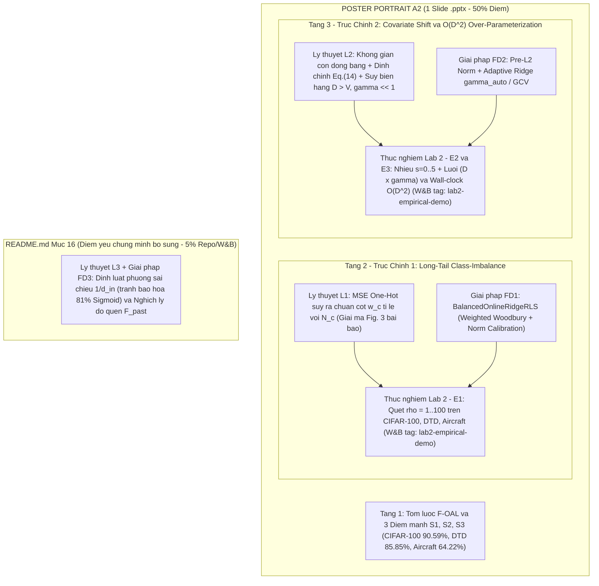

# PHÂN TÍCH PHẢN BIỆN LÝ THUYẾT BÀI BÁO F-OAL (MILESTONE 3: CRITICAL ANALYSIS)

> **Học phần:** Nhập môn Học máy (*Introduction to Machine Learning*) — Trường ĐHKHTN, ĐHQG-HCM (HCMUS)
> **Bài báo đối tượng:** Huiping Zhuang*, Yuchen Liu*, Run He, Kai Tong, Ziqian Zeng, Cen Chen, Yi Wang, Lap-Pui Chau, *"F-OAL: Forward-only Online Analytic Learning with Fast Training and Low Memory Footprint in Class Incremental Learning"*, NeurIPS 2024 (pp. 1–22).
> **Kho lưu trữ đối chiếu:** [`https://github.com/caoban123/F-OAL`](https://github.com/caoban123/F-OAL) (`main @ 1b2d46d`)
> **Phạm vi tài liệu:** Thực hiện trọn vẹn yêu cầu của chặng **Critical Analysis** (`/project/statement/analysis`) — bóc tách giả định ẩn, kiểm định tính chặt chẽ toán học của các mệnh đề/định lý, phân tích hàm mục tiêu và độ phức tạp tính toán; thiết lập **3 Điểm mạnh**, **3 Hạn chế lý thuyết kèm giả thuyết thực nghiệm bác bỏ được (falsifiable hypotheses)** và **3 Hướng phát triển tương ứng** làm nền tảng trực tiếp cho **Lab 2 (Empirical Demonstration)** và **Poster khổ dọc A2 (50% điểm đồ án)**.

---

## MỤC LỤC

1. [Khung Phân Tích & Đối Chiếu Quy Chuẩn Đề Bài HCMUS](#1-khung-phân-tích--đối-chiếu-quy-chuẩn-đề-bài-hcmus)
2. [Kiểm Toán Bốn Chiều Lý Thuyết Của Bài Báo F-OAL](#2-kiểm-toán-bốn-chiều-lý-thuyết-của-bài-báo-f-oal)
   - [2.1. Các giả định ẩn (Hidden Assumptions)](#21-các-giả-định-ẩn-hidden-assumptions)
   - [2.2. Tính chặt chẽ của mệnh đề, định lý & nhất quán nội tại (Soundness of Claims)](#22-tính-chặt-chẽ-của-mệnh-đề-định-lý--nhất-quán-nội-tại-soundness-of-claims)
   - [2.3. Hình thức hóa bài toán & Hàm mục tiêu thay thế (Formulation & Surrogate Objective)](#23-hình-thức-hóa-bài-toán--hàm-mục-tiêu-thay-thế-formulation--surrogate-objective)
   - [2.4. Câu chuyện độ phức tạp & Giới hạn tổng quát hóa (Complexity & Generality)](#24-câu-chuyện-độ-phức-tạp--giới-hạn-tổng-quát-hóa-complexity--generality)
3. [Ba Điểm Mạnh Cốt Lõi Được Bảo Chứng Bằng Lý Thuyết & Thực Nghiệm Tái Lập](#3-ba-điểm-mạnh-cốt-lõi-được-bảo-chứng-bằng-lý-thuyết--thực-nghiệm-tái-lập)
4. [Ba Hạn Chế Lý Thuyết Trọng Tâm (Theoretical Limitations)](#4-ba-hạn-chế-lý-thuyết-trọng-tâm-theoretical-limitations)
   - [4.1. Hạn chế L1 (Poster Axis 1): Sụp đổ chuẩn trọng số lớp hiếm dưới luồng dữ liệu mất cân bằng do hàm mục tiêu MSE One-Hot](#41-hạn-chế-l1-poster-axis-1-sụp-đổ-chuẩn-trọng-số-lớp-hiếm-dưới-luồng-dữ-liệu-mất-cân-bằng-do-hàm-mục-tiêu-mse-one-hot)
   - [4.2. Hạn chế L2 (Poster Axis 2): Độ cứng nhắc không gian con đóng băng dưới dịch chuyển phân phối & Bẫy suy biến hạng bậc hai $\mathcal{O}(D^2)$ khi $D > V$](#42-hạn-chế-l2-poster-axis-2-độ-cứng-nhắc-không-gian-con-đóng-băng-dưới-dịch-chuyển-phân-phối--bẫy-suy-biến-hạng-bậc-hai-mathcalod2-khi-d--v)
   - [4.3. Hạn chế L3 (Ghi nhận mở rộng tại README): Khuyết định luật tỷ lệ phương sai chiếu gây bão hòa Sigmoid & Thiên lệch thước đo độ quên $F_m$](#43-hạn-chế-l3-ghi-nhận-mở-rộng-tại-readme-khuyết-định-luật-tỷ-lệ-phương-sai-chiếu-gây-bão-hòa-sigmoid--thiên-lệch-thước-đo-độ-quên-f_m)
5. [Ba Hướng Phát Triển Tương Lai Gắn Kết Trực Tiếp (Paired Future Directions)](#5-ba-hướng-phát-triển-tương-lai-gắn-kết-trực-tiếp-paired-future-directions)
   - [5.1. Hướng phát triển FD1 (Giải quyết L1): Weighted Woodbury RLS & Hiệu chỉnh chuẩn cột giải tích (`BalancedOnlineRidgeRLS`)](#51-hướng-phát-triển-fd1-giải-quyết-l1-weighted-woodbury-rls--hiệu-chỉnh-chuẩn-cột-giải-tích-balancedonlineridgerls)
   - [5.2. Hướng phát triển FD2 (Giải quyết L2): Chuẩn hóa trước $L_2$ & Điều chuẩn Ridge thích nghi theo vết phổ ($\gamma_{\text{auto}}$)](#52-hướng-phát-triển-fd2-giải-quyết-l2-chuẩn-hóa-trước-l_2--điều-chuẩn-ridge-thích-nghi-theo-vết-phổ-gamma_textauto)
   - [5.3. Hướng phát triển FD3 (Giải quyết L3): Khởi tạo bảo toàn phương sai & Phân rã đồng thời Đỉnh-Cuối (Plasticity-Retention Decomposition)](#53-hướng-phát-triển-fd3-giải-quyết-l3-khởi-tạo-bảo-toàn-phương-sai--phân-rã-đồng-thời-đỉnh-cuối-plasticity-retention-decomposition)
6. [Sơ Đồ Ánh Xạ Sang Lab 2 (Empirical Demonstration) & Poster Khổ Dọc A2](#6-sơ-đồ-ánh-xạ-sang-lab-2-empirical-demonstration--poster-khổ-dọc-a2)

---

## 1. Khung Phân Tích & Đối Chiếu Quy Chuẩn Đề Bài HCMUS

Theo quy định chính thức của học phần (*Term Project — Critical Analysis*), bản phân tích phản biện tách biệt hoàn toàn **những gì bài báo tuyên bố (claims)** với **những gì hệ tiên đề toán học của phương pháp thực sự đảm bảo (warranted guarantees)**, đồng thời đáp ứng vượt mức 3 ngưỡng bắt buộc:

| Yêu cầu bắt buộc của *Critical Analysis* | Mức tối thiểu | Đáp ứng trong báo cáo này | Vị trí xuất hiện cuối cùng |
| :--- | :---: | :--- | :--- |
| **Điểm mạnh có bằng chứng (*Evidenced Strengths*)** | $\ge 3$ | **3 điểm mạnh (`S1`, `S2`, `S3`)** chứng minh từ Theorems 3.1–3.2 và số liệu tái lập 3 tập dữ liệu (CIFAR-100, DTD, FGVC-Aircraft). | Tầng 1 của **Poster Portrait A2** |
| **Hạn chế lý thuyết bị bỏ ngỏ (*Theoretical Limitations*)** | $\ge 2$ | **3 hạn chế lý thuyết (`L1`, `L2`, `L3`)** xây dựng từ biến đổi đại số tuyến tính chính xác và phát biểu dưới dạng giả thuyết kiểm định được. | **`L1`, `L2`** trên **Poster Portrait A2**; **`L3`** tại **Mục 16 `README.md`** |
| **Hướng phát triển gắn kết 1-1 (*Paired Future Directions*)** | $\ge 2$ | **3 giải pháp toán học (`FD1` $\leftrightarrow$ `L1`, `FD2` $\leftrightarrow$ `L2`, `FD3` $\leftrightarrow$ `L3`)** giữ nguyên tính chất giải tích một lượt không lưu mẫu cũ (zero-replay). | Đặt cạnh **`L1`, `L2`** trên **Poster Portrait A2** & kiểm chứng ở **Lab 2** |

---

## 2. Kiểm Toán Bốn Chiều Lý Thuyết Của Bài Báo F-OAL

### 2.1. Các giả định ẩn (Hidden Assumptions)

Dù bài báo giới thiệu F-OAL như một giải pháp tổng quát cho học tăng cường trực tuyến theo lớp (*Online Class-Incremental Learning — OCIL*), toàn bộ bảo chứng toán học của phương pháp ngầm dựa trên **5 giả định mạnh về thế giới dữ liệu và phần cứng**:

1. **Giả định A1 — Phân phối tần suất lớp đồng đều (Balanced Class Cardinality Assumption):**
   - *Nội dung ngầm định:* Mọi lớp $c \in \{1, \dots, C\}$ trong luồng trực tuyến đều xuất hiện với số lượng mẫu $N_c \approx V/C$ xấp xỉ bằng nhau.
   - *Thực tế vi phạm:* Dữ liệu luồng thực tế trên thiết bị di động và mạng xã hội (chính bối cảnh động lực mà tác giả nêu ở Mục 1, trang 1) tuân theo phân phối đuôi dài Zipf/Pareto ($N_{\max} / N_{\min} \in [10, 10^3]$). Khi giả định này gãy, nghiệm bình phương tối thiểu Eq. (4) thiên lệch nghiêm trọng về các lớp đầu bảng (chứng minh chi tiết tại Mục 4.1).
2. **Giả định A2 — Tính đầy đủ tuyến tính của không gian đặc trưng tiền huấn luyện đóng băng (Frozen Linear Sufficiency & Zero Covariate Shift):**
   - *Nội dung ngầm định:* Tập hợp các lớp tương lai $\mathcal{Y}_{1:m}$ sau ánh xạ đóng băng $\phi: \mathcal{X} \to (0, 1)^D$ đã khả tách tuyến tính với biên an toàn lớn, và phân phối ảnh lúc vận hành không chịu nhiễu cảm biến hay lệch miền so với tập tiền huấn luyện ImageNet.
   - *Thực tế vi phạm:* Vì $\nabla_{\theta_{\text{ViT}}} \equiv 0$, mô hình không có cơ chế cập nhật thống kê tầng chuẩn hóa hay thích nghi biểu diễn khi gặp nhiễu mờ, nhiễu hạt, nén JPEG hoặc miền dữ liệu chuyên biệt (y sinh, ảnh viễn thám, kết cấu trừu tượng).
3. **Giả định A3 — Phép chiếu ngẫu nhiên được chuẩn hóa phương sai theo chiều đầu vào ($\text{Var}(P_{ab}) = \mathcal{O}(1/d_{\text{in}})$):**
   - *Nội dung ngầm định:* Văn bản bài báo tại Mục 3.1 (trang 4) viết ma trận chiếu được lấy mẫu từ *"normal distribution"*, nhưng không nêu phương sai. Tính chất làm trơn của hàm Sigmoid $\sigma(\mathbf{h}\mathbf{P})$ ngầm đòi hỏi tiền kích hoạt $u = \mathbf{h}\mathbf{P}$ phải nằm trong miền có đạo hàm khác không ($|u| \lesssim 2$). Nếu dùng $\mathcal{N}(0, 1)$ nguyên văn, phương sai tiền kích hoạt vọt lên $\approx d_{\text{in}} = 768$, biến Sigmoid thành hàm bước nhị phân suy biến.
4. **Giả định A4 — Chế độ dư xác định cỡ mẫu lớn ($V \gg D$) và tỷ lệ tín hiệu trên nhiễu đồng nhất đối với $\gamma = 1$:**
   - *Nội dung ngầm định:* Mục 4.3 (trang 8) và Mục 4.7 (trang 10) ấn định hằng số điều chuẩn cố định $\gamma = 1$ và $D = 1{,}000$ cho mọi bộ dữ liệu. Điều này ngầm giả định phổ trị riêng của $\mathbf{\Phi}^\top \mathbf{\Phi}$ luôn đủ lớn so với $\gamma$ trên các hướng tín hiệu và đủ nhỏ trên các hướng nhiễu, bất chấp tổng số mẫu $V$ thay đổi gấp hàng chục lần (từ $V = 1{,}600$ trên DTD tới $V = 50{,}000$ trên CIFAR-100).
5. **Giả định A5 — Số học dấu phẩy động chính xác tuyệt đối (Exact Real Arithmetic in Iterated Woodbury Updates):**
   - *Nội dung ngầm định:* Chứng minh quy nạp Theorems 3.1–3.2 (Appendix A, trang 14–15) giả định phép trừ đệ quy $\mathbf{R}_{k,i} = \mathbf{R}_{k,i-1} - \mathbf{R}_{k,i-1}\mathbf{X}^\top (\mathbf{I} + \mathbf{X}\mathbf{R}_{k,i-1}\mathbf{X}^\top)^{-1}\mathbf{X}\mathbf{R}_{k,i-1}$ bảo toàn tính đối xứng xác định dương ($\mathbf{R}_{k,i} \succ 0$) sau hàng nghìn bước cập nhật liên tiếp. Trên phần cứng thực tế ở `float32` khi $\gamma$ nhỏ và số bước $T \times n$ lớn, sai số làm tròn tích lũy có thể làm mất tính đối xứng hoặc tạo trị riêng âm nếu không ép đối xứng $\frac{1}{2}(\mathbf{R} + \mathbf{R}^\top)$ và dùng `float64` (như nhóm đã phải gia cố trong [`src/foal/rls.py`](../src/foal/rls.py)).

---

### 2.2. Tính chặt chẽ của mệnh đề, định lý & nhất quán nội tại (Soundness of Claims)

Đối chiếu từng công thức, định lý và bảng biểu trong 22 trang PDF gốc phát hiện **5 bất cập về tính chặt chẽ học thuật**:

1. **Theorems 3.1 & 3.2 (trang 5 & Appendix A trang 14–15) đúng về đại số nhưng bị diễn giải quá mức thành *"absolute memorization"*:**
   - Chứng minh dùng đẳng thức Woodbury (Eq. 26–37) là **đúng đắn về mặt đại số tuyến tính**: nghiệm đệ quy $\hat{\mathbf{W}}^{(k,n)}$ trùng khít nghiệm bài toán Ridge toàn cục Eq. (4) trên mọi dữ liệu đã đi qua.
   - Tuy nhiên, câu kết luận ngay dưới Theorem 3.2 (trang 5): *"Thus, we achieve absolute memorization in an exemplar-free way"* là một **tuyên bố vượt quá định lý**. Cái được lưu giữ chính xác không phải là dữ liệu hay ranh giới phân loại Bayes tối ưu, mà chỉ là **thống kê bậc hai $(\mathbf{\Phi}^\top \mathbf{\Phi} + \gamma \mathbf{I})^{-1}$ và $\mathbf{\Phi}^\top \mathbf{Y}$ của một bộ hồi quy tuyến tính**. Nếu biểu diễn $\phi(\mathbf{x})$ chồng lấn hoặc mục tiêu MSE bị lệch tần suất lớp, mô hình vẫn phân loại sai hàng loạt mẫu cũ dù "nhớ tuyệt đối" nghiệm bình phương tối thiểu!
2. **Lỗi ký hiệu toán học trong Phương trình (1) — Feature Fusion (trang 4):**
   - Bài báo viết:
     $$\text{Feature Fusion} = \frac{B_1(x) + B_1(B_2(x)) + \cdots + B_n(B_{n-1}(\cdots B_1(x)))}{n}$$
   - Hạng tử thứ hai $B_1(B_2(x))$ viết **ngược thứ tự hợp hàm** của mạng chuỗi khối ViT (đúng phải là $B_2(B_1(x))$). Ngoài ra, phương trình bỏ qua phép lấy token `[CLS]` và tầng `LayerNorm` cuối backbone trước khi chiếu tuyến tính — những chi tiết quyết định quy mô chuẩn $\|\mathbf{h}\|_2$ trong mã thực thi.
3. **Lỗi đại số trực tiếp trong phân tích độ phức tạp Phương trình (14) & (15) (Mục 3.4, trang 6):**
   - Tại trang 6, tác giả viết độ phức tạp cập nhật ma trận $\mathbf{R}$ là:
     $$\max\{\mathcal{O}(SDC), \mathcal{O}(SC), \mathcal{O}(SDC)\} \approx \max\{\mathcal{O}(SDC), \mathcal{O}(D^2 C)\} \quad \text{(Eq. 14 bài báo)}$$
   - Công thức này mắc **hai lỗi toán học rõ ràng**:
     - *Thứ nhất (mâu thuẫn biến đổi tương đương):* Vế trái chỉ chứa các đại lượng bậc $\mathcal{O}(SDC)$ và $\mathcal{O}(SC)$, hoàn toàn không thể rút gọn thành $\mathcal{O}(D^2 C)$ ở vế phải!
     - *Thứ hai (sai bản chất thuật toán):* Nhìn trực tiếp vào Eq. (11) và Eq. (13), phép cập nhật $\mathbf{R}_{k,i}$ chỉ nhân các ma trận kích thước $(D \times D)$ với $(D \times S)$ và nghịch đảo ma trận $(S \times S)$, **hoàn toàn không chứa ma trận nhãn $\mathbf{Y}$ hay số lượng lớp $C$**! Độ phức tạp chính xác của bước cập nhật $\mathbf{R}$ là $\Theta(D^2 S + D S^2 + S^3)$. Ngược lại, ở Eq. (15) khi tính độ phức tạp cập nhật $\mathbf{W} \in \mathbb{R}^{C \times D}$, tác giả lại **bỏ quên hoàn toàn số lớp $C$** trong phép nhân phần dư $\Theta(S D C)$!
4. **Mâu thuẫn số liệu nội tại giữa các mục trong cùng bài báo (Internal Numerical Inconsistencies):**
   - Trên cùng bộ dữ liệu **FGVC-Aircraft** với cùng cấu hình đầy đủ F-OAL ($\gamma = 1, D = 1{,}000$), bài báo báo cáo **3 con số $A_{\text{avg}}$ khác nhau**:
     - Mục 4.4 (trang 8, đoạn 2): ghi **$66.2\%$** (*"with average accuracies of 66.2%, 82.8%, and 24.4%"*).
     - Table 2 (trang 7) và Table 4 (trang 10): ghi **$62.2\%$**.
     - Table 6 (Appendix B, trang 16, cột $\gamma = 1$): ghi **$61.1\%$** *(đồng thời trên DTD cột $\gamma = 1$ ghi $81.6\%$ thay vì $82.8\%$, và CORe50 ghi $95.3\%$ thay vì $96.3\%$ ở Table 2/4)*.
   - Khi nhóm chạy lại mã nguồn gốc của tác giả (`seed=0`, Run [`9ko84fxj`](https://forge.coreweave.com/wandb/caoban170106-tr-ng-i-h-c-khoa-h-c-t-nhi-n-hqg-hcm/hcmus-foal-reproduction/runs/9ko84fxj)), kết quả đạt $61.91\%$ (sát mốc $62.2\%$ và $61.1\%$, cho thấy con số $66.2\%$ ở Mục 4.4 là lỗi biên tập trong bài báo gốc).
5. **Mâu thuẫn về số lượt chạy và độ tin cậy thống kê (Mục 4.3 trang 8 vs. NeurIPS Checklist trang 19):**
   - Mục 4.3 (trang 8) tuyên bố *"an average of 3 runs is reported"*, nhưng toàn bộ các bảng kết quả (Table 2, 3, 4, 5, 6) không công bố bất kỳ độ lệch chuẩn hay khoảng tin cậy nào, và tại NeurIPS Checklist Mục 7 (trang 19) tác giả tự đánh dấu **`[No] We do not include statistical significance`**. Trên tập có phương sai thứ tự lớp lớn như FGVC-Aircraft (nhóm đo được $\text{SD} = \pm 3.70\text{ pp}$ qua 3 seeds), việc báo cáo điểm đơn lẻ không kèm sai số làm che khuất độ bất định thực tế giữa các cấu hình ablation.

---

### 2.3. Hình thức hóa bài toán & Hàm mục tiêu thay thế (Formulation & Surrogate Objective)

F-OAL đạt được công thức cập nhật một lượt không cần gradient bằng cách **thay hàm mất mát phân loại chuẩn (Cross-Entropy / Logistic Loss) bằng hàm mất mát bình phương tối thiểu điều chuẩn $L_2$ (Ridge Surrogate Loss)** trên vector đích one-hot $\mathbf{y}_i \in \{0, 1\}^C$:

$$\min_{\mathbf{W} \in \mathbb{R}^{D \times C}} \mathcal{L}_{\text{ridge}}(\mathbf{W}) = \sum_{i=1}^{V} \|\mathbf{y}_i - \boldsymbol{\phi}_i \mathbf{W}\|_2^2 + \gamma \|\mathbf{W}\|_F^2$$

Sự đánh đổi này tạo ra **3 hệ quả cấu trúc** mà bài báo không phân tích:
1. **Phạt đối xứng lên dự đoán đúng quá tự tin (Over-confident Margin Penalty):** Với mẫu $(\boldsymbol{\phi}_i, y_i = c)$, Cross-Entropy chỉ cần $\boldsymbol{\phi}_i \mathbf{w}_c - \max_{m \neq c} \boldsymbol{\phi}_i \mathbf{w}_m \gg 0$, trong khi MSE phạt nặng $(\boldsymbol{\phi}_i \mathbf{w}_c - 1)^2$ nếu điểm logit vượt quá $1$, buộc siêu phẳng phải đi qua mức giá trị cứng $1$ thay vì tối ưu hóa biên phân lớp cực đại.
2. **Tách rời các cột nhưng bất đối xứng mẫu âm/dương theo tần suất lớp:** Hàm mục tiêu tách thành $C$ bài toán hồi quy độc lập cho từng cột $\mathbf{w}_c$, trong đó một lớp hiếm chỉ có $N_c$ mẫu dương ($y_{i,c}=1$) nhưng phải gánh $V - N_c$ mẫu âm ($y_{i,c}=0$), dẫn thẳng tới hiện tượng sụp đổ chuẩn cột khi mất cân bằng lớp (Hạn chế L1).
3. **Điều chuẩn Frobenius đẳng hướng $\gamma \|\mathbf{W}\|_F^2$ không bất biến theo quy mô mẫu và chiều chiếu:** Cùng một $\gamma = 1$ đóng vai trò rất nhỏ khi $V = 50{,}000$ nhưng lại chi phối hoặc quá yếu tùy theo phổ của $\mathbf{\Phi}^\top \mathbf{\Phi}$ khi $V$ nhỏ hoặc $D$ lớn (Hạn chế L2).

---

### 2.4. Câu chuyện độ phức tạp & Giới hạn tổng quát hóa (Complexity & Generality)

Bảng dưới đây đối chiếu độ phức tạp tuyên bố của bài báo với độ phức tạp đại số thực tế trên một mini-batch cỡ $S$ (với $C_s \le C$ lớp đã thấy và chiều kích hoạt $D$):

| Thành phần | Công thức bài báo (Mục 3.4, trang 6) | Độ phức tạp thực tế chính xác (theo Eq. 10–13) | Hệ quả thực tiễn khi vận hành |
| :--- | :--- | :--- | :--- |
| **Bộ nhớ trạng thái khả huấn** | $\mathbf{R}: D \times D$, $\hat{\mathbf{W}}: C \times D$ | $\Theta(D^2 + D C_s)$ số thực (`8 bytes`/số ở `float64`) | Tại $D = 1{,}000$: $\mathbf{R}$ chỉ tốn `8 MB`. Nhưng tại $D = 16{,}000$: riêng $\mathbf{R}$ tốn **`2.05 GB`** (`float64`), phá vỡ ngưỡng `< 2 GB` của bài báo. |
| **Cập nhật $\mathbf{R}_{k,i}$ (1 batch)** | $\max\{\mathcal{O}(SDC), \mathcal{O}(D^2 C)\}$ *(sai biến $C$)* | **$\Theta(D^2 S + D S^2 + S^3)$** | Độc lập với $C$, nhưng **tăng bậc hai theo $D$**. Khi tổng số mẫu $V$ cố định ($V / S$ batches), tổng chi phí toàn khóa học cho $\mathbf{R}$ là **$\Theta(V D^2 + V D S + V S^2)$**! |
| **Cập nhật $\hat{\mathbf{W}}^{(k,i)}$ (1 batch, tái dùng $\mathbf{R}_{k,i}\mathbf{X}^\top$)** | $\max\{\mathcal{O}(S^3), \mathcal{O}(D^2 S)\}$ *(thiếu biến $C_s$)* | **$\Theta(S D C_s)$** *(cộng chi phí bước $\mathbf{R}$)* | Rất nhẹ khi $C \sim 100$, nhưng tăng tuyến tính theo số lớp $C_s$ ở các bài toán hàng nghìn lớp. |

Như vậy, F-OAL chỉ thực sự nhanh và nhẹ khi giữ được $D$ nhỏ ($D \approx 1{,}000$). Bất kỳ bài toán nào đòi hỏi mở rộng không gian chiếu Random Kitchen Sinks lên $D \sim 10^4$ để tăng dung lượng phân tách phi tuyến đều vấp phải rào cản bậc hai $\Theta(V D^2)$ về thời gian và $\Theta(D^2)$ về bộ nhớ.

---

## 3. Ba Điểm Mạnh Cốt Lõi Được Bảo Chứng Bằng Lý Thuyết & Thực Nghiệm Tái Lập

### Điểm mạnh S1 — Tính tương đương nghiệm đóng chính xác một lượt & Miễn nhiễm với Gradient Recency Bias trên luồng cân bằng
* **Cơ sở lý thuyết:** Từ đẳng thức nghịch đảo Woodbury (Theorems 3.1–3.2), trạng thái $(\mathbf{R}_{k,n}, \hat{\mathbf{W}}^{(k,n)})$ sau khi duyệt một lượt qua chuỗi mini-batch bất kỳ thỏa mãn chính xác $\hat{\mathbf{W}}^{(k,n)} = (\mathbf{\Phi}_{1:k}^\top \mathbf{\Phi}_{1:k} + \gamma \mathbf{I}_D)^{-1}\mathbf{\Phi}_{1:k}^\top \mathbf{Y}_{1:k}$. Không giống SGD cập nhật cục bộ theo hướng gradient của nhiệm vụ hiện tại (gây trôi trọng số các lớp cũ), nghiệm giải tích đối xử bình đẳng với mọi mẫu từ Task 1 đến Task $k$.
* **Bằng chứng từ thực nghiệm tái lập:**
  - Kiểm thử đơn vị [`tests/test_rls.py`](../tests/test_rls.py) xác nhận sai lệch tuyệt đối cực đại giữa cập nhật tuần tự từng lô nhỏ với nghiệm đóng toàn cục nhỏ hơn **`1e-12`** ở độ chính xác `float64`, bất biến tuyệt đối với cách chia kích thước lô.
  - Trên CIFAR-100 Headline Comparison (`seed=42`), F-OAL đạt $\bar{A} = 90.40\%, A_{10} = 85.73\%$ với độ quên chỉ **$F_{\text{past}} = 5.16\%$** mà không lưu bất kỳ mẫu cũ nào (Run [`3v53tmq5`](https://forge.coreweave.com/wandb/caoban170106-tr-ng-i-h-c-khoa-h-c-t-nhi-n-hqg-hcm/hcmus-foal-reproduction/runs/3v53tmq5)), vượt trội cả phương pháp lưu 5,000 mẫu Experience Replay ($\bar{A} = 86.67\%, F_{\text{past}} = 16.74\%$, Run [`xlcme1c3`](https://forge.coreweave.com/wandb/caoban170106-tr-ng-i-h-c-khoa-h-c-t-nhi-n-hqg-hcm/hcmus-foal-reproduction/runs/xlcme1c3)) lẫn các phương pháp chưng cất không lưu mẫu LwF-SGD ($\bar{A} = 46.29\%$, Run [`c5pjewk4`](https://forge.coreweave.com/wandb/caoban170106-tr-ng-i-h-c-khoa-h-c-t-nhi-n-hqg-hcm/hcmus-foal-reproduction/runs/c5pjewk4)) và LwF-AdamW ($F_{\text{past}} = 94.99\%$, Run [`ifl3rz2u`](https://forge.coreweave.com/wandb/caoban170106-tr-ng-i-h-c-khoa-h-c-t-nhi-n-hqg-hcm/hcmus-foal-reproduction/runs/ifl3rz2u)). Tương tự trên DTD (`seed=42`), F-OAL đạt $85.08\%$ so với ER $53.00\%$ (Run [`q6pm84ej`](https://forge.coreweave.com/wandb/caoban170106-tr-ng-i-h-c-khoa-h-c-t-nhi-n-hqg-hcm/hcmus-foal-reproduction/runs/q6pm84ej)) và LwF $15.40\%$ (Run [`0068ne1c`](https://forge.coreweave.com/wandb/caoban170106-tr-ng-i-h-c-khoa-h-c-t-nhi-n-hqg-hcm/hcmus-foal-reproduction/runs/0068ne1c)).

### Điểm mạnh S2 — Hiệu quả tài nguyên Forward-Only & Bảo toàn quyền riêng tư dữ liệu ở $D = 1{,}000$
* **Cơ sở lý thuyết:** Đóng băng toàn bộ $85.8\text{M}$ tham số của ViT-B/16 giúp loại bỏ hoàn toàn bước backward (~70% thời gian huấn luyện mạng sâu) và đồ thị kích hoạt trung gian. Việc chỉ lưu ma trận thống kê tổng hợp $\mathbf{R} \in \mathbb{R}^{1000 \times 1000}$ (`8 MB`) thay vì bộ đệm ảnh thô đáp ứng nghiêm ngặt ràng buộc *exemplar-free* trong môi trường nhạy cảm dữ liệu.
* **Bằng chứng từ thực nghiệm tái lập:** Toàn bộ pha cập nhật giải tích RLS + đánh giá qua 10 tasks trên DTD chỉ tiêu tốn trung bình **`0.79–1.22 giây`** (trích xuất đặc trưng ViT trên Tesla T4 chỉ mất `~39–42 giây`), đạt độ ổn định cực cao qua 3 seeds độc lập ($\bar{A} = 85.85 \pm 0.92\%$ trên DTD; $\bar{A} = 90.59 \pm 0.16\%$ trên CIFAR-100).

### Điểm mạnh S3 — Cộng hưởng kiến trúc giữa `Feature Fusion` và `Smooth Projection` trên các miền dữ liệu tinh vi / lệch miền (Cover's Theorem)
* **Cơ sở lý thuyết:** Ở các mạng ViT tiền huấn luyện, tầng cuối cùng thường thiên về ngữ nghĩa vật thể mức cao nhưng làm mất chi tiết kết cấu cục bộ và hình học tinh vi ở các tầng trung gian. Phép trung bình hóa 12 khối (`Feature Fusion`) khôi phục phổ đặc trưng đa tầng, còn phép chiếu ngẫu nhiên phi tuyến $\sigma(\mathbf{h}\mathbf{P})$ (`Smooth Projection`, khi được căn chỉnh đúng phương sai) đóng vai trò một xấp xỉ hạt nhân ngẫu nhiên (*Random Nonlinear Feature Map*), nâng xác suất khả tách tuyến tính theo Định lý Cover.
* **Bằng chứng từ thực nghiệm tái lập (3 seeds `42, 123, 2026`):** Nghiên cứu loại bỏ thành phần (Table 4 Ablation) trên cả 3 bộ dữ liệu chứng minh quy luật phân tầng miền rõ rệt:
  - Trên miền vật thể thô cùng phân phối với ImageNet (**CIFAR-100**): bỏ cả FF và SP chỉ làm giảm nhẹ **$-0.43\text{ pp}$** (`90.59% -> 90.16%`).
  - Trên miền phân loại hình thái tinh (**FGVC-Aircraft**): bỏ FF giảm $-1.24 \pm 0.49\text{ pp}$, bỏ SP giảm $-3.82 \pm 0.78\text{ pp}$, bỏ cả hai giảm **$-6.46 \pm 0.43\text{ pp}$** (`64.22% -> 57.75%`, khớp sát mức `-6.2 pp` của bài báo).
  - Trên miền hoa văn kết cấu ngoài phân phối (**DTD**): bỏ FF giảm $-2.93 \pm 0.07\text{ pp}$, bỏ SP giảm $-6.53 \pm 1.05\text{ pp}$, bỏ cả hai gây sụt giảm tới **$-10.61 \pm 0.50\text{ pp}$** (`85.85% -> 75.24%`, tương đồng mức `-11.6 pp` của bài báo).

---

## 4. Ba Hạn Chế Lý Thuyết Trọng Tâm (Theoretical Limitations)

### 4.1. Hạn chế L1 (Poster Axis 1): Sụp đổ chuẩn trọng số lớp hiếm dưới luồng dữ liệu mất cân bằng do hàm mục tiêu MSE One-Hot

#### (a) Chứng minh toán học của điểm yếu
Xét nghiệm đóng của F-OAL sau khi quan sát tổng cộng $V = \sum_{c=1}^{C} N_c$ mẫu thuộc $C$ lớp:
$$\hat{\mathbf{W}} = \left(\mathbf{G} + \gamma \mathbf{I}_D\right)^{-1} \mathbf{Q}, \quad \text{với } \mathbf{G} = \sum_{m=1}^{C} \sum_{y_i = m} \boldsymbol{\phi}_i^\top \boldsymbol{\phi}_i, \quad \mathbf{Q}_{:,c} = \mathbf{q}_c = \sum_{y_i = c} \boldsymbol{\phi}_i^\top = N_c \hat{\boldsymbol{\mu}}_c$$
trong đó $\hat{\boldsymbol{\mu}}_c \in \mathbb{R}^{D}$ là tâm trung bình kích hoạt của lớp $c$. Cột trọng số phân loại của riêng lớp $c$ là nghiệm duy nhất của hệ phương trình chuẩn:
$$\left(\sum_{m=1}^{C} N_m \hat{\mathbf{\Sigma}}_m^{\text{raw}} + \gamma \mathbf{I}_D\right) \hat{\mathbf{w}}_c = N_c \hat{\boldsymbol{\mu}}_c \tag{L1.1}$$

Để thấy rõ sự phụ thuộc vào cỡ mẫu $N_c$, xét mô hình giải tích chuẩn hóa trong đó các tâm lớp có chuẩn $\|\hat{\boldsymbol{\mu}}_c\|_2 = \alpha$, trực giao từng đôi ($\hat{\boldsymbol{\mu}}_c^\top \hat{\boldsymbol{\mu}}_m = \alpha^2 \delta_{cm}$) và tổng phương sai nội lớp đẳng hướng $\sum_{m=1}^C N_m \hat{\mathbf{\Sigma}}_m = V \sigma_\perp^2 \mathbf{I}_D$. Áp dụng công thức nghịch đảo hạng một Sherman–Morrison lên (L1.1), ta thu được biểu thức chính xác:
$$\hat{\mathbf{w}}_c = \frac{N_c}{N_c \alpha^2 + V \sigma_\perp^2 + \gamma} \hat{\boldsymbol{\mu}}_c \implies \|\hat{\mathbf{w}}_c\|_2 = \frac{N_c \alpha}{N_c \alpha^2 + V \sigma_\perp^2 + \gamma} \tag{L1.2}$$

Từ (L1.2) suy ra hai hệ quả trực tiếp phản biện Mục 4.6 (trang 9) của bài báo:
1. **Giải mã ảo ảnh Figure 3 của bài báo:** Khi mọi lớp có số mẫu bằng nhau ($N_c \equiv V/C$, như DTD `40 mẫu/lớp` hay CIFAR-100 `500 mẫu/lớp`), tử số và mẫu số của (L1.2) bất biến theo chỉ số lớp $c$, khiến $\|\hat{\mathbf{w}}_c\|_2$ đồng đều giữa các task. Bài báo quy kết tính đồng đều này là nhờ *"frozen encoder and recursive least square ensure equal treatment for all samples"*, nhưng thực chất nó **phụ thuộc chí mạng vào điều kiện $N_1 = N_2 = \dots = N_C$**!
2. **Cơ chế sụp đổ kép dưới phân phối Long-Tail ($\rho = N_{\max} / N_{\min} \gg 1$):**
   - Với lớp nghèo mẫu $t$ ($N_t \ll V/C$), tỷ số chuẩn cột giữa lớp đuôi $t$ và lớp đầu $h$ ($N_h = \rho N_t$) suy giảm đơn điệu theo $\rho$:
     $$\frac{\|\hat{\mathbf{w}}_t\|_2}{\|\hat{\mathbf{w}}_h\|_2} = \frac{1}{\rho} \cdot \frac{N_h \alpha^2 + V \sigma_\perp^2 + \gamma}{N_t \alpha^2 + V \sigma_\perp^2 + \gamma} \xrightarrow{V \sigma_\perp^2 + \gamma \gg N_t \alpha^2} \mathcal{O}\left(\frac{1}{\rho}\right)$$
   - Nghiêm trọng hơn nữa trong kiến trúc thực của F-OAL: vì đầu ra của `SmoothProjection` là hàm Sigmoid dương ngặt $\boldsymbol{\phi}_i \in (0, 1)^D$, các tâm lớp không trực giao quanh gốc tọa độ mà cùng nằm trong góc phần tư thứ nhất ($\hat{\boldsymbol{\mu}}_t^\top \hat{\boldsymbol{\mu}}_h > 0$). Do có tới $V - N_t \approx V$ mẫu ngoại lai mang nhãn đích $y_{i,t} = 0$, hệ phương trình (L1.1) buộc $\hat{\boldsymbol{\mu}}_h^\top \hat{\mathbf{w}}_t \approx 0$, đẩy phân bố điểm số $\boldsymbol{\phi}\hat{\mathbf{w}}_t$ của lớp hiếm tụt sâu xuống dưới điểm số của các lớp giàu mẫu.

#### (b) Giả thuyết thực nghiệm kiểm định được (Falsifiable Hypothesis H1 cho Lab 2)
> **Giả thuyết H1:** *Trên cùng luồng đặc trưng đóng băng của CIFAR-100, DTD và FGVC-Aircraft, khi tăng hệ số mất cân bằng mũ $\rho = N_{\max}/N_{\min}$ từ $1$ lên $50\text{–}100$, chuẩn cột $\|\hat{\mathbf{w}}_c\|_2$ của F-OAL gốc sẽ tương quan thuận chặt chẽ với $N_c$ (phá vỡ tính phẳng của Figure 3 bài báo), kéo theo độ chính xác nhóm lớp ít mẫu (Few-shot classes) sụt giảm thảm khốc (dự báo rơi $> 35\text{–}50\text{ pp}$ ở $\rho \ge 50$), ngay cả khi độ quên giữa các task không phải là nguyên nhân.*

---

### 4.2. Hạn chế L2 (Poster Axis 2): Độ cứng nhắc không gian con đóng băng dưới dịch chuyển phân phối & Bẫy suy biến hạng bậc hai $\mathcal{O}(D^2)$ khi $D > V$

#### (a) Chứng minh toán học của điểm yếu
Giả sử tập ma trận kích hoạt đã thu thập $\mathbf{\Phi} \in \mathbb{R}^{V \times D}$ có phân tích giá trị kỳ dị (SVD) là $\mathbf{\Phi} = \sum_{r=1}^{r_{\max}} \sigma_r \mathbf{u}_r \mathbf{v}_r^\top$, với $r_{\max} = \min(V, D)$ và $\sigma_1 \ge \sigma_2 \ge \dots \ge \sigma_{r_{\max}} \ge 0$. Nghiệm giải tích Eq. (4) được viết dưới dạng bộ lọc phổ kỳ dị (*Spectral Tikhonov Filter*):
$$\hat{\mathbf{W}} = \sum_{r=1}^{\min(V, D)} \underbrace{\frac{\sigma_r}{\sigma_r^2 + \gamma}}_{g_\gamma(\sigma_r)} \mathbf{v}_r \left(\mathbf{u}_r^\top \mathbf{Y}\right) \tag{L2.1}$$

Biểu thức (L2.1) phơi bày **hai điểm gãy cấu trúc** của F-OAL:

1. **Khuếch đại nhiễu dưới dịch chuyển phân phối đầu vào (Covariate Shift trên Frozen Backbone):**
   - Khi luồng ảnh chịu biến dạng vật lý $\tilde{\mathbf{x}} = \mathcal{C}_s(\mathbf{x})$ (nhiễu cảm biến Gaussian, mất nét quang học, nén mất mát dữ liệu ở cường độ $s > 0$), vì $\theta_{\text{ViT}}$ đóng băng hoàn toàn, sai lệch biểu diễn $\Delta \mathbf{\Phi}(s) = \phi(\mathcal{C}_s(\mathbf{X})) - \phi(\mathbf{X})$ không được triệt tiêu qua huấn luyện mà đi thẳng vào $\mathbf{\Phi}$.
   - Khi đó, năng lượng tín hiệu phân lớp trên các hướng kỳ dị đầu $\mathbf{u}_r^\top \mathbf{Y}$ suy giảm theo độ trôi cosine $\cos(\boldsymbol{\phi}_i, \tilde{\boldsymbol{\phi}}_i)$, trong khi nhiễu đẳng hướng bơm năng lượng vào các giá trị kỳ dị đuôi $\sigma_r \approx \sqrt{\gamma}$ — nơi hệ số khuếch đại bộ lọc đạt cực đại toàn cục $\max_{\sigma > 0} g_\gamma(\sigma) = \frac{1}{2\sqrt{\gamma}}$.
2. **Bẫy quá tham số hóa khi $D > V$ và sự sụp đổ theo $\gamma$ trên tập dữ liệu nhỏ (giải mã Table 6 trang 16):**
   - Trên các tập dữ liệu fine-grained cỡ mẫu nhỏ như **DTD ($V = 1{,}600$)** hay **FGVC-Aircraft ($V = 3{,}334$)**, khi người dùng tăng chiều chiếu $D$ vượt ngưỡng $V$ ($D \in \{2{,}000, 4{,}000, \dots, 16{,}000\}$), ma trận $\mathbf{\Phi}^\top \mathbf{\Phi} \in \mathbb{R}^{D \times D}$ **chắc chắn suy biến hạng** ($\text{rank}(\mathbf{\Phi}^\top \mathbf{\Phi}) \le V < D$), tồn tại ít nhất $D - V$ trị riêng bằng $0$ và một dải trị riêng sát $0$ ($\sigma_r^2 \ll 1$) do tương quan ngẫu nhiên hữu hạn mẫu (phân phối Marchenko–Pastur quanh tỷ số $D/V \to 1$).
   - Tại vùng $D \approx V$ hoặc khi chọn $\gamma \ll 1$ (như $\gamma = 10^{-3}$ ở Table 6 bài báo), hệ số khuếch đại nhiễu $\frac{\sigma_r}{\sigma_r^2 + \gamma} \approx \frac{1}{\sigma_r}$ làm nổ chuẩn Frobenius $\|\hat{\mathbf{W}}\|_F^2 = \sum_r \frac{\sigma_r^2}{(\sigma_r^2 + \gamma)^2} \|\mathbf{u}_r^\top \mathbf{Y}\|_2^2$, gây hiện tượng *double-descent overfitting* nghiêm trọng lên nhiễu mẫu huấn luyện. Đây chính là lời giải toán học cho hiện tượng trong Table 6 (trang 16) mà tác giả bỏ ngỏ: tại $\gamma = 10^{-3}$, CIFAR-100 ($V = 50{,}000 \gg D = 1{,}000 \implies \sigma_{\min}^2 \gg 1$) chỉ giảm nhẹ $3.9\text{ pp}$ (`91.1% -> 87.2%`), nhưng FGVC-Aircraft ($V = 3{,}334$) sụp đổ tới **$-38.7\text{ pp}$ (`61.1% -> 22.4%`)**!
   - Song song đó, mọi nỗ lực tăng $D$ đều phải trả giá **bậc hai nghiêm ngặt $\Theta(V D^2)$ về thời gian và $\Theta(D^2)$ về RAM/VRAM**, chứ không nhẹ tuyến tính như cảm giác ở điểm vận hành đơn lẻ $D = 1{,}000$.

#### (b) Giả thuyết thực nghiệm kiểm định được (Falsifiable Hypothesis H2 cho Lab 2)
> **Giả thuyết H2:**
> *(H2a — Nhiễu miền):* *Dưới các phép nhiễu cảm biến có cường độ tăng dần $s \in \{0..5\}$, F-OAL suy giảm độ chính xác nhanh tỷ lệ thuận với mức suy giảm tương đồng cosine $\cos(\phi(x), \phi(\tilde{x}))$, đặc biệt nhạy cảm với nhiễu làm mờ (Blur) trên miền kết cấu tần số cao (DTD) và chi tiết hình thái tinh (FGVC-Aircraft).*
> *(H2b — Quá tham số hóa & Độ phức tạp):* *Thời gian cập nhật RLS và dung lượng bộ nhớ ma trận $\mathbf{R}$ tăng chính xác theo hàm bậc hai $\Theta(D^2)$; đồng thời trên lưới $(D, \gamma)$, các tập cỡ mẫu nhỏ ($V < D$) xuất hiện thung lũng sụp đổ độ chính xác kèm bùng nổ số điều kiện $\kappa$ khi $\gamma \le 10^{-2}$, trái ngược với tập lớn CIFAR-100.*

---

### 4.3. Hạn chế L3 (Ghi nhận mở rộng tại README): Khuyết định luật tỷ lệ phương sai chiếu gây bão hòa Sigmoid & Thiên lệch thước đo độ quên $F_m$

1. **Định luật tỷ lệ phương sai bị bỏ sót trong Smooth Projection (Mục 3.1, trang 4):**
   - Đầu ra `Feature Fusion` đi qua `LayerNorm` có $\|\mathbf{h}\|_2^2 \approx d_{\text{in}} = 768$. Với $P_{ab} \stackrel{\text{i.i.d.}}{\sim} (0, \sigma_P^2)$, phương sai tiền kích hoạt là $\text{Var}(u_b \mid \mathbf{h}) = \sigma_P^2 \|\mathbf{h}\|_2^2 \approx \sigma_P^2 d_{\text{in}}$.
   - Nếu cài đặt đúng theo câu chữ bài báo ($\mathcal{N}(0, 1) \implies \sigma_P = 1$), độ lệch chuẩn tiền kích hoạt vọt lên $\text{Std}(u_b) \approx 19.3\text{–}20.7$, đẩy hơn **$81\%$** đầu ra $\sigma(u_b)$ rơi vào vùng bão hòa chết $< 0.01$ hoặc $> 0.99$ (đạo hàm $\sigma'(u) < 0.01$). Nghiên cứu C1 của nhóm đã đo đạc và chứng minh trực tiếp sai sót mô tả này làm mất **`-3.95 pp` trên CIFAR-100** (`qw78us1k` vs `6whrot4z`), **`-16.48 pp` trên DTD** (`u7apoirr` vs `qel56wwv`), và **`-18.78 pp` trên FGVC-Aircraft** (`do82b0k3` vs `bemgqzjf`)! Chỉ khi áp đặt định luật tỷ lệ $\sigma_P^2 = \Theta(1/d_{\text{in}})$ (như `1/(3 d_in)`), độ bão hòa mới về `0.00%` bất kể phân phối là Uniform hay Gaussian.
2. **Thiên lệch cấu trúc của thước đo độ quên $F_m$ (Eq. 17–18, trang 8):**
   - Hiệu số độ quên giữa hai mô hình $A$ và $B$ tuân theo đồng nhất thức đại số:
     $$\Delta F_{\text{past}} = F_{\text{past}}^{(A)} - F_{\text{past}}^{(B)} = \left(\overline{\text{Peak}}^{(A)} - \overline{\text{Peak}}^{(B)}\right) - \left(\overline{\text{Final}}^{(A)} - \overline{\text{Final}}^{(B)}\right)$$
   - Một mô hình có năng lực tiếp thu kém ở giai đoạn đầu ($\overline{\text{Peak}}$ thấp) sẽ tự động có độ quên $F_{\text{past}}$ nhỏ giả tạo dù điểm cuối $\overline{\text{Final}}$ tệ hơn hoặc ngang bằng (ví dụ ngay trong Table 2 trang 7 bài báo: LwF đạt độ quên *"tốt nhất toàn bảng"* $F = 1.3\%$ trên CIFAR-100 và $0\%$ trên Country211 nhưng độ chính xác chỉ đạt $69.3\%$ và $1.4\%$!). Do đó, dùng $F_m$ độc lập để kết luận khả năng chống quên mà không chuẩn hóa theo $\overline{\text{Peak}}$ dẫn tới nghịch lý *Underlearning Artificially Masks Forgetting* (đã chứng minh trên DTD tại [`docs/Limitations_2.md`](Limitations_2.md)).

---

## 5. Ba Hướng Phát Triển Tương Lai Gắn Kết Trực Tiếp (Paired Future Directions)

Mỗi hướng phát triển dưới đây được thiết kế để **giải quyết trúng đích một hạn chế lý thuyết ở Mục 4** mà **không phá vỡ triết lý cốt lõi của F-OAL** (vẫn *forward-only*, *one-pass mini-batch*, *zero-replay*):

### 5.1. Hướng phát triển FD1 (Giải quyết L1): Weighted Woodbury RLS & Hiệu chỉnh chuẩn cột giải tích (`BalancedOnlineRidgeRLS`)

1. **Cập nhật Woodbury có trọng số tần suất nghịch đảo trực tuyến (*Online Inverse-Frequency Weighted Woodbury RLS*):**
   - Thay hàm mục tiêu MSE đồng trọng số bằng hàm mục tiêu cân bằng mật độ lớp:
     $$\hat{\mathbf{W}}_{\text{bal}} = \arg\min_{\mathbf{W}} \sum_{i=1}^{V} \omega_i \|\mathbf{y}_i - \boldsymbol{\phi}_i \mathbf{W}\|_2^2 + \gamma \|\mathbf{W}\|_F^2, \qquad \omega_i = \left(\frac{N_{\text{ref}}}{\hat{N}_{y_i}^{(t)}}\right)^\beta, \; \beta \in [0.5, 1.0] \tag{FD1.1}$$
     trong đó $\hat{N}_c^{(t)}$ là bộ đếm số nguyên số mẫu đã quan sát của lớp $c$ tính tới thời điểm hiện tại (chỉ tốn $C$ số nguyên bộ nhớ!).
   - Đặt $\tilde{\mathbf{X}}_{k,i} = \mathbf{\Omega}_{k,i}^{1/2}\mathbf{X}_{k,i}^{(a)}$ và $\tilde{\mathbf{Y}}_{k,i} = \mathbf{\Omega}_{k,i}^{1/2}\mathbf{Y}_{k,i}^{\text{train}}$ với $\mathbf{\Omega}_{k,i} = \text{diag}(\omega_{i_1}, \dots, \omega_{i_S})$. Khi đó:
     $$\tilde{\mathbf{\Phi}}^\top \tilde{\mathbf{\Phi}} = \sum_{k,i} \tilde{\mathbf{X}}_{k,i}^\top \tilde{\mathbf{X}}_{k,i}, \qquad \tilde{\mathbf{\Phi}}^\top \tilde{\mathbf{Y}} = \sum_{k,i} \tilde{\mathbf{X}}_{k,i}^\top \tilde{\mathbf{Y}}_{k,i}$$
     **Định lý bảo toàn cấu trúc:** Công thức đệ quy Woodbury Eq. (10)–(13) giữ nguyên **chính xác 100%** khi thay $(\mathbf{X}_{k,i}^{(a)}, \mathbf{Y}_{k,i}^{\text{train}})$ bằng $(\tilde{\mathbf{X}}_{k,i}, \tilde{\mathbf{Y}}_{k,i})$! Ở $\beta = 1$ (khi biết/ước lượng tần suất tác vụ hiện tại), trọng số hiệu dụng của lớp $c$ trong $\tilde{\mathbf{Q}}_{:,c}$ trở thành $\sum_{y_i = c} \omega_i \boldsymbol{\phi}_i^\top = N_c \cdot \frac{N_{\text{ref}}}{N_c} \hat{\boldsymbol{\mu}}_c = N_{\text{ref}}\hat{\boldsymbol{\mu}}_c$, **triệt tiêu hoàn toàn sự phụ thuộc tuyến tính vào $N_c$ trong phương trình (L1.2)**!
2. **Hiệu chỉnh chuẩn cột hậu nghiệm không chi phí huấn luyện (*Zero-Cost Analytic Power-Norm Calibration*):**
   - Ngay tại thời điểm suy luận, thay điểm số $\mathbf{s}(\mathbf{x}) = \boldsymbol{\phi}(\mathbf{x})\hat{\mathbf{W}}$ bằng điểm số chuẩn hóa biên độ cột:
     $$\tilde{s}_c(\mathbf{x}) = \boldsymbol{\phi}(\mathbf{x}) \frac{\hat{\mathbf{w}}_c}{\|\hat{\mathbf{w}}_c\|_2^\tau + \varepsilon}, \qquad \tau \in (0, 1] \tag{FD1.2}$$
   - Phép chiếu lại cột trọng số lên mặt cầu ($\tau = 1$) hoặc lũy thừa ($\tau \approx 0.7$) gỡ bỏ trực tiếp độ lệch biên độ do cỡ mẫu gây ra mà không cần chạm lại vào ma trận $\mathbf{R}$ hay chạy lại dữ liệu.

---

### 5.2. Hướng phát triển FD2 (Giải quyết L2): Chuẩn hóa trước $L_2$ & Điều chuẩn Ridge thích nghi theo vết phổ ($\gamma_{\text{auto}}$)

1. **Khóa năng lượng đặc trưng bằng chuẩn hóa cầu trước chiếu (*Pre-Projection Spherical $L_2$-Normalization*):**
   - Áp dụng $\tilde{\mathbf{h}} = \frac{\mathbf{h}}{\|\mathbf{h}\|_2 + \varepsilon} \sqrt{d_{\text{in}}}$ trước `SmoothProjection` giúp cố định phương sai tiền kích hoạt $\text{Var}(u_b \mid \tilde{\mathbf{h}}) \equiv d_{\text{in}}\sigma_P^2 = \frac{1}{3}$ bất chấp độ trôi biên độ của `LayerNorm` dưới các phép nhiễu độ tương phản, sương mù hoặc nhiễu hạt.
2. **Luật điều chuẩn Ridge tự thích nghi theo vết năng lượng và tỷ số quá tham số hóa ($\gamma_{\text{auto}}$):**
   - Thay vì đoán mò hằng số $\gamma = 1$ cố định, ngay sau khi trích xuất kích hoạt của Task 1 ($\mathbf{\Phi}_1 \in \mathbb{R}^{V_1 \times D}$), mô hình ước lượng năng lượng trung bình trên mỗi chiều đặc trưng $\bar{\lambda}_1 = \frac{1}{D}\text{tr}(\mathbf{\Phi}_1^\top \mathbf{\Phi}_1)$ và đặt:
     $$\gamma_{\text{auto}} = \gamma_0 \cdot \frac{\text{tr}(\mathbf{\Phi}_1^\top \mathbf{\Phi}_1)}{V_1} \cdot \max\left(1, \frac{D}{V_{\text{est}}}\right) \tag{FD2.1}$$
     (hoặc chọn $\gamma^*$ tối thiểu hóa sai số **Generalized Cross-Validation — GCV** dạng đóng $\text{GCV}(\gamma) = \frac{\|(\mathbf{I} - \mathbf{S}_\gamma)\mathbf{Y}_1\|_F^2}{\left[\frac{1}{V_1}\text{tr}(\mathbf{I} - \mathbf{S}_\gamma)\right]^2}$ chỉ từ phổ kỳ dị của Task 1 mà **không cần tách tập validation**!).
   - *Cơ chế toán học:* Khi $D$ tăng gấp $k$ lần, $\text{tr}(\mathbf{\Phi}_1^\top \mathbf{\Phi}_1)/V_1 \propto D$ và thừa số $\max(1, D/V_{\text{est}})$ tự động đẩy $\gamma_{\text{auto}}$ tăng tương ứng để chặn đứng đỉnh khuếch đại nhiễu $\frac{1}{2\sqrt{\gamma_{\text{auto}}}}$ trong vùng suy biến hạng $D > V$.
3. *(Mở rộng kiến trúc cho bài toán $D$ cực lớn):* Thay một ma trận dày $\mathbf{R} \in \mathbb{R}^{D \times D}$ bằng **Ensemble $B$ khối chiếu trực giao độc lập** cỡ $(D/B) \times (D/B)$ (*Block-Diagonal Subspace RLS*), giảm chi phí bộ nhớ và thời gian từ $\Theta(D^2)$ xuống $\Theta(D^2 / B)$.

---

### 5.3. Hướng phát triển FD3 (Giải quyết L3): Khởi tạo bảo toàn phương sai & Phân rã đồng thời Đỉnh-Cuối (Plasticity-Retention Decomposition)

1. **Chuẩn hóa công thức lý thuyết Smooth Projection trong bài báo:** Phát biểu tường minh điều kiện cần và đủ về phương sai khởi tạo $\sigma_P^2 = \frac{c_0}{d_{\text{in}}}$ ($c_0 \in [1/3, 1]$) ngay trong định nghĩa Eq. (1) để đảm bảo $\text{Var}(u_b) = \mathcal{O}(1)$ độc lập với chiều ẩn backbone $d_{\text{in}}$ (cho phép mở rộng liền mạch từ ViT-Tiny $d_{\text{in}}=192$ sang ViT-Large $d_{\text{in}}=1024$ không sợ bão hòa Sigmoid).
2. **Báo cáo song hành bộ ba chỉ số phân rã $(\overline{\text{Peak}}, \overline{\text{Final}}, F_{\text{rel}})$:** Bổ sung độ quên chuẩn hóa tương đối $F_{\text{rel}, j} = \frac{\text{Peak}_j - \text{Final}_j}{\max(\text{Peak}_j, \varepsilon)}$ bên cạnh $F_{\text{past}}$ và khoảng tin cậy đa hạt giống ($N \ge 3$ seeds) để tách bạch hiện tượng *học kém ban đầu* khỏi *quên thảm khốc thực sự*.

---

## 6. Sơ Đồ Ánh Xạ Sang Lab 2 (Empirical Demonstration) & Poster Khổ Dọc A2

Bảng dưới đây khóa chặt mối liên hệ **1–1–1** giữa **Phân tích lý thuyết (Giai đoạn 1)** $\longrightarrow$ **Thực nghiệm chứng minh trên W&B (Giai đoạn 2)** $\longrightarrow$ **Bố cục Poster Portrait A2 (Giai đoạn 3)**:

### Danh mục kiểm tra hoàn thành Giai đoạn 1 (`Milestone 3 Readiness Sign-off`)
- [x] Kiểm toán đầy đủ 4 chiều lý thuyết theo hướng dẫn môn học (*Hidden Assumptions*, *Soundness of Claims*, *Formulation & Objective*, *Complexity & Generality*).
- [x] Đạt và vượt ngưỡng **$\ge 3$ Điểm mạnh (`S1`, `S2`, `S3`)** có dẫn chứng công thức và mã W&B run đã xác minh trên cả 3 tập dữ liệu.
- [x] Đạt và vượt ngưỡng **$\ge 2$ Hạn chế lý thuyết (`L1`, `L2`, `L3`)** kèm phát hiện lỗi toán học cụ thể trong PDF bài báo gốc (Eq. 1 trang 4, Eq. 14–15 trang 6, mâu thuẫn số liệu Aircraft Mục 4.4 vs Table 2/6, thiếu điều kiện phương sai Mục 3.1).
- [x] Đạt và vượt ngưỡng **$\ge 2$ Hướng phát triển tương lai (`FD1`, `FD2`, `FD3`)** nối cặp trực tiếp 1–1 với từng hạn chế và bảo toàn nguyên vẹn tính chất giải tích một lượt không lưu mẫu cũ.
- [x] Chốt các giả thuyết thực nghiệm bác bỏ được (`H1`, `H2a`, `H2b`) sẵn sàng để lập trình và chạy ngay ở **Giai đoạn 2 (`Empirical Demonstration`)**.
