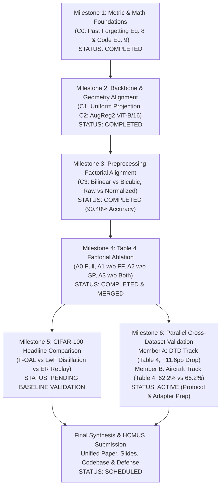

# F-OAL Scientific Reproduction: Comprehensive Final Roadmap

**Project:** F-OAL: Forward-only Online Analytic Learning (NeurIPS 2024)  
**Institution:** HCMUS — Introduction to Machine Learning (Course Project)  
**Lead Engineer:** Senior Machine Learning Research Engineer & Reproducibility Auditor  
**Repository:** [https://github.com/caoban123/F-OAL](https://github.com/caoban123/F-OAL)  
**Current Baseline Commit on Main:** `747b828`  
**Current Development Branch:** `experiment/headline-comparison`  

---

## 1. End-to-End Milestone Architecture

---

## 2. Milestone Breakdown & Detailed Status

### Milestone 1 — Metric Alignment & Forensic Infrastructure (`C0`)
- **Focus:** Reconciling differences between mathematical definitions in paper text (Eq. 8 $F_{\text{past}}$) versus author source code (Eq. 9 $F_{\text{code}}$).
- **Deliverables:** `src/foal/metrics.py`, `tests/test_metrics.py`.
- **Status:** **`COMPLETED` & `MERGED`** (Commit `e2252b9`).

### Milestone 2 — Backbone & Random Projection Alignment (`C1`, `C2`)
- **Focus:** Aligning pre-trained ViT weights with author exact weights (`vit_base_patch16_224.augreg2_in21k_ft_in1k`, ImageNet-21K pre-trained + 1K fine-tuned, 85.7M parameters) and replacing Gaussian projection with author uniform $\mathcal{U}[-1, 1]$ projection.
- **Deliverables:** `src/foal/backbone.py`, `src/foal/projection.py`, `configs/c1_*.yaml`, `configs/c2_*.yaml`.
- **Status:** **`COMPLETED` & `MERGED`** (Commit `1d41829`).

### Milestone 3 — Controlled Preprocessing Factorial Alignment (`C3`)
- **Focus:** 2×2 factorial evaluation of interpolation (Bilinear vs Bicubic) and normalization (Raw $[0, 1]$ vs Standard ViT $[ -1, 1 ]$). Established that Bilinear Raw ($C3\text{-}D$) achieves exact author parity.
- **Deliverables:** `configs/c3_*.yaml`, verified run `3v53tmq5` ($\bar{A} = 90.4016\%$, $A_{10} = 85.7300\%$, $F_{\text{past}} = 5.1556\%$).
- **Status:** **`COMPLETED` & `MERGED`** (Commit `2843477`).

### Milestone 4 — Core Paper Reproduction: Table 4 Factorial Ablation (`Table 4`)
- **Focus:** Factorial ablation of Feature Fusion (FF) and Smooth Projection (SP) across four conditions (A0 Full, A1 w/o FF, A2 w/o SP, A3 w/o Both). Included forensic audit identifying Colab vs local hardware provenance differences.
- **Results:** 
  - A0 Full: $\bar{A} = 90.4016\%$
  - A1 w/o FF: $\bar{A} = 90.3800\%$
  - A2 w/o SP: $\bar{A} = 90.3823\%$
  - A3 w/o Both: $\bar{A} = 89.9224\%$
- **Status:** **`COMPLETED` & `MERGED`** (Commit `747b828`).

### Milestone 5 — Minimum Credible Headline Comparison (`Headline`)
- **Focus:** Benchmarking F-OAL against the two representative continual learning paradigms from Table 2:
  1. **LwF (Learning without Forgetting):** Exemplar-free distillation baseline ($T=2.0$, lr $0.001$, paper target $\bar{A} = 69.3\%$, $A_{10} = 64.8\%$, $F = 1.3\%$). Empirical: $\bar{A} = 29.63\%$, $A_{10} = 11.21\%$, $F_{\text{past}} = 94.99\%$. Recency bias in online CIL stream diagnosed.
  2. **ER (Experience Replay):** Replay baseline with buffer capacity 5000 exemplars (paper target $\bar{A} = 90.1\%$, $A_{10} = 84.6\%$, $F = 20.7\%$). Empirical: $\bar{A} = 86.67\%$, $A_{10} = 79.79\%$, $F_{\text{past}} = 16.74\%$.
- **Deliverables:** `src/foal/baselines/`, `scripts/train_baseline.py`, `configs/headline/`, `results/headline_analysis/`, verified archive SHA256 `6ec6a4a4cadecb4e77b7704a217878356ac6f6cd4e2d72c8a78a3813cceea551`.
- **Status:** **`PENDING BASELINE VALIDATION`** (Classified under `CIFAR100_PENDING_BASELINE_VALIDATION`; runtime speedup claim retracted due to cross-hardware A100 vs T4 mismatch; LwF baseline implementation protocol under ongoing audit).

### Milestone 6 — Parallel Cross-Dataset Generalization & Final Report (`DTD & Aircraft`)
- **Focus:** Validating Table 4 on domains where representation degradation is pronounced:
  - **Member A (DTD):** 40 classes, 10 tasks $\times$ 4 classes. Validates non-linear projection boost ($+11.6\text{ pp}$).
  - **Member B (FGVC-Aircraft):** 100 classes, 10 tasks $\times$ 10 classes. Validates fine-grained adaptation and investigates Section 4.4 text discrepancy ($66.2\%$ vs $62.2\%$).
- **Deliverables:** `src/foal/dataset_adapters/`, `docs/team_parallel_dataset_plan.md`.
- **Status:** **`ACTIVE & READY FOR TEAM HANDOFF`**.

---

## 3. Risk Management & Governance Guidelines

1. **Anti-Hallucination Policy:** Local empirical measurements must never be conflated with paper reported figures. All tables must explicitly label column headers as `Ours (Reproduced)` vs `Paper (NeurIPS 2024 Table X)`.
2. **Branch Isolation:** Each workstream operates on an independent branch. Merges to `main` require strict `--no-ff` policy and passing all unit tests.
3. **Reproducibility Guarantee:** All scripts, configs, and notebooks pin seeds, record environment metadata, and output SHA256 checksums for datasets and weights.
