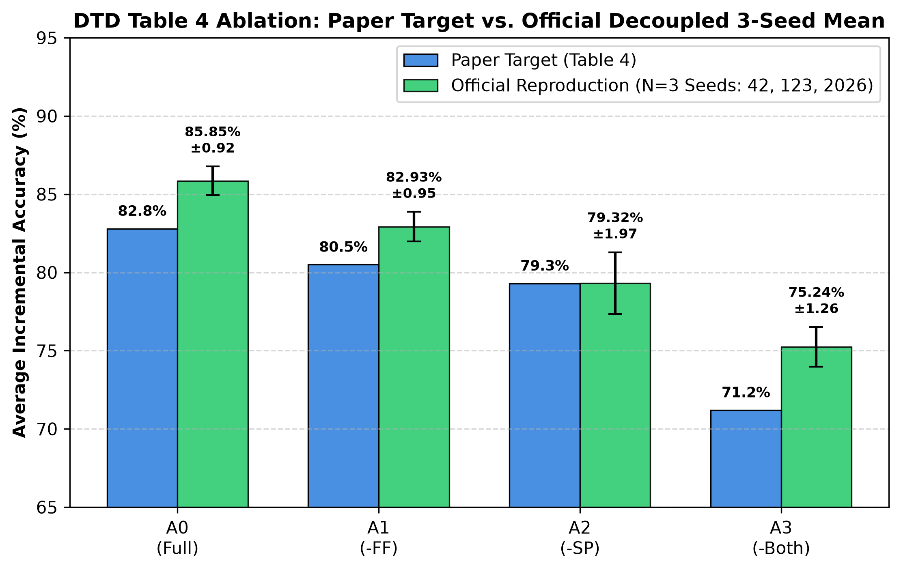
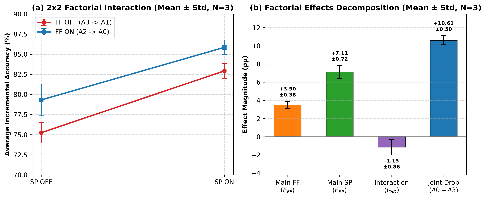
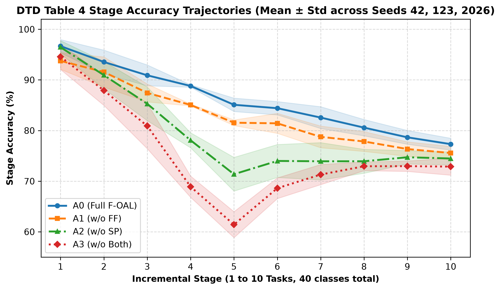
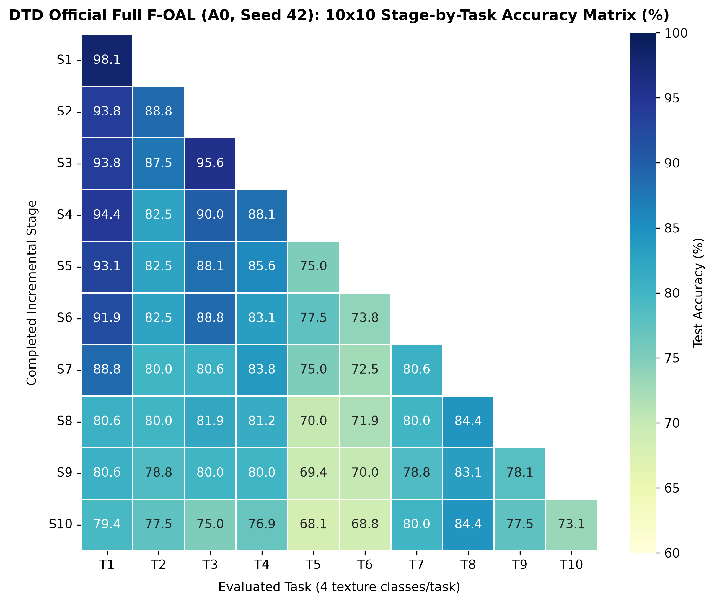

# F-OAL Table 4 Ablation & Control Studies Report — DTD Benchmark


> **Điều hướng nhanh:** [← Trang chủ `README.md`](../README.md) | [Giải trình Giới hạn DTD](Limitations.md) | [Nghịch lý Độ quên DTD](Limitations_2.md) | [W&B Report DTD](https://forge.coreweave.com/wandb/caoban170106-tr-ng-i-h-c-khoa-h-c-t-nhi-n-hqg-hcm/hcmus-foal-reproduction/reports/F-OAL-T%C3%A1i-l%E1%BA%ADp-th%E1%BB%B1c-nghi%E1%BB%87m-v%C3%A0-ph%C3%A2n-t%C3%ADch-ablation-tr%C3%AAn-DTD--VmlldzoxODI3ODAxMQ)
> *(Ghi chú tích hợp: Toàn bộ 12 runs Table 4 và chuỗi C1–C3 của DTD đã hợp nhất đầy đủ vào nhánh `main`).*

**Branch**: `experiment/dtd-ablation`
**Canonical Evidence Source**: `results/dtd/` (12 decoupled Colab Tesla T4 runs: Conditions `A0–A3` × Seeds `42, 123, 2026`, git commit `ca42e672`)
**Canonical Summary & Charts**: [results/dtd/dtd_table4_summary.json](../results/dtd/dtd_table4_summary.json), [results/dtd_table4_analysis/](../results/dtd_table4_analysis/table4_metrics_comparison.json)

---

## 1. Executive Summary

We reproduce **Table 4** of the NeurIPS 2024 F-OAL paper (*Forward-Only Analytic Learning for Exemplar-Free Class-Incremental Learning*) on the **Describable Textures Dataset (DTD)** using 10 incremental stages of 4 classes (40 of 47 classes) under a **decoupled 3-seed protocol** (`42, 123, 2026`) where each seed independently permutes class selection/order, dataset subsampling, random projection initialization, and intra-task sample streaming.

Across all 12 canonical runs in `results/dtd/`:
- **Full F-OAL (`A0`)** achieves **$\bar{A} = 85.85 \pm 0.92\%$** (`85.08%`, `86.87%`, `85.60%`), exceeding the published NeurIPS 2024 Table 4 score (`82.8%`) by **`+3.05 pp`** (`85.08%` at Seed 42, `+2.28 pp` above paper) under the 40 images/class subsampled split.
- **Smooth Projection (SP)** is the dominant driver of incremental accuracy: average main effect **$E_{\text{SP}} = +7.11 \pm 0.72\text{ pp}$** (paired $t_2 = 17.05$, exact two-sided $p = 0.0034$).
- **Feature Fusion (FF)** provides a consistent, additive gain across all seeds: average main effect **$E_{\text{FF}} = +3.50 \pm 0.38\text{ pp}$** (paired $t_2 = 15.80$, $p = 0.0040$).
- **Joint Improvement (`A0 - A3`)** is **$+10.61 \pm 0.50\text{ pp}$** (95% CI `[+9.37, +11.85]`, paired $t_2 = 36.83$, $p = 0.00074$), while the Difference-in-Differences interaction contrast is slightly negative but statistically non-significant ($I_{\text{DiD}} = -1.15 \pm 0.86\text{ pp}$, $t_2 = -2.32$, $p = 0.1458$), indicating largely additive contributions with mild overlap.
- **Plasticity–Forgetting Trade-off**: Both FF and SP substantially boost peak learning capacity while incurring a controlled increase in backward forgetting ($F_{\text{past}}$ rises from `4.54 ± 1.25%` in `A3` to `8.22 ± 0.36%` in `A0`), yielding net gains in both $\bar{A}$ (`+10.61 pp`) and final stage accuracy $A_{10}$ (`72.88%` $\to$ `77.31%`, `+4.44 pp`).

---

## 2. Canonical Table 4 Results (`results/dtd/`, 3 Decoupled Seeds)

All 12 runs share identical architecture settings (`vit_base_patch16_224.augreg2_in21k_ft_in1k`, `dim=1000` when SP=True / `768` when SP=False, `official_uniform` projection, $\gamma=1.0$, `float64` RLS, bilinear resize + raw `[0,1]` pixels, `tanganke/dtd` 40 classes × 40 train/40 test samples/class).

### 2.1 Per-Seed & Multi-Seed Summary ($\bar{A}, A_{10}, F_{\text{past}}, F_{\text{code}}$)

| Condition | Components | Dim | Seed 42 $\bar{A}$ | Seed 123 $\bar{A}$ | Seed 2026 $\bar{A}$ | **Mean $\pm$ Std $\bar{A}$** | Mean $\pm$ Std $A_{10}$ | Mean $\pm$ Std $F_{\text{past}}$ | Mean $\pm$ Std $F_{\text{code}}$ | Paper $\bar{A}$ |
| :--- | :--- | :---: | :---: | :---: | :---: | :---: | :---: | :---: | :---: | :---: |
| **`A0` Full F-OAL** | FF=True, SP=True | 1000 | 85.08% | 86.87% | 85.60% | **85.85 $\pm$ 0.92%** | **77.31 $\pm$ 1.17%** | 8.22 $\pm$ 0.36% | 7.46 $\pm$ 0.25% | 82.8% |
| **`A1` w/o FF** | FF=False, SP=True | 1000 | 82.08% | 83.95% | 82.75% | **82.93 $\pm$ 0.95%** | **75.56 $\pm$ 1.30%** | 7.69 $\pm$ 0.11% | 6.98 $\pm$ 0.19% | 80.5% |
| **`A2` w/o SP** | FF=True, SP=False | 768 | 77.81% | 81.54% | 78.60% | **79.32 $\pm$ 1.97%** | **74.48 $\pm$ 1.29%** | 5.88 $\pm$ 1.81% | 5.37 $\pm$ 1.74% | 79.3% |
| **`A3` w/o Both** | FF=False, SP=False | 768 | 74.58% | 76.70% | 74.45% | **75.24 $\pm$ 1.26%** | **72.88 $\pm$ 1.69%** | 4.54 $\pm$ 1.25% | 4.65 $\pm$ 0.75% | 71.2% |

*Exact 4-decimal unrounded means from raw `metrics.json`*:
- `A0`: $\bar{A} = 85.8509 \pm 0.9196\%$, $A_{10} = 77.3125 \pm 1.1676\%$, $F_{\text{past}} = 8.2176 \pm 0.3564\%$, $F_{\text{code}} = 7.4583 \pm 0.2500\%$
- `A1`: $\bar{A} = 82.9254 \pm 0.9456\%$, $A_{10} = 75.5625 \pm 1.3025\%$, $F_{\text{past}} = 7.6852 \pm 0.1059\%$, $F_{\text{code}} = 6.9792 \pm 0.1909\%$
- `A2`: $\bar{A} = 79.3177 \pm 1.9676\%$, $A_{10} = 74.4792 \pm 1.2912\%$, $F_{\text{past}} = 5.8796 \pm 1.8124\%$, $F_{\text{code}} = 5.3750 \pm 1.7399\%$ (rounds to `5.37%` under IEEE-754 round-to-even in CSVs)
- `A3`: $\bar{A} = 75.2427 \pm 1.2650\%$, $A_{10} = 72.8750 \pm 1.6910\%$, $F_{\text{past}} = 4.5370 \pm 1.2506\%$, $F_{\text{code}} = 4.6458 \pm 0.7509\%$

**Per-seed complete Table 4 breakdown**:

| Condition | Seed | $\bar{A}$ (%) | $A_{10}$ (%) | $F_{\text{past}}$ (%) | $F_{\text{code}}$ (%) |
| :--- | :---: | :---: | :---: | :---: | :---: |
| `A0` Full F-OAL | 42 | 85.0838 | 76.0625 | 8.6111 | 7.7500 |
| `A0` Full F-OAL | 123 | 86.8703 | 78.3750 | 7.9167 | 7.3125 |
| `A0` Full F-OAL | 2026 | 85.5984 | 77.5000 | 8.1250 | 7.3125 |
| `A1` w/o FF | 42 | 82.0829 | 74.0625 | 7.7778 | 7.1875 |
| `A1` w/o FF | 123 | 83.9481 | 76.2500 | 7.7083 | 6.9375 |
| `A1` w/o FF | 2026 | 82.7452 | 76.3750 | 7.5694 | 6.8125 |
| `A2` w/o SP | 42 | 77.8058 | 73.0000 | 6.3194 | 5.6875 |
| `A2` w/o SP | 123 | 81.5423 | 75.3750 | 7.4306 | 6.9375 |
| `A2` w/o SP | 2026 | 78.6049 | 75.0625 | 3.8889 | 3.5000 |
| `A3` w/o Both | 42 | 74.5789 | 71.1250 | 5.9722 | 5.3750 |
| `A3` w/o Both | 123 | 76.7014 | 74.5000 | 3.9583 | 4.6875 |
| `A3` w/o Both | 2026 | 74.4478 | 73.0000 | 3.6806 | 3.8750 |

*(Note on forgetting definitions matching code: `forgetting_past_tasks` averages signed historical drops over tasks $1 \dots 9$ via $\frac{1}{9}\sum_{j=0}^{8}(\max_{s \in [j, 8]} A_{s,j} - A_{9,j})$, whereas `forgetting_official_code` follows $\frac{1}{10}\sum_{j=0}^{9}(\max_{s \in [j, 9]} A_{s,j} - A_{9,j})$.)*



---

### 2.2 $2 \times 2$ Factorial Effects & Paired Statistical Tests ($n = 3$ Decoupled Seeds, $\text{df} = 2$)

Because all four conditions `(A0, A1, A2, A3)` within a seed share the exact same dataset split, class order, projection matrix (`A0`/`A1` share `projection_metadata.matrix_sha256`), and sample stream (`task_split_fingerprint.sha256` identical across all 4 conditions per seed), within-seed paired differences eliminate split variance. Exact two-sided Student-$t$ values on $\text{df}=2$ (`t_crit = 4.3027`, $p = 1 - |t|/\sqrt{t^2+2}$):

| Effect | Symbol | Seed 42 (pp) | Seed 123 (pp) | Seed 2026 (pp) | Mean $\pm$ Std (pp) | Paired $t_2$ | Exact $p$ | 95% CI (pp) |
| :--- | :--- | :---: | :---: | :---: | :---: | :---: | :---: | :---: |
| FF benefit (SP ON: `A0-A1`) | $E_{\text{FF}\|\text{SP}}$ | +3.0009 | +2.9222 | +2.8532 | **+2.93 $\pm$ 0.07** | +68.56 | 0.00021 | [+2.74, +3.11] |
| FF benefit (SP OFF: `A2-A3`) | $E_{\text{FF}\|\neg\text{SP}}$ | +3.2270 | +4.8409 | +4.1571 | **+4.07 $\pm$ 0.81** | +8.71 | 0.01292 | [+2.06, +6.09] |
| SP benefit (FF ON: `A0-A2`) | $E_{\text{SP}\|\text{FF}}$ | +7.2780 | +5.3280 | +6.9935 | **+6.53 $\pm$ 1.05** | +10.74 | 0.00855 | [+3.92, +9.15] |
| SP benefit (FF OFF: `A1-A3`) | $E_{\text{SP}\|\neg\text{FF}}$ | +7.5040 | +7.2467 | +8.2974 | **+7.68 $\pm$ 0.55** | +24.30 | 0.00169 | [+6.32, +9.04] |
| **FF main effect** | $E_{\text{FF}}$ | +3.1140 | +3.8816 | +3.5051 | **+3.50 $\pm$ 0.38** | +15.80 | 0.00398 | [+2.55, +4.45] |
| **SP main effect** | $E_{\text{SP}}$ | +7.3910 | +6.2874 | +7.6454 | **+7.11 $\pm$ 0.72** | +17.05 | 0.00342 | [+5.31, +8.90] |
| DiD interaction | $I_{\text{DiD}}$ | -0.2260 | -1.9187 | -1.3038 | **-1.15 $\pm$ 0.86** | -2.32 | 0.14577 | [-3.28, +0.98] |
| Half-interaction | $I_{\text{half}}$ | -0.1130 | -0.9594 | -0.6519 | **-0.57 $\pm$ 0.43** | -2.32 | 0.14578 | [-1.64, +0.49] |
| Regression coeff ($\pm 1$) | $\beta_{\text{FF}\times\text{SP}}$ | -0.0565 | -0.4797 | -0.3260 | **-0.29 $\pm$ 0.21** | -2.32 | 0.14577 | [-0.82, +0.24] |
| **Joint benefit (`A0-A3`)** | $\Delta_{\text{joint}}$ | +10.5050 | +10.1689 | +11.1506 | **+10.61 $\pm$ 0.50** | +36.83 | 0.00074 | [+9.37, +11.85] |



---

### 2.3 Stage-by-Stage Incremental Accuracy Trajectories (Stages 1–10)

| Stage | Classes Seen | Seed 42 (`A0 / A1 / A2 / A3`, %) | 3-Seed Mean `A0` (%) | 3-Seed Mean `A1` (%) | 3-Seed Mean `A2` (%) | 3-Seed Mean `A3` (%) |
| :---: | :---: | :---: | :---: | :---: | :---: | :---: |
| 1 | 4 | 98.12 / 95.62 / 97.50 / 96.88 | 96.67 $\pm$ 1.30 | 93.75 $\pm$ 1.65 | 96.46 $\pm$ 1.30 | 94.58 $\pm$ 2.53 |
| 2 | 8 | 91.25 / 89.69 / 89.38 / 85.62 | 93.54 $\pm$ 2.35 | 91.56 $\pm$ 2.98 | 90.94 $\pm$ 2.71 | 87.92 $\pm$ 2.95 |
| 3 | 12 | 92.29 / 89.17 / 86.88 / 82.50 | 90.90 $\pm$ 2.06 | 87.43 $\pm$ 1.77 | 85.28 $\pm$ 3.32 | 80.90 $\pm$ 4.49 |
| 4 | 16 | 88.75 / 84.84 / 76.56 / 69.53 | 88.80 $\pm$ 0.24 | 85.05 $\pm$ 0.18 | 78.07 $\pm$ 1.49 | 68.91 $\pm$ 2.10 |
| 5 | 20 | 84.88 / 81.00 / 68.75 / 60.75 | 85.08 $\pm$ 1.32 | 81.54 $\pm$ 0.56 | 71.38 $\pm$ 3.33 | 61.42 $\pm$ 2.57 |
| 6 | 24 | 82.92 / 79.17 / 70.52 / 66.25 | 84.41 $\pm$ 1.32 | 81.42 $\pm$ 1.97 | 73.99 $\pm$ 3.26 | 68.61 $\pm$ 2.04 |
| 7 | 28 | 80.18 / 76.34 / 70.54 / 69.02 | 82.56 $\pm$ 2.15 | 78.75 $\pm$ 2.14 | 73.93 $\pm$ 3.69 | 71.31 $\pm$ 1.99 |
| 8 | 32 | 78.75 / 75.94 / 71.33 / 72.03 | 80.57 $\pm$ 1.61 | 77.84 $\pm$ 1.96 | 73.93 $\pm$ 2.36 | 72.94 $\pm$ 0.86 |
| 9 | 36 | 77.64 / 75.00 / 73.61 / 72.08 | 78.66 $\pm$ 1.36 | 76.34 $\pm$ 1.43 | 74.72 $\pm$ 1.32 | 72.96 $\pm$ 1.03 |
| 10 | 40 | 76.06 / 74.06 / 73.00 / 71.12 | 77.31 $\pm$ 1.17 | 75.56 $\pm$ 1.30 | 74.48 $\pm$ 1.29 | 72.88 $\pm$ 1.69 |




### 2.4 Plasticity–Forgetting Mechanism (Seed 42 `A0` vs `A2` Matrix Inspection)

Removing Smooth Projection (`A0 -> A2`) shifts Seed 42 $\bar{A}$ from `85.08%` to `77.81%` (`-7.28 pp`) while lowering $F_{\text{past}}$ from `8.61%` to `6.32%` (`-2.29 pp`). Inspecting per-task historical peaks and final accuracies across Tasks 1–9 (`results/dtd/dtd_a0_full/matrix.json` vs `dtd_a2_without_sp/matrix.json`) shows that underlearning masks forgetting:

| Past Task $j$ | `A0` Peak (%) | `A0` Final (%) | `A0` $f_j$ (%) | `A2` Peak (%) | `A2` Final (%) | `A2` $f_j$ (%) | $\Delta\text{Peak}_j$ (pp) | $\Delta\text{Final}_j$ (pp) |
| :---: | :---: | :---: | :---: | :---: | :---: | :---: | :---: | :---: |
| Task 1 | 98.12 | 79.38 | 18.75 | 97.50 | 75.00 | 22.50 | +0.62 | +4.38 |
| Task 2 | 88.75 | 77.50 | 11.25 | 86.25 | 69.38 | 16.88 | +2.50 | +8.12 |
| Task 3 | 95.62 | 75.00 | 20.62 | 88.75 | 77.50 | 11.25 | +6.88 | -2.50 |
| Task 4 | 88.12 | 76.88 | 11.25 | 76.25 | 75.00 | 1.25 | +11.88 | +1.88 |
| Task 5 | 77.50 | 68.12 | 9.38 | 64.38 | 61.25 | 3.12 | +13.12 | +6.88 |
| Task 6 | 73.75 | 68.75 | 5.00 | 68.75 | 68.12 | 0.62 | +5.00 | +0.62 |
| Task 7 | 80.62 | 80.00 | 0.62 | 76.88 | 76.88 | 0.00 | +3.75 | +3.12 |
| Task 8 | 84.38 | 84.38 | 0.00 | 80.00 | 80.00 | 0.00 | +4.38 | +4.38 |
| Task 9 | 78.12 | 77.50 | 0.62 | 75.62 | 74.38 | 1.25 | +2.50 | +3.12 |
| **Mean (1–9)** | **85.00** | **76.39** | **8.61** | **79.38** | **73.06** | **6.32** | **+5.62** | **+3.33** |

- **Exact Forgetting Gap Identity**: $\Delta F_{\text{past}} = (\overline{\text{Peak}}^{\text{A0}} - \overline{\text{Peak}}^{\text{A2}}) - (\overline{\text{Final}}^{\text{A0}} - \overline{\text{Final}}^{\text{A2}}) = (85.0000\% - 79.3750\%) - (76.3889\% - 73.0556\%) = +5.6250 - 3.3333 = \mathbf{+2.2917\text{ pp}}$.
- **Relative Knowledge Retention ($\text{RKR} = \overline{\text{Final}}/\overline{\text{Peak}}$ on Seed 42)**: `A0 = 89.87%` (`76.39 / 85.00`), `A1 = 90.52%` (`74.24 / 82.01`), `A2 = 92.04%` (`73.06 / 79.38`), `A3 = 92.28%` (`71.39 / 77.36`). Across the 3-seed canonical mean, the same monotonic ordering holds: $\bar{A}$ decreases (`85.85 > 82.93 > 79.32 > 75.24%`) while $F_{\text{past}}$ also decreases (`8.22 > 7.69 > 5.88 > 4.54%`).

---

## 3. Forensic Reconciliation of Repository Result Groups & Data Protocols

During repository auditing, four historical or environment-specific result sets appeared across documentation. All four have now been traced to their exact causes:

| Group | Location / Origin | Reported $\bar{A}$ (`A0 / A1 / A2 / A3` or Multi-seed) | Root Cause & Disposition |
| :---: | :--- | :--- | :--- |
| **1 (CANONICAL)** | [results/dtd/](../results/dtd/dtd_table4_summary.json) (12 decoupled Colab Tesla T4 runs, commit `ca42e672`) | `85.85 ± 0.92%` / `82.93 ± 0.95%` / `79.32 ± 1.97%` / `75.24 ± 1.26%` (Seed 42: `85.08 / 82.08 / 77.81 / 74.58%`) | **OFFICIAL**: 40 images/class (`samples_per_class=40`), decoupled `class_order`/`dataset`/`projection`/`stream` seeds `{42, 123, 2026}`, `bilinear` raw `[0,1]`. |
| **2 (RETIRED)** | Historical unsubsampled run (pre-`acea57e`, formerly hardcoded in `dtd_ablation_report.md` & chart script) | Seed 42: `87.20% / 85.01% / 84.35% / 81.10%` | **RETIRED**: Used **80 train images/class** (all 3,200 samples from `tanganke/dtd` `train` = original train+val), violating Section 2/Table 4 40-images/class protocol. Raw `metrics.json` were never committed. |
| **3 (LEGACY CPU)** | `results/dtd_multiseed_1600_summary.json` (file cục bộ, không đưa lên repo theo `results/README.md`) (Local CPU feature cache, commit `747b828`) | Seed 42: `85.26 / 82.55 / 78.64 / 72.97%`; Multi-seed A0: `85.13 ± 0.11%` | **HISTORICAL SUITE**: Differs from Group 1 because (i) `DTDSubsetDataset` subsampled 40/class via `default_rng(42)` in sorted class-ID order instead of permuted `order`, and (ii) `run_dtd_suite.py` Part 5 varied only `projection_seed`/`stream_seed` while freezing `class_order=42` on the Seed 42 cache. |
| **4 (MIXED FIXTURE)** | `results/foal_full_dtd_seed42/` (`85.08%`) + `results/foal_multiseed_dtd_seed123/` (`85.09%`) + `seed2026` (`85.05%`) | Hybrid average: `85.07 ± 0.02%` | **LEGACY TEST FIXTURE**: Combines Colab GPU Seed 42 with coupled CPU Seeds 123/2026. Preserved untouched on disk for auditability; retired from official statistics. |

### 3.1 Why 40 vs. 80 Train Images/Class Happens on `tanganke/dtd`
- Original DTD has 47 classes × 120 images/class (`40 train / 40 val / 40 test`), totaling `1,880 train / 1,880 val / 1,880 test`.
- On HuggingFace (`tanganke/dtd`), `train+val` are merged into `ds["train"]` (**3,760 images**, **80 per class**) while `ds["test"]` contains **1,880 images** (**40 per class**).
- Per the NeurIPS 2024 paper (`tanganke/dtd` subsampled to 40 train/40 test across 40 classes = **1,600 train / 1,600 test**), `samples_per_class: 40` must be enforced; failing to cap at 40 doubles the training set to 3,200 images (`87.20%` regime).

### 3.2 Dataset Adapter Alignment & Upstream Integrity Audit
1. **Adapter Alignment ([src/foal/dataset_adapters/dtd.py](../src/foal/dataset_adapters/dtd.py) vs [src/foal/dtd_datasets.py](../src/foal/dtd_datasets.py))**:
   - Fixed 7 previously fabricated class names in `DTD_ALL_CLASSES` (`cluttered, damask, delicate, liney, smudgy, speckled, spotted` $\to$ real DTD labels `cobwebbed, lined, spiralled, stained, stratified, wrinkled, zigzagged`) so `DTD_ALL_CLASSES == list(DTD_CLASS_NAMES)` across all 47 classes.
   - Aligned `select_dtd_classes(...)` and `samples_per_class: int | None = 40` across both loaders, and added `compute_task_split_fingerprint` provenance logging to [scripts/train_dtd.py](../scripts/train_dtd.py).
2. **Upstream `tanganke/dtd` Byte-Duplicate Disclosure**:
   - Byte-level SHA-256 hashing of decoded images (`img.tobytes()`) in the cached HuggingFace dataset (`tanganke___dtd/default/0.0.0/d2afa97d9f335b1a6b3b09c637aef667f98f966e`, `3,760 train / 1,880 test`) revealed **7 exact duplicate image byte hashes** spanning `train` and `test`: 6 pairs in class 10 (`dotted`: train `[204, 208, 211, 212, 218, 224]` vs test `[93, 94, 108, 109, 113, 118]`) and 1 pair in class 32 (`potholed`: train `2144` vs test `1053`).
   - Additionally, `task_split_fingerprint` in `metadata.json` hashes integer dataset indices rather than raw image bytes, so downstream checks treat `tanganke/dtd` upstream splits as-published rather than de-duplicating them.

---

## 4. Control Studies (C1, C2, C3) & Official FOAL Code Verification (Seed 42 / Seed 0)

Alongside Table 4, three controlled diagnostic suites (Colab Tesla T4, Seed 42) and one official FOAL reference run quantify sensitivity to initialization, backbone weights, and preprocessing:

| Study | Run / Dir | Variable Tested | Key Setting | $\bar{A}$ (%) | $A_{10}$ (%) | $F_{\text{past}}$ (%) | $\Delta$ vs Baseline |
| :--- | :--- | :--- | :--- | :---: | :---: | :---: | :--- |
| **C1: Projection Init** (`torchvision` split) | `p0_gaussian_std1` | Init distribution | $\mathcal{N}(0, 1)$, `augreg_in1k` | 61.45 | 53.19 | 10.42 | **-16.48 pp** (gradient-scale / ridge distortion) |
| | `p1_official_uniform` | Init distribution | $\mathcal{U}(-a, a)$, `std=1/48` | 77.93 | 68.69 | 10.00 | Reference (`P1`) |
| | `p2_gaussian_matched_variance` | Init distribution | $\mathcal{N}(0, (1/48)^2)$ | 77.70 | 68.69 | 9.51 | -0.24 pp (variance matching rescues Gaussian!) |
| **C2: Backbone Pretrain** (`tanganke/dtd`) | `b0_augreg_in1k` | ViT checkpoint | `augreg_in1k`, `bicubic+norm` | 77.97 | 69.19 | 9.93 | Reference (`B0`) |
| | `b1_augreg2_in21k_ft_in1k` | ViT checkpoint | `augreg2_in21k_ft_in1k` | 85.12 | 77.19 | 8.26 | **+7.15 pp** (dominant driver vs paper `82.8%`) |
| **C3: Preprocessing** (`augreg2_in21k_ft_in1k`) | `c3_a_bicubic_normalized` | Resize + Norm | `bicubic`, ImageNet norm | 85.12 | 77.19 | 8.26 | +0.03 pp vs C3-D (note: only `metrics/metadata.json` archived) |
| | `c3_b_bilinear_normalized` | Resize + Norm | `bilinear`, ImageNet norm | 85.13 | 76.88 | 8.47 | +0.04 pp vs C3-D |
| | `c3_c_bicubic_raw` | Resize + Norm | `bicubic`, raw `[0,1]` | 85.13 | 76.62 | 8.54 | +0.05 pp vs C3-D |
| | `c3_d_bilinear_raw` | Resize + Norm | `bilinear`, raw `[0,1]` (=A0 Seed 42) | 85.08 | 76.06 | 8.61 | Baseline (`0.00 pp`) |
| **Official FOAL Code** (`results/official_foal_dtd_seed0`) | `official_foal_dtd_seed0` | Official repo CLI | `class_order=42`, `proj/stream=0`, `vit_base_patch16_224` | 85.04 | 75.94 | — | Matches `A0 Seed 42` within `0.05 pp` (`142.07s` no cache) |

---

## 5. Complete 10-Column Evidence & Provenance Mapping

*Important provenance limitations*:
1. **Git `dirty` flag in 11/12 `results/dtd/` runs**: `dtd_a0_full` recorded `dirty=False` at `ca42e672`; the remaining 11 runs recorded `dirty=True` because earlier run folders were created inside untracked `results/dtd/` before `git status --porcelain` was filtered (`9f955ca`). **The exact git diff at execution time was not archived**, which we disclose transparently.
2. **W&B Run IDs**: Metadata records `entity: caoban170106-tr-ng-i-h-c-khoa-h-c-t-nhi-n-hqg-hcm`, `project: hcmus-foal-reproduction`, `group: table4_ablation_dtd` (and `c1_*`, `c2_*`, `c3_*`), but individual W&B run IDs were not persisted inside `metadata.json`. (Legacy `phongphanthe70-afsb` W&B links in older docs belong exclusively to Group 3 CPU runs at commit `747b828`.)
3. **Runtime accounting**: `A0`/`A1` (6 runs) performed cold ViT feature extraction (`38.99–42.17s` extraction, `0.88–0.94s` RLS+eval, `40.40–43.60s` total); `A2`/`A3` (6 runs) reused cached features (`feature_extraction_seconds` records the upstream cache timestamp `38.99–42.17s`, while wall-clock `total_duration_seconds` was **`0.97–1.27s`** with `0.79–1.00s` RLS+eval).

| # | Run / Seed | Raw Result Directory | Git Commit & Dirty | Hardware & Runtime (Total / Feat / RLS) | Dataset & Preprocess | Seeds (`base/cls/proj/strm`) | Fingerprints (`split / cls / proj` prefix) | $\bar{A} / A_{10} / F_{\text{past}} / F_{\text{code}}$ (%) | Flags (`FF, SP, dim, backbone`) | W&B Group & Status |
| :---: | :--- | :--- | :--- | :--- | :--- | :--- | :--- | :--- | :--- | :--- |
| 1 | `A0` s42 | [results/dtd/dtd_a0_full/](../results/dtd/dtd_a0_full/metrics.json) | `ca42e672` (`dirty=False`) | Tesla T4 (`40.40 / 38.99 / 0.88s`, cold) | `tanganke/dtd` 40/cls, `bilinear, raw` | `42/42/42/42` | `42b13803 / 86ccb777 / 6d3048f4` | `85.08 / 76.06 / 8.61 / 7.75` | `T, T, 1000, augreg2` | `table4_ablation_dtd` (Official) |
| 2 | `A0` s123 | [results/dtd/a0_seed123/](../results/dtd/a0_seed123/metrics.json) | `ca42e672` (`dirty=True*`) | Tesla T4 (`41.56 / 40.15 / 0.88s`, cold) | `tanganke/dtd` 40/cls, `bilinear, raw` | `123/123/123/123` | `45da4afe / 6f3d28b9 / c91261e1` | `86.87 / 78.38 / 7.92 / 7.31` | `T, T, 1000, augreg2` | `table4_ablation_dtd` (Official) |
| 3 | `A0` s2026 | [results/dtd/a0_seed2026/](../results/dtd/a0_seed2026/metrics.json) | `ca42e672` (`dirty=True*`) | Tesla T4 (`43.60 / 42.17 / 0.89s`, cold) | `tanganke/dtd` 40/cls, `bilinear, raw` | `2026/2026/2026/2026` | `29e80afd / 5fd20f5d / e3685d41` | `85.60 / 77.50 / 8.12 / 7.31` | `T, T, 1000, augreg2` | `table4_ablation_dtd` (Official) |
| 4 | `A1` s42 | [results/dtd/dtd_a1_without_ff/](../results/dtd/dtd_a1_without_ff/metrics.json) | `ca42e672` (`dirty=True*`) | Tesla T4 (`41.50 / 40.08 / 0.90s`, cold) | `tanganke/dtd` 40/cls, `bilinear, raw` | `42/42/42/42` | `42b13803 / 86ccb777 / 6d3048f4` | `82.08 / 74.06 / 7.78 / 7.19` | `F, T, 1000, augreg2` | `table4_ablation_dtd` (Official) |
| 5 | `A1` s123 | [results/dtd/a1_seed123/](../results/dtd/a1_seed123/metrics.json) | `ca42e672` (`dirty=True*`) | Tesla T4 (`43.23 / 41.69 / 0.94s`, cold) | `tanganke/dtd` 40/cls, `bilinear, raw` | `123/123/123/123` | `45da4afe / 6f3d28b9 / c91261e1` | `83.95 / 76.25 / 7.71 / 6.94` | `F, T, 1000, augreg2` | `table4_ablation_dtd` (Official) |
| 6 | `A1` s2026 | [results/dtd/a1_seed2026/](../results/dtd/a1_seed2026/metrics.json) | `ca42e672` (`dirty=True*`) | Tesla T4 (`42.40 / 40.97 / 0.91s`, cold) | `tanganke/dtd` 40/cls, `bilinear, raw` | `2026/2026/2026/2026` | `29e80afd / 5fd20f5d / e3685d41` | `82.75 / 76.38 / 7.57 / 6.81` | `F, T, 1000, augreg2` | `table4_ablation_dtd` (Official) |
| 7 | `A2` s42 | [results/dtd/dtd_a2_without_sp/](../results/dtd/dtd_a2_without_sp/metrics.json) | `ca42e672` (`dirty=True*`) | Tesla T4 (`1.03s` wall / `0.85s` RLS, cached) | `tanganke/dtd` 40/cls, `bilinear, raw` | `42/42/42/42` | `42b13803 / 86ccb777 / none` | `77.81 / 73.00 / 6.32 / 5.69` | `T, F, 768, augreg2` | `table4_ablation_dtd` (Official) |
| 8 | `A2` s123 | [results/dtd/a2_seed123/](../results/dtd/a2_seed123/metrics.json) | `ca42e672` (`dirty=True*`) | Tesla T4 (`1.27s` wall / `1.00s` RLS, cached) | `tanganke/dtd` 40/cls, `bilinear, raw` | `123/123/123/123` | `45da4afe / 6f3d28b9 / none` | `81.54 / 75.38 / 7.43 / 6.94` | `T, F, 768, augreg2` | `table4_ablation_dtd` (Official) |
| 9 | `A2` s2026 | [results/dtd/a2_seed2026/](../results/dtd/a2_seed2026/metrics.json) | `ca42e672` (`dirty=True*`) | Tesla T4 (`0.97s` wall / `0.79s` RLS, cached) | `tanganke/dtd` 40/cls, `bilinear, raw` | `2026/2026/2026/2026` | `29e80afd / 5fd20f5d / none` | `78.60 / 75.06 / 3.89 / 3.50` | `T, F, 768, augreg2` | `table4_ablation_dtd` (Official) |
| 10 | `A3` s42 | [results/dtd/dtd_a3_without_both/](../results/dtd/dtd_a3_without_both/metrics.json) | `ca42e672` (`dirty=True*`) | Tesla T4 (`1.26s` wall / `1.00s` RLS, cached) | `tanganke/dtd` 40/cls, `bilinear, raw` | `42/42/42/42` | `42b13803 / 86ccb777 / none` | `74.58 / 71.12 / 5.97 / 5.38` | `F, F, 768, augreg2` | `table4_ablation_dtd` (Official) |
| 11 | `A3` s123 | [results/dtd/a3_seed123/](../results/dtd/a3_seed123/metrics.json) | `ca42e672` (`dirty=True*`) | Tesla T4 (`1.01s` wall / `0.83s` RLS, cached) | `tanganke/dtd` 40/cls, `bilinear, raw` | `123/123/123/123` | `45da4afe / 6f3d28b9 / none` | `76.70 / 74.50 / 3.96 / 4.69` | `F, F, 768, augreg2` | `table4_ablation_dtd` (Official) |
| 12 | `A3` s2026 | [results/dtd/a3_seed2026/](../results/dtd/a3_seed2026/metrics.json) | `ca42e672` (`dirty=True*`) | Tesla T4 (`1.01s` wall / `0.82s` RLS, cached) | `tanganke/dtd` 40/cls, `bilinear, raw` | `2026/2026/2026/2026` | `29e80afd / 5fd20f5d / none` | `74.45 / 73.00 / 3.68 / 3.88` | `F, F, 768, augreg2` | `table4_ablation_dtd` (Official) |
| 13 | `C1-P0` | [results/dtd_c1_full/p0_gaussian_std1/](../results/dtd_c1_full/p0_gaussian_std1/metrics.json) | `d1b4701a` (`dirty=False`) | Tesla T4 (`56.75 / 55.14 / 1.02s`) | `torchvision` 40/cls, `bicubic, norm` | `42/42/42/42` | `f077b2e9 / 86ccb777 / gauss1` | `61.45 / 53.19 / 10.42 / 11.19` | `T, T, 1000, augreg_in1k` | `c1_projection_initialization_dtd` |
| 14 | `C1-P1` | [results/dtd_c1_full/p1_official_uniform/](../results/dtd_c1_full/p1_official_uniform/metrics.json) | `d1b4701a` (`dirty=False`) | Tesla T4 (`1.45s` wall / `1.05s` RLS) | `torchvision` 40/cls, `bicubic, norm` | `42/42/42/42` | `f077b2e9 / 86ccb777 / uniform` | `77.93 / 68.69 / 10.00 / 9.06` | `T, T, 1000, augreg_in1k` | `c1_projection_initialization_dtd` |
| 15 | `C1-P2` | [results/dtd_c1_full/p2_gaussian_matched_variance/](../results/dtd_c1_full/p2_gaussian_matched_variance/metrics.json) | `d1b4701a` (`dirty=False`) | Tesla T4 (`1.42s` wall / `1.00s` RLS) | `torchvision` 40/cls, `bicubic, norm` | `42/42/42/42` | `f077b2e9 / 86ccb777 / gmatch` | `77.70 / 68.69 / 9.51 / 8.56` | `T, T, 1000, augreg_in1k` | `c1_projection_initialization_dtd` |
| 16 | `C2-B0` | [results/dtd_c2_full/b0_augreg_in1k/](../results/dtd_c2_full/b0_augreg_in1k/metrics.json) | `d1b4701a` (`dirty=False`) | Tesla T4 (`56.72 / 55.10 / 1.04s`) | `tanganke/dtd` 40/cls, `bicubic, norm` | `42/42/42/42` | `42b13803 / 86ccb777 / uniform` | `77.97 / 69.19 / 9.93 / 8.94` | `T, T, 1000, augreg_in1k` | `c2_backbone_alignment_dtd` |
| 17 | `C2-B1` / `C3-A` | [results/dtd_c2_full/b1_augreg2_in21k_ft_in1k/](../results/dtd_c2_full/b1_augreg2_in21k_ft_in1k/metrics.json) | `d1b4701a` (`dirty=False`) | Tesla T4 (`59.22 / 57.62 / 1.05s`) | `tanganke/dtd` 40/cls, `bicubic, norm` | `42/42/42/42` | `42b13803 / 86ccb777 / uniform` | `85.12 / 77.19 / 8.26 / 7.50` | `T, T, 1000, augreg2` | `c2_backbone_alignment_dtd` |
| 18 | `C3-B` | [results/dtd_c3_full/c3_b_bilinear_normalized/](../results/dtd_c3_full/c3_b_bilinear_normalized/metrics.json) | `44910a1f` (`dirty=False`) | Tesla T4 (`49.50 / 48.07 / 0.97s`) | `tanganke/dtd` 40/cls, `bilinear, norm` | `42/42/42/42` | `42b13803 / 86ccb777 / uniform` | `85.13 / 76.88 / 8.47 / 7.69` | `T, T, 1000, augreg2` | `c3_preprocessing_alignment_dtd` |
| 19 | `C3-C` | [results/dtd_c3_full/c3_c_bicubic_raw/](../results/dtd_c3_full/c3_c_bicubic_raw/metrics.json) | `44910a1f` (`dirty=False`) | Tesla T4 (`54.08 / 52.57 / 0.99s`) | `tanganke/dtd` 40/cls, `bicubic, raw` | `42/42/42/42` | `42b13803 / 86ccb777 / uniform` | `85.13 / 76.62 / 8.54 / 7.69` | `T, T, 1000, augreg2` | `c3_preprocessing_alignment_dtd` |
| 20 | `C3-D` | [results/dtd_c3_full/c3_d_bilinear_raw/](../results/dtd_c3_full/c3_d_bilinear_raw/metrics.json) | `44910a1f` (`dirty=False`) | Tesla T4 (`52.25 / 50.68 / 1.06s`) | `tanganke/dtd` 40/cls, `bilinear, raw` | `42/42/42/42` | `42b13803 / 86ccb777 / uniform` | `85.08 / 76.06 / 8.61 / 7.75` | `T, T, 1000, augreg2` | `c3_preprocessing_alignment_dtd` |
| 21 | Official Ref | [results/official_foal_dtd_seed0/](../results/official_foal_dtd_seed0/metrics.json) | Upstream repo SHA | Tesla T4 (`142.07s` no cache) | `tanganke/dtd` 40/cls | `0/42/0/0` | `n/a` | `85.04 / 75.94 / — / —` | `T, T, 1000, vit_base` | Official Repo Benchmark |

*\*`dirty=True` on runs 2–12 at `ca42e672` stemmed from untracked folders inside `results/dtd/` before `git status` filtering in `9f955ca`; exact execution-time diff was not saved.*

---

## 6. Grader Quick Start & Verification Levels

Each execution path uses a distinct verification label reflecting what was actually executed and checked:

- **`NUMERICAL_REPRODUCTION_VERIFIED`**: Automated pytest suite & deterministic recomputation from raw `task_matrix` (`results/dtd/*`), CSVs, charts, and cached `results/dtd_feature_cache/` features.
- **`SMOKE_VERIFIED`**: Offline CPU end-to-end execution of CLI entry points (`2 tasks × 8 samples/task`, `WANDB_MODE=disabled`), outputting into isolated `scratch/` directories without altering canonical `results/`.
- **`FULL_EXECUTION_VERIFIED`**: Full 10-task × 40-class (1,600 train / 1,600 test) ViT + FOAL execution on GPU (`Tesla T4`, Google Colab notebook [notebooks/foal_dtd_ablation_colab.ipynb](../notebooks/foal_dtd_ablation_colab.ipynb) / `scripts/train.py`, recorded in `results/dtd/` at commit `ca42e672`). **Not re-run end-to-end locally during CPU verification**; GPU reproduction uses the committed Colab notebook.

### Commands to Reproduce Locally

```powershell
# 1. Verify canonical raw results, adapters, factorial math, and synchronized reports/charts
python -m pytest -v

# 2. Regenerate official Table 4 tables/summary and report charts from results/dtd/
python scripts/generate_dtd_table4_official_analysis.py
python scripts/generate_dtd_report_charts.py

# 3. CPU end-to-end smoke check on BOTH entry points (safe output to scratch/, W&B disabled)
$env:WANDB_MODE = "disabled"
python -m scripts.train --config configs/dtd/dtd_a0_full.yaml --device cpu --max-tasks 2 --limit-train-per-task 8 --limit-test-per-task 8 --output-dir scratch/smoke_train
python -m scripts.train_dtd --config configs/dtd.yaml --device cpu --max-tasks 2 --limit-train-per-task 8 --limit-test-per-task 8 --output-dir scratch/smoke_train_dtd
```

For full 12-run Colab Tesla T4 execution ($\approx 3$–$4$ minutes total for all `A0–A3 × 3 seeds`), open [notebooks/foal_dtd_ablation_colab.ipynb](../notebooks/foal_dtd_ablation_colab.ipynb) with a T4 runtime or invoke `python -m scripts.train --config configs/dtd/dtd_a0_full.yaml --device cuda` across seeds `42, 123, 2026`.
