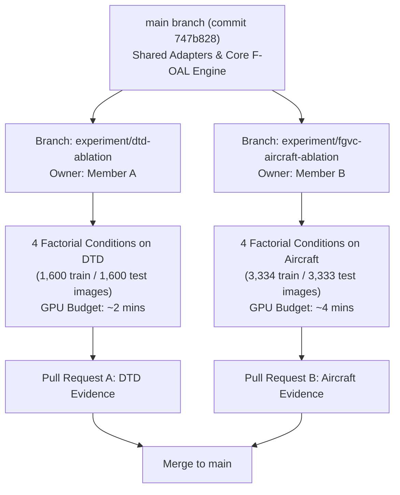

# Team Parallel Cross-Dataset Reproduction Plan (DTD & FGVC-Aircraft)

**Project:** F-OAL NeurIPS 2024 Reproduction (HCMUS Intro to ML)  
**Lead Engineer:** Senior Machine Learning Research Engineer & Research Project Lead  
**Target Main Commit:** `747b828`  
**Shared Framework Foundation:** `src/foal/dataset_adapters/`  
**Status:** `READY_FOR_TEAM_HANDOFF`  

---

## 1. Executive Strategy & Team Alignment

To validate the generalizability of F-OAL beyond CIFAR-100 without blocking or causing merge conflicts, the cross-dataset ablation experiments (Table 4) are split into two parallel, decoupled workstreams:



---

## 2. Member A Track: Describable Textures Dataset (DTD)

### 2.1 Mission & Research Significance
In Table 4 of the paper, the authors demonstrate that while CIFAR-100 drops by only $\sim 0.5\text{ pp}$ when components are ablated, **DTD experiences severe degradation**:
- **Full F-OAL:** **$82.8\%$**
- **w/o Feature Fusion (FF):** **$80.5\%$** ($-2.3\text{ pp}$)
- **w/o Smooth Projection (SP):** **$79.3\%$** ($-3.5\text{ pp}$)
- **w/o Both (Linear Ridge on Single Layer):** **$71.2\%$** (**$-11.6\text{ pp}$**)

**Key Insight to Reproduce:** Texture patterns lack the high-level semantic hierarchy of natural object datasets. DTD therefore relies heavily on the non-linear expansion provided by the Smooth Projection module ($+11.6\text{ pp}$ boost).

### 2.2 Dataset Specifications & Task Stream
- **Source:** `torchvision.datasets.DTD(root='./data', split='train'/'test', download=True)` via `src.foal.dataset_adapters.dtd.DTDAdapter`.
- **Classes:** 40 classes selected (out of 47).
- **Stream Setup:** 10 incremental tasks $\times$ 4 classes per task.
- **Dataset Size:** 40 train images and 40 test images per class (Total: 1,600 train, 1,600 test).
- **Batch Size:** 10, single-pass streaming.
- **Estimated GPU Time:** $< 30\text{ seconds}$ per condition on Colab T4 GPU ($\sim 2\text{ minutes}$ for all 4 runs).

### 2.3 File Ownership & Git Commands for Member A
Member A works strictly within their designated files to eliminate merge conflicts:
- **Dedicated Branch:** `experiment/dtd-ablation`
- **Owned Configs:** `configs/dtd/dtd_a0_full.yaml`, `dtd_a1_without_ff.yaml`, `dtd_a2_without_sp.yaml`, `dtd_a3_without_both.yaml`
- **Owned Notebook:** `notebooks/foal_dtd_ablation_colab.ipynb`
- **Owned Artifacts & Reports:** `runs/dtd/*`, `docs/dtd_ablation_report.md`

```bash
# Member A Setup Commands
git checkout main
git pull origin main
git checkout -b experiment/dtd-ablation
git push -u origin experiment/dtd-ablation
```

---

## 3. Member B Track: FGVC-Aircraft (Fine-Grained Aircraft)

### 3.1 Mission & Discrepancy Forensic Focus
FGVC-Aircraft evaluates continual learning under fine-grained domain shift across 100 aircraft model variants:
- **Full F-OAL:** **$62.2\%$** *(Published in Table 2 and Table 4)*
- **w/o Feature Fusion (FF):** **$60.9\%$** ($-1.3\text{ pp}$)
- **w/o Smooth Projection (SP):** **$58.7\%$** ($-3.5\text{ pp}$)
- **w/o Both:** **$56.0\%$** ($-6.2\text{ pp}$)

> [!WARNING]
> **Forensic Alert for Member B:** Section 4.4 text in the paper states *"On Aircraft, F-OAL achieves 66.2%..."*, whereas Table 2 and Table 4 both report **$62.2\%$**. Member B's report must explicitly reconcile this publication discrepancy against empirical findings.

### 3.2 Dataset Specifications & Task Stream
- **Source:** `torchvision.datasets.FGVCAircraft(root='./data', split='trainval'/'test', annotation_level='variant', download=True)` via `src.foal.dataset_adapters.fgvc_aircraft.FGVCAircraftAdapter`.
- **Classes:** 100 classes selected (out of 102).
- **Stream Setup:** 10 incremental tasks $\times$ 10 classes per task.
- **Dataset Size:** $\sim 33$ train images and $\sim 33$ test images per class (Total: 3,334 train, 3,333 test).
- **Batch Size:** 10, single-pass streaming.
- **Estimated GPU Time:** $< 1\text{ minute}$ per condition on Colab T4 GPU ($\sim 4\text{ minutes}$ for all 4 runs).

### 3.3 File Ownership & Git Commands for Member B
Member B works strictly within their designated files:
- **Dedicated Branch:** `experiment/fgvc-aircraft-ablation`
- **Owned Configs:** `configs/aircraft/aircraft_a0_full.yaml`, `aircraft_a1_without_ff.yaml`, `aircraft_a2_without_sp.yaml`, `aircraft_a3_without_both.yaml`
- **Owned Notebook:** `notebooks/foal_aircraft_ablation_colab.ipynb`
- **Owned Artifacts & Reports:** `runs/aircraft/*`, `docs/aircraft_ablation_report.md`

```bash
# Member B Setup Commands
git checkout main
git pull origin main
git checkout -b experiment/fgvc-aircraft-ablation
git push -u origin experiment/fgvc-aircraft-ablation
```

---

## 4. Shared Integration Rules & Quality Gates

To guarantee smooth integration into `main`:
1. **Zero Modification to Core Files:** Neither member may edit `src/foal/rls.py`, `src/foal/projection.py`, `src/foal/backbone.py`, or `src/foal/metrics.py` without lead auditor approval.
2. **Backbone Standard:** Both members must use `vit_base_patch16_224.augreg2_in21k_ft_in1k` with bilinear interpolation and raw $[0, 1]$ preprocessing.
3. **Seed Discipline:** Fixed random seed `42` must be used for all primary benchmark runs.
4. **Unit Test Gate:** Before opening a PR, all tests must pass:
   ```bash
   python -m pytest -q tests/test_dataset_adapters.py
   ```
5. **No Blind Fast-Forward:** All PR merges to `main` must use `--no-ff` with detailed squash/merge commit messages referencing Table 4 reproduction metrics.

---

## 5. Team Progress Board

| Task Item | Assignee | Target Date | Status |
| :--- | :---: | :---: | :---: |
| Shared Adapter Protocol (`src/foal/dataset_adapters/`) | Lead Engineer | Nov 3, 2026 | **COMPLETED** |
| DTD Adapter & Unit Tests | Lead Engineer | Nov 3, 2026 | **COMPLETED** |
| Aircraft Adapter & Unit Tests | Lead Engineer | Nov 3, 2026 | **COMPLETED** |
| DTD 4-Condition Configs & Notebook | Member A | Nov 4, 2026 | **READY FOR EXECUTION** |
| Aircraft 4-Condition Configs & Notebook | Member B | Nov 4, 2026 | **READY FOR EXECUTION** |
| DTD Colab GPU Execution & Results Validation | Member A | Nov 5, 2026 | **SCHEDULED** |
| Aircraft Colab GPU Execution & Results Validation | Member B | Nov 5, 2026 | **SCHEDULED** |
| Cross-Dataset Synthesis & Final HCMUS Report | Team Lead & All | Nov 6, 2026 | **PLANNED** |
