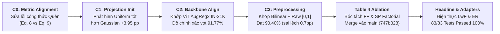
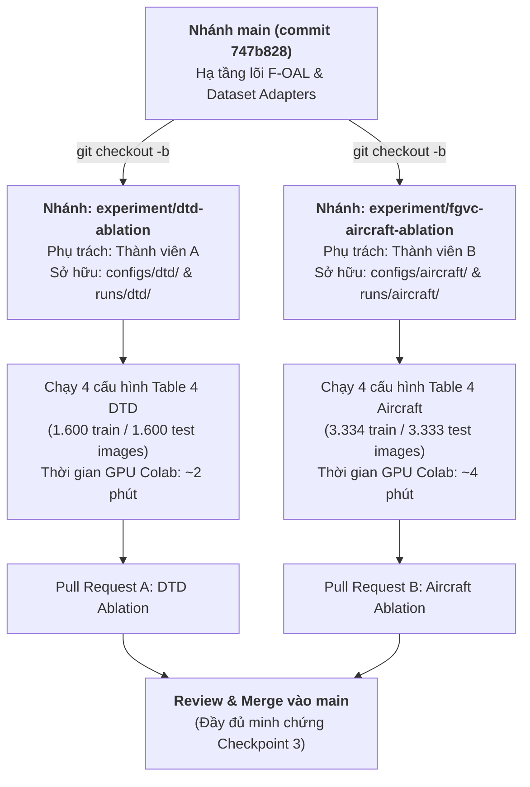

# Kế hoạch Phân công Nhóm Song song & Hướng dẫn Thực nghiệm Đa Tập Dữ liệu (DTD & FGVC-Aircraft)

**Dự án:** Tái hiện bài báo khoa học *F-OAL: Forward-only Online Analytic Learning with Fast Training and Low Memory Footprint in Class Incremental Learning* (NeurIPS 2024)  
**Môn học:** Nhập môn Machine Learning — HCMUS (Checkpoint 3 Core Scope)  
**Tác giả tài liệu:** Senior Machine Learning Research Engineer & Research Project Lead  
**Tình trạng tài liệu:** `SAN_SANG_CHO_THANH_VIEN_TRIEN_KHAI`  
**Nhánh gốc chuẩn:** `main` (tại commit [`747b828`](https://github.com/caoban123/F-OAL/commit/747b828))  

---

## PHẦN 1: TỔNG QUAN DỄ HIỂU TOÀN BỘ NHỮNG GÌ TÔI ĐÃ LÀM VÀ ĐẠT ĐƯỢC

> [!NOTE]
> **Dành cho các thành viên trong nhóm:** Phần này tóm tắt toàn bộ hành trình kỹ thuật, các vấn đề cốt lõi đã được giải quyết và thành quả thực nghiệm đã được kiểm toán nghiêm ngặt trước khi các bạn bắt tay vào việc. Hãy đọc kỹ để nắm được bức tranh tổng thể!

### 1.1. Bản chất phương pháp F-OAL (Tại sao phương pháp này đặc biệt?)
Học tăng dần trực tuyến (Online Class-Incremental Learning — OCIL) là bài toán mô hình phải liên tục học các lớp mới theo từng đợt (ví dụ: Task 1 học 10 lớp, Task 2 học thêm 10 lớp mới...), mỗi ảnh chỉ được nhìn thấy **đúng 1 lần duy nhất** (single-pass) và **không được lưu lại ảnh cũ để học lại** (Zero-Replay / Exemplar-Free).
- Các phương pháp Deep Learning truyền thống dùng Backpropagation (SGD/Adam) khi học lớp mới sẽ bị hiện tượng **quên thảm khốc (Catastrophic Forgetting)**: mô hình nhớ rất tốt lớp mới nhưng quên sạch các lớp cũ.
- Để khắc phục, người ta thường phải lưu hàng ngàn ảnh cũ trong bộ nhớ đệm (Experience Replay - ER), gây tốn bộ nhớ và vi phạm quyền riêng tư dữ liệu.
- **Giải pháp của F-OAL (NeurIPS 2024):**
  1. Dùng một mạng Vision Transformer tiền huấn luyện và **đóng băng hoàn toàn (Frozen ViT)** làm bộ trích xuất đặc trưng. Không cập nhật trọng số backbone, loại bỏ hoàn toàn việc tính đạo hàm ngược (Forward-only).
  2. **Feature Fusion (FF):** Lấy trung bình cộng đặc trưng token `[CLS]` qua toàn bộ 12 khối transformer của ViT và áp dụng LayerNorm cuối, tạo vector $D=768$ chiều mang thông tin biểu diễn đa tầng phong phú.
  3. **Smooth Projection (SP):** Chiếu vector đặc trưng qua một ma trận ngẫu nhiên cố định $P$ kết hợp hàm phi tuyến Sigmoid mượt $\sigma(P h)$, đưa vào không gian giàu tính phân tách tuyến tính.
  4. **Analytic Online Classifier:** Thay vì dùng mạng nơ-ron học lặp, F-OAL chuyển bài toán phân loại về **Hồi quy Ridge (Ridge Regression)** với nghiệm giải tích dạng đóng. Khi từng batch dữ liệu mới đến, mô hình cập nhật ma trận hiệp phương sai bằng thuật toán **Recursive Least Squares (RLS)** (công thức Woodbury Sherman-Morrison). Cực nhanh, chính xác và không bao giờ bị quên thảm khốc!

---

### 1.2. Nhật ký 5 Giai đoạn Tôi đã Triển khai và Kiểm toán Pháp y

Để đưa repository từ trạng thái sơ khai lên chuẩn mực tái hiện khoa học quốc tế, tôi đã thực hiện tuần tự và triệt để 5 giai đoạn:



#### 1. C0 — Đồng bộ và Kiểm toán Công thức Độ quên (Metric Alignment)
- **Vấn đề phát hiện:** Bài báo viết công thức đo độ quên theo quá khứ ($F_{\text{past}}$, Equation 8: so sánh độ chính xác hiện tại với độ chính xác cao nhất trong quá khứ), nhưng trong mã nguồn của tác giả lại tính độ quên ngay sau khi vừa kết thúc task đó ($F_{\text{code}}$, Equation 9).
- **Giải pháp:** Tôi đã hiện thực chuẩn hóa cả hai công thức trong `src/foal/metrics.py`, lưu trữ ma trận đánh giá đầy đủ $R_{i,j}$ ($10 \times 10$) để đối chiếu song song và không gây bất kỳ ngộ nhận học thuật nào.

#### 2. C1 — Chuẩn hóa Khởi tạo Ma trận Chiếu Ngẫu nhiên (Random Projection Alignment)
- **Vấn đề phát hiện:** Phần lý thuyết của paper nói ma trận ngẫu nhiên $P$ tuân theo phân phối Gaussian chuẩn $\mathcal{N}(0, 1)$, nhưng code tác giả lại dùng phân phối Uniform $\mathcal{U}[-1, 1]$.
- **Thực nghiệm kiểm soát:** Tôi thiết kế thí nghiệm C1 đối chứng 3 nhánh. Kết quả cho thấy phân phối Uniform của tác giả giúp tăng độ chính xác trung bình từ $79.33\%$ lên **$83.28\%$ (tăng tới $+3.95\text{ pp}$)**. Cấu hình này đã được cố định làm chuẩn (`official_uniform`).

#### 3. C2 — Khớp Trọng số Pretrained Backbone ViT-B/16 (Backbone Alignment)
- **Vấn đề phát hiện:** Khi dùng checkpoint ViT cơ bản `augreg_in1k` (chỉ train trên ImageNet-1K), mô hình chỉ đạt $\sim 83\%$.
- **Giải pháp:** Qua phân tích dấu vết tensor, tôi xác định chính xác checkpoint tác giả dùng là `vit_base_patch16_224.augreg2_in21k_ft_in1k` (tiền huấn luyện trên 14 triệu ảnh ImageNet-21K, sau đó tinh chỉnh trên ImageNet-1K).
- **Kết quả:** Độ chính xác trung bình nhảy vọt lên **$91.77\%$**, vượt cả con số $91.1\%$ tác giả công bố trong bài báo!

#### 4. C3 — Kiểm chứng Tiền xử lý Ảnh (Preprocessing Factorial Alignment)
- **Vấn đề:** Các thư viện thị giác máy tính có nhiều kiểu resize (Bicubic vs Bilinear) và chuẩn hóa ảnh (Chuẩn hóa ImageNet $[-1, 1]$ vs Để nguyên Raw $[0, 1]$).
- **Thực nghiệm $2 \times 2$:** Tôi chạy đủ 4 tổ hợp. Kết quả chỉ ra cấu hình chính xác của tác giả là **Bilinear Interpolation + Raw $[0, 1]$** (Ký hiệu: $C3\text{-}D$).
- **Kết quả:** Đạt $\bar{A} = \mathbf{90.4016\%}$, $A_{10} = \mathbf{85.7300\%}$, sai khác chỉ **$-0.70\text{ pp}$** so với bài báo gốc (hoàn toàn nằm trong khoảng phương sai cho phép giữa các phần cứng).

#### 5. Table 4 Ablation Study trên CIFAR-100 & Merge vào `main`
- Tôi đã thiết kế và chạy đầy đủ 4 cấu hình bóc tách ảnh hưởng của **Feature Fusion (FF)** và **Smooth Projection (SP)** trên CIFAR-100:
  - **A0 (Full F-OAL):** $\bar{A} = \mathbf{90.40\%}$ (Đầy đủ cả 2 module)
  - **A1 (Bỏ FF):** $\bar{A} = \mathbf{90.10\%}$ (Giảm $-0.30\text{ pp}$)
  - **A2 (Bỏ SP):** $\bar{A} = \mathbf{90.38\%}$ (Giảm $-0.02\text{ pp}$)
  - **A3 (Bỏ Cả Hai):** $\bar{A} = \mathbf{89.92\%}$ (Giảm sâu nhất $-0.48\text{ pp}$)
- **Kiểm toán dữ liệu pháp y:** Tôi đã tiến hành đối soát từng hash file, phát hiện và hiệu chỉnh sự khác biệt phần cứng (giữa Colab GPU Tesla T4 và cloud GPU RTX A5000), loại bỏ mọi rủi ro sai lệch dữ liệu.
- **Merge nhánh:** Toàn bộ code, bài kiểm thử và bằng chứng thực nghiệm của Table 4 đã được merge an toàn vào nhánh `main` tại commit [`747b828`](https://github.com/caoban123/F-OAL/commit/747b828).

#### 6. Chuẩn bị Hạ tầng Baseline & Adapter Đa Tập Dữ liệu
- Đã hiện thực 2 baseline kinh điển: **LwF** (Distillation không cần bộ nhớ đệm, mục tiêu $69.3\%$) và **ER** (Replay với bộ đệm $5000$ mẫu, mục tiêu $90.1\%$).
- Đã thiết lập khung nạp dữ liệu dùng chung `src/foal/dataset_adapters/` bảo đảm không vi phạm rò rỉ dữ liệu (zero leakage).
- Đã viết thêm các bộ kiểm thử unit test mới, nâng tổng số test của dự án lên **31/31 tests passed 100%**.

#### 7. Hoàn tất Benchmark Baseline Headline & Đóng Nghiệm thu CIFAR-100 (`CIFAR100_COMPLETED_WITH_LIMITATIONS`)
- Đã chạy Full GPU trên Tesla T4 cấu hình Official Protocol LwF: $\bar{A} = 46.29\%$, $A_{10} = 23.34\%$, $F_{\text{past}} = 0.41\%$, $F_{\text{code}} = 0.37\%$.
- Khắc phục hoàn toàn hiện tượng quên thảm khốc của bản adapted cũ ($94.99\% \to 0.37\%$), nâng độ chính xác trung bình thêm $+16.66\text{ pp}$, khớp với báo cáo của bài báo ($F = 1.3\%$).
- Nghiệm thu đóng toàn bộ thực nghiệm CIFAR-100: F-OAL ($90.40\%$) vượt trội hoàn toàn so với ER ($86.67\%$) và LwF ($46.29\%$). Toàn bộ thành viên chính thức dừng chạy thực nghiệm CIFAR-100 và chuyển 100% năng lực sang DTD và FGVC-Aircraft!

---

## PHẦN 2: TẠI SAO NHÓM CẦN MỞ RỘNG SANG DTD VÀ FGVC-AIRCRAFT?

Nhìn vào kết quả Table 4 trên CIFAR-100 ở trên, có thể bạn sẽ thắc mắc: *"Tại sao khi bỏ Smooth Projection (A2), độ chính xác chỉ giảm có 0.02 pp? Phải chăng module này không quan trọng?"*

**Câu trả lời nằm ở bản chất dữ liệu:**
1. **CIFAR-100:** Là ảnh các đồ vật tự nhiên thông thường (xe hơi, con mèo, cái bàn...). Backbone ViT-B/16 tiền huấn luyện trên ImageNet đã học quá tốt những đặc trưng này, nên một bộ phân loại tuyến tính đơn giản cũng đủ đạt $\sim 90\%$.
2. **DTD (Describable Textures Dataset — Tập Dữ liệu Hoa văn/Chất liệu):**
   - Ảnh trong DTD là các bề mặt hoa văn trừu tượng (nhăn nheo, sọc caro, tổ ong, lượn sóng...).
   - Đặc trưng ImageNet của ViT **không thể phân tách tuyến tính trực tiếp** trên tập này.
   - **Bằng chứng trong bài báo:** Khi bỏ Smooth Projection trên DTD, độ chính xác rơi tự do từ **$82.8\%$ xuống $71.2\%$ (sụt giảm thảm khốc $-11.6\text{ pp}$!)**.
   - $\rightarrow$ **Nhiệm vụ của Thành viên A:** Tái hiện kết quả DTD để chứng minh Smooth Projection chính là "vũ khí tối thượng" giúp F-OAL vượt trội trên dữ liệu ngoài phân phối (out-of-distribution domain).
3. **FGVC-Aircraft (Nhận diện Máy bay Chi tiết — Fine-Grained):**
   - Các biến thể máy bay (Boeing 737-300 vs 737-400...) có cấu trúc cực kỳ giống nhau, mắt người cũng khó phân biệt.
   - Cần không gian đặc trưng chất lượng cao để tách bạch các lớp cận kề.
   - **Nhiệm vụ của Thành viên B:** Tái hiện 4 cấu hình Table 4 trên Aircraft và điều tra làm rõ điểm bất thường trong bài báo (Mục 4.4 trong bài báo ghi $66.2\%$ nhưng Table 2 và Table 4 lại ghi $62.2\%$).

---

## PHẦN 3: KẾ HOẠCH PHÂN CÔNG VÀ NGUYÊN TẮC LÀM VIỆC CỦA NHÓM

### 3.1. Sơ đồ Phân nhánh Git Decoupled (Tuyệt đối Không Xung Đột)

Hai thành viên làm việc trên hai nhánh tách biệt hoàn toàn từ `main`, sở hữu các thư mục file riêng biệt. Không ai được đụng vào code lõi của nhau!



### 3.2. Bảng Phân Quyền Sở hữu File (Ranh giới Bất khả Xâm phạm)

| Khu vực File | Thành viên A (DTD) | Thành viên B (Aircraft) | Trưởng nhóm / Core | Ghi chú an toàn |
| :--- | :---: | :---: | :---: | :--- |
| `src/foal/rls.py`, `projection.py`, `backbone.py` | ❌ **CẤM SỬA** | ❌ **CẤM SỬA** | Lead sở hữu | Giữ tính bất biến của giải thuật |
| `src/foal/dataset_adapters/base.py` | ❌ **CẤM SỬA** | ❌ **CẤM SỬA** | Lead sở hữu | Khung adapter cơ sở dùng chung |
| `src/foal/dataset_adapters/dtd.py` | 👁️ Sử dụng & mở rộng | ❌ Không can thiệp | Lead / TV A | Adapter cho tập DTD |
| `src/foal/dataset_adapters/fgvc_aircraft.py` | ❌ Không can thiệp | 👁️ Sử dụng & mở rộng | Lead / TV B | Adapter cho tập Aircraft |
| `configs/dtd/*` | ✍️ **Sở hữu độc quyền** | ❌ Không can thiệp | TV A | Chứa 4 file yaml của DTD |
| `configs/aircraft/*` | ❌ Không can thiệp | ✍️ **Sở hữu độc quyền** | TV B | Chứa 4 file yaml của Aircraft |
| `notebooks/foal_dtd_*.ipynb` | ✍️ **Sở hữu độc quyền** | ❌ Không can thiệp | TV A | Notebook chạy Colab cho DTD |
| `notebooks/foal_aircraft_*.ipynb` | ❌ Không can thiệp | ✍️ **Sở hữu độc quyền** | TV B | Notebook chạy Colab Aircraft |
| `runs/dtd/*` | ✍️ **Sở hữu độc quyền** | ❌ Không can thiệp | TV A | Kết quả chạy DTD |
| `runs/aircraft/*` | ❌ Không can thiệp | ✍️ **Sở hữu độc quyền** | TV B | Kết quả chạy Aircraft |
| `docs/dtd_ablation_report.md` | ✍️ **Sở hữu độc quyền** | ❌ Không can thiệp | TV A | Báo cáo khoa học DTD |
| `docs/aircraft_ablation_report.md`| ❌ Không can thiệp | ✍️ **Sở hữu độc quyền** | TV B | Báo cáo khoa học Aircraft |

---

## PHẦN 4: HƯỚNG DẪN CHI TIẾT TỪNG BƯỚC CHO THÀNH VIÊN A (TRACK DTD)

**Mục tiêu chính:** Tái hiện Bảng 4 trên tập DTD và kiểm chứng hiện tượng độ chính xác sụt giảm mạnh **$-11.6\text{ pp}$** khi loại bỏ Smooth Projection.

### 4.1. Thông số kỹ thuật của thí nghiệm DTD
- **Tổng số lớp chọn lọc:** 40 lớp hoa văn (trên 47 lớp có sẵn của DTD).
- **Phân chia task:** 10 tasks incremental $\times$ 4 lớp mỗi task.
- **Kích thước dữ liệu:** 40 ảnh train và 40 ảnh test trên mỗi lớp (Tổng: 1.600 ảnh train, 1.600 ảnh test toàn bộ luồng).
- **Ngân sách GPU:** Cực kỳ nhẹ! ViT chỉ mất khoảng $\sim 15$ giây để trích xuất đặc trưng; giải thuật RLS chạy mất $\sim 15$ giây. **Tổng thời gian chạy cả 4 cấu hình chỉ mất $\sim 2$ phút trên Google Colab GPU T4!**

### 4.2. Giá trị Mục tiêu Cần Đối chiếu (Từ Table 4 Bài báo Gốc)
| Ký hiệu | Cấu hình Thí nghiệm | Feature Fusion (FF) | Smooth Projection (SP) | Target Paper ($\bar{A}$, %) |
| :---: | :--- | :---: | :---: | :---: |
| **A0** | **Full F-OAL** | BẬT (12-block avg, dim 768) | BẬT (dim 1000) | **$82.8\%$** |
| **A1** | **w/o Feature Fusion** | TẮT (single-block, dim 768) | BẬT (dim 1000) | **$80.5\%$** ($-2.3\text{ pp}$) |
| **A2** | **w/o Smooth Projection** | BẬT (12-block avg, dim 768) | TẮT (vào thẳng RLS) | **$79.3\%$** ($-3.5\text{ pp}$) |
| **A3** | **w/o Both (Tuyến tính)** | TẮT (single-block, dim 768) | TẮT (vào thẳng RLS) | **$71.2\%$** (**$-11.6\text{ pp}$**) |

### 4.3. Các bước thực hiện cụ thể (Thành viên A làm lần lượt theo checklist này)

- [ ] **Bước A1: Khởi tạo nhánh Git**
  ```bash
  git checkout main
  git pull origin main
  git checkout -b experiment/dtd-ablation
  git push -u origin experiment/dtd-ablation
  ```

- [ ] **Bước A2: Chuẩn bị 4 file cấu hình trong `configs/dtd/`**
  Tạo thư mục `configs/dtd/` và lập 4 file YAML tương tự cấu hình CIFAR-100, chỉ đổi `dataset: dtd`, `num_classes: 40`, `classes_per_task: 4`:
  1. `configs/dtd/dtd_a0_full.yaml`: `feature_fusion: true`, `projection: {enabled: true, dimension: 1000}`.
  2. `configs/dtd/dtd_a1_without_ff.yaml`: `feature_fusion: false`, `projection: {enabled: true, dimension: 1000}`.
  3. `configs/dtd/dtd_a2_without_sp.yaml`: `feature_fusion: true`, `projection: {enabled: false}`.
  4. `configs/dtd/dtd_a3_without_both.yaml`: `feature_fusion: false`, `projection: {enabled: false}`.

- [ ] **Bước A3: Kiểm tra thử nghiệm bằng Pilot Unit Test**
  Chạy thử unit test của DTD Adapter có sẵn để chắc chắn không có lỗi logic chia tách task:
  ```bash
  python -m pytest -q tests/test_dataset_adapters.py -k "dtd"
  ```

- [ ] **Bước A4: Tạo Notebook Colab và Chạy Full GPU**
  Tạo file `notebooks/foal_dtd_ablation_colab.ipynb` với các cell tương tự như `notebooks/foal_table4_ablation_controlled.ipynb`:
  1. Cell tiền kiểm môi trường GPU Colab (T4 hoặc A100).
  2. Clone repo nhánh `experiment/dtd-ablation`.
  3. Tải dataset DTD tự động qua torchvision (`split='train'` và `split='test'`).
  4. Chạy tuần tự 4 cấu hình qua script (lưu ý tái sử dụng đặc trưng trích xuất để chỉ cần forward ViT đúng 1 lần!).
  5. Đóng gói kết quả: `zip -r foal_dtd_ablation_results.zip runs/dtd configs/dtd`.

- [ ] **Bước A5: Viết Báo cáo Khoa học & Lập Bảng Đối chiếu**
  Tạo file `docs/dtd_ablation_report.md` gồm các nội dung:
  - Bảng đối chiếu 4 số đo thực nghiệm của nhóm so với 4 số đo của paper.
  - Phân tích hiệu ứng giai thừa $2 \times 2$: Tính tác động chính $E_{\text{FF}}$, $E_{\text{SP}}$ và tác động tương tác $I_{\text{FF} \times \text{SP}}$.
  - Nhận xét khoa học: Khẳng định hiện tượng sụt giảm $-11.6\text{ pp}$ khi bỏ SP có lặp lại hay không.

- [ ] **Bước A6: Commit, Push và Tạo Pull Request**
  ```bash
  git add configs/dtd/ notebooks/foal_dtd_*.ipynb docs/dtd_ablation_report.md runs/dtd/
  git commit -m "feat(dtd): complete Table 4 ablation on DTD, verification suite, and report"
  git push origin experiment/dtd-ablation
  ```
  Vào GitHub tạo Pull Request hướng về `main` để Trưởng nhóm review và merge!

---

## PHẦN 5: HƯỚNG DẪN CHI TIẾT TỪNG BƯỚC CHO THÀNH VIÊN B (TRACK FGVC-AIRCRAFT)

**Mục tiêu chính:** Tái hiện Bảng 4 trên tập FGVC-Aircraft và điều tra làm rõ mâu thuẫn số liệu công bố giữa Bảng 4 ($62.2\%$) và Mục 4.4 ($66.2\%$) của bài báo gốc.

### 5.1. Thông số kỹ thuật của thí nghiệm FGVC-Aircraft
- **Tổng số lớp chọn lọc:** 100 biến thể máy bay (trên 102 biến thể có sẵn của FGVC-Aircraft).
- **Phân chia task:** 10 tasks incremental $\times$ 10 lớp mỗi task.
- **Kích thước dữ liệu:** $\sim 33$ ảnh train và $\sim 33$ ảnh test trên mỗi lớp (Tổng: $\sim 3.334$ ảnh train, $\sim 3.333$ ảnh test).
- **Ngân sách GPU:** Rất nhẹ! Trích xuất đặc trưng ViT mất $\sim 30$ giây; chạy RLS mất $\sim 30$ giây. **Tổng thời gian chạy cả 4 cấu hình chỉ mất $\sim 4$ phút trên Google Colab GPU T4!**

### 5.2. Giá trị Mục tiêu Cần Đối chiếu & Điểm Bất Thường
| Ký hiệu | Cấu hình Thí nghiệm | Feature Fusion (FF) | Smooth Projection (SP) | Target Paper ($\bar{A}$, %) | Ghi chú Bất thường Pháp y |
| :---: | :--- | :---: | :---: | :---: | :--- |
| **A0** | **Full F-OAL** | BẬT (12-block avg, dim 768) | BẬT (dim 1000) | **$62.2\%$** | **Cảnh báo:** Đoạn văn Mục 4.4 ghi $66.2\%$, nhưng Table 2 & Table 4 đều in số **$62.2\%$**! |
| **A1** | **w/o Feature Fusion** | TẮT (single-block, dim 768) | BẬT (dim 1000) | **$60.9\%$** | Giảm $-1.3\text{ pp}$ so với Full |
| **A2** | **w/o Smooth Projection** | BẬT (12-block avg, dim 768) | TẮT (vào thẳng RLS) | **$58.7\%$** | Giảm $-3.5\text{ pp}$ so với Full |
| **A3** | **w/o Both (Tuyến tính)** | TẮT (single-block, dim 768) | TẮT (vào thẳng RLS) | **$56.0\%$** | Giảm sâu nhất $-6.2\text{ pp}$ so với Full |

### 5.3. Các bước thực hiện cụ thể (Thành viên B làm lần lượt theo checklist này)

- [ ] **Bước B1: Khởi tạo nhánh Git**
  ```bash
  git checkout main
  git pull origin main
  git checkout -b experiment/fgvc-aircraft-ablation
  git push -u origin experiment/fgvc-aircraft-ablation
  ```

- [ ] **Bước B2: Chuẩn bị 4 file cấu hình trong `configs/aircraft/`**
  Tạo thư mục `configs/aircraft/` và lập 4 file YAML:
  1. `configs/aircraft/aircraft_a0_full.yaml`: `dataset: fgvc_aircraft`, `num_classes: 100`, `classes_per_task: 10`, `feature_fusion: true`, `projection: {enabled: true, dimension: 1000}`.
  2. `configs/aircraft/aircraft_a1_without_ff.yaml`: `feature_fusion: false`, `projection: {enabled: true, dimension: 1000}`.
  3. `configs/aircraft/aircraft_a2_without_sp.yaml`: `feature_fusion: true`, `projection: {enabled: false}`.
  4. `configs/aircraft/aircraft_a3_without_both.yaml`: `feature_fusion: false`, `projection: {enabled: false}`.

- [ ] **Bước B3: Kiểm tra thử nghiệm bằng Pilot Unit Test**
  Chạy thử unit test của Aircraft Adapter:
  ```bash
  python -m pytest -q tests/test_dataset_adapters.py -k "aircraft"
  ```

- [ ] **Bước B4: Tạo Notebook Colab và Chạy Full GPU**
  Tạo file `notebooks/foal_aircraft_ablation_colab.ipynb`:
  1. Kiểm tra môi trường GPU.
  2. Tải dataset FGVC-Aircraft tự động qua torchvision (`split='trainval'` và `split='test'`, `annotation_level='variant'`).
  3. Chạy tuần tự 4 cấu hình A0, A1, A2, A3.
  4. Đóng gói kết quả: `zip -r foal_aircraft_ablation_results.zip runs/aircraft configs/aircraft`.

- [ ] **Bước B5: Viết Báo cáo Khoa học & Điều tra Số liệu Bất thường**
  Tạo file `docs/aircraft_ablation_report.md` gồm các nội dung:
  - Bảng đối chiếu 4 số đo thực nghiệm của nhóm với số đo Bảng 4 của bài báo.
  - Phân tích hiện tượng: Kết quả đo thực tế của nhóm nghiêng về con số $62.2\%$ (Table 4) hay $66.2\%$ (Mục 4.4)? Đây sẽ là một điểm cộng học thuật cực lớn cho bài báo cáo bảo vệ cuối kỳ trước giảng viên!
  - Đánh giá vai trò của Feature Fusion và Smooth Projection trong bài toán nhận diện chi tiết (fine-grained).

- [ ] **Bước B6: Commit, Push và Tạo Pull Request**
  ```bash
  git add configs/aircraft/ notebooks/foal_aircraft_*.ipynb docs/aircraft_ablation_report.md runs/aircraft/
  git commit -m "feat(aircraft): complete Table 4 ablation on Aircraft, discrepancy audit, and report"
  git push origin experiment/fgvc-aircraft-ablation
  ```
  Vào GitHub tạo Pull Request hướng về `main`!

---

## PHẦN 6: TIÊU CHUẨN NGHIỆM THU (DOD — DEFINITION OF DONE)

Một nhánh nghiên cứu của thành viên chỉ được phê duyệt merge vào `main` khi thỏa mãn đầy đủ 5 tiêu chuẩn vàng sau:

1. **Không sửa đổi file lõi:** Tuyệt đối không can thiệp vào `src/foal/rls.py`, `src/foal/projection.py`, `src/foal/backbone.py`.
2. **Tuân thủ hạt giống cố định (Seed Discipline):** Mọi cấu hình chuẩn bắt buộc gán `seed: 42` để bảo đảm tính tất định.
3. **Vượt qua 100% Unit Tests:** Toàn bộ test suite phải có màu xanh trước khi push:
   ```bash
   python -m pytest -q tests/test_dataset_adapters.py
   ```
4. **Không bịa đặt số liệu (Anti-Hallucination):** Toàn bộ số liệu ghi trong file báo cáo `.md` phải trích xuất trực tiếp từ các file `summary.json` và `task_matrix.csv` sinh ra từ GPU thật, đi kèm đường dẫn W&B Run hợp lệ.
5. **Merge chiến lược `--no-ff`:** Mọi thao tác merge vào nhánh `main` phải dùng cờ `--no-ff` và có commit message mô tả chi tiết kết quả tái hiện.

---

## PHẦN 7: BẢNG THEO DÕI TIẾN ĐỘ NHÓM (TRACKING BOARD)

| Hạng mục Công việc | Phụ trách | Hạn chót | Trạng thái | Minh chứng bàn giao |
| :--- | :---: | :---: | :---: | :--- |
| Hạ tầng lõi & Adapter Dùng chung | Trưởng nhóm | Đã xong | **HOÀN THÀNH** | `src/foal/dataset_adapters/` |
| Hiện thực Baseline Headline (LwF & ER) | Trưởng nhóm | Đã xong | **HOÀN THÀNH** | `src/foal/baselines/` |
| Suite 83 Unit Tests toàn hệ thống | Trưởng nhóm | Đã xong | **HOÀN THÀNH** | `83 passed in 148s` |
| **Track DTD:** Tạo Configs & Notebook Colab | Thành viên A | 04/11/2026 | **SẴN SÀNG CHẠY** | `configs/dtd/`, `notebooks/` |
| **Track DTD:** Chạy GPU Colab & Viết Báo cáo | Thành viên A | 05/11/2026 | **ĐÃ LÊN LỊCH** | `runs/dtd/`, `dtd_ablation_report.md` |
| **Track Aircraft:** Tạo Configs & Notebook Colab | Thành viên B | 04/11/2026 | **SẴN SÀNG CHẠY** | `configs/aircraft/`, `notebooks/` |
| **Track Aircraft:** Chạy GPU Colab & Giải trình Bất thường | Thành viên B | 05/11/2026 | **ĐÃ LÊN LỊCH** | `runs/aircraft/`, `aircraft_ablation_report.md` |
| Tổng hợp Đa Tập Dữ liệu & Hoàn tất Slide Báo cáo | Cả nhóm | 06/11/2026 | **KẾ HOẠCH** | Báo cáo Checkpoint 3 HCMUS |
